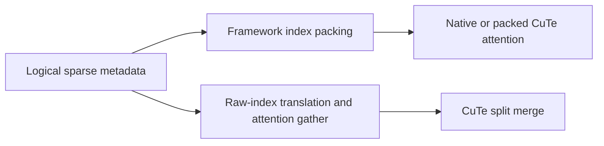

<!-- SPDX-FileCopyrightText: Copyright (c) 2026 NVIDIA CORPORATION & AFFILIATES. All rights reserved. -->
<!-- SPDX-License-Identifier: Apache-2.0 -->

# B300 small-head FP8 DSv4 decode

This implementation uses CuTeDSL and CUTLASS primitives behind the existing
`trtllm_batch_decode_sparse_mla_dsv4(..., backend="auto")` API. Explicit backend
selection is preserved. Automatic selection is limited to the qualified SM103
geometry; unsupported geometry, explicit PDL-off, and an unwarmed CUDA Graph
capture retain the native path.

| Property | Supported automatic route |
| --- | --- |
| GPU / DSL | B300 SM103 / CuTeDSL 4.8 or newer |
| Query | FP8 E4M3, ordinary decode, one query per request |
| Heads / rows | H16 with 1, 2 or 4 rows; H32 with 1 or 2 rows |
| Head dimension | 512 |
| Sparse table | 640 columns: 128 SWA slots plus 512 compressed-cache slots |
| Cache | FP8 E4M3, physical token-row offsets; padded page strides supported |
| Output / sinks | BF16 output / FP32 sinks |
| Storage | Caller-owned output and uint8 workspace; serialized workspace use |

The public query/output shape is `[batch, 1, heads, 512]`. HND, NHD and rank3
refer to cache layouts, not to the ordinary query rank. The existing API
normalizes caches before handing them to the internal kernel adapter. Logical
index remapping, ragged/padded requests, native counter buffers and packed KV
formats keep their existing routes.

The partial kernel uses a 512-thread CTA for cooperative copies and softmax;
four of those warps perform CUTLASS FP8 QK and BF16 PV MMA. Vectorized copies,
shared-memory layouts and warp-cooperative merging target the gather and
reduction costs of small query batches. Address multiplication uses 64-bit
arithmetic. PDL allows merge and an eligible downstream consumer to launch
earlier while preserving dependency waits before reading predecessor outputs.
A PDL kernel interval can include waiting, so overlapping launch intervals are
not themselves a measurement of useful work.

Compiled caches own immutable geometry and code, not caller tensors. Each call
rebinds its input, output and workspace pointers. Warm an eligible geometry
outside CUDA Graph capture before expecting the automatic CuTeDSL route inside
a graph; a cache miss during capture falls back without compiling there.

## Reproduce the GPU comparison

From the FlashInfer checkout under test:

```bash
pytest tests/mla/test_dsv4_smallhead.py -v
python benchmarks/bench_dsv4_smallhead.py --output /tmp/dsv4-smallhead-first.json
python benchmarks/bench_dsv4_smallhead.py --reverse --output /tmp/dsv4-smallhead-reverse.json
```

The standalone benchmark covers both admitted shapes and neighboring native
fallback shapes. It checks changing inputs against an FP64 reference, then
measures warm-cache GPU intervals using FlashInfer's standard CUDA Graph event
timer with 128 calls per graph. Captured replay output and native counter reset
are checked after timing. It is independent of campaign files and test-module
imports.

The original controls include the default native path and ten original-kernel
configurations: five logical scheduling budgets with PDL off/on. Only an
isolated copy of the native launcher's `get_device_sm_count` lookup changes;
this is a research scheduling control, not a physical GPU partition or a
public tuning API. Native implementations and mathematical inputs are shared.

Each result gives absolute microseconds for default native, the best measured
native control, and automatic dispatch. The comparison uses the fastest native
repeat and slower candidate repeat, then requires agreement in the independent
reverse-order process. A fallback row must not be called a new-kernel gain.

These synthetic padded-cache measurements are component GPU comparisons, not
model traffic or serving token throughput. The benchmark reports warm-cache
results only; cold-cache and full-model results require their own matched
protocols and must not be combined with these absolute times.

## Raw-index integration before framework packing

`flashinfer.mla.try_batch_decode_sparse_mla_dsv4_raw` accepts the logical SWA
indices, request-local compressed indices, request IDs, compressed page table
and token-validity flags before a framework materializes physical sparse indices.
The partial attention kernel translates these addresses during its gather. Its
QK/PV arithmetic and split merge match the packed CuTeDSL implementation.



This helper has query/output shape `[rows, heads, 512]`, normalized HND FP8 pools,
SWA page size 32 and compressed page size 64 or 128. It supports the same H16 and
H32 row counts listed above. Obtain scratch bytes with
`get_dsv4_raw_decode_workspace_size(rows, heads)`; sufficiently large serialized
native scratch can also be reused. The function returns `True` after enqueueing
into the supplied output, or `False` before GPU work for unsupported metadata or
an unwarmed capture. Compilation and execution errors propagate. The caller
retains its original packing-plus-attention path on `False`.

The compressed length uses the count of nonnegative IDs as a prefix, including
interior holes. Invalid-token rows suppress compressed attention only. Request
IDs and nonnegative compressed IDs/page entries must be in bounds even for a
masked row, because address translation precedes masking. See the API docstring
for complete value, layout, non-aliasing and workspace-lifetime requirements.

Existing eligible packed-index callers using `backend="auto"` need no API
change. The pinned vLLM ordinary-decode call supplies `cum_seq_lens_q`, which
keeps that call on native fallback; upgrading FlashInfer alone does not activate
the packed route there. Removing index packing requires the paired framework
call to the raw helper before that producer runs.

The raw comparison requires vLLM's `build_flashinfer_mixed_sparse_indices` API
(tested runtime: `0.32.0rc1.dev100+g77154ca61`). It does not load model weights:

```bash
pytest tests/mla/test_dsv4_smallhead_raw.py -v
python benchmarks/bench_dsv4_smallhead_raw.py --heads 16 --rows 1 --page 128 --output /tmp/raw-first.json
python benchmarks/bench_dsv4_smallhead_raw.py --heads 16 --rows 1 --page 128 --reverse --output /tmp/raw-reverse.json
```

Repeat for H16 rows 1/2/4, H32 rows 1/2, and compressed pages 64/128. Every
baseline invocation includes the actual vLLM packing kernel followed by native
or packed CuTeDSL attention. Native controls retain five scheduling budgets,
PDL off/on and owned counters, plus the default native path. The raw arm uses
the same input, output and workspace storage. Independent FP64 and metadata
checks precede timing; replay output and counter reset are checked afterward.
JSON includes source hashes, absolute GPU microseconds and all timing samples.
These remain warm synthetic **packing-plus-attention component** comparisons,
separate from full-forward GPU intervals and serving throughput.

The first 20-process raw matrix passed all numerical and post-replay checks,
but selected original/packed controls varied by up to 5.0% between graph
captures, exceeding the predeclared 1% repeat bound. A complete graph-primer
round did not resolve this. Retain the raw samples as timing diagnostics;
do not treat their ratios as a precise, independently qualified component gain.
This limitation is separate from the paired FULL-forward GPU measurements
reported in the PR, which passed their own same-implementation controls.
