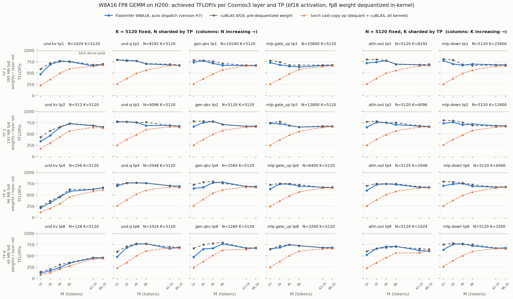

# W8A16 FP8 GEMM performance comparisons

These figures preserve the archived benchmark measurements for Hopper (H100 and
H200) and Blackwell (B200). They precede the review refactors and upstream merge;
they are not new measurements of the merged PR head.

Each grid compares BF16 activations and FP8 e4m3 weights across the Cosmos3 layer
shapes, tensor-parallel shard sizes, and activation row counts. Higher achieved
TFLOP/s is better. The plotted throughput is `2 * M * N * K / elapsed_time`,
including all kernels in the cast-copy path's elapsed time.

- **Blue:** FlashInfer W8A16 with automatic variant selection.
- **Gray:** BF16 cuBLAS using a pre-dequantized weight; conversion is excluded.
- **Orange:** the complete Torch weight cast/scale followed by cuBLAS.

The benchmark implementation and current CLI are in
[`benchmarks/bench_w8a16_fp8_gemm.py`](../../../benchmarks/bench_w8a16_fp8_gemm.py).
The archived optimization record is
[`benchmarks/w8a16_fp8_gemm_ladder.md`](../../../benchmarks/w8a16_fp8_gemm_ladder.md).

## Hopper: H100

## Hopper: H200

## Blackwell: B200

