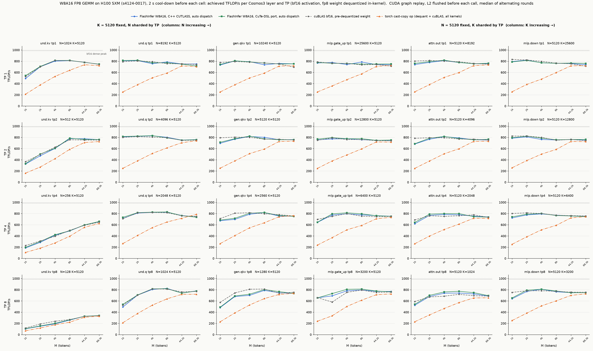
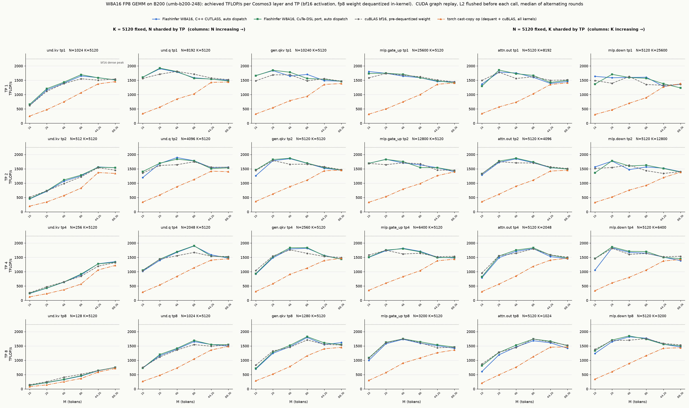
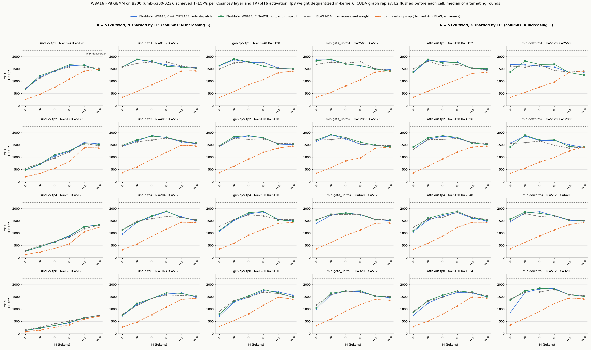
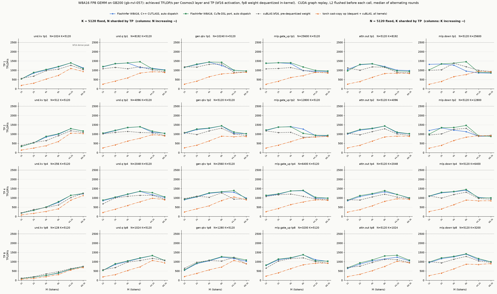

# W8A16 FP8 GEMM performance comparisons

Each grid compares BF16 activations and FP8 e4m3 weights across the Cosmos3 layer
shapes, tensor-parallel shard sizes and activation row counts. Higher achieved
TFLOP/s is better. The plotted throughput is `2 * M * N * K / elapsed_time`,
including all kernels in the cast-copy path's elapsed time.

Timing: per cell and implementation a CUDA graph of back-to-end calls, each preceded
by a 256 MB memset that flushes the L2, replayed in rounds that alternate the
implementations; the flush-only graph's time is subtracted and the median is kept.
On the H100 and GB200 each cell was preceded by a two-second idle so the long rows
are not measured on a thermally throttled part.

- **Blue:** FlashInfer W8A16, the CUTLASS C++ implementation this port replaced,
  automatic variant selection (measured for reference; it is no longer in the tree).
- **Green:** FlashInfer W8A16, the CuTe-DSL implementation, automatic variant selection.
- **Gray:** BF16 cuBLAS using a pre-dequantized weight; conversion is excluded.
- **Orange:** the complete Torch weight cast/scale followed by cuBLAS.

The benchmark implementation and current CLI are in
[`benchmarks/bench_w8a16_fp8_gemm.py`](../../../benchmarks/bench_w8a16_fp8_gemm.py).

## Hopper: H100

## Blackwell: B200

## Blackwell: B300

## Blackwell: GB200

