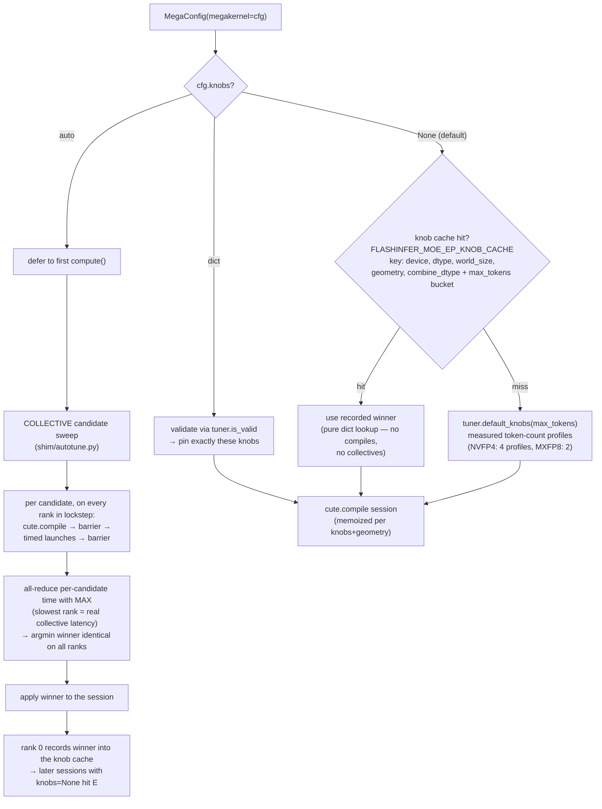
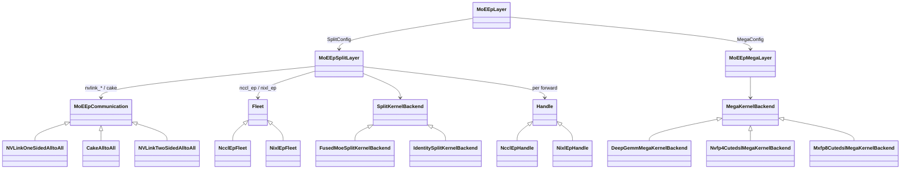
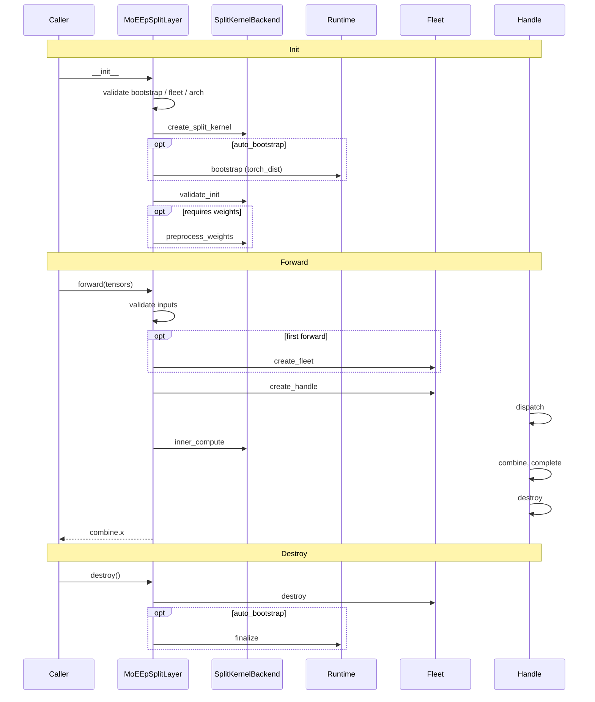
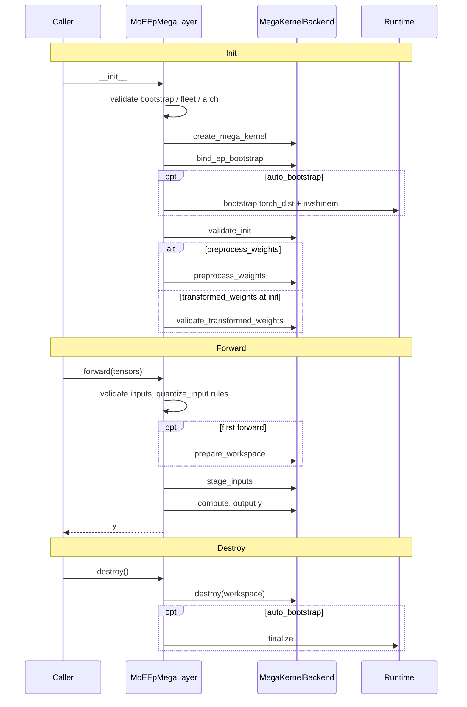

# moe_ep Design

`flashinfer.moe_ep` implements expert-parallel MoE layers, communication
backends, and fused kernels.

> For build/test/how-to-extend instructions, see the
> [moe_ep runbook](./moe_ep_runbook.md).
> For the CuTeDSL mega backends' tuning surface, measured performance, and
> benchmark methodology, see
> [kernel_src/sm100/cutedsl_megamoe/TUNING.md](../../flashinfer/moe_ep/kernel_src/sm100/cutedsl_megamoe/TUNING.md)
> (SM100) and
> [kernel_src/sm107/next_cutedsl_megamoe/TUNING.md](../../flashinfer/moe_ep/kernel_src/sm107/next_cutedsl_megamoe/TUNING.md)
> (SM107).

Expert-Parallel MoE with two execution modes:

| Mode | Flow | When to use |
|------|------|-------------|
| **Split** | dispatch → inner kernel → combine | Pluggable comm + compute; NVLink one-/two-sided, NCCL-EP, NIXL-EP |
| **Mega** | fused comm + MoE kernel | Single symmetric-memory kernel; no separate Fleet/Handle |

Entry point: `MoEEpLayer(bootstrap, fleet_params, weights, fleet_knobs=(), backend=...)` → `MoEEpSplitLayer`, `MoEEpMegaLayer`, or `MoEEpAutoLayer`.

## Available backends

Backends resolve by name from the config object's `kernel_name` /
`backend_name` field (four registries: mega kernels, split kernels,
`MoEEpCommunication` backends, and Fleet transports; deprecated aliases still
resolve but warn).

### Mega (fused comm + MoE kernel)

Selected via `MegaConfig(megakernel=<config>)`. One symmetric-memory kernel
owns dispatch, expert compute, and combine; output is always BF16
`[num_tokens, hidden]`.

| Backend (alias) | Activation | Weight | Output | Arch | Tuning |
|---|---|---|---|---|---|
| `sm100_bf16_nvfp4_bf16_cutedsl` | BF16 | NVFP4 (block-16) | BF16 | SM100/SM103 | same `knobs` surface as the NVFP4 backend |
| `sm100_nvfp4_nvfp4_bf16_cutedsl` (`nvfp4_cutedsl`) | NVFP4 (block-16) | NVFP4 (block-16) | BF16 | SM100 family | `knobs=None` → token-count heuristic; `knobs=dict` → pinned; `knobs="auto"` → collective compile+time sweep at first forward (never in serving); winners cacheable via `FLASHINFER_MOE_EP_KNOB_CACHE` |
| `sm100_mxfp8_mxfp8_bf16_cutedsl` (`mxfp8_cutedsl`) | MXFP8 (block-32 UE8M0) | MXFP8 (block-32 UE8M0) | BF16 | SM100 family | same `knobs` surface as the NVFP4 backend |
| `sm100_fp8_fp4_bf16_deepgemm` (`deep_gemm_mega`) | FP8 (E4M3, block-32 UE8M0) | FP4 (int8-packed, block-32) | BF16 | SM100 family | — (DeepGEMM selects its own JIT configs internally) |
| `sm90_fp8_fp8_bf16_pull_cutedsl` (`sm90_pull_fp8`) | FP8 (E4M3/E5M2; per-tensor or DeepGEMM-style blockwise scales) | FP8 (same `fp8_scale_mode`) | BF16 | SM90 exactly | same `knobs` surface as the SM100 backends (heuristic table / knob cache / `knobs="auto"`) |
| `sm90_bf16_bf16_bf16_pull_cutedsl` | BF16 | BF16 | BF16 | SM90 exactly | same `knobs` surface as the FP8 pull backend, shared knob cache |
| `sm90_fp8_fp8_bf16_push_cuda` (`sm90_push_fp8`) | FP8 (E4M3) | FP8 (E4M3) | BF16 | SM90 | — (static dimensions/protocol choices only) |
| `sm90_bf16_bf16_bf16_push_cake` | BF16 | BF16 | BF16 | SM90 | — (`capacity_factor`, `dedup_dispatch`, optional `clamp_limit`, `combine_wire` = `prereduced` (default: one pre-reduced bf16 row per (token, source rank), deterministic rank-ordered fp32 sum) or `per_route`; native BF16 end to end: bf16 dispatch payload, Cake-generated WGMMA FC1/FC2 with fp32 accumulation, bf16 combine wire) |
| `sm120_mxfp4_mxfp8_bf16_cake` | MXFP8 (E4M3, block-32 UE8M0) | MXFP4 (E2M1, block-32 UE8M0); optional FP8 E4M3 shared expert | BF16 | SM120 | `transport_table` per EP-rank pair (`all_gin` default; `lsa_where_reachable` / `all_lsa` / explicit tuple: LSA copier CTAs over NVLink / PCIe P2P); `"tuned"` → offline winner from `torchrun --nproc_per_node=<EP> -m flashinfer.moe_ep.tune --dtype sm120_mxfp4_mxfp8` in `FLASHINFER_MOE_EP_KNOB_CACHE`; `"auto"` → setup probe. Compile-time `swiglu_limit`, `codec_overflow_blocks`; one Cake-generated parametric persistent kernel (dispatch, FC1 + SwiGLU, FP8 requant, FC2, return, weighted combine) JIT-compiled per (EP, E, H, I, top-k, capacity), DeepSeek-V4-Flash EP4/EP8 instances in AOT; graph token buckets via `stage_inputs(compile_tokens_per_rank=...)` |

The `sm100_bf16_nvfp4_bf16_cutedsl` backend is the W4A16 variant: expert
weights remain packed NVFP4 and expert activations remain BF16, including
the FC1-to-FC2 handoff. For more on this backend's design and performance, see
[Faster-than-light NVFP4 decode—with precision](https://humansand.ai/blog/faster-than-light-nvfp4-decode)
by Ziang Li at humans& ai.

The SM90 pull-style CuTeDSL tree is process-exclusive with the SM100 CuTeDSL
tree (module names collide). Weight inputs are canonical BF16 `MoEWeightPack`
by default (the FP8 backend quantizes at `preprocess_weights`, the BF16 twin
only re-lays them out); kernel-ready pre-quantized (FP8) or pre-laid-out
(BF16) weights can be supplied instead.

### Split (dispatch → inner kernel → combine)

Composed via `SplitConfig(comm=..., kernel=...)`; any comm backend pairs with
any kernel backend. The comm layer moves tokens (BF16 unless the kernel
backend packs them); the kernel backend computes on this rank's expert shard.

#### Comm backends (dispatch/combine transports)

Comm backends come in two peer kinds, and `MoEEpSplitLayer` accepts either
through `SplitConfig(comm=...)`. They differ in object model, not in role.
Inside the split layer each kind runs on its own path (the Fleet/Handle path
and the MoEEpCommunication path); a backend must be registered as exactly one
kind, and both paths hand the inner kernel the same `SplitKernelContext`:

- **`MoEEpCommunication`** (`core/comm/communication.py`) is a self-contained
  dispatch/combine object: long-lived instances of one EP group (e.g. one per
  MoE layer) share a workspace per layout, and per-step routing state lives in
  that workspace, so rounds on it must not interleave. The NVLink
  backends implement it, with the workspace in
  [symmetric memory](./symmetric_memory.md). `dispatch(hidden_states, topk_ids,
  topk_weights, ...)` returns `ep_size * tokens_per_rank` receive rows with
  their GLOBAL top-k routing (rows without a token carry
  `MoEEpCommParams.invalid_expert_id`); the expert computation weights and
  reduces over its local experts; `combine` sums each token's per-rank results
  on its source rank. Create one with `create_communication(bootstrap,
  MoEEpCommParams(...), backend=<config>)`, or let `MoEEpSplitLayer` create it
  (requires `FleetParams(algorithm=LOW_LATENCY, layout=RANK_MAJOR)`).
  `MoEEpCommParams.dispatch_format` names the `QuantFormat` the activations
  are dispatched in (unquantized `dtype` rows when unset); backends that
  reserve buffers per dispatched byte, such as `nvlink_one_sided`, size them
  from it.
- **`Fleet` / `Handle`** (`core/comm/fleet.py`, `handle.py`) is the native API
  of the NCCL-EP and NIXL-EP backends. It mirrors those libraries' group /
  per-step-handle model and exposes their full surface (EXPERT_MAJOR and HT
  layouts, split send/receive staging, persistent handles for CUDA graphs,
  fault-tolerance masks). `MoEEpSplitLayer` drives `nccl_ep` / `nixl_ep`
  through it, and engines integrate them through it directly.

| Backend | Config | Interface | Transport |
|---|---|---|---|
| `nvlink_one_sided` | `NVLinkOneSidedConfig` | `MoEEpCommunication` | MNNVL symmetric memory; dispatch puts tokens into peers' receive buffers, combine gets results back; up to 256 ranks. `sync_protocol` picks how receivers learn of arrivals: `fence` (completion flags behind a system-scope fence), `sentinel` (they poll a sentinel word that every pushed vector replaces; SM100 / SM103 / SM107, up to 64 ranks; `include/flashinfer/comm/moe_alltoall_sentinel.cuh`) or `auto` (default: `sentinel` for steps of at most 256 tokens per rank that it can carry, else `fence`). Every rank passes the same `sync_protocol`; if any rank cannot run `sentinel`, all of them use `fence`. Kernels follow TensorRT-LLM's (`kernels/moe/communication/`) |
| `cake` | `CakeAlltoAllConfig` | `MoEEpCommunication` | One-sided put/get like `nvlink_one_sided`, running generated Cake kernels (`cake/kernels.py`, `csrc/cake_moe_alltoall*`); SM100/SM103 only |
| `nvlink_two_sided` | `NVLinkTwoSidedConfig` | `MoEEpCommunication` | MNNVL FIFO channels, all-to-all-v (`nvlink_two_sided/kernels.py`, `csrc/nvlink_two_sided_*`); `num_experts % 4 == 0` |
| `nccl_ep` | `NcclEpConfig` | Fleet/Handle | see below |
| `nixl_ep` | `NvepConfig` | Fleet/Handle | see below |

Fleet transports:

| Backend | Config | Transport | Modes | Constraints |
|---|---|---|---|---|
| `nccl_ep` | `NcclEpConfig` | NCCL (nccl-extensions wheel) | LL `EXPERT_MAJOR` / `RANK_MAJOR`, HT `FLAT` | LL device kernel whitelists per-token row widths and caps top-k at 8 — see the runbook's "NCCL-EP low-latency device-kernel limits" |
| `nixl_ep` | `NvepConfig` | NIXL over UCX device API (GPU-initiated RDMA) | LL `EXPERT_MAJOR` only | needs `BUILD_NIXL_EP=1` (UCX v1.21+ device headers) and `BootstrapConfig.tcp_store`; `max_tokens_per_rank ≤ 1024`; hidden ∈ {2048, 2560, 3072, 4096, 5120, 6144, 7168, 8192}; handles top-k > 8 |

#### Kernel backends (post-dispatch inner compute)

| Backend | Activation | Weight | Output | Arch | Tuning |
|---|---|---|---|---|---|
| `identity` (`IdentityConfig`) | passthrough | none | dispatch tensor unchanged | any | — |
| `fused_moe` (`FusedMoeKernelConfig`) with `TrtllmBf16Config` | BF16 | BF16 | BF16 | SM100 family | inner `MoELayer` AutoTuner: per-runner tactic search + cross-backend winner per token bucket, up to `ExecutionConfig.tune_max_num_tokens` |
| `fused_moe` with `TrtllmFp4Config` | NVFP4 (block-16) or MXFP8 (block-32), quantized post-dispatch in the bridge | NVFP4 or MXFP4, respectively | BF16 | SM100/SM103/SM107 | same `MoELayer` AutoTuner |
| `fused_moe` with `CuteDslConfig` | NVFP4 (W4A4), MXFP8 (W4A8), or BF16 (W4A16); W4A8 may use pre-dispatch packed payloads with `mxfp8_dispatch=True` | NVFP4/MXFP4 | BF16 | SM100/SM103 (W4A4/W4A16 also SM107) | same `MoELayer` AutoTuner |

`fused_moe` prepares weight views for each configured compute backend. For
NVFP4×NVFP4 or MXFP4×MXFP8, `BackendOptions(candidates=(CuteDslConfig(), TrtllmFp4Config()))`
lets `MoELayer` compare eligible compute backends and cache its winner per
token-count bucket. A singleton retains explicit backend selection. This
comparison times local compute, not EP dispatch/combine; warm up each input
shape before graph capture. The W4A8 split kernel requires
hidden and intermediate sizes to be multiples of 128.

## How tuning works

Two independent tuning systems, matching the two execution modes:

- **Split** kernels tune through the generic FlashInfer `AutoTuner`: each
  `fused_moe` runner enumerates kernel *tactics*, the tuner times them per
  token bucket (up to `ExecutionConfig.tune_max_num_tokens`), and `MoELayer`
  additionally picks a cross-backend winner per bucket. Nothing moe_ep-specific
  — see the fused_moe docs.
- **Mega** CuTeDSL kernels tune through the moe_ep-owned **knob** system
  described below. The knob space is larger than a tactic id (tile, cluster,
  warp-role, and scheduling choices that must be fixed at `cute.compile` time)
  and every measurement is a **collective** — the fused kernel spans all EP
  ranks, so candidates must compile and launch in lockstep on every rank.

### Knob resolution (mega CuTeDSL)

`Sm100_*_Cutedsl_MegaMoeConfig.knobs` accepts three values; resolution happens
when the symmetric-memory session is created (and, for `"auto"`, at the first
`compute()`):



The knobs split into two classes (`kernel_src/sm100/cutedsl_megamoe/shim/tuner.py`):

- **correctness knobs** change a code path or the output and must be kept at
the validated value: `mma_tiler_mnk`, `cluster_shape_mnk`,
`token_back_mode`, `load_balance_mode`, `non_ubulk_fc2_store`, and
`in_kernel_fc2_reduce` (ikr — makes the accumulation order
nondeterministic); the knobs may select it, but only when the config sets
`enable_in_kernel_fc2_reduce=True`, so leaving `enable_in_kernel_fc2_reduce`
at `False` keeps the session bit-reproducible.
- **perf knobs** are output-neutral and free to sweep: `group_hint`,
  `flag_batch`, `epi_flag_batch`.

A validity predicate (`tuner.is_valid`) mirrors the kernel team's
`inference_solver.filter_invalid` rules, so sweeps only enumerate
compilable combinations.

### Detailed example: `sm100_nvfp4_nvfp4_bf16_cutedsl`

**1. Default (**`knobs=None`**).** The session resolves the knob cache first;
on a miss it falls back to four measured token-count profiles keyed on the
compile-time buffer capacity (`max_tokens_per_rank * world`):

| bucket | profile |
|---|---|
| < 512 | small-batch latency: 128-wide N tile, `token_back_mode="epi_warps"` |
| 512–1023 | mid: `reuse_dispatch_warps` |
| 1024–2047 | mid-large: 256-wide N tile, `standalone_warps` |
| ≥ 2048 | large throughput: `flag_batch=8`, `reuse_dispatch_warps` |

`in_kernel_fc2_reduce` defaults to the value of `enable_in_kernel_fc2_reduce`

**2. Pinned (**`knobs=dict`**).** E.g. a winner from the kernel team's tester
sweep:

```python
Sm100_Nvfp4_Nvfp4_Bf16_Cutedsl_MegaMoeConfig(
    intermediate_size=2048, top_k=8,
    knobs={"mma_tiler_mnk": (256, 128, 256), "cluster_shape_mnk": (2, 1, 1),
           "token_back_mode": "reuse_dispatch_warps", "flag_batch": 8,
           "group_hint": 512, "epi_flag_batch": (2, 4),
           "load_balance_mode": "atomic_counter",
           "in_kernel_fc2_reduce": False},
)
```

**3. Online (**`knobs="auto"`**).** At the first `compute()` every rank runs the
same ~24-candidate sweep (`nvfp4_candidates()`: tile {256×128, 256×256} ×
`flag_batch` {4, 8} × three `token_back_mode` values × ikr {off, on}, over a
fixed base of `cluster (2,1,1)`, `group_hint 512`, `epi_flag_batch (2,4)`,
`atomic_counter`). Each candidate costs one `cute.compile` (minutes), so the
sweep is a multi-minute, collective, once-per-session event — **never run it
inside a serving engine**. The winner is applied and rank 0 records it in the
knob cache.

**4. Offline CLI (the intended production flow).** Run the same sweep outside
the engine, with the production EP world size, GPU model, and geometry:

```shell
torchrun --nproc_per_node=4 -m flashinfer.moe_ep.tune \
    --dtype nvfp4 --hidden 7168 --intermediate 2048 \
    --num-experts 256 --topk 8 --max-tokens 8 512 2048
```

Winners land in the JSON knob cache (default
`~/.cache/flashinfer/moe_ep_knob_cache.json`; override or disable with
`FLASHINFER_MOE_EP_KNOB_CACHE`), keyed by (device, dtype, world_size, hidden,
intermediate, num_experts, topk, combine_dtype) plus a `max_tokens` bucket
(exact bucket when present, else the smallest recorded bucket ≥ the request,
else the largest below). The engine then constructs the layer with the
default `knobs=None` and gets the tuned winner as a pure lookup — no
compiles, no collectives, no timing on the hot path. Nondeterministic ikr
candidates are excluded from the CLI sweep unless
`--allow-nondeterministic` is passed.

Measured results, methodology, and the full knob reference live in
[kernel_src/sm100/cutedsl_megamoe/TUNING.md](../../flashinfer/moe_ep/kernel_src/sm100/cutedsl_megamoe/TUNING.md).

## Layout

```text
moe_ep/
  config.py, tensors.py, weights.py, layer.py, algo_knobs.py, errors.py
  core/comm, core/kernel, core/runtime, core/validation, core/bootstrap_utils.py
  backends/split/comm/{nccl_ep,nixl_ep}
  backends/split/kernel/{identity,fused_moe}
  backends/mega/kernel/sm100/{bf16_bf16_bf16_cutedsl,bf16_mxfp8_bf16_cutedsl,nvfp4_nvfp4_bf16_cutedsl,mxfp8_mxfp8_bf16_cutedsl,fp8_fp4_bf16_deepgemm}
  backends/mega/kernel/sm90/{fp8_fp8_bf16_pull_cutedsl,bf16_bf16_bf16_pull_cutedsl,fp8_fp8_bf16_push_cuda}
  backends/mega/kernel/sm107/{mxfp8_mxfp8_bf16_cutedsl, mxfp8_mxfp4_bf16_cutedsl, nvfp4_nvfp4_bf16_cutedsl}
  kernel_src/sm100/cutedsl_megamoe/  ← Blackwell CuTeDSL kernel src (kernel team) + FI shim
    src/                       ← VERBATIM kernel team drop (common, moe_bf16_glu, moe_nvfp4_swapab, moe_mxfp8_glu, src)
    __init__.py                ← public API consumed by the sm100 cutedsl backends
    shim/                      ← thin adapters over src/ (_paths, comm, bf16, nvfp4, mxfp8, kernel_helpers, correctness, autotune, tuner)
    SKILL.md                   ← how to resync src/ when kernel team drops a new version
    TUNING.md                  ← tuning surface, measured perf, benchmark methodology
    ACKNOWLEDGEMENT.md         ← kernel authors
  kernel_src/sm90/pull_style_cutedsl_megakernel/  ← Hopper pull-style FP8 and BF16 kernel src + FI shim
    src/                       ← VERBATIM drop, fork of the sm100 kernel repo (common, src, moe_nvfp4_swapab, moe_hopper_fp8, moe_hopper_bf16)
    shim/, __init__.py, SKILL.md  ← same layering; process-exclusive with the sm100 tree (module names collide)
  kernel_src/sm90/push_style_megamoe/  ← Hopper push-style FP8 (raw CUDA, JIT-compiled)
    src/{a2a,fp8_gemm}/        ← VERBATIM drop from flashinfer PR #4069 (.cu/.cuh)
    shim/, __init__.py, VENDOR.md  ← shim is part of the upstream PR here (vendored with it)
  kernel_src/sm107/next_cutedsl_megamoe/  ← Rubin block-scaled inference
    src/sources/               ← verbatim upstream exporter output; see VENDOR.md
    shim/, __init__.py          ← FlashInfer adapters and public package API
    VENDOR.md, SKILL.md, TUNING.md  ← provenance, update procedure, and measurements
  modes/{split_layer,mega_layer,config}.py
```

Layout rule — taxonomy vs provenance:

- `backends/mega/kernel/` is organized by **taxonomy** (the user view):
  `sm<arch>/<act_dtype>_<weight_dtype>_<out_dtype>_<kernel_style>/`. Backends are
  thin adapters; several may wrap kernels from the same vendored repo.
- `kernel_src/` is organized by **provenance** (the kernel-dev view): one
  directory per upstream kernel repo snapshot, mirroring the vendor repo, with
  `src/` verbatim, all adaptation in `shim/`, and a `VENDOR.md` recording the
  upstream repo, pinned commit, sync date, and any pending local diffs. Never
  hand-merge two upstream states into one directory. (`kernel_src/sm90/…` is a
  separate snapshot of a fork and keeps its current path for now; fold it into
  `cutedsl_megamoe/` if upstream merges the SM90 kernel.)

Kernels register via `@register_split_kernel` / `@register_mega_kernel` when `backends` is imported; communication backends and comm fleets register when their `communication.py` / `fleet.py` is imported from `__init__.py`.

## Core types

| Type | Role |
|------|------|
| `BootstrapConfig` | `world_size`, `rank`, `stream`, `nccl_comm`, `tcp_store`, optional `process_group` (EP comm; defaults to WORLD), `auto_bootstrap=True` |
| `FleetParams` | EP sizing only (no weights); split transport fields (`algorithm`, `layout`, `dtype_bytes`) default and are ignored by mega |
| `MoEEpTensors` | `hidden_states`, `topk_ids`, `topk_weights`; optional `scales`, `fc1_alpha`, `fc2_alpha`, `fc1_norm_const`, `fc1_activation_per_token_scale`, `recv_count`, `num_tokens_per_expert` |
| `MoEWeightPack` | Canonical `w13` / `w2` (+ optional `w13_scale` / `w2_scale`); required `weights` arg at layer construction; `dummy_moe_weights()` for comm-only split |
| `MoEEpMegaWorkspace` | Public, layer-bound capacity-profile handle returned by `MoEEpMegaLayer.create_workspace()`; do not construct directly |
| `SplitConfig` | `comm` + `kernel` slots (default `NcclEpConfig` + `IdentityConfig`) |
| `MegaConfig` | `megakernel`, `quantize_input`, `preprocess_weights`, optional `transformed_weights` |
| `AutoConfig` | Explicit Mega/split candidates, with an optional candidate index to force one |
| `MoEEpAutoWorkspace` | A prepared input profile, selected complete EP plan, and storage retained for its captures |
| `FleetAlgoKnobFaultTolerance` | Opt-in rank masking (`enabled`, `timeout_ms`, reconcile budgets) — see **Fault tolerance** |

**Split:** pass `SplitConfig(comm=..., kernel=...)` or a comm string/config (kernel defaults to `IdentityConfig`). `fleet_knobs` tune Fleet transports. The Fleet (or `MoEEpCommunication`) is lazy-created on first `forward()`; Fleet transports get a new Handle per forward. CUDA-graph capture goes through `create_graph_state()` for both kinds of comm backend; a `MoEEpCommunication` is already long-lived, so its graph state only pins the bound buffers, and `create_graph_state()` rejects backends with `supports_cuda_graph=False`. `MoEEpSplitLayer.enable_timing` optionally records per-stage GPU ms (`MoEEpSplitLayer.STAGES`: quantize, dispatch, compute, combine) in `last_timings_ms`; `stage_hook` brackets the same stages without synchronizing, for timing under CUDA graph capture.

**Split compute:** the `fused_moe` kernel bridges the 3D EP dispatch buffer to `flashinfer.fused_moe` (a token-major `MoEActivationPack`) via `backends/split/kernel/fused_moe/bridge.py`:

- LL **EXPERT_MAJOR** — `[num_local_experts, cap, hidden]` (`cap = max_tokens_per_rank * world`), each row pre-assigned to one expert; the bridge synthesizes `top_k=1` / `final_scales=1` and **combine owns the real top-k reweight**.
- LL **RANK_MAJOR** / **HT FLAT** — `[world, max_tokens_per_rank, hidden]` carrying received `topk_idx` / `topk_weights`; the runner uses the real `top_k` with non-local picks masked to weight 0, and combine just sums across ranks.

BF16, W4A4, W4A8, and W4A16 are supported through the unified compute path (`MoEConfig.quant` weight/activation `QuantFormat` pair); quantized activations are prepared in the bridge, and W4A8 optionally packs its MXFP8 payload before dispatch (see **Available backends**).

### Batch-invariant BF16 MegaMoE

Batch-invariant execution supports the SM100/SM103/SM107 BF16 CuTeDSL
MegaMoE backend, selected explicitly through `MegaConfig`. SM107 requires native
`sm_107a` compilation and a CUDA/CuTe launcher with oversized shared-memory
support; multi-GPU NVLink execution also needs a Rubin-aware NCCL.

```python
from flashinfer.moe_ep import (
    MegaConfig,
    Sm100_Bf16_Bf16_Bf16_Cutedsl_MegaMoeConfig,
)

backend = MegaConfig(
    megakernel=Sm100_Bf16_Bf16_Bf16_Cutedsl_MegaMoeConfig(
        intermediate_size=intermediate_size,
        top_k=top_k,
        batch_invariant=True,
        apply_routing_weights_before_fc2=True,
    ),
)
```

For fixed weights, per-token input values and precomputed routing IDs and
weights, this mode preserves finalized output bits when the surrounding batch
changes. The guarantee applies within the same GPU architecture, software and
compiler versions, and EP topology and expert placement. Router computation is
outside this API's guarantee. It does not promise bitwise agreement with regular
MoE kernels, another backend, or another precision.
Live routing IDs must name existing global experts or use `-1` for dropped
slots. Dropped slots contribute zero, including when their unused routing
weight is NaN; they do not read a prior invocation's combine cells.

Batch-invariant mode disables in-kernel FC2 atomic reduction and uses an ordered
finalizer. It requires finalized output; `FinalizeMode.NONE` is unsupported.
Permitted tile geometries preserve the same ordered K16 accumulation,
activation and routing-weight placement. In particular,
`apply_routing_weights_before_fc2` selects a numerical calculation: keep its
value fixed when comparing batches. Create a new layer to change numerical
settings after construction; mutating a configuration does not update an
existing layer's compiled plans or captured graphs. Autotune, cached knobs and
heuristic fallbacks must all satisfy the batch-invariant configuration restrictions.
Changing communication scheduling alone may remain eligible where it preserves
that calculation.

The tile family admits M128/M256, N128/N256 and K64/K128/K256. M128 uses one CTA
with `cluster_shape_mnk=(1, 1, 1)`; M256 uses paired CTAs with
`cluster_shape_mnk=(2, 1, 1)`. Tile K must divide both hidden and intermediate
sizes after rounding each up to 64, preserving the original padded K16 trace.
Every selected plan must fit at least one A/B pipeline stage in shared memory:
232448 bytes per CTA on SM100/SM103 or 334848 bytes in SM107 oversized mode.
`flag_batch=1`, `epi_flag_batch=(1, 1)` and `group_hint=None` remain fixed.
Static and atomic-counter task assignment and the three token-back carriers
remain eligible, giving up to 72 plans before shape and resource filtering.
Integer task counters do not accumulate output values. An unrecognized knob or
numerical implementation is rejected rather than silently admitted.

Use this backend directly for the initial implementation. SM100 BF16 does not
yet implement the outer `AutoConfig` complete-EP selection protocol. An
`AutoConfig` containing a batch-invariant candidate rejects ordinary or
unsupported candidates and candidates with different activation clamps,
expert geometry or routing-weight placement, even with a pinned candidate
index; it cannot silently fall back to an ordinary calculation.

#### Arithmetic fingerprint and Lean model

The arithmetic receipt is available as `layer.batch_invariant_fingerprint`
(`None` in ordinary mode) and without constructing a layer:

```python
from flashinfer.batch_invariant import fingerprint

receipt = fingerprint(
    "megamoe_bf16",
    hidden=hidden_size,
    intermediate=intermediate_size,
    top_k=top_k,
    num_experts=num_experts,
    apply_routing_weights_before_fc2=True,
    gate_up_clamp=None,
    arch="sm_100",  # sm_103 / sm_107 also supported; defaults to the active device
)
```

`moe_ep/batch_invariant/spec.py` builds ordered terms for the actual computation:
K64 stages containing four BF16 K16 MMA steps (including padded steps and a
distinct first-step initializer), the FP32 activation and its NaN-propagating
clamps, the BF16 handoff and FC2 wire, and the fixed slot-order FP32 sum or FMA.
The BI activation runs this same chain through a device backend with pinned
`ex2.approx.ftz.f32`, `rcp.approx.ftz.f32` and RN/no-FTZ ALU operations.
As in ordinary MegaMoE, the effective clamp is `abs(gate_up_clamp)`, so opposite
signs of the same clamp magnitude share a receipt. FP32 constants are identified
by bits, including the negative-zero lower bound of a zero clamp.
Early and late routing-weight placement have different fingerprints. All
admitted tile/schedule/carrier plans of one calculation share one fingerprint. Batch,
capacity, packing order and pointers are absent from the receipt; input and
weight values and ordered routing slots remain runtime inputs.

The digest binds component terms and their composition rather than expanding a
full dense FFN expression. It is a specification identifier, not a source hash or
a proof certificate. Admission-policy version 3 caches also match this arithmetic
digest; older-policy entries and entries with a missing or mismatched digest
are not reused. The arithmetic specification remains version 1.

`batch_invariant/lean/BIKernels/MegaMoE.lean` proves the K64-to-K16 lowering,
configuration agreement, token permutation/sub-batch invariance and logical
placement preservation under an inverse address map, unique logical cells and
correct publication of their values. Generated
cases couple the Python and Lean S-expressions; the project axiom checker rejects
`sorry` and any new axiom outside the existing policy. The model does not verify
the internals of MMA or approximate instructions, compiler lowering, CUDA memory
ordering, barriers or remote communication. Those remain hardware assumptions
checked by independent device conformance and the cross-plan/batch GPU suite.
NaN payloads are not interpreted by the exact CPU arithmetic model; device
scalar/packed agreement checks their observed representations separately.

From the repository root, regenerate and check the formal cases with:

```bash
python -m flashinfer.moe_ep.batch_invariant.lean_cases
pytest tests/batch_invariant/test_megamoe_lean.py
pytest tests/moe_ep/test_bf16_megamoe_spec.py
pytest tests/moe_ep/test_bf16_megamoe_batch_invariant.py --full
```

The Lean build, conformance executable and axiom-policy checks run when the
pinned Lean toolchain is installed; without it, the generated-file consistency
test still runs. Keep a fingerprint with its FlashInfer/compiler versions,
architecture, EP topology and expert placement when recording an output receipt.

### Complete EP selection

`AutoConfig` compares explicitly configured Mega and split candidates during an
`autotune_v2()` warmup. Candidates must implement the same quantization,
activation and expert geometry, using canonical BF16 weights and contiguous
BF16 inputs with finalized BF16 output. Routing tensors are contiguous, with
int32/int64 expert IDs and float32 weights. FC1 rows use the unified MoE API's
`[up, gate]` order.
Routing-weight placement, the NVFP4 activation recipe and the combine format
must also agree. In particular, mixing a split candidate with Rubin Mega
requires `apply_routing_weights_before_fc2=False` and `combine_dtype="bf16"`.
Candidate preparation converts native weight layouts before tuning. Mega
candidates currently use the Rubin block-scaled
adapters. Split candidates use `FusedMoeKernelConfig` and its existing prepared
weight views. The layer prepares and retains each candidate's weights once;
workspaces share those views. Each split configuration pins its communication
backend, including its default; the selector does not enumerate other transports.
Raw allocator callbacks and CUDA stream handles carry process-local addresses
and are not supported in automatic-selection cache contracts. The built-in
`FleetAlgoKnobAllocator(torch_caching=True)` remains serializable.

```python
from flashinfer import autotune_v2
from flashinfer.moe_ep import AutoConfig, MegaConfig, MoEEpLayer, SplitConfig

layer = MoEEpLayer(
    bootstrap, fleet_params, weights,
    backend=AutoConfig(candidates=(
        MegaConfig(megakernel=mega_config),
        SplitConfig(comm=comm_config, kernel=split_kernel_config),
    )),
)
with autotune_v2():
    workspace = layer.create_workspace(tensors)
    layer.warmup(tensors, workspace=workspace)
output = layer.forward(tensors, workspace=workspace)
selected = layer.get_selected_plan(workspace=workspace)
```

Set Rubin's `knobs="auto"` and `kernel_variant="auto"` to search its eligible
variants and knobs. Explicit Mega variants or knob dictionaries retain their
meaning. For each split configuration, the selector enumerates eligible
compute backends and tactics without using MoELayer's compute-only winner.
Every tactic is measured through input preparation, dispatch, compute, combine
and output handling. The best backend/tactic competes with the Mega winner over
that same boundary. Compilation, weight transformation and workspace allocation
happen before measurement. All EP ranks use the median of the per-iteration
maximum rank latency.

The managed v2 store holds split backend winners and the overall plan in
separate namespaces. Rubin keeps its existing variant and knob records. Outer
records match the configured candidates, capacity, rank-local input shapes,
numerical settings, environment and measurement policy. A replay context loads
one complete plan without measuring; a miss prepares the first eligible
candidate's fallback and leaves tuning pending. `candidate=i` in `AutoConfig`
forces that candidate while allowing its inner tuning. `get_selected_plan()`
returns its index and either a Mega variant/knob dictionary or a split backend
position and tactic. The backend position indexes the configured `BackendOptions`.

Prepare workspaces collectively with an agreed `runtime_max_tokens_per_rank`,
or omit it to use the workspace capacity as the row bound. Live row counts may
vary independently on each rank within that bound. NCCL-EP and NIXL-EP use
fixed-row handles, so partial batches stage into bound-sized buffers with
masked routing tails. A full-bound batch executes directly; NVLink one-sided
keeps its variable-row path. Dtypes, strides, top-k, output layout and the
runtime hint stay fixed. Prepare another workspace collectively to change them.

Eager calls may use new input buffers with the same layout. Ordinary serving
reuses the prepared plan without selector collectives; changed routing values
do not trigger selection. An enabled tuning context selects for the actual
rank-local live row counts, which remain distinct in the tuning cache even
when workloads share a workspace bound. Warm up that workload before capture.
The workspace owns the returned output and may overwrite it on its next call; pass
`MoEEpTensors.output` to supply an output buffer. Output must not alias an input.
Prepared fixed-row transports keep their eager stream binding; run eager
forwards on the stream used to prepare the plan. Capture uses its capture stream.

Prepared Mega plans own their symmetric scratch instead of using the process
workspace pool. Scratch usage grows with the number of live layer/profile
workspaces; transformed weights are shared. Independent storage prevents plans
and older graph captures from overwriting one another.

Warm up each profile before capture. Selection cannot run inside capture. Later
warmup can replace a selected plan using fresh execution storage while retaining
storage used by older graphs. Transformed weights remain shared. Retire all
graphs using a handle before calling its collective `destroy()`. Separate handles
let the engine release old profiles independently; layer destruction releases
all remaining handles.

**Mega:** pass `MegaConfig(megakernel=...)`. Weights required as the layer's `weights` argument. Workspace allocated on first forward. Output is bf16 `[num_tokens, token_hidden_size]` where `num_tokens = MoEEpTensors.num_tokens` (may be `< max_tokens_per_rank`). `fleet_knobs` are ignored. NIXL-EP split layers require `BootstrapConfig.tcp_store` at init.

After an automatic warmup, `layer.get_tuned_knobs()` returns a copy of the
selected knob dictionary. Pass it as `knobs` when constructing a fixed layer
with the same kernel configuration and capacity. The getter performs no tuning
or file access and raises before a successful automatic search or after layer
destruction. `warmup()` continues to return `None`.

On Rubin, `kernel_variant="auto"` together with `knobs="auto"` selects between
inference and GenPhase. An enabled `autotune_v2()` warmup selects each variant's
knobs, then compares the winners. Candidate measurements
include input staging, compute and output handling at both levels.
The same numerical settings apply to both variants;
GenPhase is excluded when its capacity or combine requirements are not met.
Explicit inference or GenPhase with `knobs="auto"` uses the same complete-forward
boundary, restricted to that variant. The Rubin offline CLI also measures staging,
compute and writing an owned output, matching the default layer forward with
BF16 inputs. Pass `--kernel-variant auto` to search both eligible variants and
save their winners and the overall selection; explicit variants restrict the
search. Offline searches bypass cached winners and do not install the result.
Output copies are measured when the selected path requires them. Input generation, weight preparation, compilation and correctness
checks are outside measurement. Match the deployment's input and output layouts
when reusing automatic results; kernel-only records do not satisfy this objective.

Each variant's winning knobs are stored in its fixed-variant managed-cache
records and the MegaMoE compatibility file when persistence is enabled. The
overall selection has a separate managed entry containing the variant and knobs,
matched to the workspace capacity, per-rank live-token counts, eligible variants
and execution contract. Enabled tuning reuses fixed-variant records only when
their capacity and EP-wide live-token count match the requested workload;
otherwise it searches that variant's knob grid. Replay retains token-bucket and
capacity fallbacks for fixed variants. On an overall miss, cached winners are
checked and timed before comparing variants; a rejected cached choice triggers
a fresh search within that variant. Reused records retain their search score.
Overall selections from the previous fallback-only search are invalidated.
An explicit fresh search bypasses both levels. Skipping fixed-variant tuning
compares heuristic knobs
without publishing fixed-variant managed records. A variant-selection replay
miss uses the inference heuristic and leaves selection pending. Low-level tuning
of already-staged workspaces remains available for kernel measurements.

Use `layer.get_tuned_config()` to reconstruct a fixed layer after variant
selection. It returns the concrete kernel config with the selected variant and
knobs. The knobs-only getter retains its meaning; those knobs alone do not
identify the variant. Weight preprocessing is shared between Rubin variants.
Automatic workspace handles own separate selection state. Later selection can
replace a captured default workspace while its old storage remains available to
existing graphs; captured explicit handles require a new handle.

Rubin automatic workspaces reuse their agreed configuration during ordinary
eager execution, without selection collectives or cache lookups on each forward.
Calling the layer inside an explicit tuning or replay context performs collective
checks; the first bare forward afterward reconciles the ambient cache and controls.
Unrelated contexts, including tuning on another thread, do not invalidate a
prepared workspace. Use `cache_scope="context"` for rank-local cache contexts.
Process-wide store changes and `autotune_v2_reload()` must be coordinated across
EP ranks before serving resumes. When changing the attached store, call the layer
in a replay or tuning context on every rank, including ranks already using that
store. After a coordinated reload, the next eager forward reconciles the reloaded
records. A rank-local `AutoTuner.clear_cache()` alone does not change a
prepared workspace during bare serving; call the layer in a replay or tuning
context on every rank to adopt the change. CUDA graph replay keeps its captured
configuration and storage.

For serving several token capacities with one layer and one transformed weight
set, allocate explicit profiles before capture:

```python
decode_workspace = layer.create_workspace(max_tokens_per_rank=256)
prefill_workspace = layer.create_workspace(max_tokens_per_rank=4096)

decode_out = layer.forward(decode_inputs, workspace=decode_workspace)
prefill_out = layer.forward(prefill_inputs, workspace=prefill_workspace)

# Explicit opt-in when a graph needs a stable borrowed output address.
decode_view = layer.forward(
    decode_inputs,
    workspace=decode_workspace,
    return_workspace_view=True,
)
```

Pass `knobs=selected_knobs` to `create_workspace()` to use a fixed dictionary
for that capacity while sharing the layer's transformed weights. The dictionary
is copied. Omitting `knobs` or passing `None` inherits the layer's configuration.
The layer must use fixed knobs. An override for the default capacity must be
supplied before that workspace is allocated.

Creation and destruction are collective across EP ranks and must occur in the
same order, with matching capacities and knobs. A handle belongs to the layer
that created it and accepts any live
token count up to its capacity. Only one live handle per `(capacity, live_tokens)`
is allowed on a layer. If an explicit handle is created for the
`FleetParams.max_tokens_per_rank` capacity, it becomes the same logical profile
selected by `workspace=None`; FlashInfer transfers/reuses the default allocation
when knobs are inherited, rather than acquiring an aliasing pool reference.
`workspace=` selects capacity and knobs
but preserves the existing owned-output default; request
`return_workspace_view=True` explicitly when a supported backend and CUDA Graph
need a stable borrowed output address.

Warm each handle with `layer.warmup(..., workspace=handle)` before capturing a
separate CUDA graph for it. Before `destroy()`, synchronize all uses and retire
graphs that reference the handle. Physical workspaces are process-pooled across
compatible layers, so handles are capacity profiles, not concurrency-isolation
lanes: pooled profiles must execute under stream ordering. Calls without an
explicit handle preserve the original lazy default-workspace behavior.
Do not rely on Python garbage collection for cleanup: call `layer.destroy()`
collectively and explicitly on every EP rank.

## Architecture



## Built-in plugins

| Kind | Name | Config |
|------|------|--------|
| Comm | `nvlink_one_sided` | `NVLinkOneSidedConfig` |
| Comm | `cake` | `CakeAlltoAllConfig` |
| Comm | `nvlink_two_sided` | `NVLinkTwoSidedConfig` |
| Comm | `nccl_ep` | `NcclEpConfig` (`NCCLEPConfig` alias) |
| Comm | `nixl_ep` | `NvepConfig` (needs `tcp_store`) |
| Split kernel | `identity` | `IdentityConfig` — comm-only; `dummy_moe_weights` OK |
| Split kernel | `fused_moe` | `FusedMoeKernelConfig(moe_config=...)` — bridges to `flashinfer.fused_moe`; BF16 + W4A4/W4A8/W4A16; LL EXPERT_MAJOR / RANK_MAJOR / HT FLAT |
| Mega kernel | `sm100_fp8_fp4_bf16_deepgemm` | `Sm100_Fp8_Fp4_Bf16_Deepgemm_MegaMoeConfig` — FP8/FP4, sm_100+ |
| Mega kernel | `sm100_bf16_nvfp4_bf16_cutedsl` | `Sm100_Bf16_Nvfp4_Bf16_Cutedsl_MegaMoeConfig` — BF16/NVFP4, SM100/SM103 |
| Mega kernel | `sm100_nvfp4_nvfp4_bf16_cutedsl` | `Sm100_Nvfp4_Nvfp4_Bf16_Cutedsl_MegaMoeConfig` — NVFP4, sm_100+ |
| Mega kernel | `sm100_mxfp8_mxfp8_bf16_cutedsl` | `Sm100_Mxfp8_Mxfp8_Bf16_Cutedsl_MegaMoeConfig` — MXFP8 (`kind` e4m3/e5m2), sm_100+ |

**Mega weights:** with `preprocess_weights=True` (default), canonical bf16 or pre-quantized `MoEWeightPack` is transformed at init. With `preprocess_weights=False`, supply `MegaConfig.transformed_weights` (from `preprocess_*_mega_weights`).

BF16×NVFP4 stages BF16 inputs and defaults to ordered FP32 combine inside MegaMoE.
Routing weights apply after FC2 by default;
`apply_routing_weights_before_fc2=True` applies them before the BF16 FC1
handoff, with a different rounding contract.

**Mega activations:** with `quantize_input=True` (default), bf16 `[T, hidden]` is quantized into symm workspace at forward. Non-bf16 with `quantize_input=True` raises `MoEEpConfigError`; use `quantize_input=False` and pre-quantized activations plus `MoEEpTensors.scales`.
BF16-activation backends ignore `quantize_input` and copy BF16 inputs.

## Runtime

Both paths call `ensure_moe_ep_cuda_device()` at init. With `auto_bootstrap=True` (default), layers acquire a ref-counted process runtime and release it in `destroy()`.

| Requirement | Used by |
|-------------|---------|
| `torch_dist` | split comm, all mega kernels |
| `nvshmem` | `sm100_nvfp4_nvfp4_bf16_cutedsl`, `sm100_mxfp8_mxfp8_bf16_cutedsl`, `sm100_bf16_nvfp4_bf16_cutedsl` (skip with `MEGA_NO_DIST=1`) |

**Host framework bootstrap (e.g. vLLM):** when the host already initialized `torch.distributed` and EP uses a subgroup, pass `BootstrapConfig(process_group=ep_group, world_size=ep_size, rank=ep_rank, auto_bootstrap=False)` and call `bootstrap_moe_ep_runtime(bootstrap, reqs)` once per worker after dist init. Mega kernels resolve comm via `bootstrap_comm_group` / `bootstrap_ep_rank_world` (`MegaKernelBackend.bind_ep_bootstrap`).

When `auto_bootstrap=False`: dist must be up at layer construction if `process_group` is set; rank/world cross-checks run at init or first `forward()`; call `bootstrap_moe_ep_runtime` yourself.

## Build / availability

Split comm backends ship native libs under `backends/split/comm/*/_libs/`. Probe with `have_nccl_ep()`, `have_nixl_ep()`, `available_backends()`. Missing libs raise `MoEEpNotBuiltError`.

**Recommended build:** `docker/install/build_flashinfer_ep_pytorch.sh` builds the full NCCL-EP + Mega environment inside the NVIDIA PyTorch base image (`nvcr.io/nvidia/pytorch`): it pins the NCCL-EP runtime wheels (`nvidia-nccl-cu13`, `nccl-extensions`, `nccl4py`, `cuda-core`, `cuda-bindings`), installs the mega deps (DeepGEMM, NVSHMEM, CUTLASS DSL), then runs `BUILD_NIXL_EP=0 pip install --no-build-isolation -e .`. The EP backends are ON by default: NCCL-EP needs no build step (`nccl-extensions>=0.1.0` is a base dependency; `nccl.ep` moved there out of `nccl4py` in nccl4py 0.4.1), and the NIXL-EP meson build runs best-effort unless opted out with `BUILD_NIXL_EP=0` (set `BUILD_NIXL_EP=1` to make missing build deps a hard error; `BUILD_NVEP=0` turns both backends off).

## Lifetimes

| Object | Created | Destroyed |
|--------|---------|-----------|
| Kernel backend | layer init | layer destroy |
| Process runtime | layer init (if `auto_bootstrap`) | layer destroy (ref-counted) |
| Fleet | first split forward | layer destroy |
| Handle | each split forward | end of forward |
| Default mega workspace | first mega forward | layer destroy |
| Explicit mega workspace | `create_workspace()` | handle or layer destroy |

## Usage

```python
from flashinfer.moe_ep import (
    MoEEpLayer, BootstrapConfig, FleetParams, MoEEpTensors,
    MoEWeightPack, SplitConfig, NcclEpConfig, FusedMoeKernelConfig,
    MegaConfig, Sm100_Fp8_Fp4_Bf16_Deepgemm_MegaMoeConfig,
)

# Split: NCCL-EP + fused MoE
layer = MoEEpLayer(
    bootstrap=BootstrapConfig(world_size=4, rank=rank),
    fleet_params=FleetParams(num_experts=32, max_tokens_per_rank=256,
        token_hidden_size=2048),
    weights=MoEWeightPack(w13=..., w2=...),
    backend=SplitConfig(comm=NcclEpConfig(),
        kernel=FusedMoeKernelConfig(moe_config=moe_config)),
)
out = layer.forward(MoEEpTensors(hidden_states=..., topk_ids=..., topk_weights=...))

# Mega: wrap megakernel config in MegaConfig
layer = MoEEpLayer(..., backend=MegaConfig(
    megakernel=Sm100_Fp8_Fp4_Bf16_Deepgemm_MegaMoeConfig(intermediate_size=1024, top_k=4)))
out = layer.forward(MoEEpTensors(...))
layer.destroy()
```

Raw megakernel or split-kernel configs cannot be passed as `backend=`; wrap in `MegaConfig` / `SplitConfig`.

## Extending

See the [runbook's mega-kernel walkthrough](./moe_ep_runbook.md#adding-a-new-mega-kernel-backend) for a step-by-step example (frontend contract, config, registration).

1. **Split kernel** — `backends/split/kernel/<name>/`: subclass `SplitKernelBackend`, `@register_split_kernel`, import in `backends/split/kernel/__init__.py`.
2. **Mega kernel** — `backends/mega/kernel/sm<arch>/<act>_<weight>_<out>_<style>/`: subclass `MegaKernelBackend`, implement `compute` / `_allocate_workspace` / `stage_inputs`, override `runtime_requirements()` if needed, `@register_mega_kernel`, import in `backends/mega/kernel/__init__.py`.
3. **Comm backend** (split only) — `backends/split/comm/<name>/`, implementing one of the two peer interfaces: a self-contained dispatch/combine object subclasses `MoEEpCommunication` and registers with `@register_communication` (`config.py`, `communication.py`); a transport built on a group / per-step-handle library implements `Fleet` / `Handle` and registers with `@register_fleet` (`fleet.py`, `handle.py`). Import it from `moe_ep.__init__.py` and add the backend's runtime needs to `split_comm_runtime_requirements`.

## Tests

See the [runbook's build & test section](./moe_ep_runbook.md#build--test-environment) for the container setup and per-target requirements.

`tests/moe_ep/run_tests.sh [unit|oracle|oracle_sm90|oracle_sm107|qualify_sm107|multirank|sm90_push|sm90_bf16_push_cake|split_path_correctness_{bf16,nvfp4,ht}|mega|mega_sm90|mega_sm107|mega_sm120_cake|smoke|ft|all]`:

- **unit** — host-only pytest (mocks + single-GPU; no multirank)
- **oracle** — single-GPU torch-oracle correctness for every SM100 compute path (see **Torch oracles** below)
- **oracle_sm90** — single-GPU (Hopper) torch oracle for the sm90_fp8_fp8_bf16_pull_cutedsl (FP8) and sm90_bf16_bf16_bf16_pull_cutedsl (BF16) mega kernels
- **oracle_sm107** — single-GPU (Rubin) torch oracle and boundary tests for NVFP4, MXFP8 E4M3, and MXFP8 E5M2
- **qualify_sm107** — strict Rubin host, single-GPU, and multirank qualification, rejecting skipped/empty tests and OOMs; see the [qualification runbook](moe_ep_sm107_qualification.md)
- **multirank** — 4-GPU split path: `test_moe_ep_layer_multirank.py` + `test_split_kernels.py` over NCCL-EP (and NIXL-EP when built)
- **split_path_correctness_{bf16,nvfp4,ht}** — 4-GPU split-path numerics (LL EXPERT_MAJOR + RANK_MAJOR / NVFP4 / HT FLAT) vs a single-process `MoELayer` reference (Blackwell)
- **mega** — 4-GPU DeepGEMM + NVFP4 + MXFP8 mega parity **and multi-rank torch oracles**, plus single-rank preprocess/kernel-vs-reference checks (`MEGA_NO_DIST=1`) (Blackwell, sm_100+)
- **mega_sm90** — 4-GPU (Hopper) sm90_fp8_fp8_bf16_pull_cutedsl (FP8) + sm90_bf16_bf16_bf16_pull_cutedsl (BF16) mega parity + multi-rank torch oracles; own torchrun process (the SM90/SM100 kernel trees share top-level module names and are mutually exclusive per process)
- **mega_sm107** — Rubin MoEEpLayer vs multirank torch oracle for all three formats, with idle ranks and pooled-layer graph replay; `NPROC_MULTIRANK=2`, `4`, or `8` (default 4), own torchrun process
- **mega_sm120_cake** — 4-GPU (SM120) sm120_mxfp4_mxfp8_bf16_cake backend vs a multirank torch oracle (V4-Flash, DeepSeek-V3, Qwen3 geometries, unclamped SwiGLU, odd local expert counts), EPLB physical experts == logical (bitwise), transport-table bit-identity; `NPROC_CAKE_SM120=8` (one host) or a two-node torchrun for 16 ranks; own torchrun processes
- **sm90_push** — 2-GPU (Hopper) sm90_fp8_fp8_bf16_push_cuda kernel + backend; own torchrun process
- **sm90_bf16_push_cake** — 2-GPU (Hopper) sm90_bf16_bf16_bf16_push_cake backend vs an independent bf16 torch reference (single-process `-k ep1` cases, then torchrun EP≥2 routing patterns incl. the pre-reduce cases, uneven tokens, graph replay, combine-wire mismatch; every case under both combine wires); own torchrun process
- **smoke** — NCCL-EP smoke script (and NIXL-EP when built)
- **ft** — 4-GPU fault-tolerance (stalled-rank pytest half + dead-rank smoke half)

`all` runs the eight Blackwell-relevant sections (everything above except the Hopper-only targets — `oracle_sm90`, `mega_sm90`, `sm90_push`, `sm90_bf16_push_cake` — the Rubin-only `*_sm107` targets and the SM120-only `mega_sm120_cake`).

Multirank/smoke/correctness need the NCCL-EP build (see **Build / availability** — `docker/install/build_flashinfer_ep_pytorch.sh`); mega additionally needs Blackwell, deep_gemm, triton.

## Torch oracles

Every compute path is anchored to plain-torch ground truth, at two levels.

**Why they exist.** The other correctness tests are *parity* tests: layer path
vs direct-shim path, or EP vs non-EP. For the split paths that is a genuine
cross-check (dispatch/combine and the compute kernel are separate stages, and
the non-EP side exercises different communication code). For the **mega**
paths it is not: communication and compute are fused into one kernel, so both
sides of a parity test run the same CUDA kernel and a kernel that is *wrong
but self-consistent* passes silently. Worse, bit-exact layer-vs-shim tests
share the preprocessing on both sides, so wrong-preprocess bugs also pass
silently (this class produced three real bugs on the day the single-GPU
oracles landed: nvfp4 weight strides, nvfp4 norm_const, split-bf16 gated
reorder). The oracles close both gaps.

**What an oracle does.**

- *Single-GPU oracles* (`run_tests.sh oracle` / `oracle_sm90`): stage inputs
  exactly as the layer does, launch the kernel once on one rank, and recompute
  the output with plain torch — dequant → fp32 `@` GEMMs → SwiGLU
  (`torch.sigmoid`) → the path's exact fc1-out quant round-trip → fp32 fc2 →
  topk combine — asserting a tight band (typically `rel_l2 < 0.02`; residual
  is quant RTNE flips + accumulation-order noise, since both sides consume the
  same quantized operands).
- *Multi-rank oracles* (inside `mega` / `mega_sm90`, 4 GPUs, names
  `test_moe_ep_*_mega_multirank_torch_oracle`): each rank stages its own
  shard and launches the fused kernel with **real cross-rank NVSHMEM
  traffic**, then `all_gather`s the *actual* operands the kernel consumed —
  the plain (pre-swizzle) quantized weight legs of every rank, and for
  mxfp8/sm90 also the staged activation payloads + routing — and recomputes
  its own output slice with torch math over the **global** expert set
  (`y[t] = Σ_k w_k · expert_{id_k}(x_t)` is per-token math, so local tokens
  vs global weights is full ground truth). The all-gather is evidence
  collection, not part of the math: it removes any reliance on cross-rank RNG
  determinism. Token 0 is force-routed to one expert per rank so cross-rank
  traffic exists by construction. This is the only test where the multi-rank
  numerics (peer-pull addressing, expert→rank ownership, peer-token dequant,
  cross-rank combine) are judged by something other than the kernel itself.
- *Variant coverage*: the nvfp4 multirank oracle is parametrized over
  `in_kernel_fc2_reduce` and the quantized combine wires (`16e2m1xbf16`,
  `32e4m3xe8m0`; the reference models the wire exactly via
  `combine_roundtrip_to_fp32` per fc2 term); mxfp8 over
  `in_kernel_fc2_reduce`; sm90 over `per_tensor`/`blockwise` × `swap_ab`.
  ikr variants keep the explicit-reduce reference and widen the band by the
  bf16 K-term accumulation bound (`_assert_ikr_close`).

**Independence contract.** No oracle executes the kernel under test or any
reference *device* kernel — GEMMs are torch fp32, elementwise is torch/triton
host code. What is *deliberately shared* is the host-side quantization recipe
(`nvfp4_quantize_per_block_16`, `per_token_cast_to_fp8/fp4`,
`combine_roundtrip_to_fp32`), so the oracle consumes the kernel's exact
operands and the band stays tight; bugs inside those shared helpers are
covered separately by the preprocess-vs-plain-quant tests (two independent
quant implementations compared bit-exactly). Provenance caveat: the
nvfp4/deep_gemm references live in the test files; the mxfp8/sm90 references
(`compute_megamoe_reference_{mxfp8,fp8}`) ship with the kernel drop —
independent in execution, same-team in authorship.

**Last passed** (update when re-validated; single-GPU + multi-rank oracle
unless noted):

| Kernel path | Last passed | Where |
|---|---|---|
| split trtllm bf16 (LL + HT share the compute kernel) | 2026-07-31 | `run_tests.sh all`, 4x GB200 (oracle + EP-vs-non-EP) |
| split trtllm nvfp4 | 2026-07-31 | same run |
| mega deep_gemm (fp8_fp4) | 2026-07-31 | same run + variant job (multirank oracle) |
| mega sm100_nvfp4_nvfp4_bf16_cutedsl (default, ikr, nvfp4/mxfp8 combine wires) | 2026-07-31 | 4x GB200 variant job |
| mega sm100_mxfp8_mxfp8_bf16_cutedsl (default, ikr) | 2026-07-31 | 4x GB200 variant job |
| mega sm90_fp8_fp8_bf16_pull_cutedsl (per_tensor/blockwise × swap_ab) | 2026-07-30 | Hopper; not runnable on SM100 |
| mega sm90_bf16_bf16_bf16_pull_cutedsl | 2026-10-08 | Hopper 4x H200, this branch |

## Forward flow

### Split



### Mega



## Fault tolerance

Opt-in per Fleet with `FleetAlgoKnobFaultTolerance()`. Without it, a peer that
stops responding during dispatch/combine trips a GPU `trap()` and takes the job
down; with it, both transports mask the offending rank, skip it, and let the
collective complete.

**LOW_LATENCY only, on both transports** — `nccl_ep` leaves its mask buffer
NULL under HIGH_THROUGHPUT (the mask APIs then abort the process) and `nixl_ep`
has no HT mask at all. `validate_fleet_params` rejects the combination.

### Mask convention

Canonical across the package: **`int32[world_size]`, `1 = active`, `0 = masked`**,
a CUDA tensor. This matches `ncclEpMaskQuery` and vLLM's `query_active_mask()`
naming, so `nccl_ep` is a pass-through.

`nixl_ep` differs on both axes and normalizes inside its own Fleet, so nothing
else in the tree ever sees its convention:

| | nccl_ep | nixl_ep |
|---|---|---|
| polarity | `1 = active` | **nonzero = masked** (buffer is `0xFF`-memset, so an untouched entry reads back as `-1`; kernels test `!= 0`) |
| length | `world_size` | topology **capacity** (`query_mask_buffer` asserts on it) |
| normalization | identity | `active = (raw[:world_size] == 0)` — **not** `1 - raw`, which yields `2` for never-connected tail ranks |

### Fleet API

| Method | Collective? | Blocks host? | Stream-ordered? |
|---|---|---|---|
| `supports_fault_tolerance` | — | no | no |
| `query_fault()` | local | nccl no / nixl yes (small D2H) | nccl no / nixl yes |
| `query_active_mask(out=None)` | local | no | **yes** |
| `set_active_mask(mask)` | local (but must be applied identically everywhere) | no | **yes** |
| `reconcile_active_mask()` | **store-collective**, tolerates dead ranks | yes (≤ timeout) | yes |
| `clear_faults(readmit=False)` | local | no | no |
| `clear_faults(readmit=True)` | **collective over survivors** | **yes** | yes |
| `active_mask_epoch` | — | no | no |

Reconciliation goes through the bootstrap rendezvous store
(`resolve_rendezvous_store(..., subsystem="ft")`), never a `torch.distributed`
allreduce: an allreduce over the EP group would hang on exactly the rank being
masked out. See `core/comm/fault_tolerance.py` and the runbook for the protocol
and the recovery state machine.

### Offline live-token tuning

Rubin inference searches all 32 default candidates unless capped. GenPhase uses
8 or 11, depending on the datatype. Both lists order choices for prefix-limited
searches. `--max-candidates N`
takes the first N unique choices from each eligible variant independently;
shorter lists are used in full. The low-level Python tuner also accepts an
ordered `candidates` list. Repeated choices are removed before measurement,
with JSON lists and Python tuples treated alike. Custom order is preserved.

CuTeDSL MegaMoE tuning records both workspace capacity (`max_tokens`) and
benchmark workload (`live_tokens`) in each JSON entry. Different workloads at
the same capacity coexist; retuning the same pair replaces its winner. No
profile tag is required. This applies to SM90, SM100, and SM107 tuners.

Lookup first matches capacity exactly, then selects the smallest recorded live
bucket at least as large as the workload, or the largest bucket if none is
large enough. Legacy entries without `live_tokens` count as full-capacity
buckets. If the requested capacity has no buckets, lookup retains the
capacity-based fallback. Default callers without a live count select for full
capacity.

Before CUDA graph capture, enumerate `layer.live_token_buckets(capacity)`, create
`layer.create_workspace(capacity, live_tokens=bucket)`, and warm each handle.
Use the same cache and allocation order on all EP ranks. Select the handle using
the EP-wide maximum padded token count; the handle retains its tactic and
addresses through capture and replay. Equal tactics at the same capacity share
buffers; distinct tactics require additional memory. Restart to reload tuning.
Explicit knob dictionaries override offline tuning; SM107 requires `knobs="cache"`.

For decode capacity 512 and prefill capacity 16384, record workloads separately
under each capacity, for example `--max-tokens 512 --live-tokens 128` and
`--max-tokens 16384 --live-tokens 2048`. Graph replay performs no JSON lookup.
