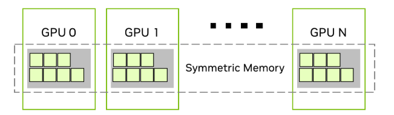

# Symmetric Memory over NVLink

FlashInfer's NVLink collectives work on symmetric memory: every rank of a group
allocates a buffer of the same size, and every rank maps every peer's buffer
into its own virtual address space, so a kernel reads and writes peer memory
with plain loads and stores.

<p align="center"></p>
<p align="center"><em>Symmetric memory registration across GPUs. (Image source: <a href="https://developer.nvidia.com/blog/enabling-fast-inference-and-resilient-training-with-nccl-2-27/">NVIDIA NCCL 2.27 blog</a>)</em></p>

Two classes in [`flashinfer/comm/mnnvl.py`](../../flashinfer/comm/mnnvl.py)
provide it:

| | `MnnvlMemory` | `SymmDeviceMemory` |
|---|---|---|
| Users | MoE all-to-all workspaces (`flashinfer.moe_ep` NVLink one-sided, Cake, two-sided), `dcp_alltoall` | All-reduce workspaces (`trtllm_ar`, `McastGPUBuffer` for `trtllm_mnnvl_ar`), the SM90 push-style MegaMoE |
| Group | Derived from a `Mapping` and cached on the class (`MnnvlMemory.get_comm`); one group and one device per process | The `CommBackend` passed to the constructor (MPI by default) |
| Virtual addresses | One reservation per process, shared by allocations: `group_size * rank_stride` bytes, the stride a multiple of 512 MB; allocations are packed at increasing offsets and the reservation is freed when its last allocation closes | One reservation per instance: `group_size * allocation_size` bytes, rank `i` at offset `i * allocation_size` |
| Peer `i` of an allocation at `ptr` | `ptr + i * rank_stride` | `get_unicast_ptr(i)` |
| Multicast | No | Optional: one multicast object bound to every rank's buffer, mapped at `get_multicast_ptr()` |
| Extras | — | A signal pad after each rank's buffer; Lamport initialization for the one-shot all-reduce |

## Allocating and sharing the physical memory

Each rank backs its buffer with `cuMemCreate` and exports a shareable handle;
the peers import it and map it. The handle type decides how the handles
travel:

- **FABRIC** handles are opaque bytes that any rank in the NVLink domain can
  import, on any host. They move through the `CommBackend`'s object
  collectives. Creating one needs IMEX channel 0
  (`/dev/nvidia-caps-imex-channels/channel0`, passed into containers with
  `--device` or `NVIDIA_IMEX_CHANNELS=0`) and, across hosts, the
  `nvidia-imex` service on every node.
- **POSIX file descriptors** move between processes over AF_UNIX sockets with
  `SCM_RIGHTS` ([`fd_exchange.py`](../../flashinfer/comm/fd_exchange.py)), so
  they work only within one host. They need no IMEX channel.

`allocate_mnnvl_handles` does this for both classes. It is collective over the
group, and every rank of the group always takes the same path:

```text
allocate_mnnvl_handles(comm, dev_id, make_prop)
    handle_type, single_host = choose_mnnvl_handle_type(comm, dev_id)
    attempt(handle_type)
    if it failed, handle_type is FABRIC and single_host:
        attempt(POSIX)                     # warn once per process
    if it still failed: raise with every rank's error

choose_mnnvl_handle_type(comm, dev_id)      # one allgather of (host, reason, cluster UUID)
    one host:   FABRIC if every GPU reports FABRIC support, else POSIX
    many hosts: FABRIC if every GPU reports FABRIC support and the same
                non-zero NVML fabric cluster UUID, else raise with each rank's reason

attempt(handle_type)                        # _create_and_import_handles
    create and export this rank's allocation
    vote; if any rank failed: release, return the errors
    exchange the handles; import every peer's
    vote; if any rank failed: release everything, return the errors
```

The decision depends only on what the ranks report in that call, so nothing is
remembered between allocations: ranks that allocate in different groups cannot
disagree. The votes turn a failure on one rank into the same outcome on all of
them instead of leaving the others blocked in a collective.

FABRIC support is reported by `CU_DEVICE_ATTRIBUTE_HANDLE_TYPE_FABRIC_SUPPORTED`.
Recent user-mode drivers (`libcuda` 615 and 620) report 0 when the process has
no IMEX channel, so the precheck already picks POSIX. Older ones (`libcuda`
595) report 1 regardless, and `cuMemCreate` then fails with
`CUDA_ERROR_NOT_PERMITTED`; the attempt catches this and, on one host, every
allocation retries with POSIX file descriptors. Failures that no attribute
shows, such as a peer that cannot import across hosts, also surface in the
attempt.

The callers' `make_prop(handle_type)` builds the allocation properties and
size for the handle type being tried. `SymmDeviceMemory` sizes its buffer
there, including the multicast granularity. `MnnvlMemory` must place the
allocation in its address reservation before the handle type is settled, so it
sizes allocations with a granularity that fits both handle types.

## `MnnvlMemory`

```python
memory = MnnvlMemory(mapping, size)        # collective over the mapping's group
workspace = memory.as_torch_strided_tensor(torch.uint8)  # [group_size, size], row i = rank i
```

`open_mnnvl_memory` checks that every rank asks for the same size, rounds it
up to the granularity, reserves a new address range when the current one is
full, and maps every rank's allocation at `start + i * rank_stride + offset`.
`allocated_map` keeps a record per allocation (handles, offsets, handle type)
and `address_refcnt` counts the allocations of each reservation.
`fabric_handles` tells whether an allocation uses FABRIC handles.

Owners of a workspace can release and restore its physical memory for process
checkpoint/restore while keeping its virtual addresses
(`unmap_mnnvl_memory` / `remap_mnnvl_memory` in
[`nvlink_common.py`](../../flashinfer/moe_ep/backends/split/comm/nvlink_common.py)).
The restore runs `allocate_mnnvl_handles` again over a fresh `CommBackend`, so
it may settle on a different handle type, which the record then stores.

## `SymmDeviceMemory`

```python
memory = SymmDeviceMemory(buf_size, group_size, group_rank, device_idx, comm_backend)
memory.get_unicast_ptr(i)                  # rank i's buffer
memory.get_multicast_ptr()                 # stores reach every rank's buffer
```

After `allocate_mnnvl_handles`, the unicast buffers are mapped back to back in
the instance's reservation. With multicast enabled, rank 0 creates the
multicast object with the same handle type as the unicast buffers and
broadcasts its handle; every rank imports it, maps it and binds its own buffer
to it. Each buffer is followed by a signal pad, zeroed by its owner, that the
all-reduce kernels use for cross-rank flags.

`_unmap_and_release_handles` and `_create_and_map_handles` release and restore
the physical memory with the same addresses; the all-reduce workspaces expose
them as `checkpoint_prepare` and `checkpoint_restore` (see
[`docs/api/comm.rst`](../api/comm.rst)).

## Interaction with CFT counted writes

The NVLink one-sided all-to-all can bind its workspace to CUDA logical
endpoints (CFT counted writes), which only accept memory shared through
FABRIC handles. The workspace layout depends on whether CFT is used, so the
backend decides before allocating, from `MnnvlMemory.uses_fabric_handles` (the
precheck above). If the allocation then falls back to POSIX file
descriptors, binding is skipped and the backend uses its fence path.
