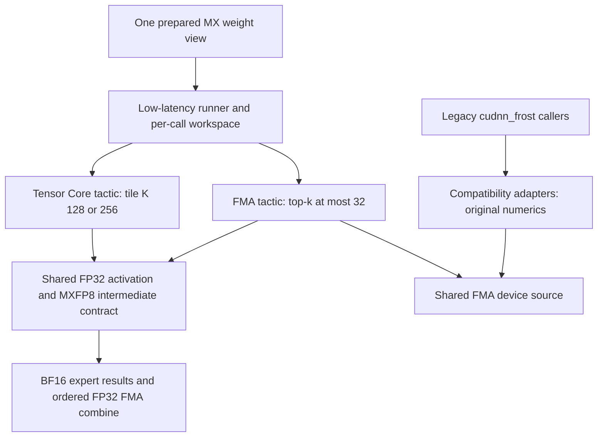
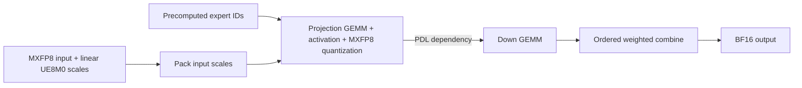
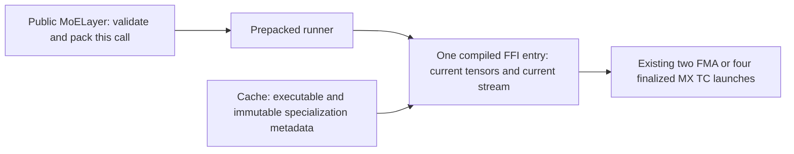
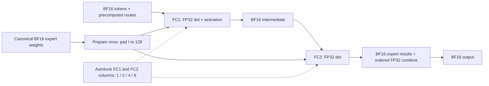
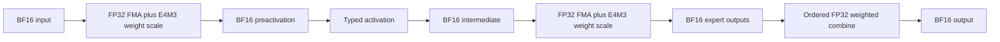
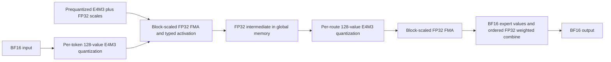
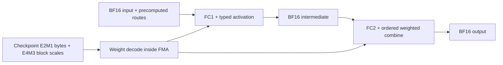
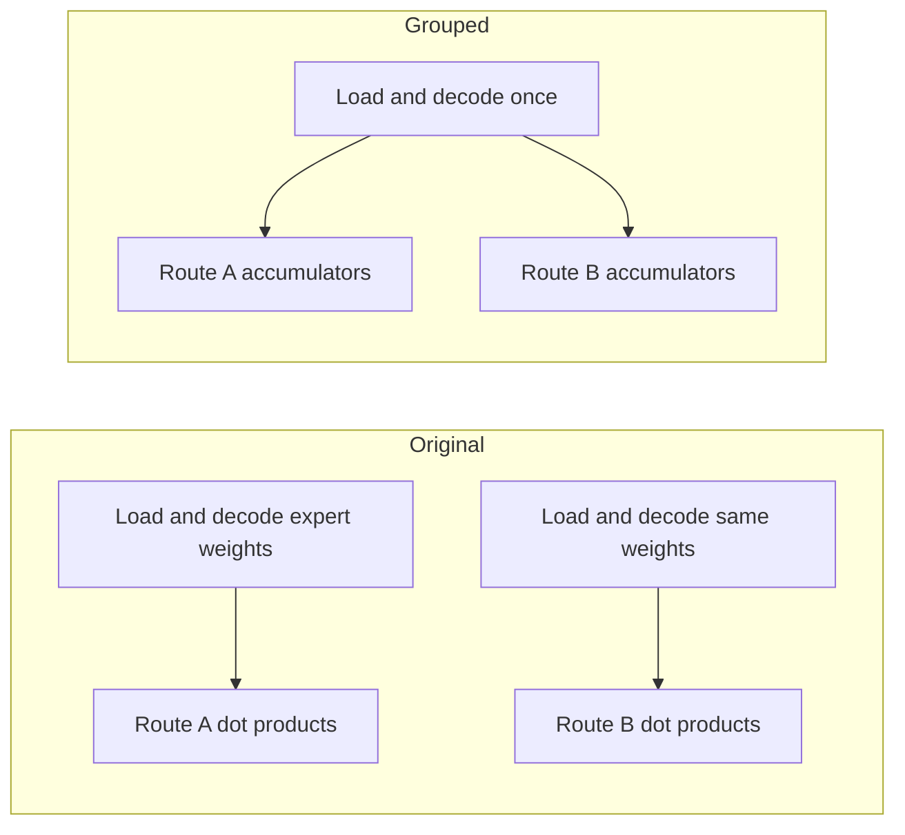
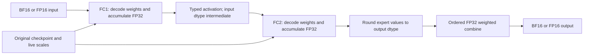

# FROST low-latency routed MoE

`FrostLowLatencyConfig` adds an explicit low-token candidate to `MoELayer` on
SM100/SM103/SM107, with FMA coverage on SM80, SM90 and SM120 and bounded
grouped Tensor Core candidates on SM80/SM90/SM120.
SM80 admits BF16/FP16 inputs and weights; its other quantized formats remain unsupported.
SM90 admits BF16, FP16, ordinary per-tensor FP8, DeepSeek block FP8 and
NVFP4/MXFP4/MXINT4 weights with BF16/FP16 activations. MXFP8 inputs and NVFP4 activations remain
unsupported on SM90. The MX Tensor Core path uses
CuTe DSL and the existing FlashInfer low-latency blockscaled GEMM's TMA
producers and epilogue. It does not depend on cuDNN.

This backend is opt-in: the default `MoEConfig` candidate list does not include
`FrostLowLatencyConfig`. Add it explicitly and prepare a `frost_low_latency`
weight view to include it in cross-backend selection. Upgrading FlashInfer alone
does not redirect existing calls to this backend.

The backend owns both scalar FMA and Tensor Core tactics. FMA reuses the device
implementation previously embedded in `cudnn_frost`. For MX, both tactics read
the same prepared weights. Switching MX tactics needs no second
weight copy, requantization, or per-call layout conversion. Autotuning compares
the complete pipelines. The MX untuned default remains Tensor Core on SM100/103/107
and uses FMA on SM120. BF16, FP16 and ordinary per-tensor FP8 use
shared FMA kernels and independently tune one, two, four or eight output
columns per warp in FC1 and FC2.

Ampere SM80, Hopper and SM120 additionally offer grouped Tensor Core tactics for the qualified BF16 input,
weight and output workload: default SwiGLU, H=2048, I=512, top-k=10,
T=4 or T=8, with finalization. Hopper offers three WGMMA pipeline depths: T4 uses K128 and T8 uses K64,
with two matching routes per weight load. SM120 offers two warp-MMA
configurations at T4 and four at T8, varying route-group size, K tile and depth.
They were selected from 15 valid configurations; warm and cold cases can prefer
different groups and tiles.
SM80 offers one cp.async + warp-MMA configuration per token count:
T4 uses group4/K128/stages4 and T8 uses group4/K64/stages2.
It also admits H7168/I2048/top-k8 at T4/T8 with group8/K64/stages2.
At H2048/I512/top-k10, SM80 also offers the same small-shape choices for
FP16 SwiGLU and BF16/FP16 ReLU2 with matching input/weight/output types.
On SM90/SM120, FP16 input/weight/output adds the same default SwiGLU shape at T4/T8.
On Hopper it offers group2/stages4 with K64 or K128 at T4 and K64 at T8.
BF16 and FP16 ReLU2 are additionally offered at T8 on Hopper (group2/stages4/K128),
and T4/T8 on SM120 using the same bounded warp-MMA choices.
BF16/FP16 GeGLU also uses T4/T8; Hopper uses group2/stages4 with K128 at T4
and K64 at T8. SiLU follows the ReLU2 bounds: Hopper T8, SM120 T4/T8.
SM120 additionally offers BF16/FP16 GeGLUTanh and default SiTU/SwiGLUStep
at T4/T8 with the same bounded warp-MMA choices. Supported custom SwiGLU/
SwiGLUStep parameters, mixed output dtypes and other activations retain FMA-only
candidates. Custom SiTU parameters remain unsupported by both paths.
The grouped implementation, typed epilogues and buffer ownership are shared;
on SM90/SM120 this extension changes candidate admission, not the device pipeline.
The original 16 FMA choices remain available and the untuned default remains FMA.
Other workloads retain their existing advertised tactics.

All three paths read the same prepared weights as FMA. Each CTA discovers live
matching expert IDs and loads original up/gate weight slices. SM80 uses cooperative
128-bit cp.async copies; Hopper and SM120 use TMA. The projections use
WGMMA on Hopper and warp MMA on SM80/SM120. FC1 applies the shared activation before writing
the typed intermediate. FC2 writes typed expert partials, followed by the same
ascending-slot FP32 multiply/add combine contract. It needs neither an offline
interleaved weight copy nor FP32 projection scratch. Repeated, invalid and
changing routes are handled at execution time; no route values enter the compile
cache. The shared runtime binds current input/output buffers and stream for every
call, including replay with changed routes and independently captured buffers.
Reuse-heavy cases can benefit, while disjoint routes still favor FMA.
An autotuned choice remains dependent on the profiling routes and cache state;
this is not a universal token-count heuristic.

Frost uses the existing FlashInfer autotuner. Each runner retains its own
tuning policy; cross-backend selection measures packing plus forward with the
existing CUDA Graph benchmark. The shared individual-call timing mode and its
MoE integration are deferred to separate autotuner work.

The performance tables below are benchmark-selected, fixed-tactic kernel GPU
measurements from the recorded source revisions. Each section records its
timing method and condition-specific tactic sweep; those
results do not guarantee that ordinary autotuning selects the same tactics.
The split leaves device kernels, numerical contracts and default tactics
unchanged, but changes how automatic selection ranks candidates. Frost's tuning
cache identity is updated so it does not reuse winners from the deferred timing
mode. These are kernel GPU measurements, not model decode-step latency or
throughput.



Code sharing does not make the old and new numerical contracts interchangeable:

| Boundary | Low-latency FMA and TC | Legacy MX FMA adapter |
|---|---|---|
| Activation before MXFP8 quantization | FP32 | Rounded to BF16 first |
| Activation parameters | Layer's typed activation and supported scalar parameters | Existing admitted defaults |
| Expert result | BF16 | BF16 |
| Weighted combine | Slot-ordered FP32 FMA | Separate FP32 multiply and slot-ordered add |

Legacy entry points preserve these behaviors. Their compatibility mode is fixed
by the adapter and is never an autotuning choice in the low-latency backend.
Dot-product accumulation order may differ between FMA and Tensor Core; the
independent reference tests enforce the documented numerical tolerances.



Compared with composing standalone low-latency GEMMs and an activation/quantizer,
this pipeline removes the separate activation/quantization launch. GU's FP32
accumulators still pass through per-call global scratch before activation; this
is not an all-on-chip pipeline. Native MoE backends can already fuse activation,
so fusion alone does not explain the comparison with them.
Runtime expert IDs select weights directly, avoiding
sorting tokens into expert groups for tiny batches. Eight warps per CTA and a
smaller tensor-memory allocation reduce resources per independent route tile.
PDL lets the Down weight producer start early while its activation producer
waits for the preceding kernel to finish. This remains a multi-kernel pipeline.

## Warm host submission

Each Frost tactic has one compiled TVM-FFI entry for its projection,
activation and combine launches. A warm call passes the current PyTorch tensors
directly to that entry. DLPack conversion is used when compiling the entry, rather than once
per tensor per launch. MX FMA's scale-workspace view and MX Tensor Core's
pointer descriptors are formed inside the compiled entry.



The compile cache owns no input/output tensors, workspace or CUDA stream.
Independent calls bind independent storage, including when threads share a
compiled entry. Callers must still warm up each specialization before CUDA
Graph capture. The device kernels, numerical contracts, tactics and PDL
dependencies are unchanged. Legacy `cudnn_frost` adapters retain their existing
entry points. Existing Frost callers use the new entry automatically, with no
API changes. Raw output still creates its identity-index tensor per call.

### B300 host qualification

These results compare main `3f398977d` (after #7053 merged) with the host
implementation measured at `91ae8a699`. Full revisions and production-source
hashes are recorded in the [machine-readable results](frost_low_latency_host_b300.json).

Across 81 primary cases, two opposite-order processes give **2.85–4.65×**
faster warm public API submission and **5.35–9.77×** for the prepacked runner.
The cases cover BF16, MXFP4/MXFP8, MXFP8/MXFP8 and NVFP4, T=1/2/4, and
SwiGLU/SiTU/SiLU. H=2048, physical I=1408, E=64, top-k=6. The same tactic,
tensor contents and GPU workspace addresses are used on both sides.

Representative T=1 SwiGLU rows below use the median of the two process medians.
All times are microseconds; public and runner columns measure CPU enqueue,
while the last column measures GPU time per MoE call.

| Path | Public API before → after | Host speedup | Prepacked runner before → after | GPU before → after |
|---|---:|---:|---:|---:|
| BF16 FMA | 106.04 → 35.81 | 2.96× | 83.25 → 14.64 | 26.63 → 26.65 |
| MXFP4 TC128 | 260.85 → 61.85 | 4.22× | 217.82 → 24.90 | 10.33 → 10.33 |
| MXFP4 FMA | 154.30 → 47.30 | 3.26× | 117.98 → 14.33 | 17.25 → 17.25 |
| MXFP8 TC128 | 256.21 → 60.98 | 4.20× | 213.17 → 25.74 | 10.50 → 10.50 |
| MXFP8 FMA | 152.79 → 47.38 | 3.23× | 116.25 → 15.13 | 24.52 → 24.52 |
| NVFP4 FMA | 162.43 → 48.37 | 3.36× | 125.88 → 16.02 | 13.23 → 13.23 |

B300/SM103, Python 3.12.15, PyTorch 2.14.1+cu130, CuTe DSL 4.8.0,
apache-tvm-ffi 0.1.11, Xeon Platinum 8570. The CPU is shared. A/A public timing
ratios range from 0.989 to 1.011; GPU changes are within
-0.32% to +0.26% across both process orders, compared with
-0.28% to +0.27% for A/A. Plain graph-replay CPU time
has a median of 2.94 µs per replay of a 50-call graph; it is not divided by 50.
GPU timing uses repeated fixed-input graph replay without an L2 flush.
These results do not establish a GPU-time or model-throughput improvement.
A smaller H=512/I=128/E=8/top-k=2 control covers 27 SwiGLU cases and gives
2.93–4.22× public API and 5.57–8.43× prepacked-runner improvement.

Current-main B300 qualification passed 166 tests. Two noncurrent-device cases
were skipped because this allocation exposes one GPU.
The same production sources previously passed 149 tests on SM107 before the
main rebase. Tests cover fresh tensor bindings, concurrent threads/streams,
changed-input graphs, storage ownership and independent numerical references.

Use `benchmarks/bench_frost_host_overhead.py` with the recorded baseline and
candidate revisions. The following commands reproduce the primary protocol
against a separate baseline checkout:

```bash
args=(--tokens 1 2 4 --activations swiglu situ silu \
      --repeats 101 --calls-per-graph 50)
python benchmarks/bench_frost_host_overhead.py "${args[@]}" \
  --baseline-root /path/to/baseline-checkout --output host-ab.json
python benchmarks/bench_frost_host_overhead.py "${args[@]}" \
  --baseline-root /path/to/baseline-checkout --output host-ba.json --reverse
python benchmarks/bench_frost_host_overhead.py "${args[@]}" \
  --baseline-root "$PWD" --output host-aa.json
```

The benchmark records source hashes and requires identical shared API/dispatcher
wrappers. Both sides use the same fixed tactic, prepared weight contents and
shape. It measures public API, packing, prepacked runner and graph-replay CPU
times separately, with device synchronization outside each CPU interval.
CPU replay uses a graph without instrumentation. External CUDA event nodes
inside a separate captured graph measure GPU time. Both GPU timing graphs bind
the same workspace addresses to avoid allocation-dependent A/A differences.
Independent call buffers and per-replay output snapshots check correctness.
Numerical checks compare both implementations and public/replay
outputs after changing route IDs and weights. Compilation, initial selection,
weight preparation and input quantization are outside timing. A/A controls and
independent reversed-order runs help distinguish small GPU differences from
measurement noise. Host savings do not imply a corresponding CUDA Graph
GPU-time or model-throughput improvement.

## Current B300 kernel results

Each comparison holds GPU, shape, activation, cache and routing pattern fixed.
These are local routed-MoE GPU measurements. Model-shaped kernel tests are not
model-throughput tests, and TP-local weight slices do not measure communication.
The two dtype cohorts below have different numerical boundaries.

### BF16

These unquantized BF16 shape proxies are measured with
`benchmarks/bench_frost_low_latency_bf16.py`. Each row compares complete routed
MoE GPU calls on the same B300, shape, activation, cache and expert-reuse
condition. This includes GPU adapters and combine; it excludes host submission,
weight preparation, router selection, shared experts and communication.
Model-shaped kernel measurements are not model throughput tests.

| Activation | H / I / E / K | T | Cache / reuse | Fastest tested original | Original µs | Frost µs | Speedup |
|---|---|---:|---|---|---:|---:|---:|
| swiglu | 2048 / 512 / 512 / 10 | 1 | warm / disjoint | trtllm_default | 27.736 | 15.460 | 1.794× |
| swiglu | 2048 / 512 / 512 / 10 | 2 | warm / disjoint | trtllm | 44.144 | 31.872 | 1.385× |
| situ | 2048 / 1408 / 64 / 6 | 2 | warm / disjoint | cutlass | 60.424 | 46.056 | 1.312× |

The SwiGLU rows admit TRT-LLM, CUTLASS, Prims-TS and cuDNN grouped GEMM,
including defaults. For SiTU, CUTLASS is the only admitted native candidate in
this B300/software configuration. cuTile and legacy cuDNN Frost decline this
architecture; all requested but unsupported/failing candidates remain recorded. The JSON records
which backends were admitted in each row, search counts and numerical checks.
Runner-advertised spaces can be factorized shortlists; this is not a claim
against every possible FlashInfer configuration. Selection is frozen before
separate normal/reverse validation processes. Only qualified comparisons are
shown, and sub-1% differences mean parity. A selected-pair qualification does
not imply every slower candidate is stable.

Software: B300/SM103, PyTorch 2.13.0+cu130, CUDA 13.0, CuTe DSL 4.8.0,
CUDA Python bindings 13.4.3 and cuDNN 9.27. The benchmark records the exact source
hash. See [BF16 results and controls](frost_low_latency_bf16_b300.json), including
excluded comparisons and an independent comparison against the best prior
FC2=4 tuning space. BF16 uses a separate numerical contract from the MX
performance tables; do not combine their ratios.

### PowLU across the shared epilogues

`PowLU(m=2.5, limit=None)` now uses the existing Frost FC1/activation and
FC2/combine pipeline across the supported weight and activation formats.
The positive gate uses a power with an input-dependent exponent; the
non-positive gate uses SiLU. An optional limit clamps the activated gate
from above and the linear branch symmetrically. Parameters remain part of
the compiled specialization. Accurate log/sqrt/power evaluation preserves
positive subnormals for small `m`, and the power at positive infinity is one.

The following BF16 kernel-call comparison uses H2048/I512/E512/K10,
`PowLU()` and disjoint expert routes. The baseline is CUTLASS with each
GEMM stage tuned, followed by a comparison of the top-two-by-top-two pairs
and the heuristic configuration. This is not an exhaustive compound search.
Frost selects among all 16 column pairs and its default. Table entries are
the median of two independent frozen-winner validation processes.

| GPU | T | Warm CUTLASS → Frost µs | Speedup | Cold CUTLASS → Frost µs | Speedup |
|---|---:|---:|---:|---:|---:|
| H100 | 1 | 52.648 → 25.500 | 2.065× | 58.640 → 32.704 | 1.793× |
| H100 | 2 | 69.272 → 42.568 | 1.627× | 78.168 → 52.388 | 1.492× |
| H100 | 4 | 101.464 → 76.512 | 1.326× | 110.780 → 86.340 | 1.283× |
| H100 | 8 | 170.532 → 142.504 | 1.197× | 178.608 → 151.828 | 1.176× |
| B200 | 1 | 44.292 → 12.064 | 3.671× | 51.636 → 19.880 | 2.597× |
| B200 | 2 | 52.600 → 27.692 | 1.899× | 58.736 → 35.552 | 1.652× |
| B300 | 1 | 38.840 → 14.748 | 2.634× | 52.392 → 26.228 | 1.998× |
| B300 | 2 | 63.408 → 39.612 | 1.601× | 69.052 → 48.772 | 1.416× |
| B300 | 4 | 96.520 → 74.052 | 1.303× | 105.348 → 84.360 | 1.249× |
| B300 | 8 | 161.608 → 143.004 | 1.130× | 170.176 → 153.292 | 1.110× |

Larger experts reduce the margin even at T=1. With H7168/I2048/E256/K8,
the same selection and validation procedure gives:

| GPU | Warm CUTLASS → Frost µs | Speedup | Cold CUTLASS → Frost µs | Speedup |
|---|---:|---:|---:|---:|
| H100 | 228.776 → 201.276 | 1.137× | 238.188 → 211.036 | 1.129× |
| B300 | 213.428 → 200.792 | 1.063× | 222.368 → 211.500 | 1.051× |

Both backends pass the independent FP64-dot reference with BF16 intermediate
and expert-output boundaries, packed BF16 routing scores, and FP32 combine
(1% relative L2 / 3% normalized maximum; not bitwise equality). The complete
[measurement record](../benchmarks/data/frost_powlu_bf16_20261024.json)
includes configuration ranking, source/environment identity, samples,
forward/reverse order, duplicate A/A captures and graph-output checks.

H100 uses external CUDA-event intervals. B200/B300 use globaltimer intervals
because the initial B300 individual-call CUDA-event samples were coarsely
quantized. The B300 empty interval is approximately 0.46 µs, retained in
both timings rather than subtracted. Cold tests evict at least 512 MiB
before each measured call; eviction is outside the interval. These are
complete routed-expert GPU-call times, including backend adapters and
combine, excluding routing selection, shared experts, communication, host
submission and serving throughput. The gain narrows as T grows: at T=8 it
is about 1.18–1.20× on H100 and 1.11–1.13× on B300. These cases do not
establish a win for every model shape.

```bash
python benchmarks/bench_frost_low_latency_bf16.py \
  --activation powlu --tokens 1 --backends cutlass --cache-mode warm \
  --timer globaltimer --select --output powlu-selection.json
python benchmarks/bench_frost_low_latency_bf16.py \
  --activation powlu --tokens 1 --backends cutlass --cache-mode warm \
  --timer globaltimer --selection powlu-selection.json --output powlu-forward.json
python benchmarks/bench_frost_low_latency_bf16.py \
  --activation powlu --tokens 1 --backends cutlass --cache-mode warm \
  --timer globaltimer --selection powlu-selection.json --reverse --output powlu-reverse.json
```

Use `--timer cuda-event` for the H100 cohort, and repeat selection for each
new token count, cache mode, source revision or software environment.

### MXFP4/MXFP8 with clamped SwiGLU

This separate cohort uses H2048/I512/E512/K10, MXFP8 activations, BF16 output,
warm/disjoint routes and SwiGLU limit=10. Its benchmark source is `7caaa1802e44`.
Runner-advertised searches completed for TRT-LLM (2,401 candidates), CUTLASS
(5), Prims-TS (1,074 W4 / 1,007 W8), Frost (4), and native CuTe DSL
(33 W4 candidates). Factorized runners expose stage-ranked shortlists rather
than every theoretical configuration.

| Weights | T | Measured original set, including defaults | Fastest named original | Original µs | Frost µs | Speedup |
|---|---:|---|---|---:|---:|---:|
| MXFP4 | 1 | TRT / CuTe / CUTLASS / Prims | CuTe DSL default | 21.616 | 13.440 | 1.608× |
| MXFP4 | 4 | TRT / CUTLASS / Prims | TRT-LLM tuned | 31.852 | 21.632 | 1.472× |
| MXFP8 | 4 | TRT / CUTLASS / Prims | TRT-LLM default | 40.008 | 31.816 | 1.257× |

These displayed pairs pass normal/reverse-process controls and six changed-input
plus post-timing correctness checks. The W4/T1 selected pair is stable while a
slower default candidate varies across processes. Both displayed T4 rows pass
all-candidate controls within their listed native sets. The separate W4/T4 run
including CuTe fails the exact-winner agreement rule; the narrower 1.472× row
therefore makes no claim against native CuTe. Other failed comparisons remain
excluded, with their raw samples and controls preserved.

Native backends use their declared intermediate-rounding references and unchanged
tolerances; only the new Frost FMA/TC tactics share one numerical contract.
Software is B300/SM103, PyTorch 2.13.0+cu130, CUDA 13.0 and CuTe DSL 4.8.0.
[Results, candidate counts, commands and controls](frost_low_latency_b300_native.json)
record the exact source and comparison scope. Do not combine these ratios with
the BF16 table or the earlier unclamped-SwiGLU cohort.

## Supported contract

| Property | Support |
|---|---|
| Architecture | SM80: BF16/FP16 FMA and bounded grouped BF16/FP16 warp MMA, top-k <= 32; SM90: BF16/FP16/per-tensor FP8/DeepSeek block FP8/NVFP4-MXFP4-MXINT4-weight BF16/FP16-activation FMA, top-k <= 32, plus grouped BF16/FP16 WGMMA for the qualified workload above; SM100/103/107: FMA and MX Tensor Core; SM120: FMA, top-k <= 32, plus grouped BF16/FP16 warp MMA for the qualified workload above |
| Input | Static per-tensor E4M3 FP8; E4M3 MXFP8 with linear group-32 UE8M0 scales; packed NVFP4 with linear group-16 E4M3 scales; or unquantized BF16/FP16 |
| Weights | Per-tensor FP8 input: per-expert E4M3 FP8 with static calibration; MX input: MXFP4 or MXFP8 with group-32 UE8M0 scales; NVFP4 input: NVFP4 with group-16 E4M3 scales; unquantized input: matching BF16/FP16 weights, or E4M3/NVFP4/MXFP4/MXINT4 weight-only checkpoints with BF16/FP16 input and output |
| Output | Quantized paths: BF16; unquantized paths: BF16 or FP16. Finalized or raw token/slot-ordered expert rows |
| MX activation | SwiGLU, SiTU, GeGLU, GeGLUTanh, SwiGLUStep, PowLU, GELU, ReLU, ReLU2, SiLU, Identity |
| BF16 activation | SwiGLU, SiTU, GeGLU, GeGLUTanh, SwiGLUStep, PowLU, GELU, ReLU, ReLU2, SiLU, Identity |
| FP16 / per-tensor FP8 / DeepSeek block FP8 activation | Same eleven activations and scalar restrictions as BF16 |
| BF16 parameters | SwiGLU alpha/beta/limit, SwiGLUStep limit, and PowLU m/optional limit; other activations require their default parameters |
| MX parameters | Same typed scalar restrictions as BF16; activation remains FP32 before MXFP8 quantization |
| MX prepared storage | MXFP4 weight bases must be 32-byte aligned; MXFP8 weights and MX scale tensors must be 16-byte aligned. `prepare_weights` supplies suitable storage; manually sliced views must preserve alignment |
| MX repeated routes | If top-k exceeds E, default and autotuned execution use FMA with top-k <= 32. MX Tensor Core tactics require top-k <= E |
| NVFP4 | NVFP4 weights and inputs, BF16 output; shared FMA, the same eleven activations, H divisible by 512, I by 128, top-k <= 32; no 4over6 intermediate quantization |
| BF16/FP16/per-tensor FP8/DeepSeek block FP8 FMA | top-k <= 32; FC1 and FC2 output columns 1/2/4/8 (16 combinations), default 1 and 4; GELU/GeGLU require compiler `erf` support |
| MX/BF16/FP16/per-tensor FP8 geometry | H divisible by 128; logical I divisible by 32, padded to 128 |
| DeepSeek block FP8 | E4M3 weights, arbitrary FP32 128×128 scales; BF16 input or prequantized E4M3 with FP32 1×128 scales; H and I divisible by 128; FP32 preactivation, BF16 output |
| Token rows | 1–2 by default; explicitly configurable up to 8 |
| Routing | Packed or unpacked precomputed IDs; valid IDs in `[0, E)` |
| Parallelism | Local expert computation, including TP weight slices; no EP shards or communication |
| Compiler | `nvidia-cutlass-dsl >= 4.8` |

This candidate is omitted from the default backend list. Include a prepared
native backend for larger inputs and for shapes where it wins. Correctness
coverage at T=8 is not a claim that this schedule is faster at T=8. Separate
shared experts, input quantization, router computation, communication, attention
and full decode-forward fusion are outside this backend.

## Use with the unified API

The weight helper accepts **prequantized** canonical tensors, preserving their
bytes. `w1` is `[E, 2I, H/pack]` in **[up, gate]** order; `w2` is
`[E, H, I/pack]`. `pack=2` for MXFP4 and 1 for MXFP8. Weight scales are
`[E, rows, K/32]` UE8M0 bytes. Preparation pads I and rearranges gate/up tiles and
scales; it does not dequantize or requantize the checkpoint.

For non-gated MX activations, pass `activation=...` to `prepare_weights` and
provide `w1` with shape `[E, I, H/pack]`. Both FMA and Tensor Core tactics omit
the gate projection. Gated activations retain the existing striped weight view.
The default remains SwiGLU, so existing four-argument preparation calls retain
their layout and arithmetic. These additional activation combinations require
their own measurements; the historical SwiGLU tables are not evidence for them.

For NVFP4, `prepare_nvfp4_weights(w1_bf16, w2_bf16, activation=...)` reuses the
canonical CUTLASS NVFP4 preparation with unit global scales. Prepare activations
with `TrtllmFp4Config.prepare_activations(..., quant=quant)` and configure
`QuantConfig(weight=QuantFormat.NVFP4, activation=QuantFormat.NVFP4,
nvfp4_4over6=None)`. The scale payload is linear E4M3 with groups of 16.
The two FMA tactics compute two or four FC1 outputs per warp. FC1 rounds its
activation to BF16 before NVFP4 quantization; FC2 rounds expert outputs to BF16
and combines them with ordered separate FP32 multiplication and addition. Raw
output retains token/slot order. This numerical contract is distinct from MX.
The unified NVFP4 quantizer preserves exact E2M1 midpoint ties with
round-to-nearest division; the legacy adapter retains its approximate-reciprocal
behavior. An enabled 4over6 recipe is rejected, including a later environment change.

```python
from flashinfer.autotuner import autotune
from flashinfer.fused_moe import (
    BackendOptions, ExpertConfig, FrostLowLatencyConfig, MoEActivationPack,
    MoEConfig, MoELayer, MoEWeightPack, QuantConfig, QuantFormat, RoutingConfig,
    SwiGLU,
)

weights = MoEWeightPack()
weights.prepare_for(
    "frost_low_latency",
    FrostLowLatencyConfig.prepare_weights(w1_q, w1_sf, w2_q, w2_sf),
)
config = MoEConfig(
    routing=RoutingConfig(num_experts=E, top_k=K),
    quant=QuantConfig(weight=QuantFormat.MXFP4, activation=QuantFormat.MXFP8),
    experts=ExpertConfig(intermediate_size=I),  # logical I, before padding
    activation=SwiGLU(alpha=1.0, beta=0.0, limit=10.0),
    backend=BackendOptions((FrostLowLatencyConfig(),)),
)
layer = MoELayer(config)
act = MoEActivationPack(x_q, x_linear_ue8m0_scale, topk_ids, topk_weights)
with autotune(True):
    y = layer(act, weights)  # select tactic and warm up before CUDA Graph capture
```

For unquantized BF16, prepare `[E, 2I, H]` **[up, gate]** weights for gated
activations or `[E, I, H]` for non-gated activations, plus `[E, H, I]` Down
weights. Use the same typed activation in preparation and configuration:

```python
from flashinfer.fused_moe import SiTU

activation = SiTU()
weights = MoEWeightPack()
weights.prepare_for(
    "frost_low_latency",
    FrostLowLatencyConfig.prepare_bf16_weights(w1_bf16, w2_bf16, activation=activation),
)
config = MoEConfig(
    routing=RoutingConfig(num_experts=E, top_k=K),
    quant=QuantConfig(weight=QuantFormat.BF16, activation=QuantFormat.BF16),
    experts=ExpertConfig(intermediate_size=I),
    activation=activation,
    backend=BackendOptions((FrostLowLatencyConfig(max_num_tokens=8),)),
)
layer = MoELayer(config)
act = MoEActivationPack(x_bf16, None, topk_ids, topk_weights)
with autotune(True):
    y = layer(act, weights)
```

The finalized BF16 path has two launches: FC1 with activation, then FC2 with
combine. Raw output also materializes the route-row mapping and, for packed
routing, converts scores to BF16. It uses FP32 dot products, BF16
intermediate/expert outputs, and
separate FP32 multiply/add in slot order. These are the shared legacy BF16
numerics, not the MX intermediate quantizer or FMA-combine contract. Different
BF16 tile candidates preserve this same numerical boundary. This extension is
functional coverage; the MX performance tables below do not establish BF16 gains.

For FP16, prepare FP16 tensors with
`FrostLowLatencyConfig.prepare_fp16_weights(w1, w2, activation=activation)` and
set `QuantConfig(weight=QuantFormat.FP16, activation=QuantFormat.FP16,
output=QuantFormat.FP16)`. The same two FMA device bodies decode FP16 instead
of BF16, accumulate in FP32 and round the activation to the input dtype.
FC2 rounds expert results to the configured output dtype before the ordered
FP32 combine. Dense BF16/FP16 inputs may independently select BF16/FP16 output;
omitting `output` retains the API's BF16 default. Packed routing scores always
retain their BF16 rounding, even when the input and output are FP16.

SM120 uses the same FMA numerical contracts. It does not enumerate or execute
the SM100-family tcgen05/TMEM tactics; MX and NVFP4 continue to produce BF16.
Historical B300 tables do not establish FP16 or SM120 speedups. The following
measurements qualify one FP16 workload on SM120.

Native SM120 BF16/NVFP4 T5–8 also has a bounded Tensor Core extension.
See the [updated native-baseline comparison](sm120_w4a16_decode.md) before
using historical T8 Frost speedups.

### FP16 on SM120

NVIDIA RTX PRO 6000 Blackwell Workstation Edition, CUDA 13.0,
PyTorch 2.14.1+cu130, CuTe DSL 4.8.0. H=2048, I=512, E=512, top-k=10,
SwiGLU, FP16 input/weights/output. These are synthetic tensors at common model
geometry, not a checkpoint or serving measurement.

The baseline is the existing flat `cutlass_fused_moe` FP16 implementation,
which uses SM80-family kernels on this GPU. Selection attempts all 8×8 advertised
GEMM1/GEMM2 pairs plus the default; 16 pairs exceed the device's shared-memory
limit. Frost sweeps all 16 column combinations. Winners are frozen before four
ABBA validation blocks. CUPTI measures the complete first-to-last GPU activity
span of each graph replay, including activation and combine. Cache eviction,
host enqueue, weight preparation, routing selection, shared experts and
communication are outside the measurement.

| T | Expert reuse | Warm CUTLASS µs | Warm Frost µs | Speedup | Cold CUTLASS µs | Cold Frost µs | Speedup |
|---:|---|---:|---:|---:|---:|---:|---:|
| 1 | — | 33.70 | 11.14 | 3.03× | 63.20 | 45.33 | 1.39× |
| 2 | Disjoint | 39.27 | 19.58 | 2.01× | 103.32 | 85.01 | 1.22× |
| 4 | Disjoint | 176.71 | 156.09 | 1.13× | 183.97 | 167.87 | 1.10× |
| 8 | Disjoint | 329.52 | 308.64 | 1.07× | 344.22 | 331.82 | 1.04× |
| 2 | Shared | 34.04 | 19.46 | 1.75× | 63.10 | 45.62 | 1.38× |
| 4 | Shared | 34.62 | 34.08 | 1.02× | 63.43 | 53.37 | 1.19× |
| 8 | Shared | 35.85 | 63.73 | 0.56× | 64.26 | 82.64 | 0.78× |

Shared means all tokens select the same ten experts; disjoint means no expert
overlap across tokens. Warm means repeated operands, not guaranteed L2 residency:
increasing the active expert working set can still make warm runs memory-bound.
FMA's advantage shrinks as T grows, and at T=8 with shared experts the native
Tensor Core pipeline wins. The 1.02× warm T=4 shared result is marginal. Keep
cross-backend selection and do not infer a universal T≤8 FMA preference.

A larger control (H=7168, I=2048, E=256, top-k=8, disjoint routes) shows much
smaller gains: at T=1, warm CUTLASS/Frost is 460.78/431.12 µs (1.07×) and cold
is 479.29/458.26 µs (1.05×). At T=8 the ratios are only 1.02× in both cache
conditions. Removing pipeline overhead matters less when expert-weight traffic
dominates; the small-shape result should not be extrapolated to these experts.

All measured candidates passed the independent numerical reference. A/A ratios
were within 0.3% of one; amortized CUDA-event graph-chain measurements independently
confirmed the warm-cache ranking. Those event times have a different scope and
are retained separately in the [results and controls](frost_low_latency_fp16_sm120.json).

```bash
python benchmarks/bench_frost_low_latency_fp16.py --tokens 1 \
  --hidden 2048 --intermediate 512 --experts 512 --top-k 10 \
  --cache-mode warm --expert-reuse disjoint --output fp16-sm120.json
```

The benchmark requires CUPTI 13+ by default and fails on profiling errors. Its
explicit `--timer globaltimer` option instead reports an interval bracketed by
timestamp kernels, including their boundary overhead; it does not silently
substitute that interval for a CUPTI span.



Use `benchmarks/bench_frost_low_latency_bf16.py` to compare this public entry
with applicable native BF16 backends. The selection process ranks the tactics
exposed by each runner, including its default; factorized runners may expose a
stage-ranked shortlist rather than the full Cartesian product. Failures and
unsupported backends remain explicit exclusions in the JSON.

```bash
python benchmarks/bench_frost_low_latency_bf16.py --select --tokens 1 \
  --hidden 2048 --intermediate 512 --experts 512 --top-k 10 \
  --output bf16-selection.json
python benchmarks/bench_frost_low_latency_bf16.py --selection bf16-selection.json \
  --tokens 1 --output bf16-first.json
python benchmarks/bench_frost_low_latency_bf16.py --selection bf16-selection.json \
  --tokens 1 --reverse --output bf16-reverse.json
```

Keep all workload arguments identical across these processes. The frozen
selection checks source and workload identity; the validation processes do not
repeat the search. `--activation`, `--cache-mode` and `--expert-reuse` select
separate cohorts. Individual CUDA-event intervals inside the graph measure GPU
execution, including routing adapters and combine. They exclude host submission
and preparation; cold-cache eviction is also outside the interval. Changed-input
graph checks and independent A/A captures accompany the timing. Inspect their
stability before reporting a speedup; a successful run alone is not qualification.

For cross-backend selection, include e.g. `TrtllmFp4Config()` in `BackendOptions`
and prepare its weight view too. Per-runner tuning uses each runner's existing
cache policy; native runners can default to cold L2 while Frost defaults to warm
L2. The existing cross-backend comparison uses amortized CUDA Graph GPU time
for packing plus forward. An explicit `MeasurementPolicy` is handled by the
existing per-runner autotuner; it does not change this layer-level comparison.
Use the benchmark's cache-specific sweeps for a common measurement objective.
A missing fallback does not silently choose an unprepared backend; the layer
rejects calls with no eligible candidate. The same activation pack is reusable
across these candidates.
Cross-backend inputs must satisfy every selected backend's routing contract.
In particular, use distinct expert IDs within each token when selecting or
falling back to TRT-LLM. Frost can compute repeated slots independently, but
the native TRT routing map retains only one slot per `(token, expert)`; repeated
IDs are therefore not an equivalent cross-backend input. Signed routing weights
with distinct IDs are covered by the fallback check.
Both candidates must also accept the shared `MoEConfig` geometry. If a native
candidate requires I divisible by 128, prepare both views from the same
explicitly zero-padded canonical weights and use that padded I in their shared
config. A FROST-only configuration can retain the smaller logical I.

Selection is cached by token bucket, routing input mode and eligible candidates.
Changing expert IDs within that bucket does not automatically select a new
backend. Warm up with representative expert reuse and cache conditions; the
benchmark's condition-specific sweeps do not imply a distribution-aware
dispatcher on every decode step.
Enter `autotune(True)` on the layer's first call for the target bucket. Re-entering
that context does not invalidate an existing `MoELayer` backend/tactic winner.
A fresh `MoELayer` re-runs cross-backend selection before graph capture and can
reuse the prepared weight pack, but it may reuse per-runner autotuner records.
To reprofile the same metadata with different routing values, also use fresh
tuning state, for example an isolated process without loading previous tuning
records. Autotuner measurement provenance applies when selection runs, not as
automatic invalidation of this layer-level cache.

The compile cache stores executable metadata. `pack_inputs` owns each call's
scratch tensors, and execution binds current pointers and stream. The packed
routing contract rounds weights to BF16; the unpacked contract preserves BF16
or FP32 weights. Raw outputs preserve this distinction for caller-side combine.
For finalized packed output, BF16 narrowing happens inside the existing combine
kernel. This removes a separate conversion launch while retaining the same
rounding before the ordered FP32 weighted sum. Producers that already supply
BF16 routing weights do not have that launch to remove.

## Reproduce correctness and performance

```bash
pytest tests/moe/test_frost_low_latency.py
python benchmarks/bench_frost_low_latency.py \
  --hidden 5120 --intermediate 1152 --experts 384 --top-k 6 --tokens 1 \
  --include-cutedsl --include-native-default --output first.json
python benchmarks/bench_frost_low_latency.py \
  --hidden 5120 --intermediate 1152 --experts 384 --top-k 6 --tokens 1 \
  --include-cutedsl --include-native-default --reverse --output reverse.json
```

The benchmark prepares all backends from the same canonical weights and uses
the same quantizer, expert IDs, routing-weight inputs and activation parameters.
FROST and TRT-LLM narrow packed routing weights to BF16; the native CuTe DSL
interface retains FP32 weights. Comparisons allow the numerical tolerances below
rather than requiring bitwise equality across those rounding boundaries.
It autotunes each original backend, checks six changing inputs after graph
replay, and verifies outputs again after timing. The default
`--timing-mode latency` brackets each complete call with external event nodes
inside the CUDA Graph. `--timing-mode amortized --cache-mode warm` instead times
128 calls together and divides the replay time by 128. Both retain repeated
original A/A controls. Amortized replay throughput and individual-call latency
are different measurements and can rank the pipelines differently; compare
candidates under the same mode.
Use `--route-pattern disjoint` for distinct experts across tokens or `shared`
for the same top-k set per token. Both modes retain distinct experts within a
token. Each timing graph repeats that routed input; it is not a serving trace.

`--cache-mode cold` sweeps a separate read/write buffer of at least 512 MiB and
twice the device's L2 capacity before each measured call. External CUDA event
nodes inside the graph bracket only MoE, excluding eviction and host enqueue.
The result records the buffer size and queried L2 capacity. Cold and warm
results must be compared separately.

For a selection run, `--retune-cache` ranks every tactic advertised by each
runner with the selected cache and routing pattern, including the native
heuristic and the initial warm-autotuned winner. Every candidate is checked
against the reference. The JSON records candidate timings in `cache_tuning`.
Freeze the selected tactics with the flags below for independent normal and
reverse-order measurements. This enumerates the runner's exposed candidates,
not every configuration its underlying kernel could theoretically implement.
For factorized backends such as CUTLASS and cuDNN grouped GEMM, enumeration
must run inside `autotune(True)` to obtain the stage-ranked candidate pairs;
outside tuning mode their inner tuner returns only a cached or default pair.
Optional `--include-cutlass` and `--include-prims-ts` add the corresponding
original MX backends. `--include-cudnn-grouped` adds the cuDNN grouped-GEMM
backend for `--weight-format mxfp8 --activation-limit 0`; its default SwiGLU
contract cannot replace a clamped-SwiGLU comparison. Requested backends must
pass their architecture, dependency and numerical checks; they are not silently
omitted. `--include-native-default` measures the default of every included
original backend. Pin their measured winners with `--cutlass-tactic`,
`--prims-ts-tactic` or `--cudnn-grouped-tactic`, alongside the existing TRT/CuTe
flags. These options expand reproducible baseline coverage; the tables below
retain their explicitly named original-backend sets.
When a tactic is pinned, initial preparation avoids a redundant full autotune;
the default and requested configuration are still initialized before capture.
`--retune-cache` explicitly requests the candidate sweep even if pins are given.

Ordinary MX SwiGLU in CUTLASS and cuDNN grouped GEMM rounds GEMM1 and
post-activation values to BF16 before intermediate MXFP8 quantization; the
low-latency paths keep FP32 through that quantizer input. By default, all
included backends must pass the same TRT-LLM comparison. To study the former
contracts, explicitly add `--backend-references`: the benchmark computes their
BF16-intermediate references outside timed regions, using the same 1% relative
L2 and 3% normalized-max limits, and records disagreement with TRT separately.
The JSON labels these comparisons as different intermediate rounding. Compare
their absolute kernel times with that qualification; they are not interchangeable
Frost autotuning tactics. Changing-input graph and post-timing checks use each
backend's declared reference, including its default-tactic control.

Prims-TS uses another MXFP8 intermediate scale: `2**(floor(log2(amax)) - 8)`
with saturating E4M3 conversion, rather than `2**ceil(log2(amax / 448))`.
For example, a block maximum of 500 gives scales 1 and 2 respectively; the
former clips its largest value to 448. `--backend-references` models this
source-defined scale with FP32 activation for Prims, again outside timing and
with unchanged tolerances. This is a separate numerical contract, not an
interchangeable Frost tactic or evidence of a kernel correctness failure.
With `--retune-cache`, the benchmark ranks the full advertised Prims tactic
list once; it skips the redundant preliminary autotune. Factorized backends
retain their native per-GEMM search before the cache-specific comparison.

It includes scale conversion and combine. By default the precomputed routing
weights are FP32; use `--routing-weights-dtype bf16` to measure a producer that
already emits BF16 weights. Removing a conversion helps only when that
conversion was required. For MXFP4 with BF16 routing weights, omit
`--include-cutedsl`: that native W4A8 interface requires FP32 routing weights.
This control compares the supported TRT-LLM and FROST paths; it does not insert
an extra dtype conversion for CuTe DSL or claim an exhaustive original baseline.
Weight preparation, input
quantization and routing selection are excluded. Check A/A and cross-process
stability before interpreting a small difference. These are kernel GPU times
at model-relevant shapes, not model throughput measurements.

## Earlier measurements

<details>
<summary>Earlier native sets, activation contracts and amortized timing</summary>

### Earlier individual-call B300 latency

These paired measurements bracket each complete call with external events
inside a CUDA Graph. They are separate from the historical amortized table
below. H/I/E/K denotes hidden size, physical intermediate size, expert count
and top-k. That cohort uses H=2048, I=512, E=512 and K=10 unless shown
otherwise; rows with failed controls are omitted. These results qualify the
stated capture configuration. Alternate graph granularities remain under
investigation; no unqualified timing-method change is included.

| H / I / E / K | Weights | T | Cache / expert sets | Best original | Original µs | Frost µs | Speedup |
|---|---|---:|---|---|---:|---:|---:|
| 2048 / 512 / 512 / 10 | MXFP8 | 1 | warm / disjoint | trtllm_default | 23.68 | 13.44 | 1.762׆ |
| 2048 / 512 / 512 / 10 | MXFP8 | 2 | warm / disjoint | trtllm_default | 27.74 | 17.55 | 1.581× |
| 2048 / 512 / 512 / 10 | MXFP8 | 4 | warm / disjoint | trtllm | 42.08 | 31.86 | 1.321× |
| 2048 / 512 / 512 / 10 | MXFP4 | 8 | warm / disjoint | cute_dsl | 45.86 | 38.02 | 1.206× |
| 2048 / 512 / 512 / 10 | MXFP8 | 8 | warm / disjoint | trtllm | 62.52 | 54.22 | 1.153׆ |
| 2048 / 512 / 512 / 10 | MXFP4 | 1 | cold / disjoint | cute_dsl | 26.62 | 18.43 | 1.444׆ |
| 2048 / 512 / 512 / 10 | MXFP4 | 4 | cold / shared | cute_dsl | 22.53 | 22.54 | 1.000× |
| 2048 / 512 / 512 / 10 | MXFP8 | 4 | cold / shared | trtllm | 30.72 | 24.58 | 1.250× |
| 2048 / 512 / 512 / 10 | MXFP4 | 4 | cold / disjoint | cute_dsl | 36.88 | 30.72 | 1.201× |
| 2048 / 512 / 512 / 10 | MXFP8 | 4 | cold / disjoint | trtllm | 51.20 | 40.96 | 1.250× |
| 2048 / 512 / 512 / 10 | MXFP8 | 4 | warm / shared | trtllm | 25.70 | 21.62 | 1.189× |

The original set includes tuned and default TRT-LLM, plus native CuTe DSL for
MXFP4. All selected Frost tactics in this table use Tensor Cores. † The displayed
pair passed; another candidate had unstable timing. Values close to 1× indicate
parity, not a meaningful gain. Cold shared-expert cases demonstrate why a native
fallback remains necessary.

B300/SM103, PyTorch 2.13.0+cu130, CUDA 13.0, CuTe DSL 4.8.0, FI base
`3184bbea`. The corrected device kernels match the current implementation;
tactics were explicitly retuned and pinned with benchmark source `bed1b997e`.
The subsequent production dispatcher fixes are validated separately. See the
[results and control metrics](frost_low_latency_b300_latency.json) for exact
tactics, cache policy, numerical tolerances and excluded cases.

### Earlier B300 performance: amortized warm replay

Single B300/SM103, FlashInfer 0.7.2 at base `3184bbea`, PyTorch 2.13.0+cu130,
CUDA 13.0 and CuTe DSL 4.8.0. These are **synthetic MX quantized model shapes**,
not original-checkpoint or model-throughput measurements. TP labels describe
local weight-slice geometry; these rows do not include communication.
The table averages 128 complete calls in a warm CUDA Graph. It does not measure
event-delimited single-call latency. Use the recorded source and commands in
the linked result artifact to reproduce this historical measurement; new
decode-selection results must state which timing mode they use.

| Workload (T=1) | H / physical I / E / top-k | Best measured original | Original µs | FROST µs | Speedup |
|---|---|---|---:|---:|---:|
| DSv4.1-Flash TP2 slice shape | 5120 / 1152 / 384 / 6 | CuTeDSL | 19.51 | 13.68 | 1.425× |
| DSv4.1-Flash TP4 slice shape | 5120 / 640 / 384 / 6 | CuTeDSL | 17.91 | 12.11 | 1.479× |
| Generic MXFP8 | 4096 / 1024 / 64 / 8 | TRT-LLM tuned | 24.70 | 17.66 | 1.398× |
| Generic large MXFP4 | 7168 / 2048 / 64 / 8 | TRT-LLM tuned | 47.80 | 41.83 | 1.143× |
| Qwen3-Next shape / MXFP4 | 2048 / 512 / 512 / 10 | CuTeDSL | 16.49 | 9.22 | 1.787× |
| Qwen3-Next shape / MXFP8 | 2048 / 512 / 512 / 10 | TRT-LLM tuned | 19.14 | 9.37 | 2.043× |
| Qwen3-235B shape / MXFP4 | 4096 / 1536 / 128 / 8 | CuTeDSL | 24.27 | 17.70 | 1.372× |

All rows use MXFP8 activations and BF16 output. The two DS-shaped rows use MXFP4
weights and SwiGLU limit 10. TP4 has logical I=576 with zero padding to 640 for
both backends. Generic rows also use limit 10; the Qwen-shaped rows use standard
SwiGLU. The Qwen source configurations are BF16: only their routed-expert
geometry is used here.

The original comparison includes TRT-LLM tuned and default heuristic; MXFP4 also
includes the existing CuTeDSL backend. Independent selection measurements first
choose the best observed configuration per implementation. Those configurations
are frozen for the reported opposite-order runs; each row uses the fastest
original in those runs. This is not an exhaustive comparison with all backends
or all possible configurations. All per-backend sweep/cross-process and original
A/A spreads are below 1%. All six changing-input graph checks pass in both
processes (relative L2 < 0.01 and normalized maximum error < 0.03).

[Machine-readable results and exact reproduction commands](frost_low_latency_b300.json)
include every compared backend, both process medians, selected tactics and the
numerical/stability controls. Use the commands with the recorded source/compiler
versions: native tactic IDs are version dependent. `--trtllm-tactic`,
`--cute-tactic` and `--frost-tile-k` pin the recorded configurations; omitting them
allows fresh autotuning. `--include-native-default` retains the original heuristic.
Use `--frost-ffma` to pin the FMA tactic for a paired comparison with a pinned
Tensor Core tile. The performance table above records the original Tensor Core
pipeline; it does not attribute those gains to the newly unified FMA tactic.


</details>

## Extension opportunities

The same route-wise schedule supports MXFP8 weights without changing the
pipeline. Hidden size, expert count, top-k and logical intermediate size are
parameters; they are not tied to one checkpoint. A model can use it only when
its activation and quantization semantics match the selected dtype contract.
MX now shares all eleven activation epilogues; NVFP4 uses its own group-16 E4M3
quantizer and FMA bindings. They are not dtype aliases for the MX path.

| Extension | What carries over | Remaining work |
|---|---|---|
| Other MXFP4/MXFP8 SwiGLU models | Route addressing, fused activation/quantization, PDL, weight preparation | Qualify the checkpoint's scale conventions, activation parameters and workload |
| More MX activation workloads | Implemented shared activation epilogues, TC/FMA weight views and Down dependency | Qualify the checkpoint and workload; functional coverage does not imply a speedup |
| NVFP4 Tensor Core | Implemented FMA route schedule, typed activations and quantization contract | Add a compatible block-16 MMA pipeline and measure the crossover |
| BF16 Tensor Core | Prepared BF16 view, numerical contract and routing | Add non-blockscaled MMA, preserving the BF16 intermediate and combine contract |
| More token rows | API and correctness contract | Expert reuse/grouping; the current per-route schedule can lose to native |

The shared BF16 FFMA kernels widen expert indices before stride multiplication.
Device-body regressions use actual 32-GiB-plus FC1 and 16-GiB-plus FC2 weight
tables and replay changing expert IDs and inputs. The old FC1 indexing wrapped
to expert zero in this test. This fixes the shared implementation's addressing;
the generic BF16 binding uses that fix while preserving legacy
activation and combine rounding.

For concrete shape candidates, the published
[Qwen3-235B-A22B configuration](https://huggingface.co/Qwen/Qwen3-235B-A22B/blob/main/config.json)
has H=4096, expert I=1536, E=128 and top-k=8; the
[Qwen3-Next-80B-A3B configuration](https://huggingface.co/Qwen/Qwen3-Next-80B-A3B-Instruct/blob/main/config.json)
has H=2048, expert I=512, E=512 and top-k=10. Their dimensions fit this schedule.
These configurations declare BF16. The BF16 entry can use their routed-expert
geometry without MX requantization; checkpoint integration still needs its own
validation. The MX tables above measure quantized shape proxies and do not
establish performance for the original checkpoints. Qwen3-Next's shared expert
also remains outside this routed-only backend.

## Hopper FMA coverage

SM90 uses the shared BF16/FP16/per-tensor-FP8 FMA kernels and FFI binding.
It does not admit integer Tensor Core tactics or the unqualified MX/NVFP4
formats. The final consolidated H100 run passed 109 tests, with 111
unsupported-format, Tensor-Core or native-fallback cases skipped across all
seven Frost test files. This run includes the destination-device padding fix
and final guard tests; it supersedes the earlier preliminary 103-pass run.
Separate H100 measurements below use H=2048, I=512, E=512, top-k=10 and
SwiGLU. CUPTI measures the full routed-expert GPU pipeline. Native CUTLASS
search uses coordinate sweeps, top-two stage combinations and the default:
45/81 advertised stage choices for FP16, 36/72 for FP8. This is not an
exhaustive Cartesian search. Frost searches all 16 FMA tactics; four frozen
ABBA rounds validate the winners. Warm event chains independently cross-check
ranking. Host enqueue, routing-network evaluation, shared experts,
communication and serving are outside the measurement.

| Format / T / routes | Warm CUTLASS → Frost µs | Warm speedup | Cold CUTLASS → Frost µs | Cold speedup |
|---|---:|---:|---:|---:|
| FP16 / 1 / disjoint | 47.952 → 22.975 | 2.09× | 58.103 → 30.128 | 1.93× |
| FP16 / 2 / disjoint | 67.127 → 39.735 | 1.69× | 77.495 → 49.200 | 1.58× |
| FP16 / 4 / shared | 47.735 → 45.672 | 1.05× | 57.104 → 53.312 | 1.07× |
| FP16 / 8 / shared | 46.696 → 76.751 | 0.61× | 57.512 → 83.663 | 0.69× |
| FP8 / 1 / disjoint | 38.551 → 10.688 | 3.61× | 48.136 → 18.848 | 2.55× |
| FP8 / 2 / disjoint | 49.064 → 25.744 | 1.91× | 57.815 → 32.952 | 1.75× |
| FP8 / 4 / shared | 36.800 → 27.383 | 1.34× | 47.128 → 34.728 | 1.36× |
| FP8 / 8 / shared | 36.792 → 46.736 | 0.79× | 47.119 → 55.175 | 0.85× |

T8 with shared experts loses for both formats. These synthetic model-shape
measurements do not establish model throughput. [H100 results and provenance](frost_low_latency_h100.json)
retain all 28 warm/cold and route-reuse cases, absolute times, candidate counts,
frozen validation medians and numerical errors. Reproduce with
`benchmarks/bench_frost_low_latency_fp16.py` or
`benchmarks/bench_frost_low_latency_fp8.py`; larger-expert Hopper controls are
not included in this table.

## Ordinary per-tensor FP8

`QuantFormat.FP8PerTensor` activates a two-kernel FMA path using the shared
dense FMA device bodies. Weights and inputs are E4M3; accumulation is FP32.
FC1 dequantizes its dot products and rounds to BF16 before applying the typed
activation, matching the CUTLASS per-tensor backbone boundary. It then applies
the checkpoint's static intermediate multiplier and saturates to E4M3. FC2
produces BF16 expert outputs and combines them with separate, ordered FP32
multiply/add operations. Packed route weights retain BF16 rounding.

TRT-LLM and PrimsTS instead retain FP32 FC1 preactivations until E4M3
requantization. Identical checkpoint weights and scales do not imply bitwise
equivalence between these numerical paths. Quantization-format support does
not promise a universal cross-backend rounding contract.

```python
view = FrostLowLatencyConfig.prepare_fp8_per_tensor_weights(
    w1_bf16, w2_bf16,
    hidden_states_scale_global=input_multiplier,
    intermediate_scale_global=intermediate_multiplier,
    num_local_experts=E, hidden_size=H, intermediate_size=I,
    activation=activation,
)
weights = MoEWeightPack()
weights.prepare_for("frost_low_latency", view)
xq, _ = FrostLowLatencyConfig.prepare_fp8_per_tensor_activations(
    x_bf16, hidden_states_scale_global=input_multiplier,
)
layer = MoELayer(MoEConfig(
    routing=RoutingConfig(num_experts=E, top_k=K),
    quant=QuantConfig(weight=QuantFormat.FP8PerTensor,
                      activation=QuantFormat.FP8PerTensor),
    experts=ExpertConfig(intermediate_size=I),
    activation=activation,
    backend=BackendOptions((FrostLowLatencyConfig(max_num_tokens=8),)),
))
y = layer(MoEActivationPack(xq, None, topk_ids, topk_weights), weights)
```

The preparation helper uses the canonical CUTLASS quantizer, then pads logical
I to 128 without changing quantized values. For already quantized checkpoints,
register a prepared dictionary with E4M3 `fc1_expert_weights` in `[E, 2P, H]`
`[up, gate]` order (or `[E, P, H]` for non-gated activation),
`fc2_expert_weights` in `[E, H, P]`, FP32 `fc1_dequant_scale` and
`fc2_dequant_scale` in `[E]`, and scalar FP32 `fc2_act_quant_scale`. Here
P = ceil(I / 128) * 128; padding is zero. FC1 dequant includes the input
scale; FC2 dequant includes the intermediate scale. This is the same retained
weight view as CUTLASS for I divisible by 128. No weight requantization or
activation-value inspection occurs during execution. Scale tensors are read
on the device on every call and may change between graph replays.

### SM120 FP8 kernel measurements

RTX PRO 6000 Blackwell Workstation Edition, FP8 SwiGLU,
H=2048/I=512/E=512/top-k=10. These are full routed-expert GPU pipeline times,
including required adapters, activation and combine. Routing selection,
shared experts, communication, host enqueue and serving are outside scope.
Static input/intermediate multipliers are 32/128. All 21×21 advertised CUTLASS
FC1/FC2 pairs plus the default were attempted; resource-incompatible pairs are
recorded. All 16 Frost column combinations were ranked. Selection is followed
by four independent frozen ABBA blocks, A/A controls, and correctness checks
before and after replay. CUPTI reports each call's first-to-last activity span.

| Tokens / routes | Warm CUTLASS µs | Warm Frost µs | Warm speedup | Cold speedup |
|---|---:|---:|---:|---:|
| 1 | 27.69 | 8.07 | 3.43× | 1.84× |
| 2 / disjoint | 33.08 | 12.81 | 2.58× | 1.49× |
| 2 / shared | 27.92 | 12.83 | 2.18× | 1.80× |
| 4 / disjoint | 45.38 | 22.00 | 2.06× | 1.23× |
| 4 / shared | 28.13 | 21.94 | 1.28× | 1.29× |
| 8 / disjoint | 181.41 | 156.91 | 1.16× | 1.11× |
| 8 / shared | 29.25 | 38.06 | 0.77× | 0.91× |

The H=7168/I=2048/E=256/top-k=8 disjoint-route control gives much smaller
speedups: T1 cold 1.08×, T1 warm 1.12×, T2 cold 1.03×, T2 warm 1.07×, T4 cold 1.02×, T4 warm 1.04×, T8 cold 1.02×, T8 warm 1.02×.
See [FP8 results and controls](frost_low_latency_fp8_sm120.json) for all
absolute times, selected tactics, A/A controls and numerical errors.

Warm means repeated operands, not guaranteed L2 residency. Cold evicts L2
outside the measurement interval. T8 with shared experts favors Tensor Core
weight reuse; Frost remains an explicit candidate. These synthetic model-shape
measurements do not establish checkpoint or model throughput.

```bash
python benchmarks/bench_frost_low_latency_fp8.py \
  --tokens 1 --cache-mode warm --expert-reuse disjoint --output fp8-t1-warm.json
```

The benchmark requires `cupti-python >= 13`; `--timer globaltimer` explicitly
selects graph intervals that include stamp-boundary overhead instead. It does
not silently substitute CUDA events. Larger weights are prepared in per-expert
chunks outside timing to bound transient preparation memory.


#### Hopper FP8 accumulation boundary

The native CUTLASS SM90 per-tensor FP8 path selects
`KernelPtrArrayTmaWarpSpecializedCooperativeFP8FastAccum`. Its Tensor Core
accumulation is not numerically identical to the Frost FP32 FMA reduction,
even though both preserve the BF16 preactivation and E4M3 intermediate
boundaries described above. The small-shape table passed the fixed reference
tolerances for both implementations; it does not establish equivalence at
arbitrary reduction lengths.

A separate `T=1, H=7168, I=2048, E=256, top-k=8` control stopped before native
timing: the native default exceeded the benchmark's unchanged relative-L2
limit (`0.01608` versus `0.015`). All 16 Frost tactics passed. The native output
was bitwise equal to an independent cuBLAS control with `use_fast_accum=True`
in both GEMMs and the same quantization/activation boundaries. Disabling fast
accumulation in that control reproduced the reference discrepancy. This
identifies the source of the mismatch; it does not qualify a speedup for that
case. No large-shape Hopper FP8 performance result is reported, and the
benchmark still fails closed rather than relaxing the numerical gate.


## E4M3 weight-only with BF16 activation

Configure `weight=QuantFormat.FP8PerTensor`, `activation=QuantFormat.BF16`
and BF16 output to use the same routed FMA schedule without quantizing
activations. This mode preserves checkpoint E4M3 weight bytes and FP32
per-expert weight scales. FC1 accumulates in FP32, applies the weight scale,
rounds preactivation to BF16, applies the selected activation, then stores a
BF16 intermediate. FC2 applies its weight scale, rounds each expert output to
BF16, and combines using ordered FP32 multiply/add. Packed routing weights
retain BF16 rounding. All eleven typed activations and the existing FMA geometry,
token and top-k limits apply. This mode is explicit opt-in.



```python
view = FrostLowLatencyConfig.prepare_fp8_weight_only_weights(
    w1_e4m3, w1_dequant_scale, w2_e4m3, w2_dequant_scale,
    activation=activation,
)
weights = MoEWeightPack()
weights.prepare_for("frost_low_latency", view)
config = MoEConfig(
    routing=RoutingConfig(num_experts=E, top_k=K),
    quant=QuantConfig(weight=QuantFormat.FP8PerTensor,
                      activation=QuantFormat.BF16),
    experts=ExpertConfig(intermediate_size=I),
    activation=activation,
    backend=BackendOptions((FrostLowLatencyConfig(max_num_tokens=8),)),
)
y = MoELayer(config)(MoEActivationPack(x_bf16, None, topk_ids, topk_weights), weights)
```

The helper accepts canonical `[E, 2*I, H]` weights in `[up, gate]` order (or
`[E, I, H]` for non-gated activation), `[E, H, I]` down weights, and two
FP32 `[E]` dequantization scales on the same CUDA device. It pads I to 128
without requantizing weights. These are weight-only scales: do not pass the
folded input/intermediate calibration scales of the W8A8 helper. The prepared
view keeps the shared FP8 binding layout; its dummy `fc2_act_quant_scale` is
unused by W8A16. Scales stay live across graph replay and fresh bindings.

`benchmarks/bench_frost_low_latency_w8a16.py` compares the full routed-expert
GPU pipelines with cuTile using the same weights, scales, BF16 rounding
boundaries and reference. By default it searches all advertised GEMM stage
pairs for all supported native block sizes and gather/sorted modes, then
validates frozen winners with ABBA and independent warm CUDA-event chains.
Native stage-ranking hooks receive private routing tensors; the benchmark
verifies that the measured IDs and scores remain unchanged. Host enqueue,
router-network evaluation, shared experts, communication and serving are
outside its scope.

### W8A16 qualification

The following results use H=2048, I=512, E=512, top-k=10 and SwiGLU, with
synthetic tensors at model geometry. Both pipelines receive identical E4M3
weights, FP32 per-expert scales, BF16 inputs and precomputed routing, and share
the BF16 preactivation/intermediate/expert boundaries described above.
CUPTI measures each full routed-expert GPU span inside CUDA Graph replay.
Cold L2 eviction is outside that interval. Warm means repeated operands and
does not guarantee that all selected weights fit in cache.

| GPU | T | Routes / cache | Best tested cuTile µs | Frost µs | Speedup |
|---|---:|---|---:|---:|---:|
| RTX PRO 6000 Blackwell / SM120 | 1 | warm | 18.912 | 8.608 | 2.20× |
| RTX PRO 6000 Blackwell / SM120 | 1 | cold | 37.288 | 26.143 | 1.43× |
| RTX PRO 6000 Blackwell / SM120 | 2 | disjoint / warm | 60.831 | 13.248 | 4.59× |
| RTX PRO 6000 Blackwell / SM120 | 8 | shared / warm | 28.816 | 38.088 | 0.76× |
| H100 / SM90 | 1 | warm | 33.600 | 11.920 | 2.82× |
| H100 / SM90 | 1 | cold | 42.864 | 22.328 | 1.92× |
| H100 / SM90 | 8 | shared / warm | 43.072 | 46.632 | 0.92× |

The search tests 289 native candidates for SM120 T1/T2 and 337 for T8;
H100 tests 301 for T1 and 351 for T8. It includes every advertised stage pair
for all supported native blocks and gather/sorted modes, plus the default.
Frost tests all 16 FC1/FC2 column pairs. Selected tactics are frozen before four
ABBA validation blocks; separate warm CUDA-event graph chains confirm the
ranking. A/A ratios in these records are within 0.9% of one. This is a full
advertised search for these conditions, not a claim that all possible native
kernel configurations have been searched.

The T8/shared losses remain in the table: Tensor Core weight reuse can beat
route-wise FMA as more tokens reuse experts. The large T2/disjoint gain is
specific to that sparse routing and baseline pipeline; it is not a universal
W8A16 speedup. Default backend selection is unchanged.

Both GPUs used CuTe DSL 4.8.0 and TVM-FFI 0.1.14.post1. SM120 used
PyTorch 2.14.1+cu130; H100 used PyTorch 2.14.0a0+b2c75dd062.nv26.09 with
CUDA 13.4. See [results and controls](frost_low_latency_w8a16.json) for exact
native/Frost source hashes, cuTile versions, actual routing, all selected
tactics, correctness errors and frozen validation samples. This measures
routed-expert kernel GPU time, not a model decode step or token throughput.

```bash
python benchmarks/bench_frost_low_latency_w8a16.py \
  --tokens 1 --cache-mode warm --expert-reuse disjoint --output w8a16-t1-warm.json
```


### SM120 E4M3 expert reuse with BF16/FP16 input

The same grouped FC1 body now handles both FP4 and E4M3 weights. It matches
expert IDs across token/top-k slots at runtime, shares one weight load across
two or four independent dot products, and writes each result to its original
route. FC2 and ordered combine remain unchanged. There is no assumption that
routes stay fixed between graph replays.

Only SM120 T>=4 advertises the 24 new groups alongside the existing 16 column
pairs. T=2 was excluded: approximately 6% warm improvement came with a 7–8%
cold regression. Grouped E4M3 did not qualify on SM90/SM100/SM103. The default
tactic remains unchanged; autotune with representative routing and cache state.

This is an **incremental comparison against the best of the 16 existing Frost
tactics**, not a comparison against another backend. All rows use
H2048/I512/E512/K10, SwiGLU, shared experts and identical E4M3 checkpoints,
scales and typed rounding. CUPTI measures the complete FC1/activation +
FC2/combine span; four ABBA blocks validate frozen winners. The
[16-case record](../benchmarks/data/frost_w8_route_reuse_20261024.json) retains
all selection/validation medians, reference errors and separate warm event
controls, including disjoint routes.

| Input/output | T | Warm original Frost → expanded Frost µs | Speedup | Cold original Frost → expanded Frost µs | Speedup |
|---|---:|---:|---:|---:|---:|
| BF16 | 4 | 22.160 → 19.792 | 1.120× | 33.480 → 33.648 | 0.995× |
| BF16 | 8 | 38.864 → 36.031 | 1.079× | 52.927 → 51.872 | 1.020× |
| FP16 | 4 | 22.184 → 19.904 | 1.115× | 33.400 → 33.567 | 0.995× |
| FP16 | 8 | 38.831 → 36.024 | 1.078× | 53.064 → 51.784 | 1.025× |

Disjoint-route speedups are 0.996–1.003×: effectively unchanged when the tuner
can retain an original tactic. Routing changes after tuning can still alter
the best choice. A separate native comparison searches 337 cuTile stage-pair,
block-size and routing choices against all 40 Frost choices. Both paths use
the same BF16 rounding reference, checkpoint, routes and full-call CUPTI
intervals within this cohort:

| T | Warm cuTile → Frost µs | Speedup | Cold cuTile → Frost µs | Speedup |
|---:|---:|---:|---:|---:|
| 4 | 25.503 → 19.127 | 1.333× | 39.976 → 33.264 | 1.202× |
| 8 | 28.800 → 35.199 | 0.818× | 43.104 → 51.344 | 0.840× |

The [native boundary record](../benchmarks/data/frost_w8_native_boundary_20261024.json)
retains all candidate medians, reference errors and 16 frozen ABBA validation
intervals per case. cuTile still wins T=8 even after the Frost reuse change.
This reproducer uses a different checkpoint generator from the incremental
Frost ablation above; do not multiply their ratios or combine their absolute
times. Default backend selection is unchanged.

```bash
python benchmarks/bench_frost_low_latency_w4a16.py \
  --weight-format w8a16 --activation-dtype fp16 \
  --native-backend frost-ungrouped --tokens 4 --expert-reuse shared \
  --cache-mode warm --output w8-reuse.json
```

## DeepSeek block-scaled FP8

Set both quantization axes to `QuantFormat.DeepSeekFp8`. This FMA path uses
canonical E4M3 expert weights and arbitrary FP32 128×128 weight scales; it does
not reinterpret the scales as MX powers of two or requantize checkpoint weights.
The same numerical contract applies on SM90, SM100, SM103, SM107 and SM120.
H and I must be positive multiples of 128, top-k at most 32, and tokens at most
the configured limit (up to eight). All eleven typed activations are supported.



BF16 entry takes four kernels; prequantized E4M3 entry takes three. FC1 keeps
preactivation in FP32, applies the typed activation, then dynamically quantizes
the intermediate to E4M3. Each group scale is `max(amax, 1e-4) / 448`, and
conversion uses round-to-nearest division and saturated E4M3 conversion. FC2
rounds each expert value to BF16 before slot-ordered FP32 multiply/add. Packed
routing scores retain BF16 rounding; unpacked scores retain their input precision.
Invalid expert IDs contribute zero.

This fixed FP32 preactivation differs from the additional FP8 preactivation
quantization used by some TRT-LLM/Prims-TS DeepSeek paths. They are not bitwise
interchangeable. Similarly, callers supplying prequantized input retain their
own quantizer's values and scales; Frost does not requantize that input. In
particular, another helper's small-value scale floor may differ from the BF16
entry's `1e-4` floor. Compare explicit numerical contracts when selecting a
backend.

```python
view = FrostLowLatencyConfig.prepare_deepseek_fp8_weights(
    w1_e4m3, w1_block_scales, w2_e4m3, w2_block_scales,
    activation=activation,
)
weights = MoEWeightPack()
weights.prepare_for("frost_low_latency", view)
config = MoEConfig(
    routing=RoutingConfig(num_experts=E, top_k=K),
    quant=QuantConfig(weight=QuantFormat.DeepSeekFp8,
                      activation=QuantFormat.DeepSeekFp8),
    experts=ExpertConfig(intermediate_size=I),
    activation=activation,
    backend=BackendOptions((FrostLowLatencyConfig(max_num_tokens=8),)),
)
y = MoELayer(config)(MoEActivationPack(x_bf16, None, ids, scores), weights)
# Alternatively: MoEActivationPack(x_e4m3, input_scales, ids, scores).
```

Canonical weights are `[E, branches*I, H]` and `[E, H, I]`, with `[up, gate]`
order for gated activation (`branches=2`, otherwise one). Weight-scale shapes
are `[E, branches*I/128, H/128]` and `[E, H/128, I/128]`. Prequantized input
scales are contiguous FP32 `[H/128, T]`. Every tensor is on the runner's CUDA
device. BF16 entry must not supply input scales. Weight scales, input scales,
route IDs, scores and workspaces are live bindings; the compile cache retains
only the executable and immutable metadata. Warm each specialization before
CUDA Graph capture.

### DeepSeek block-FP8 qualification on SM120

RTX PRO 6000 Blackwell Workstation Edition, PyTorch 2.14.1+cu130, CUDA 13.0,
CuTe DSL 4.8.0 and TVM-FFI 0.1.14.post1. CUPTI measures the full GPU span,
including BF16 input quantization, FC1/activation, intermediate quantization,
FC2 and combine. Host enqueue, preparation, router-network evaluation, shared
experts, communication and cold-cache eviction are outside timing. These are
synthetic tensors at model geometry, not checkpoint or serving measurements.

The native SM12x FP8 pipeline is tested across all 48 advertised stage-pair,
default and PDL on/off combinations; Frost tests 16 column pairs. Winners are
frozen before four ABBA validation rounds. Both sides use identical E4M3
payloads, FP32 block scales, BF16-rounded routing scores and FP32 preactivation.
Native keeps FP32 expert values before atomic BF16 combine; Frost rounds each
expert to BF16 before ordered FP32 combine. Independent references preserve
these distinct final boundaries.

| H / I / E / top-k | T / routes | Cache | Best tested native µs | Frost µs | Speedup |
|---|---|---|---:|---:|---:|
| 2048 / 512 / 512 / 10 | 1 | warm | 26.512 | 10.176 | 2.61× |
| 2048 / 512 / 512 / 10 | 1 | cold | 34.792 | 27.984 | 1.24× |
| 2048 / 512 / 512 / 10 | 8 / shared | warm | 24.016 | 39.096 | 0.61× |
| 7168 / 2048 / 256 / 8 | 1 | warm | 229.070 | 219.958 | 1.04× |
| 7168 / 2048 / 256 / 8 | 1 | cold | 251.126 | 234.662 | 1.07× |
| 7168 / 2048 / 256 / 8 | 4 / shared | warm | 229.662 | 399.141 | 0.58× |
| 7168 / 2048 / 256 / 8 | 4 / shared | cold | 253.742 | 462.933 | 0.55× |

All measured candidates passed the unchanged numerical gates; the worst
native large-shape relative L2 was approximately 1.37%, below the 1.5% gate.
The large-expert and shared-route losses are retained. This extension is an
explicit candidate, with no default `auto` selection change and no universal
T≤8 FMA preference. See [results and controls](frost_low_latency_deepseek_fp8_sm120.json)
for source hashes, exact routing, numerical errors, selected tactics and samples.

```bash
python benchmarks/bench_frost_low_latency_deepseek_fp8.py \
  --tokens 1 --cache-mode warm --output deepseek-fp8-t1-warm.json
```

The reproducer requires SM120 and CUPTI; profiling errors remain errors.
H100/SM90 correctness qualification does not establish a Hopper performance gain.

## FP4 weights with BF16 activations

`QuantConfig(weight=QuantFormat.NVFP4, activation=QuantFormat.BF16)` adds an
explicit weight-only candidate on SM90/100/103/107/120. The two shared FMA kernels
consume canonical packed E2M1 weights directly. They decode E4M3 scales for each
16-value K block and apply live per-expert FP32 global scales. Inputs, FC1
preactivation, intermediate activations and expert outputs use BF16; the final
weighted sum uses slot-ordered FP32 multiplication and addition. No activation
quantization is performed.



Hopper decodes E2M1 with integer bit operations; newer architectures reuse the
native FP4 conversion. Every finite E2M1 × E4M3 product is exactly representable
in FP16; the dot product still accumulates in FP32. The scheduling, eleven typed
activation classes, route validation and ordered combine are shared with the
existing FMA implementations.

```python
options = FrostLowLatencyConfig(max_num_tokens=8)
config = MoEConfig(
    routing=RoutingConfig(num_experts=E, top_k=K),
    quant=QuantConfig(weight=QuantFormat.NVFP4, activation=QuantFormat.BF16),
    experts=ExpertConfig(intermediate_size=I),
    backend=BackendOptions((options,)),
)
weights = MoEWeightPack()
weights.prepare_for(
    "frost_low_latency",
    options.prepare_nvfp4_weight_only_weights(
        w1, w1_block_scale, w1_global_scale,
        w2, w2_block_scale, w2_global_scale,
        activation=config.activation,
    ),
)
output = MoELayer(config)(MoEActivationPack(x, None, topk_ids, topk_weights), weights)
```

The preparation helper accepts CUDA uint8 payloads `[E, branches*I, H/2]` and
`[E, H, I/2]`, linear E4M3 scales `[E, branches*I, H/16]` and `[E, H, I/16]`,
and FP32 global scales `[E]` (or `[E, branches]` for FC1). Gated FC1 rows are
semantic `[up, gate]`; non-gated activations have one branch. H is a multiple of
128 and logical I a multiple of 32, padded to 128 internally. Supplied checkpoint
bytes are preserved; the helper does not quantize weights or reinterpret an
activation-quantization recipe. Legacy `FLASHINFER_NVFP4_4OVER6` settings therefore
do not alter this BF16-input calculation. Packed/unpacked routing, raw/final
outputs, changing scales, invalid routes and fresh tensor bindings are covered.
Top-k is at most 32; the default token cap remains 2, with explicit opt-in up to 8.
No EP communication or default-auto change is introduced.

For MXFP4 checkpoints, use
`QuantConfig(weight=QuantFormat.MXFP4, activation=QuantFormat.BF16)` and
`prepare_mxfp4_weight_only_weights(w1, s1, w2, s2, activation=activation)`.
The packed E2M1 shapes and activation boundaries are the same. Scales are
linear E8M0 bytes with K-block size 32: `[E, branches*I, H/32]` and
`[E, H, I/32]`. There is no separate global scale. Preparation preserves
the supplied bytes, including through padding; it does not quantize the checkpoint.

Both formats share the FC1/FC2 FMA implementation and binding. MXFP4 weight
scaling uses FP32 because E8M0 exponents can exceed FP16's finite range.
Scale byte 0 is the finite value 2^-127, not zero; byte 255 represents NaN.
Tests exercise the smallest and largest finite scale bytes with inverse-scaled
inputs as well as changing scales between graph replays. NVFP4 retains its
exact FP16 E2M1 × E4M3 product before FP32 accumulation.

## MXINT4 weights with BF16 activations

`QuantConfig(weight=QuantFormat.MXINT4, activation=QuantFormat.BF16)`
extends the shared two-kernel FMA path to signed INT4 checkpoints. Prepare
canonical weights with
`FrostLowLatencyConfig.prepare_mxint4_weight_only_weights(w1, s1, w2, s2, activation=...)`.
Each uint8 stores two two's-complement values in [-8, 7], with even K in the
low nibble. FC1 is `[E, branches*I, H/2]` in `[up, gate]` order; FC2 is
`[E, H, I/2]`. Scales are BF16 in linear K32 layout. Preparation copies the
checkpoint payloads and scales without requantization, padding logical I to
a multiple of 128. H must be divisible by 128 and logical I by 32.

Unlike FP4-weight modes, MXINT4 retains FP32 FC1 preactivation. The typed
activation and expert outputs round to BF16, and combine uses ordered FP32
multiplication and addition. Packed routing scores retain BF16 rounding.
All eleven typed activations, packed/unpacked precomputed routes, and raw/final
outputs use the existing scheduling and binding infrastructure. There is no
activation quantizer or additional kernel launch.

Four INT4 values are decoded together using a packed half2 conversion adapted
from the existing TRT-LLM/CUTLASS
`FastInterleavedAndBiasedNumericArrayConverter`. The signed integer results
are exact in FP16, then widened before multiplication by arbitrary BF16
scales in FP32. This preserves BF16's exponent range. The decoder regression
checks all 65,536 packed words and changed-scale CUDA-graph replay, including
scales well outside FP16's finite range.

## Four-bit execution and tuning

The three weight-only formats use the same two FMA bodies, typed activations,
route validation, ordered combine and pointer-safe compiled metadata. NVFP4
uses E4M3 K16 scales and optional live global multipliers; MXFP4 uses E8M0
K32 scales; MXINT4 uses BF16 K32 scales. No checkpoint is requantized during
preparation. The format determines decoding and rounding, not a separate
copy of the pipeline.

Each stage can consume four or eight adjacent values per lane. Eight-value
loads are split into two explicit uint16 words before native FP4 conversion.
SM103/SM120 expose 64 column/load-width combinations. Hopper NVFP4/MXFP4
also expose these 64 choices; for T>=2 they retain 24 additional FC1
route-group choices. Hopper MXINT4 and SM100/SM107 retain the original 16
column pairs pending wider-load performance qualification. Default backend
and default tactic selection are unchanged: use autotuning to select a
measured candidate, and prepare other backend views for fallback.

### Hopper software conversion and route reuse

A packed byte-permutation lookup decodes four E2M1 values at once. The
magnitude table is exact in FP16; sign insertion preserves negative zero.
Tests enumerate all 65,536 packed words and validate NVFP4 and MXFP4 scale
ranges. Blackwell/Rubin retain native FP4 conversion; signed INT4 retains
its separate packed decoder.

For multiple tokens, FC1 can dynamically group two or four flattened route
slots that select the same expert, even if they appear in different top-k
positions. The first slot owns the group and computes separate accumulators
for every member. Singleton groups use the original body. Invalid routes
write zero, and FC2/combine use the shared implementation.



Grouping reduces duplicated weight traffic and conversion work at the cost
of additional accumulators and route matching. It can lose with unrelated
experts or larger token groups. Wider ordinary loads and route grouping are
independent alternatives in the current candidate set; the tuner must
measure the actual shape and routing pattern.

### Cumulative four-bit qualification

The following are cumulative results for the complete implementation in this
section, measured with the checked-in
[benchmark](../benchmarks/bench_frost_low_latency_w4a16.py). The
[compact record](../benchmarks/data/frost_four_bit_cumulative_20261024.json)
includes source fingerprints, software versions, selected tactics, correctness
and replay controls. All rows use H=2048, I=512, E=512, top-k=10, T=1 and SwiGLU.
Times are microseconds; speedup is baseline time divided by Frost time.

| GPU / weights | Best measured comparator | Warm baseline → Frost | Speedup | Cold baseline → Frost | Speedup |
|---|---|---:|---:|---:|---:|
| H100 / NVFP4 | CUTLASS with exact offline BF16 expansion | 49.840 → 16.128 | 3.090× | 57.440 → 19.600 | 2.931× |
| H100 / MXFP4 | Native CUTLASS W4A16 | 43.216 → 16.928 | 2.553× | 51.655 → 20.104 | 2.569× |
| B300 / NVFP4 | Native CuTe DSL | 20.120 → 15.392 | 1.307× | 25.208 → 18.176 | 1.387× |
| B300 / MXFP4 | Native Prims-TS | 83.360 → 17.728 | 4.702× | 86.624 → 21.360 | 4.055× |
| B300 / MXINT4 | Native TRT-LLM | 22.688 → 18.272 | 1.242× | 25.568 → 22.496 | 1.137× |
| RTX PRO 6000 Blackwell / NVFP4 | SM12x warm; fused TC cold | 9.568 → 8.256 | 1.159× | 20.024 → 19.632 | 1.020× |
| RTX PRO 6000 Blackwell / MXFP4 | Native cuTile | 21.679 → 8.576 | 2.528× | 35.447 → 18.912 | 1.874× |

The H100 NVFP4 comparator reconstructs the same quantized weights exactly in
BF16 before timing and uses **4× packed-weight storage**. It is a stronger
measured control than native cuTile for this shape; it is not a four-bit
execution path. Native cuTile gives 132.207→15.904 µs warm and
145.751→19.296 µs cold, but those larger ratios are not the headline. Global
scales are one in this storage control. Preparation and expansion are excluded.

The B300 warm NVFP4 row revalidates a previously faster native 128×32 tile.
A short search instead selected a 128×16 tile whose frozen validation was
22.032 µs; the table uses the stronger 20.120 µs result. The SM120 NVFP4 cold
result is near parity, not a broad performance win.

Token count alone is insufficient to choose this path:

| Boundary | Native → Frost, µs | Speedup |
|---|---:|---:|
| H100 MXFP4, same shape, T=2, shared experts, warm | 43.680 → 27.968 | 1.562× |
| H100 MXFP4, same shape, T=2, shared experts, cold | 51.776 → 31.040 | 1.668× |
| H100 MXFP4, same shape, T=8, shared experts, warm | 45.056 → 78.528 | **0.574×** |
| B300 MXINT4, H=4096/I=1536/E=128/K=8/T=1, warm | 58.688 → 77.040 | **0.762×** |
| B300 MXINT4, same larger shape, cold | 60.720 → 82.832 | **0.733×** |

The final twelve-file regression suite passes on H100 (402 passed, 17 skipped),
B300 (412 passed, 7 skipped), and SM120 (398 passed, 21 skipped). Skips are
architecture-specific tests and are not counted as device validation. Independent
SM107 CI passed 413 tests with 6 skips at `bc167c0a5`. Fresh SM100 four-bit
device qualification remains pending; its current CI environment skips
the GPU cases because its CuTe DSL is older than 4.8.

The benchmark compares identical checkpoint payloads and routes. It searches
advertised Frost and applicable native candidates, freezes winners and runs
ABBA validation. It retains the output created during CUDA Graph capture
and checks that output after timed replay. H100/SM120 use CUPTI activity spans
with independent warm CUDA-event controls. B300 uses explicit graph globaltimer
intervals with empty-interval and A/A controls (`--timer globaltimer`); these
records do not include an independent CUDA-event control.

The GPU interval includes required route packing, FC1, activation, FC2 and
combine. It excludes preparation, the routing network, shared experts,
communication and host submission. Model-shaped synthetic tensors are not
model throughput measurements. Warm operands do not guarantee L2 residency;
cold-cache flushing occurs outside the measured interval.

Native rounding boundaries are recorded separately. In particular, native
Blackwell NVFP4 and B300 MXFP4 can retain FP32 preactivation where Frost
rounds to BF16; SM12x and SM120 fused TC also differ in partial/expert
accumulation. Passing each independent reference does not make the paths
bitwise interchangeable. MXINT4 preserves FP32 preactivation in both paths.

```bash
# Hopper NVFP4 headline comparator: exact offline BF16 expansion.
python benchmarks/bench_frost_low_latency_w4a16.py \
  --weight-format nvfp4 --native-backend expanded-bf16 \
  --tokens 1 --cache-mode warm --output nvfp4-expanded-warm.json

# Secondary native four-bit cuTile comparator; use cutlass for MXFP4.
python benchmarks/bench_frost_low_latency_w4a16.py \
  --weight-format nvfp4 --native-backend cutile \
  --tokens 1 --cache-mode warm --output nvfp4-warm.json

# B300 MXINT4 versus TRT-LLM; include cold and larger-I cases as well.
python benchmarks/bench_frost_low_latency_w4a16.py \
  --weight-format mxint4 --native-backend trtllm-mxint4 \
  --tokens 1 --cache-mode cold --timer globaltimer --output mxint4-cold.json

# SM120 NVFP4 has multiple native routes; audit both rather than assuming one.
python benchmarks/bench_frost_low_latency_w4a16.py \
  --weight-format nvfp4 --native-backend sm12x \
  --tokens 1 --cache-mode warm --output nvfp4-sm12x.json
python benchmarks/bench_frost_low_latency_w4a16.py \
  --weight-format nvfp4 --native-backend sm120-tc \
  --tokens 1 --cache-mode cold --output nvfp4-sm120-tc.json
```


## FP16 weight-only activation and output coverage

The explicit Frost FMA path accepts BF16 or FP16 inputs for NVFP4, MXFP4,
MXINT4, and per-tensor E4M3 weight-only checkpoints. Output can independently
be BF16 or FP16. The checkpoint payloads, scale interpretation and route
contracts are unchanged. FP4/E4M3 preactivation rounds to the input dtype;
MXINT4 retains FP32 preactivation. Intermediate activations use the input
dtype, and expert values use the output dtype before ordered FP32 combine.

Static FP8 activation/requantization remains a separate quantized contract.
The weight-only path ignores its intermediate quantization multiplier.
Compiled bindings key on input, intermediate and output dtype to separate
BF16/FP16 variants while binding fresh tensors per call.

For example, pair the existing weight preparation helper with
`QuantConfig(weight=QuantFormat.MXFP4, activation=QuantFormat.FP16,
output=QuantFormat.FP16)`. Keep `FrostLowLatencyConfig()` in the explicit
backend candidates. The same choice works for NVFP4, MXINT4 and E4M3
(`QuantFormat.FP8PerTensor`) weights with their corresponding preparation helpers.



NVFP4/MXFP4 expose both four- and eight-value loads on SM90/SM100/SM103/SM120
for FP16 input. Hopper also offers FC1 groups of two or four routes for T>=2.
These groups match expert IDs at runtime and reuse decoded weights; they do
not assume routes remain unchanged across graph replays. Independent routes
can be slower, so ordinary tactics remain available. SM107 retains the
existing narrow-load choices. MXINT4 FP16 and E4M3 FP16 retain 16 column pairs.

The native SM120 comparison also admits direct routing through T=8 for
FP16 packed NVFP4 with H<=2048, I<=512 and top-k<=10. Larger shapes keep the
previous threshold: skipping route packing can lose the weight reuse of
grouping several tokens into one expert tile. BF16's separate decode path
is unchanged. This bounded native improvement is included when measuring
the remaining Frost advantage.

### FP16 measurements

The following complete routed-expert GPU spans use SwiGLU,
H2048/I512/E512/K10. Shared routes select the same expert set for each token.
The expanded-FP16 CUTLASS comparator preserves checkpoint values exactly,
but uses **4x weight payload storage for four-bit formats, or 2x for E4M3**;
expansion is outside timing. It is a dense FP16 control, not a native low-bit
baseline. Native SM120 uses its tuned FP16 Tensor Core pipeline, including
route packing where required. Neither table measures model throughput.

| GPU / weight format / T | Comparator | Warm comparator -> Frost (us) | Speedup | Cold comparator -> Frost (us) | Speedup |
|---|---|---:|---:|---:|---:|
| H100 / NVFP4 / 1 | Expanded FP16 CUTLASS | 54.024 -> 15.776 | 3.424x | 61.296 -> 19.216 | 3.190x |
| H100 / MXFP4 / 1 | Expanded FP16 CUTLASS | 53.863 -> 16.816 | 3.203x | 61.455 -> 20.008 | 3.072x |
| H100 / MXINT4 / 1 | Expanded FP16 CUTLASS | 53.768 -> 13.344 | 4.029x | 61.560 -> 18.319 | 3.360x |
| H100 / E4M3 / 1 | Expanded FP16 CUTLASS | 53.456 -> 11.944 | 4.476x | 61.760 -> 21.679 | 2.849x |
| H100 / E4M3 / 4, shared | Expanded FP16 CUTLASS | 51.608 -> 29.192 | 1.768x | 59.312 -> 36.904 | 1.607x |
| H100 / E4M3 / 8, shared | Expanded FP16 CUTLASS | 51.896 -> 46.504 | 1.116x | 59.216 -> 55.568 | 1.066x |
| H100 / MXFP4 / 8, shared | Expanded FP16 CUTLASS | 51.928 -> 78.040 | 0.665x | 58.911 -> 85.408 | 0.690x |
| SM120 / NVFP4 / 1 | Native FP16 TC | 11.104 -> 7.776 | 1.428x | 21.000 -> 19.488 | 1.078x |
| SM120 / NVFP4 / 2, shared | Native FP16 TC | 14.080 -> 12.104 | 1.163x | 21.720 -> 22.232 | 0.977x |
| SM120 / NVFP4 / 8, shared | Improved native FP16 TC | 40.032 -> 34.504 | 1.160x | 49.064 -> 50.288 | 0.976x |

For H7168/I2048/E256/K8/T2 with shared routes on H100, expanded FP16 CUTLASS
versus Frost measures 225.214 -> 194.670 us warm (1.157x) and
235.238 -> 201.007 us cold (1.170x). The much larger small-shape ratios do
not generalize to this larger expert.

The [saved measurements](../benchmarks/data/frost_weight_only_fp16_20261024.json)
retain source fingerprints, tactic counts, trial medians and maximum reference
errors. These records use CUPTI activity spans, interleaved ABBA validation and
independent warm CUDA-event controls. Each path is checked against an
independent reference with its own numerical boundaries. Expanded CUTLASS
rounds preactivation to FP16; Frost MXINT4 retains FP32. Native SM120 retains
FP32 preactivation and expert partials; Frost rounds both to FP16 in these
cases. The checkpoint values match, but these are not bitwise-identical
rounding contracts. Preparation, router-network evaluation, shared experts,
EP communication and CPU submission are outside the measured span.

```bash
# H100: exact expanded-FP16 control; repeat with cold and other formats/T.
python benchmarks/bench_frost_low_latency_w4a16.py \
  --activation-dtype fp16 --weight-format w8a16 --native-backend expanded-fp16 \
  --tokens 8 --expert-reuse shared --cache-mode warm --output w8-fp16.json

# SM120: full native route and small/large Tensor Core tile search.
python benchmarks/bench_frost_low_latency_w4a16.py \
  --activation-dtype fp16 --weight-format nvfp4 --native-backend sm120-tc \
  --tokens 8 --expert-reuse shared --cache-mode cold --output nvfp4-fp16.json
```

## Reproducing grouped dtype and architecture coverage

The grouped reproducer supports BF16 and FP16 inputs and records the exact
activation, source hashes, routing pattern, native comparator and CUDA Graph
GPU interval. It requires working CUPTI and fails before timing if it is absent.
Run both shared and disjoint routes and both warm and cold cache conditions;
route reuse and cache residency affect which candidate wins.

```bash
# SM90/SM120: native FP16 CUTLASS comparator, same checkpoint and activation.
PYTHONPATH=. python benchmarks/bench_frost_low_latency_grouped_tc.py \
  --tokens 8 --dtype fp16 --activation geglu --baseline cutlass_fp16 \
  --reuses shared paired disjoint --output grouped-fp16-t8.json
# BF16 supports cutlass_bf16, cutile_bf16 and cudnn_grouped_gemm_bf16 adapters.
```

The native FP16 comparator profiles each CUTLASS GEMM stage, then compares the
Cartesian product of its two leading candidates and the heuristic choice. This
is a bounded search, not exhaustive tuning of all possible stage pairs.

On SM80, the additional standalone comparator loads the original vLLM matmul
device functions from a local, pinned source file. It verifies the source hash,
retains upstream attribution, and uses separate activation/combine wrappers.
It supports BF16/FP16 SwiGLU and ReLU2. The baseline uses typed preactivation and
weighted-before-cast expert output; Frost uses FP32 preactivation and casts each
expert before combine. Each is checked against its own rounding reference.
This adapter is a kernel comparison, not stock vLLM or serving throughput.

```bash
# Download the Apache-licensed source once, outside the timed program.
curl -L https://raw.githubusercontent.com/vllm-project/vllm/71c20f73f2f1764576fed799c152319c9fd1c820/vllm/model_executor/layers/fused_moe/fused_moe.py \
  -o /tmp/vllm-fused-moe.py
PYTHONPATH=. python benchmarks/bench_frost_low_latency_grouped_tc.py \
  --tokens 8 --dtype fp16 --activation swiglu --baseline vllm_device_triton \
  --vllm-source /tmp/vllm-fused-moe.py --reuses shared paired disjoint \
  --output sm80-fp16-t8.json
# For the separate SM80 BF16 large shape, use --shape large with default SwiGLU.
```

The timed interval includes FC1, activation, FC2 and combine. Preparation, host
submission, router-network evaluation, shared experts, communication and model
throughput are outside its scope. Keep each ratio within one paired checkpoint,
shape, dtype, activation, routing and cache cohort.

## Grouped per-tensor FP8 on SM90 and SM120

SM90 additionally offers a grouped E4M3 WGMMA candidate for default SwiGLU/SiTU
at T4/T8 and ReLU2 at T8, H2048/I512/top-k10 and finalized BF16 output. Both weights and inputs
use the existing per-tensor FP8 contract. SM90 uses group2/stages4/K128.
SM120 offers native E4M3 warp MMA for default SwiGLU/SiTU/ReLU2 at T4/T8
on that same shape, with group2 or group4, two stages and K128.
All sixteen FMA choices and the untuned default remain. Other shapes, activations,
T1/T2 and raw output retain existing choices. Representative routing and cache
state must be profiled; shared-expert reuse does not establish a disjoint-route win.

The shared architecture-specific projections keep the original checkpoint layout and read live
per-expert dequantization and static intermediate quantization scales. FP8 partials
spanning at most K64 are completed and promoted through separate FP32 additions,
independently of the TMA staging tile width, before
the existing BF16 preactivation boundary, activation and E4M3 intermediate
quantization. This bounds the numerical drift of long native FP8 accumulation;
FP16/BF16 retain their existing accumulation schedule. Expert partials are BF16
and the shared finalizer preserves ordered FP32 multiplication/addition and
skips invalid expert IDs before loading padding scores.

Use the existing `benchmarks/bench_frost_low_latency_fp8.py` with `--tokens 4`
or `8`, `--activation swiglu|relu2|situ`, both `--cache-mode warm` and `cold`,
and shared/disjoint expert reuse. T4 ReLU2 remains FMA-only on SM90.
Optional `--route-seed` shuffles expert addresses and slot order while preserving
the reuse pattern and checkpoint; the default retains the original routing.
The benchmark checks independent numerical references, tunes and freezes tactics
before ABBA validation, and times the complete routed-expert CUDA Graph interval.
It excludes host enqueue, preparation, router-network evaluation, shared experts
and communication, and does not establish serving throughput.

### Standalone vLLM device baseline routing

The grouped Tensor Core reproducer's `--baseline vllm_device_triton` searches
naive and expert-grouped route policies by default. The GEMM device functions
remain unchanged at their pinned upstream commit. The standalone grouped wrapper
uses FlashInfer GPU sorting and a padding adapter, both included in the timed
call, alongside its existing activation/combine wrappers. It is not a stock
vLLM or serving comparison. The two policies share the same checkpoint and
native rounding reference. Use `--vllm-route-policy naive` to reproduce the
earlier low-token policy, or `grouped` to isolate the grouped policy.

Baseline routing can change the winner when several tokens select the same
experts. A win over the naive policy or one native backend does not establish
a win over the best expert-grouped implementation.


## Grouped DeepSeek block-FP8 on SM90 and SM120

The `DeepSeekFp8` weight/activation contract additionally offers grouped Tensor
Core tactics on SM90 and SM120 for finalized `H=2048, I=512, top_k=10` calls.
Default SwiGLU is admitted at T=4/8, and default ReLU2/SiLU at T=8. T=1/2,
T=4 ReLU2/SiLU, custom activation parameters, other geometries and raw expert
output retain their existing FMA candidates. All sixteen FMA tactics remain
available inside the measured region; routing reuse and cache conditions can
still favor FMA. This does not change cross-backend `auto` selection.

Both BF16 input and prequantized E4M3 input with live FP32 `[H/128,T]` scales use
the existing preparation API. The shared projection preserves 128x128 weight
scales, promotes native FP8 partial accumulators at most every K64, applies the
weight and input block scales, and accumulates in FP32. FC1 preactivation stays
FP32 through activation and the existing dynamic 128-value quantizer. FC2
produces BF16 expert values followed by the existing ordered FP32 weighted
combine. Per-tensor FP8 and block-FP8 share the architecture-specific projection,
with their different scaling and intermediate-rounding contracts explicit.

SM90 candidates use group2/4, four stages and K128 for SwiGLU; ReLU2/SiLU use
group2. SM120 uses group2/4, two stages and K128, with an additional group4,
four-stage T4 SwiGLU choice. Compiled executables cache immutable metadata only;
input pointers, scales, route values, scratch and streams are bound per call.

The full-call reproducer now supports SM90 CUTLASS block-FP8 and SM120 native FP8,
plus every advertised Frost FMA/grouped tactic. It includes input quantization,
FC1, activation/requantization, FC2 and combine in the GPU interval. Each native
backend is checked against its own documented typed boundaries. Hopper CUTLASS
rounds FC1 and activation to BF16 before requantization; this is not bitwise
identity with Frost's FP32 preactivation. SM120 native supports only SwiGLU in
this harness, so ReLU2/SiLU reports explicitly contain an FMA-only comparison.
The Hopper search uses the runner's per-stage top-two candidates plus its
heuristic, not an exhaustive Cartesian search of all underlying GEMM configs.

```bash
python benchmarks/bench_frost_low_latency_deepseek_fp8.py \
  --tokens 8 --activation swiglu --expert-reuse shared --route-seed 7223 \
  --cache-mode warm --output block-fp8.json
```

Use `--expert-reuse paired` or `disjoint` and `--cache-mode cold` to probe reuse
and cache boundaries. This measures routed-expert kernel GPU time with
precomputed routes; it does not measure router evaluation, shared experts,
communication, host enqueue or model token throughput.


### Cooperative grouped projection staging

Ampere K128 tiles distribute activation gathering across all four warps and
use CUTLASS 128-bit `cp.async` copies for aligned inputs. Unaligned inputs
retain a scalar fallback; missing route members are zero-filled. All threads
participate in the existing copy-group completion and CTA synchronization.
K64 gathering keeps its original schedule.

Hopper distributes activation rows across four warps. BF16/FP16 weight TMA
starts before gathering so the independent transfers can overlap; FP8 keeps
gather-before-TMA ordering. Producers acquire a stage before any writer reuses
it, publish every warp's activation stores, and synchronize the CTA before
consumption. The weight TMA barrier alone does not publish those stores.

These changes preserve the existing candidate domains, checkpoint layouts,
activation and rounding contracts, workspace ownership, and default tactics.
Use the existing grouped-TC and FP8 reproductions with warm/cold caches and
shared/disjoint routing when measuring the scheduling change.

### SM120 W8A16 grouped Tensor Core candidate

For E4M3 weights with matching BF16 or FP16 inputs and outputs, finalized default SwiGLU or GeGLU
T8/H2048/I512/K10 additionally offers group8/stages2/K128 warp MMA. Compact
E4M3 tiles stay in shared memory and convert exactly to the input type in register fragments.
Per-expert FP32 scales remain live and apply after the dot product, followed by
the existing input-type preactivation/activation and output-type expert boundaries.
There is no activation quantization. FC1, FC2 and the shared combine are separate
kernels. All forty FMA choices and the untuned FMA default remain available.
Matching FP16 also offers the same T8 candidate for default ReLU2 and SiLU.
Their BF16 counterparts retain the existing FMA candidates. Cold or dispersed
routing can favor FMA; T4, other activations,
mixed input/output types and other architectures retain their existing advertised choices.

`benchmarks/bench_frost_low_latency_w8a16.py --dtype fp16 --tokens 8
--expert-reuse shared --output result.json` compares every advertised candidate
against all forty FMA choices, with matched FP16 rounding. The BF16 default
continues to search native cuTile. There is no equivalent FP16 cuTile adapter,
so the FP16 result is explicitly a comparison with FMA, not a native-backend
speedup. Use both cache modes and route patterns when tuning.


Use `--activation geglu` to reproduce the GeGLU candidate with identical quantized
weight tensors and typed boundaries, or `--dtype fp16 --activation relu2` / `silu`
for the ungated candidates. BF16 cold runs may favor native cuTile, and both
input types can favor FMA with less expert reuse.

### SM90 BF16/FP16 W8A16 grouped candidates

For matching FP16 inputs/outputs, default SwiGLU or GeGLU and finalized T8 at
H2048/I512/K10, SM90 offers group4 and group8 with stages2/K128 alongside
all sixteen FMA choices. Matching BF16 inputs/outputs with default SwiGLU, GeGLU,
ReLU2 or SiLU
at the same geometry offer group8/stages2/K128. These candidates reuse the
compact-E4M3 TMA and warp-MMA implementation, with conversion to typed register
fragments and
live per-expert scales. Native FP8 activation execution retains its WGMMA
projection. The untuned default is unchanged.

BF16 GeGLU at the same H2048/I512/K10 geometry additionally offers
group4/stages2/K256 at T4 and group8/stages2/K256 at T8. Wider K tiles
amortize producer synchronization when tokens reuse experts. The existing T8
K128 candidate and all sixteen FMA choices remain available. This extension
does not admit K256 for FP16, other activations or other architectures.

Shared expert routes can amortize fragment conversion; partial or disjoint
routes still favor FMA. Cold BF16 execution can favor native cuTile. Tune with
representative routes and cache conditions.
Other activations, T1/T2, T4 outside BF16 GeGLU, other shapes, mixed output types and
raw expert outputs keep their previous candidate sets.

Use `benchmarks/bench_frost_low_latency_w8a16.py --baseline frost_fma
--dtype fp16 --tokens 8 --expert-reuse shared --output result.json` and repeat with warm/cold caches
and half/disjoint routes; add `--activation geglu` for GeGLU. The native cuTile
W8A16 adapter accepts BF16 only; this command compares the available matching
FP16 pipelines. For BF16 SwiGLU, GeGLU, ReLU2 or SiLU, use `--dtype bf16`
with the corresponding `--activation` and compare with
`--baseline cutile_w8a16` as well as `--baseline frost_fma`.

### SM103 BF16/FP16 W8A16 grouped candidates

The shared compact-E4M3 projection also offers bounded SM103 candidates for
matching BF16 or FP16 inputs/outputs, default SwiGLU, finalized T4/T8 at
H2048/I512/K10. BF16 T4 offers group4/K128 with two or four stages; FP16 T4
offers group4/stages2/K128. T8 offers group8/stages2/K128 for both input types.
The same T8 candidate is also available for BF16 at H7168/I2048/K8.
At the smaller geometry, matching FP16 GeGLU also offers the T4/T8 candidates;
FP16 ReLU2 and SiLU offer the T8 candidate. Matching BF16 GeGLU also offers
the T4/T8 candidates at this geometry. BF16 ReLU2/SiLU and
FP16 ReLU2/SiLU at T4 retain FMA only.

BF16 GeGLU at T4 uses a serial gather producer to reduce synchronization.
FP16 retains cooperative gathering; this scheduling choice does not generalize
across the two input types. All FMA choices remain available for routes with
less expert reuse.

All sixteen FMA choices and the untuned default remain. The same TMA,
register conversion, live scale, activation and combine implementation is
compiled for SM103; this adds no second W8A16 pipeline. T2, FP16 at the larger
geometry, custom activations, mixed output types and raw expert outputs retain
the previous choices.

Use `benchmarks/bench_frost_low_latency_w8a16.py --baseline frost_fma` for
this architecture: the native cuTile W8A16 adapter does not support SM103.
Shared expert routing can amortize the Tensor Core setup; partial/disjoint
routing can strongly favor FMA. Tune using representative routing and cache
conditions rather than selecting the TC tactic unconditionally.

For example, add `--dtype fp16 --tokens 4 --expert-reuse shared` for the small
FP16 case, or `--dtype bf16 --tokens 8 --hidden 7168 --intermediate 2048
--experts 256 --top-k 8` for the larger BF16 geometry. Run each with warm/cold
cache settings and shared/half/disjoint expert reuse. These are routed-expert
GPU-time comparisons, not full-model throughput measurements.
For the additional FP16 activations, use `--dtype fp16 --activation geglu
--tokens 4` or `--dtype fp16 --activation relu2 --tokens 8` (and `silu`).
For BF16 GeGLU, use `--dtype bf16 --activation geglu --tokens 4` or `--tokens 8`.

### Larger BF16/FP16 W8A16 on SM120

SM120 also offers group8/stages2/K128 for matching BF16 or FP16 inputs/outputs,
default SwiGLU and finalized T8 at H7168/I2048/K8. It uses the existing
compact-weight warp-MMA pipeline. All forty FMA choices remain available,
and the untuned default is unchanged. Select using representative expert
routing and cache conditions: shared experts amortize weight conversion,
while disjoint routes can favor FMA. Other activations and neighboring
geometries retain their existing candidate sets.

Use `benchmarks/bench_frost_low_latency_w8a16.py --baseline frost_fma
--dtype fp16 --tokens 8 --hidden 7168 --intermediate 2048 --experts 256
--top-k 8 --output result.json`, with warm/cold cache settings and shared/half/disjoint routes.
For BF16, use `--dtype bf16` and compare with `--baseline cutile_w8a16` as well as
`--baseline frost_fma`. The interval includes both projections, activation
and final combine.
