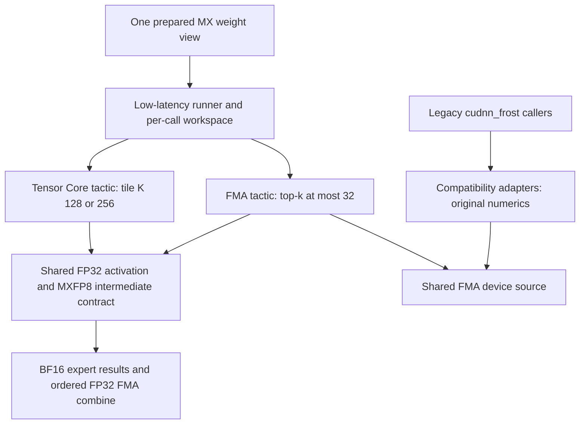
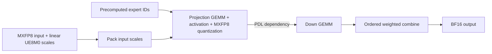
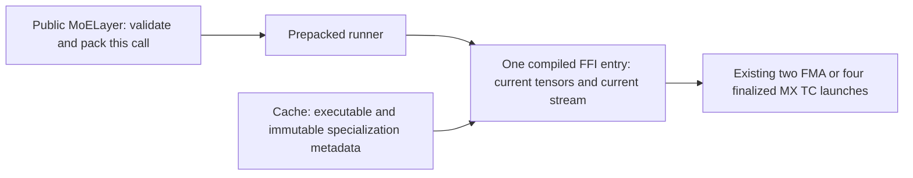
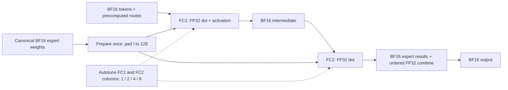

# FROST low-latency routed MoE

`FrostLowLatencyConfig` adds an explicit low-token candidate to `MoELayer` on
SM100/SM103/SM107, with FMA-only support on SM90 and SM120.
SM90 admits BF16, FP16 and ordinary per-tensor FP8; MX and NVFP4 remain
unsupported on SM90. The MX Tensor Core path uses
CuTe DSL and the existing FlashInfer low-latency blockscaled GEMM's TMA
producers and epilogue. It does not depend on cuDNN.

This backend is opt-in: the default `MoEConfig` candidate list does not include
`FrostLowLatencyConfig`. Add it explicitly and prepare a `frost_low_latency`
weight view to include it in cross-backend selection. Upgrading FlashInfer alone
does not redirect existing calls to this backend.

The backend owns both scalar FMA and Tensor Core tactics. FMA reuses the device
implementation previously embedded in `cudnn_frost`. For MX, both tactics read
the same prepared weights. Switching MX tactics needs no second
weight copy, requantization, or per-call layout conversion. Autotuning compares
the complete pipelines. The MX untuned default remains Tensor Core on SM100/103/107
and uses FMA on SM120. BF16, FP16 and ordinary per-tensor FP8 use
shared FMA kernels and independently tune one, two, four or eight output
columns per warp in FC1 and FC2.

Frost uses the existing FlashInfer autotuner. Each runner retains its own
tuning policy; cross-backend selection measures packing plus forward with the
existing CUDA Graph benchmark. The shared individual-call timing mode and its
MoE integration are deferred to separate autotuner work.

The performance tables below are benchmark-selected, fixed-tactic kernel GPU
measurements from the recorded source revisions. Each section records its
timing method and condition-specific tactic sweep; those
results do not guarantee that ordinary autotuning selects the same tactics.
The split leaves device kernels, numerical contracts and default tactics
unchanged, but changes how automatic selection ranks candidates. Frost's tuning
cache identity is updated so it does not reuse winners from the deferred timing
mode. These are kernel GPU measurements, not model decode-step latency or
throughput.



Code sharing does not make the old and new numerical contracts interchangeable:

| Boundary | Low-latency FMA and TC | Legacy MX FMA adapter |
|---|---|---|
| Activation before MXFP8 quantization | FP32 | Rounded to BF16 first |
| Activation parameters | Layer's typed activation and supported scalar parameters | Existing admitted defaults |
| Expert result | BF16 | BF16 |
| Weighted combine | Slot-ordered FP32 FMA | Separate FP32 multiply and slot-ordered add |

Legacy entry points preserve these behaviors. Their compatibility mode is fixed
by the adapter and is never an autotuning choice in the low-latency backend.
Dot-product accumulation order may differ between FMA and Tensor Core; the
independent reference tests enforce the documented numerical tolerances.



Compared with composing standalone low-latency GEMMs and an activation/quantizer,
this pipeline removes the separate activation/quantization launch. GU's FP32
accumulators still pass through per-call global scratch before activation; this
is not an all-on-chip pipeline. Native MoE backends can already fuse activation,
so fusion alone does not explain the comparison with them.
Runtime expert IDs select weights directly, avoiding
sorting tokens into expert groups for tiny batches. Eight warps per CTA and a
smaller tensor-memory allocation reduce resources per independent route tile.
PDL lets the Down weight producer start early while its activation producer
waits for the preceding kernel to finish. This remains a multi-kernel pipeline.

## Warm host submission

Each Frost tactic has one compiled TVM-FFI entry for its projection,
activation and combine launches. A warm call passes the current PyTorch tensors
directly to that entry. DLPack conversion is used when compiling the entry, rather than once
per tensor per launch. MX FMA's scale-workspace view and MX Tensor Core's
pointer descriptors are formed inside the compiled entry.



The compile cache owns no input/output tensors, workspace or CUDA stream.
Independent calls bind independent storage, including when threads share a
compiled entry. Callers must still warm up each specialization before CUDA
Graph capture. The device kernels, numerical contracts, tactics and PDL
dependencies are unchanged. Legacy `cudnn_frost` adapters retain their existing
entry points. Existing Frost callers use the new entry automatically, with no
API changes. Raw output still creates its identity-index tensor per call.

### B300 host qualification

These results compare main `3f398977d` (after #7053 merged) with the host
implementation measured at `91ae8a699`. Full revisions and production-source
hashes are recorded in the [machine-readable results](frost_low_latency_host_b300.json).

Across 81 primary cases, two opposite-order processes give **2.85–4.65×**
faster warm public API submission and **5.35–9.77×** for the prepacked runner.
The cases cover BF16, MXFP4/MXFP8, MXFP8/MXFP8 and NVFP4, T=1/2/4, and
SwiGLU/SiTU/SiLU. H=2048, physical I=1408, E=64, top-k=6. The same tactic,
tensor contents and GPU workspace addresses are used on both sides.

Representative T=1 SwiGLU rows below use the median of the two process medians.
All times are microseconds; public and runner columns measure CPU enqueue,
while the last column measures GPU time per MoE call.

| Path | Public API before → after | Host speedup | Prepacked runner before → after | GPU before → after |
|---|---:|---:|---:|---:|
| BF16 FMA | 106.04 → 35.81 | 2.96× | 83.25 → 14.64 | 26.63 → 26.65 |
| MXFP4 TC128 | 260.85 → 61.85 | 4.22× | 217.82 → 24.90 | 10.33 → 10.33 |
| MXFP4 FMA | 154.30 → 47.30 | 3.26× | 117.98 → 14.33 | 17.25 → 17.25 |
| MXFP8 TC128 | 256.21 → 60.98 | 4.20× | 213.17 → 25.74 | 10.50 → 10.50 |
| MXFP8 FMA | 152.79 → 47.38 | 3.23× | 116.25 → 15.13 | 24.52 → 24.52 |
| NVFP4 FMA | 162.43 → 48.37 | 3.36× | 125.88 → 16.02 | 13.23 → 13.23 |

B300/SM103, Python 3.12.15, PyTorch 2.14.1+cu130, CuTe DSL 4.8.0,
apache-tvm-ffi 0.1.11, Xeon Platinum 8570. The CPU is shared. A/A public timing
ratios range from 0.989 to 1.011; GPU changes are within
-0.32% to +0.26% across both process orders, compared with
-0.28% to +0.27% for A/A. Plain graph-replay CPU time
has a median of 2.94 µs per replay of a 50-call graph; it is not divided by 50.
GPU timing uses repeated fixed-input graph replay without an L2 flush.
These results do not establish a GPU-time or model-throughput improvement.
A smaller H=512/I=128/E=8/top-k=2 control covers 27 SwiGLU cases and gives
2.93–4.22× public API and 5.57–8.43× prepacked-runner improvement.

Current-main B300 qualification passed 166 tests. Two noncurrent-device cases
were skipped because this allocation exposes one GPU.
The same production sources previously passed 149 tests on SM107 before the
main rebase. Tests cover fresh tensor bindings, concurrent threads/streams,
changed-input graphs, storage ownership and independent numerical references.

Use `benchmarks/bench_frost_host_overhead.py` with the recorded baseline and
candidate revisions. The following commands reproduce the primary protocol
against a separate baseline checkout:

```bash
args=(--tokens 1 2 4 --activations swiglu situ silu \
      --repeats 101 --calls-per-graph 50)
python benchmarks/bench_frost_host_overhead.py "${args[@]}" \
  --baseline-root /path/to/baseline-checkout --output host-ab.json
python benchmarks/bench_frost_host_overhead.py "${args[@]}" \
  --baseline-root /path/to/baseline-checkout --output host-ba.json --reverse
python benchmarks/bench_frost_host_overhead.py "${args[@]}" \
  --baseline-root "$PWD" --output host-aa.json
```

The benchmark records source hashes and requires identical shared API/dispatcher
wrappers. Both sides use the same fixed tactic, prepared weight contents and
shape. It measures public API, packing, prepacked runner and graph-replay CPU
times separately, with device synchronization outside each CPU interval.
CPU replay uses a graph without instrumentation. External CUDA event nodes
inside a separate captured graph measure GPU time. Both GPU timing graphs bind
the same workspace addresses to avoid allocation-dependent A/A differences.
Independent call buffers and per-replay output snapshots check correctness.
Numerical checks compare both implementations and public/replay
outputs after changing route IDs and weights. Compilation, initial selection,
weight preparation and input quantization are outside timing. A/A controls and
independent reversed-order runs help distinguish small GPU differences from
measurement noise. Host savings do not imply a corresponding CUDA Graph
GPU-time or model-throughput improvement.

## Current B300 kernel results

Each comparison holds GPU, shape, activation, cache and routing pattern fixed.
These are local routed-MoE GPU measurements. Model-shaped kernel tests are not
model-throughput tests, and TP-local weight slices do not measure communication.
The two dtype cohorts below have different numerical boundaries.

### BF16

These unquantized BF16 shape proxies are measured with
`benchmarks/bench_frost_low_latency_bf16.py`. Each row compares complete routed
MoE GPU calls on the same B300, shape, activation, cache and expert-reuse
condition. This includes GPU adapters and combine; it excludes host submission,
weight preparation, router selection, shared experts and communication.
Model-shaped kernel measurements are not model throughput tests.

| Activation | H / I / E / K | T | Cache / reuse | Fastest tested original | Original µs | Frost µs | Speedup |
|---|---|---:|---|---|---:|---:|---:|
| swiglu | 2048 / 512 / 512 / 10 | 1 | warm / disjoint | trtllm_default | 27.736 | 15.460 | 1.794× |
| swiglu | 2048 / 512 / 512 / 10 | 2 | warm / disjoint | trtllm | 44.144 | 31.872 | 1.385× |
| situ | 2048 / 1408 / 64 / 6 | 2 | warm / disjoint | cutlass | 60.424 | 46.056 | 1.312× |

The SwiGLU rows admit TRT-LLM, CUTLASS, Prims-TS and cuDNN grouped GEMM,
including defaults. For SiTU, CUTLASS is the only admitted native candidate in
this B300/software configuration. cuTile and legacy cuDNN Frost decline this
architecture; all requested but unsupported/failing candidates remain recorded. The JSON records
which backends were admitted in each row, search counts and numerical checks.
Runner-advertised spaces can be factorized shortlists; this is not a claim
against every possible FlashInfer configuration. Selection is frozen before
separate normal/reverse validation processes. Only qualified comparisons are
shown, and sub-1% differences mean parity. A selected-pair qualification does
not imply every slower candidate is stable.

Software: B300/SM103, PyTorch 2.13.0+cu130, CUDA 13.0, CuTe DSL 4.8.0,
CUDA Python bindings 13.4.3 and cuDNN 9.27. The benchmark records the exact source
hash. See [BF16 results and controls](frost_low_latency_bf16_b300.json), including
excluded comparisons and an independent comparison against the best prior
FC2=4 tuning space. BF16 uses a separate numerical contract from the MX
performance tables; do not combine their ratios.

### MXFP4/MXFP8 with clamped SwiGLU

This separate cohort uses H2048/I512/E512/K10, MXFP8 activations, BF16 output,
warm/disjoint routes and SwiGLU limit=10. Its benchmark source is `7caaa1802e44`.
Runner-advertised searches completed for TRT-LLM (2,401 candidates), CUTLASS
(5), Prims-TS (1,074 W4 / 1,007 W8), Frost (4), and native CuTe DSL
(33 W4 candidates). Factorized runners expose stage-ranked shortlists rather
than every theoretical configuration.

| Weights | T | Measured original set, including defaults | Fastest named original | Original µs | Frost µs | Speedup |
|---|---:|---|---|---:|---:|---:|
| MXFP4 | 1 | TRT / CuTe / CUTLASS / Prims | CuTe DSL default | 21.616 | 13.440 | 1.608× |
| MXFP4 | 4 | TRT / CUTLASS / Prims | TRT-LLM tuned | 31.852 | 21.632 | 1.472× |
| MXFP8 | 4 | TRT / CUTLASS / Prims | TRT-LLM default | 40.008 | 31.816 | 1.257× |

These displayed pairs pass normal/reverse-process controls and six changed-input
plus post-timing correctness checks. The W4/T1 selected pair is stable while a
slower default candidate varies across processes. Both displayed T4 rows pass
all-candidate controls within their listed native sets. The separate W4/T4 run
including CuTe fails the exact-winner agreement rule; the narrower 1.472× row
therefore makes no claim against native CuTe. Other failed comparisons remain
excluded, with their raw samples and controls preserved.

Native backends use their declared intermediate-rounding references and unchanged
tolerances; only the new Frost FMA/TC tactics share one numerical contract.
Software is B300/SM103, PyTorch 2.13.0+cu130, CUDA 13.0 and CuTe DSL 4.8.0.
[Results, candidate counts, commands and controls](frost_low_latency_b300_native.json)
record the exact source and comparison scope. Do not combine these ratios with
the BF16 table or the earlier unclamped-SwiGLU cohort.

## Supported contract

| Property | Support |
|---|---|
| Architecture | SM90: BF16/FP16/per-tensor FP8 FMA only, top-k <= 32; SM100/103/107: FMA and MX Tensor Core; SM120: FMA only, top-k <= 32 |
| Input | Static per-tensor E4M3 FP8; E4M3 MXFP8 with linear group-32 UE8M0 scales; packed NVFP4 with linear group-16 E4M3 scales; or unquantized BF16/FP16 |
| Weights | Per-tensor FP8 input: per-expert E4M3 FP8 with static calibration; MX input: MXFP4 or MXFP8 with group-32 UE8M0 scales; NVFP4 input: NVFP4 with group-16 E4M3 scales; unquantized input: matching BF16/FP16 weights |
| Output | Quantized paths: BF16; unquantized paths: BF16 or FP16. Finalized or raw token/slot-ordered expert rows |
| MX activation | SwiGLU, SiTU, GeGLU, GeGLUTanh, SwiGLUStep, GELU, ReLU, ReLU2, SiLU, Identity |
| BF16 activation | SwiGLU, SiTU, GeGLU, GeGLUTanh, SwiGLUStep, GELU, ReLU, ReLU2, SiLU, Identity |
| FP16 / per-tensor FP8 activation | Same ten activations and scalar restrictions as BF16 |
| BF16 parameters | SwiGLU alpha/beta/limit and SwiGLUStep limit; other activations require their default parameters |
| MX parameters | Same typed scalar restrictions as BF16; activation remains FP32 before MXFP8 quantization |
| NVFP4 | NVFP4 weights and inputs, BF16 output; shared FMA, the same ten activations, H divisible by 512, I by 128, top-k <= 32; no 4over6 intermediate quantization |
| BF16/FP16/per-tensor FP8 FMA | top-k <= 32; FC1 and FC2 output columns 1/2/4/8 (16 combinations), default 1 and 4; GELU/GeGLU require compiler `erf` support |
| MX/BF16/FP16/per-tensor FP8 geometry | H divisible by 128; logical I divisible by 32, padded to 128 |
| Token rows | 1–2 by default; explicitly configurable up to 8 |
| Routing | Packed or unpacked precomputed IDs; valid IDs in `[0, E)` |
| Parallelism | Local expert computation, including TP weight slices; no EP shards or communication |
| Compiler | `nvidia-cutlass-dsl >= 4.8` |

This candidate is omitted from the default backend list. Include a prepared
native backend for larger inputs and for shapes where it wins. Correctness
coverage at T=8 is not a claim that this schedule is faster at T=8. Separate
shared experts, input quantization, router computation, communication, attention
and full decode-forward fusion are outside this backend.

## Use with the unified API

The weight helper accepts **prequantized** canonical tensors, preserving their
bytes. `w1` is `[E, 2I, H/pack]` in **[up, gate]** order; `w2` is
`[E, H, I/pack]`. `pack=2` for MXFP4 and 1 for MXFP8. Weight scales are
`[E, rows, K/32]` UE8M0 bytes. Preparation pads I and rearranges gate/up tiles and
scales; it does not dequantize or requantize the checkpoint.

For non-gated MX activations, pass `activation=...` to `prepare_weights` and
provide `w1` with shape `[E, I, H/pack]`. Both FMA and Tensor Core tactics omit
the gate projection. Gated activations retain the existing striped weight view.
The default remains SwiGLU, so existing four-argument preparation calls retain
their layout and arithmetic. These additional activation combinations require
their own measurements; the historical SwiGLU tables are not evidence for them.

For NVFP4, `prepare_nvfp4_weights(w1_bf16, w2_bf16, activation=...)` reuses the
canonical CUTLASS NVFP4 preparation with unit global scales. Prepare activations
with `TrtllmFp4Config.prepare_activations(..., quant=quant)` and configure
`QuantConfig(weight=QuantFormat.NVFP4, activation=QuantFormat.NVFP4,
nvfp4_4over6=None)`. The scale payload is linear E4M3 with groups of 16.
The two FMA tactics compute two or four FC1 outputs per warp. FC1 rounds its
activation to BF16 before NVFP4 quantization; FC2 rounds expert outputs to BF16
and combines them with ordered separate FP32 multiplication and addition. Raw
output retains token/slot order. This numerical contract is distinct from MX.
The unified NVFP4 quantizer preserves exact E2M1 midpoint ties with
round-to-nearest division; the legacy adapter retains its approximate-reciprocal
behavior. An enabled 4over6 recipe is rejected, including a later environment change.

```python
from flashinfer.autotuner import autotune
from flashinfer.fused_moe import (
    BackendOptions, ExpertConfig, FrostLowLatencyConfig, MoEActivationPack,
    MoEConfig, MoELayer, MoEWeightPack, QuantConfig, QuantFormat, RoutingConfig,
    SwiGLU,
)

weights = MoEWeightPack()
weights.prepare_for(
    "frost_low_latency",
    FrostLowLatencyConfig.prepare_weights(w1_q, w1_sf, w2_q, w2_sf),
)
config = MoEConfig(
    routing=RoutingConfig(num_experts=E, top_k=K),
    quant=QuantConfig(weight=QuantFormat.MXFP4, activation=QuantFormat.MXFP8),
    experts=ExpertConfig(intermediate_size=I),  # logical I, before padding
    activation=SwiGLU(alpha=1.0, beta=0.0, limit=10.0),
    backend=BackendOptions((FrostLowLatencyConfig(),)),
)
layer = MoELayer(config)
act = MoEActivationPack(x_q, x_linear_ue8m0_scale, topk_ids, topk_weights)
with autotune(True):
    y = layer(act, weights)  # select tactic and warm up before CUDA Graph capture
```

For unquantized BF16, prepare `[E, 2I, H]` **[up, gate]** weights for gated
activations or `[E, I, H]` for non-gated activations, plus `[E, H, I]` Down
weights. Use the same typed activation in preparation and configuration:

```python
from flashinfer.fused_moe import SiTU

activation = SiTU()
weights = MoEWeightPack()
weights.prepare_for(
    "frost_low_latency",
    FrostLowLatencyConfig.prepare_bf16_weights(w1_bf16, w2_bf16, activation=activation),
)
config = MoEConfig(
    routing=RoutingConfig(num_experts=E, top_k=K),
    quant=QuantConfig(weight=QuantFormat.BF16, activation=QuantFormat.BF16),
    experts=ExpertConfig(intermediate_size=I),
    activation=activation,
    backend=BackendOptions((FrostLowLatencyConfig(max_num_tokens=8),)),
)
layer = MoELayer(config)
act = MoEActivationPack(x_bf16, None, topk_ids, topk_weights)
with autotune(True):
    y = layer(act, weights)
```

The finalized BF16 path has two launches: FC1 with activation, then FC2 with
combine. Raw output also materializes the route-row mapping and, for packed
routing, converts scores to BF16. It uses FP32 dot products, BF16
intermediate/expert outputs, and
separate FP32 multiply/add in slot order. These are the shared legacy BF16
numerics, not the MX intermediate quantizer or FMA-combine contract. Different
BF16 tile candidates preserve this same numerical boundary. This extension is
functional coverage; the MX performance tables below do not establish BF16 gains.

For FP16, prepare FP16 tensors with
`FrostLowLatencyConfig.prepare_fp16_weights(w1, w2, activation=activation)` and
set `QuantConfig(weight=QuantFormat.FP16, activation=QuantFormat.FP16,
output=QuantFormat.FP16)`. The same two FMA device bodies decode FP16 instead
of BF16, accumulate in FP32 and round the activation to the input dtype.
FC2 rounds expert results to the configured output dtype before the ordered
FP32 combine. Dense BF16/FP16 inputs may independently select BF16/FP16 output;
omitting `output` retains the API's BF16 default. Packed routing scores always
retain their BF16 rounding, even when the input and output are FP16.

SM120 uses the same FMA numerical contracts. It does not enumerate or execute
the SM100-family tcgen05/TMEM tactics; MX and NVFP4 continue to produce BF16.
Historical B300 tables do not establish FP16 or SM120 speedups. The following
measurements qualify one FP16 workload on SM120.

### FP16 on SM120

NVIDIA RTX PRO 6000 Blackwell Workstation Edition, CUDA 13.0,
PyTorch 2.14.1+cu130, CuTe DSL 4.8.0. H=2048, I=512, E=512, top-k=10,
SwiGLU, FP16 input/weights/output. These are synthetic tensors at common model
geometry, not a checkpoint or serving measurement.

The baseline is the existing flat `cutlass_fused_moe` FP16 implementation,
which uses SM80-family kernels on this GPU. Selection attempts all 8×8 advertised
GEMM1/GEMM2 pairs plus the default; 16 pairs exceed the device's shared-memory
limit. Frost sweeps all 16 column combinations. Winners are frozen before four
ABBA validation blocks. CUPTI measures the complete first-to-last GPU activity
span of each graph replay, including activation and combine. Cache eviction,
host enqueue, weight preparation, routing selection, shared experts and
communication are outside the measurement.

| T | Expert reuse | Warm CUTLASS µs | Warm Frost µs | Speedup | Cold CUTLASS µs | Cold Frost µs | Speedup |
|---:|---|---:|---:|---:|---:|---:|---:|
| 1 | — | 33.70 | 11.14 | 3.03× | 63.20 | 45.33 | 1.39× |
| 2 | Disjoint | 39.27 | 19.58 | 2.01× | 103.32 | 85.01 | 1.22× |
| 4 | Disjoint | 176.71 | 156.09 | 1.13× | 183.97 | 167.87 | 1.10× |
| 8 | Disjoint | 329.52 | 308.64 | 1.07× | 344.22 | 331.82 | 1.04× |
| 2 | Shared | 34.04 | 19.46 | 1.75× | 63.10 | 45.62 | 1.38× |
| 4 | Shared | 34.62 | 34.08 | 1.02× | 63.43 | 53.37 | 1.19× |
| 8 | Shared | 35.85 | 63.73 | 0.56× | 64.26 | 82.64 | 0.78× |

Shared means all tokens select the same ten experts; disjoint means no expert
overlap across tokens. Warm means repeated operands, not guaranteed L2 residency:
increasing the active expert working set can still make warm runs memory-bound.
FMA's advantage shrinks as T grows, and at T=8 with shared experts the native
Tensor Core pipeline wins. The 1.02× warm T=4 shared result is marginal. Keep
cross-backend selection and do not infer a universal T≤8 FMA preference.

A larger control (H=7168, I=2048, E=256, top-k=8, disjoint routes) shows much
smaller gains: at T=1, warm CUTLASS/Frost is 460.78/431.12 µs (1.07×) and cold
is 479.29/458.26 µs (1.05×). At T=8 the ratios are only 1.02× in both cache
conditions. Removing pipeline overhead matters less when expert-weight traffic
dominates; the small-shape result should not be extrapolated to these experts.

All measured candidates passed the independent numerical reference. A/A ratios
were within 0.3% of one; amortized CUDA-event graph-chain measurements independently
confirmed the warm-cache ranking. Those event times have a different scope and
are retained separately in the [results and controls](frost_low_latency_fp16_sm120.json).

```bash
python benchmarks/bench_frost_low_latency_fp16.py --tokens 1 \
  --hidden 2048 --intermediate 512 --experts 512 --top-k 10 \
  --cache-mode warm --expert-reuse disjoint --output fp16-sm120.json
```

The benchmark requires CUPTI 13+ by default and fails on profiling errors. Its
explicit `--timer globaltimer` option instead reports an interval bracketed by
timestamp kernels, including their boundary overhead; it does not silently
substitute that interval for a CUPTI span.



Use `benchmarks/bench_frost_low_latency_bf16.py` to compare this public entry
with applicable native BF16 backends. The selection process ranks the tactics
exposed by each runner, including its default; factorized runners may expose a
stage-ranked shortlist rather than the full Cartesian product. Failures and
unsupported backends remain explicit exclusions in the JSON.

```bash
python benchmarks/bench_frost_low_latency_bf16.py --select --tokens 1 \
  --hidden 2048 --intermediate 512 --experts 512 --top-k 10 \
  --output bf16-selection.json
python benchmarks/bench_frost_low_latency_bf16.py --selection bf16-selection.json \
  --tokens 1 --output bf16-first.json
python benchmarks/bench_frost_low_latency_bf16.py --selection bf16-selection.json \
  --tokens 1 --reverse --output bf16-reverse.json
```

Keep all workload arguments identical across these processes. The frozen
selection checks source and workload identity; the validation processes do not
repeat the search. `--activation`, `--cache-mode` and `--expert-reuse` select
separate cohorts. Individual CUDA-event intervals inside the graph measure GPU
execution, including routing adapters and combine. They exclude host submission
and preparation; cold-cache eviction is also outside the interval. Changed-input
graph checks and independent A/A captures accompany the timing. Inspect their
stability before reporting a speedup; a successful run alone is not qualification.

For cross-backend selection, include e.g. `TrtllmFp4Config()` in `BackendOptions`
and prepare its weight view too. Per-runner tuning uses each runner's existing
cache policy; native runners can default to cold L2 while Frost defaults to warm
L2. The existing cross-backend comparison uses amortized CUDA Graph GPU time
for packing plus forward. An explicit `MeasurementPolicy` is handled by the
existing per-runner autotuner; it does not change this layer-level comparison.
Use the benchmark's cache-specific sweeps for a common measurement objective.
A missing fallback does not silently choose an unprepared backend; the layer
rejects calls with no eligible candidate. The same activation pack is reusable
across these candidates.
Cross-backend inputs must satisfy every selected backend's routing contract.
In particular, use distinct expert IDs within each token when selecting or
falling back to TRT-LLM. Frost can compute repeated slots independently, but
the native TRT routing map retains only one slot per `(token, expert)`; repeated
IDs are therefore not an equivalent cross-backend input. Signed routing weights
with distinct IDs are covered by the fallback check.
Both candidates must also accept the shared `MoEConfig` geometry. If a native
candidate requires I divisible by 128, prepare both views from the same
explicitly zero-padded canonical weights and use that padded I in their shared
config. A FROST-only configuration can retain the smaller logical I.

Selection is cached by token bucket, routing input mode and eligible candidates.
Changing expert IDs within that bucket does not automatically select a new
backend. Warm up with representative expert reuse and cache conditions; the
benchmark's condition-specific sweeps do not imply a distribution-aware
dispatcher on every decode step.
Enter `autotune(True)` on the layer's first call for the target bucket. Re-entering
that context does not invalidate an existing `MoELayer` backend/tactic winner.
A fresh `MoELayer` re-runs cross-backend selection before graph capture and can
reuse the prepared weight pack, but it may reuse per-runner autotuner records.
To reprofile the same metadata with different routing values, also use fresh
tuning state, for example an isolated process without loading previous tuning
records. Autotuner measurement provenance applies when selection runs, not as
automatic invalidation of this layer-level cache.

The compile cache stores executable metadata. `pack_inputs` owns each call's
scratch tensors, and execution binds current pointers and stream. The packed
routing contract rounds weights to BF16; the unpacked contract preserves BF16
or FP32 weights. Raw outputs preserve this distinction for caller-side combine.
For finalized packed output, BF16 narrowing happens inside the existing combine
kernel. This removes a separate conversion launch while retaining the same
rounding before the ordered FP32 weighted sum. Producers that already supply
BF16 routing weights do not have that launch to remove.

## Reproduce correctness and performance

```bash
pytest tests/moe/test_frost_low_latency.py
python benchmarks/bench_frost_low_latency.py \
  --hidden 5120 --intermediate 1152 --experts 384 --top-k 6 --tokens 1 \
  --include-cutedsl --include-native-default --output first.json
python benchmarks/bench_frost_low_latency.py \
  --hidden 5120 --intermediate 1152 --experts 384 --top-k 6 --tokens 1 \
  --include-cutedsl --include-native-default --reverse --output reverse.json
```

The benchmark prepares all backends from the same canonical weights and uses
the same quantizer, expert IDs, routing-weight inputs and activation parameters.
FROST and TRT-LLM narrow packed routing weights to BF16; the native CuTe DSL
interface retains FP32 weights. Comparisons allow the numerical tolerances below
rather than requiring bitwise equality across those rounding boundaries.
It autotunes each original backend, checks six changing inputs after graph
replay, and verifies outputs again after timing. The default
`--timing-mode latency` brackets each complete call with external event nodes
inside the CUDA Graph. `--timing-mode amortized --cache-mode warm` instead times
128 calls together and divides the replay time by 128. Both retain repeated
original A/A controls. Amortized replay throughput and individual-call latency
are different measurements and can rank the pipelines differently; compare
candidates under the same mode.
Use `--route-pattern disjoint` for distinct experts across tokens or `shared`
for the same top-k set per token. Both modes retain distinct experts within a
token. Each timing graph repeats that routed input; it is not a serving trace.

`--cache-mode cold` sweeps a separate read/write buffer of at least 512 MiB and
twice the device's L2 capacity before each measured call. External CUDA event
nodes inside the graph bracket only MoE, excluding eviction and host enqueue.
The result records the buffer size and queried L2 capacity. Cold and warm
results must be compared separately.

For a selection run, `--retune-cache` ranks every tactic advertised by each
runner with the selected cache and routing pattern, including the native
heuristic and the initial warm-autotuned winner. Every candidate is checked
against the reference. The JSON records candidate timings in `cache_tuning`.
Freeze the selected tactics with the flags below for independent normal and
reverse-order measurements. This enumerates the runner's exposed candidates,
not every configuration its underlying kernel could theoretically implement.
For factorized backends such as CUTLASS and cuDNN grouped GEMM, enumeration
must run inside `autotune(True)` to obtain the stage-ranked candidate pairs;
outside tuning mode their inner tuner returns only a cached or default pair.
Optional `--include-cutlass` and `--include-prims-ts` add the corresponding
original MX backends. `--include-cudnn-grouped` adds the cuDNN grouped-GEMM
backend for `--weight-format mxfp8 --activation-limit 0`; its default SwiGLU
contract cannot replace a clamped-SwiGLU comparison. Requested backends must
pass their architecture, dependency and numerical checks; they are not silently
omitted. `--include-native-default` measures the default of every included
original backend. Pin their measured winners with `--cutlass-tactic`,
`--prims-ts-tactic` or `--cudnn-grouped-tactic`, alongside the existing TRT/CuTe
flags. These options expand reproducible baseline coverage; the tables below
retain their explicitly named original-backend sets.
When a tactic is pinned, initial preparation avoids a redundant full autotune;
the default and requested configuration are still initialized before capture.
`--retune-cache` explicitly requests the candidate sweep even if pins are given.

Ordinary MX SwiGLU in CUTLASS and cuDNN grouped GEMM rounds GEMM1 and
post-activation values to BF16 before intermediate MXFP8 quantization; the
low-latency paths keep FP32 through that quantizer input. By default, all
included backends must pass the same TRT-LLM comparison. To study the former
contracts, explicitly add `--backend-references`: the benchmark computes their
BF16-intermediate references outside timed regions, using the same 1% relative
L2 and 3% normalized-max limits, and records disagreement with TRT separately.
The JSON labels these comparisons as different intermediate rounding. Compare
their absolute kernel times with that qualification; they are not interchangeable
Frost autotuning tactics. Changing-input graph and post-timing checks use each
backend's declared reference, including its default-tactic control.

Prims-TS uses another MXFP8 intermediate scale: `2**(floor(log2(amax)) - 8)`
with saturating E4M3 conversion, rather than `2**ceil(log2(amax / 448))`.
For example, a block maximum of 500 gives scales 1 and 2 respectively; the
former clips its largest value to 448. `--backend-references` models this
source-defined scale with FP32 activation for Prims, again outside timing and
with unchanged tolerances. This is a separate numerical contract, not an
interchangeable Frost tactic or evidence of a kernel correctness failure.
With `--retune-cache`, the benchmark ranks the full advertised Prims tactic
list once; it skips the redundant preliminary autotune. Factorized backends
retain their native per-GEMM search before the cache-specific comparison.

It includes scale conversion and combine. By default the precomputed routing
weights are FP32; use `--routing-weights-dtype bf16` to measure a producer that
already emits BF16 weights. Removing a conversion helps only when that
conversion was required. For MXFP4 with BF16 routing weights, omit
`--include-cutedsl`: that native W4A8 interface requires FP32 routing weights.
This control compares the supported TRT-LLM and FROST paths; it does not insert
an extra dtype conversion for CuTe DSL or claim an exhaustive original baseline.
Weight preparation, input
quantization and routing selection are excluded. Check A/A and cross-process
stability before interpreting a small difference. These are kernel GPU times
at model-relevant shapes, not model throughput measurements.

## Earlier measurements

<details>
<summary>Earlier native sets, activation contracts and amortized timing</summary>

### Earlier individual-call B300 latency

These paired measurements bracket each complete call with external events
inside a CUDA Graph. They are separate from the historical amortized table
below. H/I/E/K denotes hidden size, physical intermediate size, expert count
and top-k. That cohort uses H=2048, I=512, E=512 and K=10 unless shown
otherwise; rows with failed controls are omitted. These results qualify the
stated capture configuration. Alternate graph granularities remain under
investigation; no unqualified timing-method change is included.

| H / I / E / K | Weights | T | Cache / expert sets | Best original | Original µs | Frost µs | Speedup |
|---|---|---:|---|---|---:|---:|---:|
| 2048 / 512 / 512 / 10 | MXFP8 | 1 | warm / disjoint | trtllm_default | 23.68 | 13.44 | 1.762׆ |
| 2048 / 512 / 512 / 10 | MXFP8 | 2 | warm / disjoint | trtllm_default | 27.74 | 17.55 | 1.581× |
| 2048 / 512 / 512 / 10 | MXFP8 | 4 | warm / disjoint | trtllm | 42.08 | 31.86 | 1.321× |
| 2048 / 512 / 512 / 10 | MXFP4 | 8 | warm / disjoint | cute_dsl | 45.86 | 38.02 | 1.206× |
| 2048 / 512 / 512 / 10 | MXFP8 | 8 | warm / disjoint | trtllm | 62.52 | 54.22 | 1.153׆ |
| 2048 / 512 / 512 / 10 | MXFP4 | 1 | cold / disjoint | cute_dsl | 26.62 | 18.43 | 1.444׆ |
| 2048 / 512 / 512 / 10 | MXFP4 | 4 | cold / shared | cute_dsl | 22.53 | 22.54 | 1.000× |
| 2048 / 512 / 512 / 10 | MXFP8 | 4 | cold / shared | trtllm | 30.72 | 24.58 | 1.250× |
| 2048 / 512 / 512 / 10 | MXFP4 | 4 | cold / disjoint | cute_dsl | 36.88 | 30.72 | 1.201× |
| 2048 / 512 / 512 / 10 | MXFP8 | 4 | cold / disjoint | trtllm | 51.20 | 40.96 | 1.250× |
| 2048 / 512 / 512 / 10 | MXFP8 | 4 | warm / shared | trtllm | 25.70 | 21.62 | 1.189× |

The original set includes tuned and default TRT-LLM, plus native CuTe DSL for
MXFP4. All selected Frost tactics in this table use Tensor Cores. † The displayed
pair passed; another candidate had unstable timing. Values close to 1× indicate
parity, not a meaningful gain. Cold shared-expert cases demonstrate why a native
fallback remains necessary.

B300/SM103, PyTorch 2.13.0+cu130, CUDA 13.0, CuTe DSL 4.8.0, FI base
`3184bbea`. The corrected device kernels match the current implementation;
tactics were explicitly retuned and pinned with benchmark source `bed1b997e`.
The subsequent production dispatcher fixes are validated separately. See the
[results and control metrics](frost_low_latency_b300_latency.json) for exact
tactics, cache policy, numerical tolerances and excluded cases.

### Earlier B300 performance: amortized warm replay

Single B300/SM103, FlashInfer 0.7.2 at base `3184bbea`, PyTorch 2.13.0+cu130,
CUDA 13.0 and CuTe DSL 4.8.0. These are **synthetic MX quantized model shapes**,
not original-checkpoint or model-throughput measurements. TP labels describe
local weight-slice geometry; these rows do not include communication.
The table averages 128 complete calls in a warm CUDA Graph. It does not measure
event-delimited single-call latency. Use the recorded source and commands in
the linked result artifact to reproduce this historical measurement; new
decode-selection results must state which timing mode they use.

| Workload (T=1) | H / physical I / E / top-k | Best measured original | Original µs | FROST µs | Speedup |
|---|---|---|---:|---:|---:|
| DSv4.1-Flash TP2 slice shape | 5120 / 1152 / 384 / 6 | CuTeDSL | 19.51 | 13.68 | 1.425× |
| DSv4.1-Flash TP4 slice shape | 5120 / 640 / 384 / 6 | CuTeDSL | 17.91 | 12.11 | 1.479× |
| Generic MXFP8 | 4096 / 1024 / 64 / 8 | TRT-LLM tuned | 24.70 | 17.66 | 1.398× |
| Generic large MXFP4 | 7168 / 2048 / 64 / 8 | TRT-LLM tuned | 47.80 | 41.83 | 1.143× |
| Qwen3-Next shape / MXFP4 | 2048 / 512 / 512 / 10 | CuTeDSL | 16.49 | 9.22 | 1.787× |
| Qwen3-Next shape / MXFP8 | 2048 / 512 / 512 / 10 | TRT-LLM tuned | 19.14 | 9.37 | 2.043× |
| Qwen3-235B shape / MXFP4 | 4096 / 1536 / 128 / 8 | CuTeDSL | 24.27 | 17.70 | 1.372× |

All rows use MXFP8 activations and BF16 output. The two DS-shaped rows use MXFP4
weights and SwiGLU limit 10. TP4 has logical I=576 with zero padding to 640 for
both backends. Generic rows also use limit 10; the Qwen-shaped rows use standard
SwiGLU. The Qwen source configurations are BF16: only their routed-expert
geometry is used here.

The original comparison includes TRT-LLM tuned and default heuristic; MXFP4 also
includes the existing CuTeDSL backend. Independent selection measurements first
choose the best observed configuration per implementation. Those configurations
are frozen for the reported opposite-order runs; each row uses the fastest
original in those runs. This is not an exhaustive comparison with all backends
or all possible configurations. All per-backend sweep/cross-process and original
A/A spreads are below 1%. All six changing-input graph checks pass in both
processes (relative L2 < 0.01 and normalized maximum error < 0.03).

[Machine-readable results and exact reproduction commands](frost_low_latency_b300.json)
include every compared backend, both process medians, selected tactics and the
numerical/stability controls. Use the commands with the recorded source/compiler
versions: native tactic IDs are version dependent. `--trtllm-tactic`,
`--cute-tactic` and `--frost-tile-k` pin the recorded configurations; omitting them
allows fresh autotuning. `--include-native-default` retains the original heuristic.
Use `--frost-ffma` to pin the FMA tactic for a paired comparison with a pinned
Tensor Core tile. The performance table above records the original Tensor Core
pipeline; it does not attribute those gains to the newly unified FMA tactic.


</details>

## Extension opportunities

The same route-wise schedule supports MXFP8 weights without changing the
pipeline. Hidden size, expert count, top-k and logical intermediate size are
parameters; they are not tied to one checkpoint. A model can use it only when
its activation and quantization semantics match the selected dtype contract.
MX now shares all ten activation epilogues; NVFP4 uses its own group-16 E4M3
quantizer and FMA bindings. They are not dtype aliases for the MX path.

| Extension | What carries over | Remaining work |
|---|---|---|
| Other MXFP4/MXFP8 SwiGLU models | Route addressing, fused activation/quantization, PDL, weight preparation | Qualify the checkpoint's scale conventions, activation parameters and workload |
| More MX activation workloads | Implemented shared activation epilogues, TC/FMA weight views and Down dependency | Qualify the checkpoint and workload; functional coverage does not imply a speedup |
| NVFP4 Tensor Core | Implemented FMA route schedule, typed activations and quantization contract | Add a compatible block-16 MMA pipeline and measure the crossover |
| BF16 Tensor Core | Prepared BF16 view, numerical contract and routing | Add non-blockscaled MMA, preserving the BF16 intermediate and combine contract |
| More token rows | API and correctness contract | Expert reuse/grouping; the current per-route schedule can lose to native |

The shared BF16 FFMA kernels widen expert indices before stride multiplication.
Device-body regressions use actual 32-GiB-plus FC1 and 16-GiB-plus FC2 weight
tables and replay changing expert IDs and inputs. The old FC1 indexing wrapped
to expert zero in this test. This fixes the shared implementation's addressing;
the generic BF16 binding uses that fix while preserving legacy
activation and combine rounding.

For concrete shape candidates, the published
[Qwen3-235B-A22B configuration](https://huggingface.co/Qwen/Qwen3-235B-A22B/blob/main/config.json)
has H=4096, expert I=1536, E=128 and top-k=8; the
[Qwen3-Next-80B-A3B configuration](https://huggingface.co/Qwen/Qwen3-Next-80B-A3B-Instruct/blob/main/config.json)
has H=2048, expert I=512, E=512 and top-k=10. Their dimensions fit this schedule.
These configurations declare BF16. The BF16 entry can use their routed-expert
geometry without MX requantization; checkpoint integration still needs its own
validation. The MX tables above measure quantized shape proxies and do not
establish performance for the original checkpoints. Qwen3-Next's shared expert
also remains outside this routed-only backend.

## Hopper FMA coverage

SM90 uses the shared BF16/FP16/per-tensor-FP8 FMA kernels and FFI binding.
It does not admit integer Tensor Core tactics or the unqualified MX/NVFP4
formats. The final consolidated H100 run passed 109 tests, with 111
unsupported-format, Tensor-Core or native-fallback cases skipped across all
seven Frost test files. This run includes the destination-device padding fix
and final guard tests; it supersedes the earlier preliminary 103-pass run.
Separate H100 measurements below use H=2048, I=512, E=512, top-k=10 and
SwiGLU. CUPTI measures the full routed-expert GPU pipeline. Native CUTLASS
search uses coordinate sweeps, top-two stage combinations and the default:
45/81 advertised stage choices for FP16, 36/72 for FP8. This is not an
exhaustive Cartesian search. Frost searches all 16 FMA tactics; four frozen
ABBA rounds validate the winners. Warm event chains independently cross-check
ranking. Host enqueue, routing-network evaluation, shared experts,
communication and serving are outside the measurement.

| Format / T / routes | Warm CUTLASS → Frost µs | Warm speedup | Cold CUTLASS → Frost µs | Cold speedup |
|---|---:|---:|---:|---:|
| FP16 / 1 / disjoint | 47.952 → 22.975 | 2.09× | 58.103 → 30.128 | 1.93× |
| FP16 / 2 / disjoint | 67.127 → 39.735 | 1.69× | 77.495 → 49.200 | 1.58× |
| FP16 / 4 / shared | 47.735 → 45.672 | 1.05× | 57.104 → 53.312 | 1.07× |
| FP16 / 8 / shared | 46.696 → 76.751 | 0.61× | 57.512 → 83.663 | 0.69× |
| FP8 / 1 / disjoint | 38.551 → 10.688 | 3.61× | 48.136 → 18.848 | 2.55× |
| FP8 / 2 / disjoint | 49.064 → 25.744 | 1.91× | 57.815 → 32.952 | 1.75× |
| FP8 / 4 / shared | 36.800 → 27.383 | 1.34× | 47.128 → 34.728 | 1.36× |
| FP8 / 8 / shared | 36.792 → 46.736 | 0.79× | 47.119 → 55.175 | 0.85× |

T8 with shared experts loses for both formats. These synthetic model-shape
measurements do not establish model throughput. [H100 results and provenance](frost_low_latency_h100.json)
retain all 28 warm/cold and route-reuse cases, absolute times, candidate counts,
frozen validation medians and numerical errors. Reproduce with
`benchmarks/bench_frost_low_latency_fp16.py` or
`benchmarks/bench_frost_low_latency_fp8.py`; larger-expert Hopper controls are
not included in this table.

## Ordinary per-tensor FP8

`QuantFormat.FP8PerTensor` activates a two-kernel FMA path using the shared
dense FMA device bodies. Weights and inputs are E4M3; accumulation is FP32.
FC1 dequantizes its dot products and rounds to BF16 before applying the typed
activation, matching the CUTLASS per-tensor backbone boundary. It then applies
the checkpoint's static intermediate multiplier and saturates to E4M3. FC2
produces BF16 expert outputs and combines them with separate, ordered FP32
multiply/add operations. Packed route weights retain BF16 rounding.

TRT-LLM and PrimsTS instead retain FP32 FC1 preactivations until E4M3
requantization. Identical checkpoint weights and scales do not imply bitwise
equivalence between these numerical paths. Quantization-format support does
not promise a universal cross-backend rounding contract.

```python
view = FrostLowLatencyConfig.prepare_fp8_per_tensor_weights(
    w1_bf16, w2_bf16,
    hidden_states_scale_global=input_multiplier,
    intermediate_scale_global=intermediate_multiplier,
    num_local_experts=E, hidden_size=H, intermediate_size=I,
    activation=activation,
)
weights = MoEWeightPack()
weights.prepare_for("frost_low_latency", view)
xq, _ = FrostLowLatencyConfig.prepare_fp8_per_tensor_activations(
    x_bf16, hidden_states_scale_global=input_multiplier,
)
layer = MoELayer(MoEConfig(
    routing=RoutingConfig(num_experts=E, top_k=K),
    quant=QuantConfig(weight=QuantFormat.FP8PerTensor,
                      activation=QuantFormat.FP8PerTensor),
    experts=ExpertConfig(intermediate_size=I),
    activation=activation,
    backend=BackendOptions((FrostLowLatencyConfig(max_num_tokens=8),)),
))
y = layer(MoEActivationPack(xq, None, topk_ids, topk_weights), weights)
```

The preparation helper uses the canonical CUTLASS quantizer, then pads logical
I to 128 without changing quantized values. For already quantized checkpoints,
register a prepared dictionary with E4M3 `fc1_expert_weights` in `[E, 2P, H]`
`[up, gate]` order (or `[E, P, H]` for non-gated activation),
`fc2_expert_weights` in `[E, H, P]`, FP32 `fc1_dequant_scale` and
`fc2_dequant_scale` in `[E]`, and scalar FP32 `fc2_act_quant_scale`. Here
P = ceil(I / 128) * 128; padding is zero. FC1 dequant includes the input
scale; FC2 dequant includes the intermediate scale. This is the same retained
weight view as CUTLASS for I divisible by 128. No weight requantization or
activation-value inspection occurs during execution. Scale tensors are read
on the device on every call and may change between graph replays.

### SM120 FP8 kernel measurements

RTX PRO 6000 Blackwell Workstation Edition, FP8 SwiGLU,
H=2048/I=512/E=512/top-k=10. These are full routed-expert GPU pipeline times,
including required adapters, activation and combine. Routing selection,
shared experts, communication, host enqueue and serving are outside scope.
Static input/intermediate multipliers are 32/128. All 21×21 advertised CUTLASS
FC1/FC2 pairs plus the default were attempted; resource-incompatible pairs are
recorded. All 16 Frost column combinations were ranked. Selection is followed
by four independent frozen ABBA blocks, A/A controls, and correctness checks
before and after replay. CUPTI reports each call's first-to-last activity span.

| Tokens / routes | Warm CUTLASS µs | Warm Frost µs | Warm speedup | Cold speedup |
|---|---:|---:|---:|---:|
| 1 | 27.69 | 8.07 | 3.43× | 1.84× |
| 2 / disjoint | 33.08 | 12.81 | 2.58× | 1.49× |
| 2 / shared | 27.92 | 12.83 | 2.18× | 1.80× |
| 4 / disjoint | 45.38 | 22.00 | 2.06× | 1.23× |
| 4 / shared | 28.13 | 21.94 | 1.28× | 1.29× |
| 8 / disjoint | 181.41 | 156.91 | 1.16× | 1.11× |
| 8 / shared | 29.25 | 38.06 | 0.77× | 0.91× |

The H=7168/I=2048/E=256/top-k=8 disjoint-route control gives much smaller
speedups: T1 cold 1.08×, T1 warm 1.12×, T2 cold 1.03×, T2 warm 1.07×, T4 cold 1.02×, T4 warm 1.04×, T8 cold 1.02×, T8 warm 1.02×.
See [FP8 results and controls](frost_low_latency_fp8_sm120.json) for all
absolute times, selected tactics, A/A controls and numerical errors.

Warm means repeated operands, not guaranteed L2 residency. Cold evicts L2
outside the measurement interval. T8 with shared experts favors Tensor Core
weight reuse; Frost remains an explicit candidate. These synthetic model-shape
measurements do not establish checkpoint or model throughput.

```bash
python benchmarks/bench_frost_low_latency_fp8.py \
  --tokens 1 --cache-mode warm --expert-reuse disjoint --output fp8-t1-warm.json
```

The benchmark requires `cupti-python >= 13`; `--timer globaltimer` explicitly
selects graph intervals that include stamp-boundary overhead instead. It does
not silently substitute CUDA events. Larger weights are prepared in per-expert
chunks outside timing to bound transient preparation memory.


#### Hopper FP8 accumulation boundary

The native CUTLASS SM90 per-tensor FP8 path selects
`KernelPtrArrayTmaWarpSpecializedCooperativeFP8FastAccum`. Its Tensor Core
accumulation is not numerically identical to the Frost FP32 FMA reduction,
even though both preserve the BF16 preactivation and E4M3 intermediate
boundaries described above. The small-shape table passed the fixed reference
tolerances for both implementations; it does not establish equivalence at
arbitrary reduction lengths.

A separate `T=1, H=7168, I=2048, E=256, top-k=8` control stopped before native
timing: the native default exceeded the benchmark's unchanged relative-L2
limit (`0.01608` versus `0.015`). All 16 Frost tactics passed. The native output
was bitwise equal to an independent cuBLAS control with `use_fast_accum=True`
in both GEMMs and the same quantization/activation boundaries. Disabling fast
accumulation in that control reproduced the reference discrepancy. This
identifies the source of the mismatch; it does not qualify a speedup for that
case. No large-shape Hopper FP8 performance result is reported, and the
benchmark still fails closed rather than relaxing the numerical gate.
