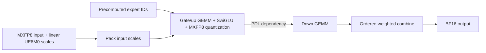

# FROST low-latency routed MoE

`FrostLowLatencyConfig` adds an explicit low-token candidate to `MoELayer` on
SM100/SM103. It uses CuTe DSL and the existing FlashInfer low-latency blockscaled
GEMM's TMA producers and epilogue. It does not depend on cuDNN.



Compared with composing standalone low-latency GEMMs and an activation/quantizer,
this pipeline removes the separate activation/quantization launch. GU's FP32
accumulators still pass through per-call global scratch before activation; this
is not an all-on-chip pipeline. Native MoE backends can already fuse activation,
so fusion alone does not explain the comparison with them.
Runtime expert IDs select weights directly, avoiding
sorting tokens into expert groups for tiny batches. Eight warps per CTA and a
smaller tensor-memory allocation reduce resources per independent route tile.
PDL lets the Down weight producer start early while its activation producer
waits for the preceding kernel to finish. This remains a multi-kernel pipeline.

## Supported contract

| Property | Support |
|---|---|
| Input | E4M3 MXFP8, group-32 UE8M0 scales in the common linear layout |
| Weights | Packed E2M1 MXFP4 or E4M3 MXFP8, group-32 UE8M0 |
| Output | BF16, finalized or raw token/slot-ordered expert rows |
| Activation | `SwiGLU(alpha, beta, limit)` |
| Geometry | H divisible by 128; logical I divisible by 32, padded to 128 |
| Token rows | 1–2 by default; explicitly configurable up to 8 |
| Routing | Packed or unpacked precomputed IDs; valid IDs in `[0, E)` |
| Parallelism | Local expert computation, including TP weight slices; no EP shards or communication |
| Compiler | `nvidia-cutlass-dsl >= 4.8` |

This candidate is omitted from the default backend list. Include a prepared
native backend for larger inputs and for shapes where it wins. Correctness
coverage at T=8 is not a claim that this schedule is faster at T=8. Separate
shared experts, input quantization, router computation, communication, attention
and full decode-forward fusion are outside this backend.

## Use with the unified API

The weight helper accepts **prequantized** canonical tensors, preserving their
bytes. `w1` is `[E, 2I, H/pack]` in **[up, gate]** order; `w2` is
`[E, H, I/pack]`. `pack=2` for MXFP4 and 1 for MXFP8. Weight scales are
`[E, rows, K/32]` UE8M0 bytes. Preparation pads I and rearranges gate/up tiles and
scales; it does not dequantize or requantize the checkpoint.

```python
from flashinfer.autotuner import autotune
from flashinfer.fused_moe import (
    BackendOptions, ExpertConfig, FrostLowLatencyConfig, MoEActivationPack,
    MoEConfig, MoELayer, MoEWeightPack, QuantConfig, QuantFormat, RoutingConfig,
    SwiGLU,
)

weights = MoEWeightPack()
weights.prepare_for(
    "frost_low_latency",
    FrostLowLatencyConfig.prepare_weights(w1_q, w1_sf, w2_q, w2_sf),
)
config = MoEConfig(
    routing=RoutingConfig(num_experts=E, top_k=K),
    quant=QuantConfig(weight=QuantFormat.MXFP4, activation=QuantFormat.MXFP8),
    experts=ExpertConfig(intermediate_size=I),  # logical I, before padding
    activation=SwiGLU(alpha=1.0, beta=0.0, limit=10.0),
    backend=BackendOptions((FrostLowLatencyConfig(),)),
)
layer = MoELayer(config)
act = MoEActivationPack(x_q, x_linear_ue8m0_scale, topk_ids, topk_weights)
with autotune(True):
    y = layer(act, weights)  # select tile K and warm up before CUDA Graph capture
```

For cross-backend selection, include e.g. `TrtllmFp4Config()` in `BackendOptions`
and prepare its weight view too. A missing fallback does not silently choose an
unprepared backend; the layer rejects calls with no eligible candidate. The
same activation pack is reusable across these candidates.
Both candidates must also accept the shared `MoEConfig` geometry. If a native
candidate requires I divisible by 128, prepare both views from the same
explicitly zero-padded canonical weights and use that padded I in their shared
config. A FROST-only configuration can retain the smaller logical I.

The compile cache stores executable metadata. `pack_inputs` owns each call's
scratch tensors, and execution binds current pointers and stream. The packed
routing contract rounds weights to BF16; the unpacked contract preserves BF16
or FP32 weights. Raw outputs preserve this distinction for caller-side combine.

## Reproduce correctness and performance

```bash
pytest tests/moe/test_frost_low_latency.py
python benchmarks/bench_frost_low_latency.py \
  --hidden 5120 --intermediate 1152 --experts 384 --top-k 6 --tokens 1 \
  --include-cutedsl --include-native-default --output first.json
python benchmarks/bench_frost_low_latency.py \
  --hidden 5120 --intermediate 1152 --experts 384 --top-k 6 --tokens 1 \
  --include-cutedsl --include-native-default --reverse --output reverse.json
```

The benchmark prepares all backends from the same canonical weights and uses
the same quantizer, routing and activation semantics. It autotunes each original
backend, checks six changing inputs after graph replay, then measures paired
warm CUDA Graphs with 128 public calls each and repeated original A/A controls.
Each timing graph repeats the same routed input; it does not model cold weights
or changing expert selection across serving steps.
It includes scale conversion and combine. Weight preparation, input
quantization and routing selection are excluded. Check A/A and cross-process
stability before interpreting a small difference. These are kernel GPU times
at model-relevant shapes, not model throughput measurements.

## B300 performance

Single B300/SM103, FlashInfer 0.7.2 at base `3184bbea`, PyTorch 2.13.0+cu130,
CUDA 13.0 and CuTe DSL 4.8.0. These are **synthetic MX quantized model shapes**,
not original-checkpoint or model-throughput measurements. TP labels describe
local weight-slice geometry; these rows do not include communication.

| Workload (T=1) | H / physical I / E / top-k | Best measured original | Original µs | FROST µs | Speedup |
|---|---|---|---:|---:|---:|
| DSv4.1-Flash TP2 slice shape | 5120 / 1152 / 384 / 6 | CuTeDSL | 19.40 | 14.16 | 1.370× |
| DSv4.1-Flash TP4 slice shape | 5120 / 640 / 384 / 6 | CuTeDSL | 17.71 | 12.83 | 1.381× |
| Generic MXFP8 | 4096 / 1024 / 64 / 8 | TRT-LLM default | 24.12 | 18.35 | 1.314× |
| Generic large MXFP4 | 7168 / 2048 / 64 / 8 | TRT-LLM default | 47.41 | 42.22 | 1.123× |
| Qwen3-Next shape / MXFP4 | 2048 / 512 / 512 / 10 | CuTeDSL | 16.42 | 9.81 | 1.673× |
| Qwen3-Next shape / MXFP8 | 2048 / 512 / 512 / 10 | TRT-LLM default | 19.02 | 9.86 | 1.928× |
| Qwen3-235B shape / MXFP4 | 4096 / 1536 / 128 / 8 | CuTeDSL | 24.07 | 18.33 | 1.313× |

All rows use MXFP8 activations and BF16 output. The two DS-shaped rows use MXFP4
weights and SwiGLU limit 10. TP4 has logical I=576 with zero padding to 640 for
both backends. Generic rows also use limit 10; the Qwen-shaped rows use standard
SwiGLU. The Qwen source configurations are BF16: only their routed-expert
geometry is used here.

The original comparison includes TRT-LLM tuned and default heuristic; MXFP4 also
includes the existing CuTeDSL backend. Independent selection measurements first
choose the best observed configuration per implementation. Those configurations
are frozen for the reported opposite-order runs; each row uses the fastest
original in those runs. This is not an exhaustive comparison with all backends
or all possible configurations. All per-backend sweep/cross-process and original
A/A spreads are below 1%. All six changing-input graph checks pass in both
processes (relative L2 < 0.01 and normalized maximum error < 0.03).

[Machine-readable results and exact reproduction commands](frost_low_latency_b300.json)
include every compared backend, both process medians, selected tactics and the
numerical/stability controls. Use the commands with the recorded source/compiler
versions: native tactic IDs are version dependent. `--trtllm-tactic`,
`--cute-tactic` and `--frost-tile-k` pin the recorded configurations; omitting them
allows fresh autotuning. `--include-native-default` retains the original heuristic.

## Extension opportunities

The same route-wise schedule supports MXFP8 weights without changing the
pipeline. Hidden size, expert count, top-k and logical intermediate size are
parameters; they are not tied to one checkpoint. A model can use it only when
its activation and quantization semantics match this contract. SiTU, BF16 and
NVFP4 need separate implementation and qualification. They are not dtype aliases
for the MX path.

| Extension | What carries over | Remaining work |
|---|---|---|
| Other MXFP4/MXFP8 SwiGLU models | Route addressing, fused activation/quantization, PDL, weight preparation | Qualify the checkpoint's scale conventions, activation parameters and workload |
| SiTU activation | Route schedule, weight loads and Down dependency | Implement and validate its distinct activation arithmetic |
| NVFP4 | Route schedule and dependency design | Group-16 E4M3 scales, global scales, FP4 activation quantization and MMA layout |
| BF16 | Route schedule and fusion boundaries | A non-blockscaled MMA implementation and a new resource configuration |
| More token rows | API and correctness contract | Expert reuse/grouping; the current per-route schedule can lose to native |

For concrete shape candidates, the published
[Qwen3-235B-A22B configuration](https://huggingface.co/Qwen/Qwen3-235B-A22B/blob/main/config.json)
has H=4096, expert I=1536, E=128 and top-k=8; the
[Qwen3-Next-80B-A3B configuration](https://huggingface.co/Qwen/Qwen3-Next-80B-A3B-Instruct/blob/main/config.json)
has H=2048, expert I=512, E=512 and top-k=10. Their dimensions fit this schedule.
These configurations declare BF16, so this is a compatibility opportunity for
a separately qualified MX quantized variant, not support for those original
checkpoints or a measured model speedup. Qwen3-Next's shared expert also remains
outside this routed-only backend.
