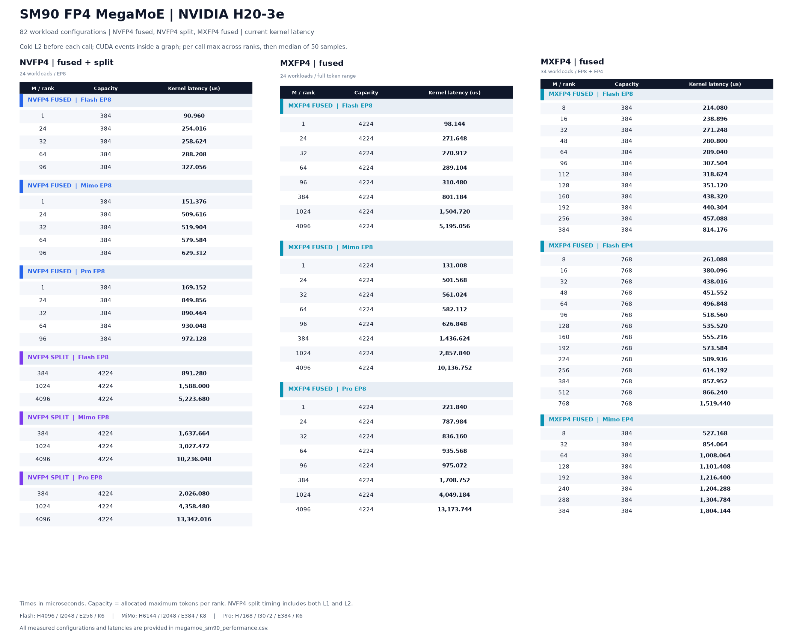
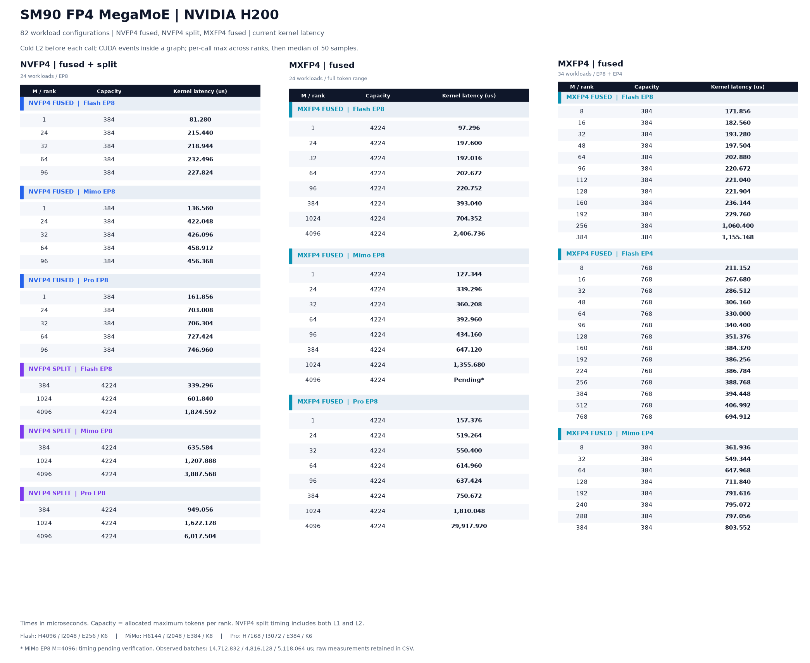

# SM90 FP4 MegaMoE

`flashinfer.megamoe` runs expert-parallel MoE on NVLink-connected Hopper GPUs.
It accepts FP8 E4M3 activations and FP4 expert weights, applies clamped SwiGLU,
and writes BF16 outputs. Token dispatch, expert computation, output scatter
and top-k reduction execute on the GPU.

## Execution paths

| Weight format | Family | Kernel launches | Expert parallelism |
| --- | --- | ---: | --- |
| NVFP4 | fused | 1 | 8 ranks |
| NVFP4 | split | 2: L1, then L2 | 8 ranks |
| MXFP4 | fused | 1 | Power-of-two rank counts from 1 to 32 |

The fused paths perform dispatch, both GEMMs, activation and reduction in a
persistent kernel. The split path dispatches and computes L1 in the first
kernel, then computes L2 and reduces the routed outputs in the second.
NVFP4 split L1 uses a two-CTA cluster.

Weights are decoded to FP8 in shared memory for Hopper WGMMA. TMA stages the
expert-token tiles; warp groups perform GEMMs and write routed outputs to
peer buffers. In the MXFP4 no-swap L2 path, the four math warps synchronize
after WGMMA completion before reusing a decoded weight tile.

## Inputs and weight layouts

Activations have shape `[tokens, hidden]`, with FP32 scales per 128 channels.
Routing uses INT64 global expert indices and FP32 weights of shape
`[tokens, num_topk]`. An expert index of `-1` masks a route. Hidden width must
be a multiple of 256; intermediate width must be a multiple of 128.

The weight preparation functions accept `(packed, scales)` pairs. Packed
weights are UINT8 arrays of shape `[local_experts, N, K / 2]`; byte `b` in each
four-byte word stores `K[b]` in its high nibble and `K[b + 4]` in its low nibble.
L1 places gate rows before up rows. Scale inputs are raw UINT8 E4M3 bytes per
16 values for NVFP4, or E8M0 bytes per 32 values for MXFP4.

NVFP4 preparation produces 80-byte rows per K128 block, consumed by both
families. MXFP4 preparation produces chunk-major N128/K128 tiles containing
8192 packed-weight bytes and 512 scale bytes, for 8704 bytes per tile.
Prepared weights are contiguous and can be reused across invocations.

## API usage

All ranks allocate identical buffer geometry, stage their inputs, and invoke
matching kernels in matching order. Buffer allocation and rendezvous happen
before CUDA graph capture. NVFP4 fused plans support 32 or 48 local experts.

```python
from flashinfer.megamoe import (
    MegaMoESymmBuffer,
    mxfp4_mega_moe,
    nvfp4_mega_moe,
    transform_mxfp4_weights_for_mega_moe,
    transform_nvfp4_weights_for_mega_moe,
)

buf = MegaMoESymmBuffer(
    group,
    num_experts=256,
    num_max_tokens_per_rank=8448,
    num_topk=6,
    hidden=4096,
    intermediate_hidden=2048,
)
nv_w1, nv_w2 = transform_nvfp4_weights_for_mega_moe(nv_l1, nv_l2)
mx_w1, mx_w2 = transform_mxfp4_weights_for_mega_moe(mx_l1, mx_l2)

buf.stage(x_fp8, x_sf, topk_idx, topk_weights)
nvfp4_mega_moe(y, nv_w1, nv_w2, buf, kernel_family="auto")

buf.stage(x_fp8, x_sf, topk_idx, topk_weights)
mxfp4_mega_moe(y, mx_w1, mx_w2, buf)
```

NVFP4 auto selection uses fused through 256 tokens per rank, then split.
`kernel_family` can explicitly select either family. MXFP4 uses fused.
The APIs write the first `num_tokens` rows of `y` and return the same tensor.
Optional FP32 vectors apply per-expert L1/L2 global scales; optional INT32
receive statistics accumulate counts in place.

## Numerical validation

```bash
pytest tests/moe/test_megamoe_fp4_weights.py
pytest tests/moe/test_megamoe_fp4_sm90.py
python tests/moe/test_megamoe_fp4_sm90.py --routing hot --no-fast-math
python tests/moe/test_megamoe_fp4_sm90.py --routing empty --cuda-graph
```

Weight-layout tests run on CPU. Kernel tests require eight Hopper GPUs and
check all three paths against a dense W4A8 reference, including intermediate
FP8 quantization and BF16 routed outputs. They cover masked and signed routing,
expert scales, receive counts, repeated workspace use and CUDA graph replay.
The MXFP4 no-swap test also checks H4096/I2048 with 384 tokens per rank using
six direct calls and six graph replays.

## Performance

Each table contains 82 measured workloads: 15 NVFP4 fused, 9 NVFP4 split and
58 MXFP4 fused. `M` is the number of tokens per rank; `capacity` is the allocated
maximum token count per rank. Flash is H4096/I2048/E256/K6, MiMo is
H6144/I2048/E384/K8, and Pro is H7168/I3072/E384/K6.

The tables use cold L2 before each call, one MoE invocation per CUDA graph,
and CUDA-event timing. Each sample takes the maximum across ranks; the
reported latency is the median of 50 samples. Split latency includes L1 and L2.
Packing, JIT compilation and cache clearing are outside the timed interval.

### H20



### H200



H200 MiMo EP8 M4096 varied across three independently measured batches:
14,712.832, 4,816.128 and 5,118.064 microseconds. This point is marked
**Pending** in the figure; its final latency remains unverified. All observed
values are retained with `status=pending` in
[the performance data](megamoe_sm90_performance.csv).

The bundled benchmark supports repeated-call measurements:

```bash
python benchmarks/bench_megamoe_fp4_sm90.py --shapes flash mimo pro \
    --tokens 1 24 32 64 96 384 --output megamoe_fp4_benchmark.json
```

It defaults to 40 calls per graph replay with a warm cache. Its results use a
different cache protocol from the tables above. Every replay aligns ranks
with an unmeasured GPU collective before CUDA events; reports retain rank
durations and reduce rank maxima before calculating medians.
