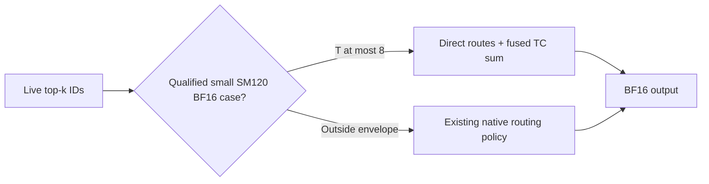

# SM120 BF16/NVFP4 small-token decode

The native SM12x W4A16 MoE path can use direct routing and its fused Tensor
Core sum through eight tokens for small experts. The policy is restricted to
SM120, BF16 activations, packed NVFP4 weights with E4M3 block-16 scales,
H <= 2048, I <= 512 and top-k <= 10. Existing gated-activation, expert-map,
route-dtype and activation-amax checks still apply. Other shapes and SM121
keep the previous four-token cap. The FP16 policy is unchanged.

This reuses the existing MMA body. It extends the region that avoids route
packing and folds the top-k sum into the FC2 epilogue. Preplanned launches
and runtime compilation use the same shape-dependent bound.



## Measurements

NVIDIA RTX PRO 6000 Blackwell Workstation Edition (SM120), CUDA 13.0,
PyTorch 2.14.1+cu130, CuTe DSL 4.8.0, tvm-ffi 0.1.14.post1 and CUPTI 13.0.1.
H=2048, I=512, E=512, top-k=10, T=8, SwiGLU. Synthetic tensors at common model
geometry; the same checkpoint, inputs and routes are used across versions.

| Routes / cache | Original native µs | Bounded native µs | Native speedup | Frost control µs | Improved native / Frost |
|---|---:|---:|---:|---:|---:|
| Shared / warm | 93.807 | 39.840 | 2.355× | 36.000 | 1.107× |
| Shared / cold | 107.423 | 48.848 | 2.199× | 48.688 | 1.003× |
| Disjoint / warm | 163.919 | 63.808 | 2.569× | 52.696 | 1.211× |
| Disjoint / cold | 195.935 | 103.615 | 1.891× | 105.415 | 0.983× |

The benchmark independently selects the native and Frost tactics, then runs
four native-Frost-Frost-native rounds per process. Original and bounded native
measurements come from separate processes, with unchanged Frost as a control:
its median changes by at most 0.1%. This is not a direct two-version ABBA run.
A/A controls and warm CUDA-event-chain checks are retained in the
[measurement record](../benchmarks/data/sm120_bf16_tc_decode_20261024.json).
The search covers all same-thread small/large native tile pairs plus default.
Cold tests evict L2 before each call; eviction is outside the timed interval.

These are complete routed-expert GPU calls. They exclude routing-network
computation, weight preparation, shared experts, EP communication and host
enqueue; they are not model throughput measurements. The former approximately
2.6× Frost advantage over the original native T8/shared path becomes 1.11×
warm and parity cold after improving the native baseline.

The original native path accumulates expert partials and combines in FP32;
the fused TC path atomically accumulates into BF16 output. Both pass the
independent FP64-dot reference at 1% relative L2 and 3% normalized maximum
error, but they are not bitwise-equivalent rounding contracts. Frost also
rounds FC1 preactivation to BF16, while native retains FP32 through activation.

A separate boundary probe at H7168/I2048/E256/K8/T8 found that unrestricted
TC decode was substantially slower for shared experts: approximately
147→389 µs warm and 155→608 µs cold. Its uniformly sampled packed weights are
a diagnostic cohort, not the checkpoint generator used by the table. The
larger shapes therefore retain the original policy; a token-only cutoff would
lose useful weight reuse. T5/T6 diagnostic probes within the small shape show
approximately 1–5% improvement, smaller than the T8 routing transition.

## Repeatability and the existing non-fused option

The fused TC epilogue adds expert contributions to BF16 output with atomics.
The order in which CTAs arrive can change, so identical inputs can produce
different output bits. Passing a numerical tolerance does not establish
bitwise repeatability. CUDA Graph replay does not impose a fixed order on
those cross-CTA additions.

Callers that need a fixed-order combine can use the existing preplanned
route: build `compile_w4a16_fused_moe` with `direct_topk_routes=False` and
`tc_decode_fused_sum=False`, then pass that plan as `fused_launch` to
`run_w4a16_moe`. This writes BF16 expert outputs and uses the separate top-k
sum with FP32 accumulation instead of the fused BF16 atomic epilogue. The
runtime honors the non-fused plan even when the shape qualifies for fused
TC decode. Retain the plan and provide its correctly sized workspaces before
CUDA Graph capture.

This is a low-level plan choice, not a new unified-MoE determinism flag. It
can add route-packing and reduction work. It also has different rounding
boundaries from the atomic path; their results need not match bitwise.
Repeatability should be qualified for the concrete hardware, software and
tactic in use, rather than assumed across devices or compiler versions.
The regression test checks repeated eager execution and retained-graph
replay of the non-fused path with poisoned output and scratch, including
live shared/permuted routes and invalid slots.

## Reproduction and correctness

Run this command on the parent revision and this change with the same settings;
repeat with `--expert-reuse disjoint` and `--cache-mode cold`:

```bash
python benchmarks/bench_frost_low_latency_w4a16.py \
  --weight-format nvfp4 --activation-dtype bf16 \
  --native-backend sm120-tc --tokens 8 \
  --hidden 2048 --intermediate 512 --experts 512 --top-k 10 \
  --expert-reuse shared --cache-mode warm --output tc-decode.json
```

The new regression tests cover T5/6/7/8, live inputs and routes, shared and
permuted experts, invalid IDs with NaN scores, poisoned graph outputs, and
preplanned/runtime-compiled launches without falling back to route packing.
The new tests plus the existing FP16 direct-route tests passed 30 cases;
targeted route-pack, cache and unified integration tests passed another
171 cases (35 deselected). Architecture/format/shape rejection checks preserve excluded regions.
