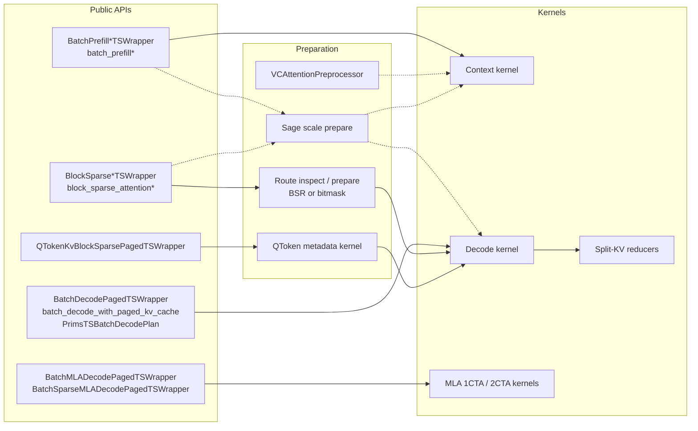
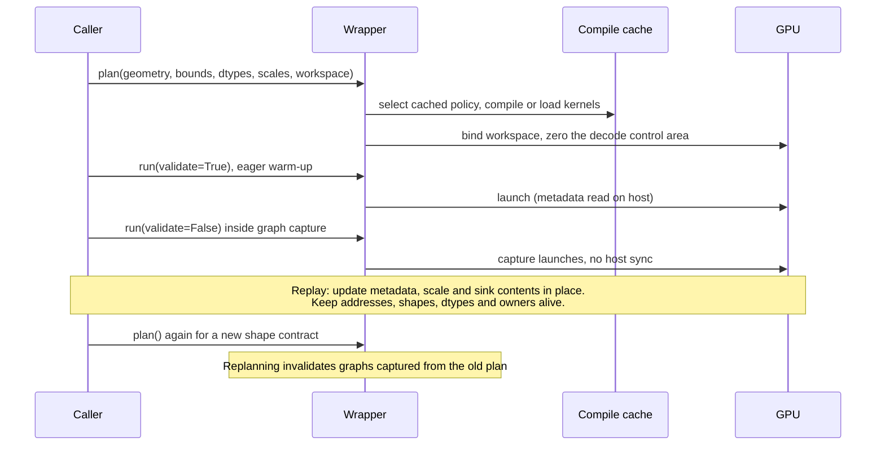

# Experimental Task-Scheduled Attention

`flashinfer.attention.prims_ts` (PrimTS) provides experimental CuTe DSL
attention kernels for NVIDIA Blackwell GPUs: FMHA context/prefill, paged FMHA
decode, block-sparse FMHA, QToken-KV-block sparse attention, and dense and
sparse MLA decode. Scheduling, tile selection, and split-KV reduction are
private; the public interfaces describe attention and cache semantics and
expose no tuning knobs.

- **Experimental API.** Public entry points are decorated with
  `@flashinfer_experimental_api`. Each one emits an `ExperimentalWarning` once,
  on first use, and carries no compatibility guarantee. Calling the API is the
  opt-in; no environment variable is needed. API logging and `fi_trace`
  bindings work as for stable APIs.
- **Import cost.** `import flashinfer.attention.prims_ts` does not need the
  CuTe DSL. The family `__init__.py` modules are host-only; the `kernel/`
  subpackages load the CuTe DSL when a plan first compiles or loads a kernel.
- **DSL versions.** The kernels support CuTe DSL 4.7 and 4.8
  ([`device/task.py`](device/task.py) adapts to either task API).

The rules every family shares (workspace ownership, `validate=False`, CUDA
graphs, global scales, LSE and sinks, split-KV, the compile cache) are in the
[runtime contract](docs/runtime_contract.md).

## Feature map

Block-sparse FMHA and QToken-KV-block sparse attention are front ends over the
paged decode kernel: they prepare routes or metadata and then launch it.



## Which API do I use

Import every name below from `flashinfer.attention.prims_ts`.

| Use case | Public names | Guide |
| --- | --- | --- |
| Prefill over contiguous or paged K/V | `BatchPrefillTSWrapper`, `batch_prefill`, `BatchPrefillPagedTSWrapper`, `batch_prefill_with_paged_kv_cache` | [Context](variants/context/README.md) |
| VC-Attention prefill (quantized Q/K with prepared scales) | `VCAttentionConfig`, `VCAttentionParams`, `VCAttentionPreprocessor`, `vc_qk8_dtype` | [VC-Attention](variants/vc_attention/README.md) |
| Sage attention recipes for context and block-sparse plans | `SageAttentionConfig`, `SageAttentionParams` | [Sage](variants/sage/README.md) |
| Paged decode with a dense page table | `BatchDecodePagedTSWrapper`, `batch_decode_with_paged_kv_cache`, `get_prims_ts_batch_decode_workspace_size` | [Decode](variants/decode/README.md) |
| Decode hot path for a framework that keeps K/V, page tables and workspace stable | `prepare_prims_ts_batch_decode_with_kv_cache`, `PrimsTSBatchDecodePlan` | [Decode](variants/decode/README.md) |
| Per-query-token top-k K/V blocks over a paged cache | `QTokenKvBlockSparsePagedTSWrapper`, `q_token_kv_block_sparse_attention_with_paged_kv_cache`, `get_q_token_kv_block_sparse_workspace_size`, `suggest_q_token_kv_block_sparse_group_size`, `validate_q_token_kv_block_sparse_group_size`, `make_q_token_kv_block_sparse_qo_indptr` | [QToken-KV-block sparse](variants/q_token_kv_block_sparse_metadata/README.md) |
| Block-sparse FMHA over contiguous or paged K/V (BSR or bitmask) | `BlockSparseTSWrapper`, `block_sparse_attention`, `BlockSparsePagedTSWrapper`, `block_sparse_attention_with_paged_kv_cache` | [Block sparse](variants/block_sparse/README.md) |
| Dense MLA decode | `BatchMLADecodePagedTSWrapper`, `batch_mla_decode_with_paged_kv_cache`, `get_prims_ts_batch_mla_decode_workspace_size`, `MLAAttentionTuning` | [MLA decode](variants/mla_decode/README.md) |
| Sparse (top-k index) MLA decode | `BatchSparseMLADecodePagedTSWrapper`, `batch_sparse_mla_decode_with_paged_kv_cache`, `get_prims_ts_sparse_mla_decode_workspace_size` | [MLA decode](variants/mla_decode/README.md) |

Wrappers (`*TSWrapper`) split work into `plan()` and `run()` and suit
repeated calls and CUDA graphs. The one-shot functions plan and run in one
call. Each family guide lists supported shapes, dtypes, layouts, examples and
limitations.

## Quickstart: paged decode

```python
import torch
from flashinfer.attention.prims_ts import BatchDecodePagedTSWrapper

device = torch.device("cuda")
dtype = torch.bfloat16
num_qo_heads, num_kv_heads, head_dim, page_size = 32, 4, 128, 32
batch_size, max_kv_len = 2, 128

# Plan once: select the policy, compile or load kernels, bind workspace.
wrapper = BatchDecodePagedTSWrapper("NHD")
wrapper.plan(
    device, batch_size, num_qo_heads, num_kv_heads, head_dim, page_size,
    max_kv_len, q_dtype=dtype,
)

# One query token per request; NHD K/V: [pages, page_size, kv_heads, head_dim].
q = torch.randn(batch_size, num_qo_heads, head_dim, dtype=dtype, device=device)
k_cache = torch.randn(8, page_size, num_kv_heads, head_dim, dtype=dtype, device=device)
v_cache = torch.randn_like(k_cache)
seq_lens_kv = torch.tensor([128, 96], dtype=torch.int32, device=device)
block_tables = torch.tensor([[0, 1, 2, 3], [4, 5, 6, 0]], dtype=torch.int32, device=device)
out = torch.empty_like(q)

# Eager warm-up with validation, then capture the trusted path.
wrapper.run(q, (k_cache, v_cache), seq_lens_kv, block_tables, out=out)
graph = torch.cuda.CUDAGraph()
with torch.cuda.graph(graph):
    wrapper.run(q, (k_cache, v_cache), seq_lens_kv, block_tables, out=out, validate=False)

# Update metadata and inputs in place, then replay.
seq_lens_kv.copy_(torch.tensor([100, 128], dtype=torch.int32))
graph.replay()
```

## Plan, run and capture lifecycle



`plan()` takes the model configuration, the exact batch size and the Q/KV
bounds. `run()` never selects a policy or compiles; it binds live tensors and
metadata to the prepared state. (QToken-KV-block sparse attention compiles on
its first eager `run()` instead.) Growing live K/V lengths within the planned
capacity does not need a new plan. See the
[runtime contract](docs/runtime_contract.md) for the workspace, `validate=False`
and CUDA-graph obligations.

## Source layout

| Path | Contents |
| --- | --- |
| [`variants/`](variants) | One package per feature (`context`, `decode`, `mla_decode`, `block_sparse`, `q_token_kv_block_sparse_metadata`, `sage`, `vc_attention`) with its public API in `__init__.py`; context, decode, MLA decode and block sparse keep their CuTe DSL kernels in `kernel/`. Each package is also importable under its public path, `flashinfer.attention.prims_ts.<feature>` |
| [`common/`](common) | Host-only helpers: argument validation, global scales, paged K/V views, workspace sections, split-KV mode ordering |
| [`device/`](device) | Shared CuTe DSL helpers: LSE merge, masks, packing, pipelines, schedule steps, softmax row max, task and stage support, TMA descriptors |
| [`compile_cache.py`](compile_cache.py) | Persistent compile cache for all families |

Where new code goes, the dependency and naming rules, and the checks that
enforce them are in [code structure](docs/code_structure.md).

## Tests

```bash
pytest -q tests/attention/test_attention_ts_*.py
```

| Validated on | Stack |
| --- | --- |
| SM100a (B200), SM103 (GB300) | B200: kernel qualification. GB300: CUDA 13.4, PyTorch 26.08, CuTe DSL 4.7.0; correctness smoke on CuTe DSL 4.8.1 |
