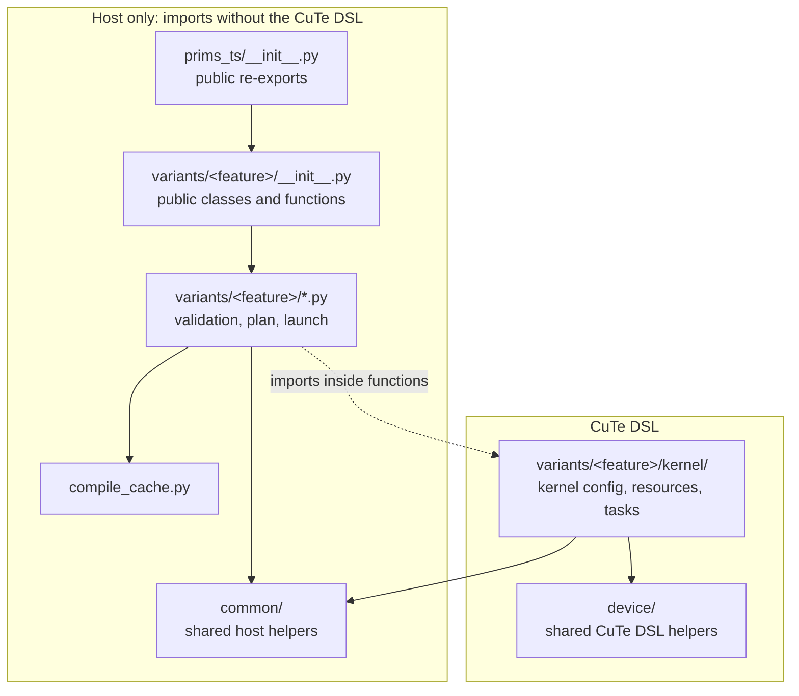
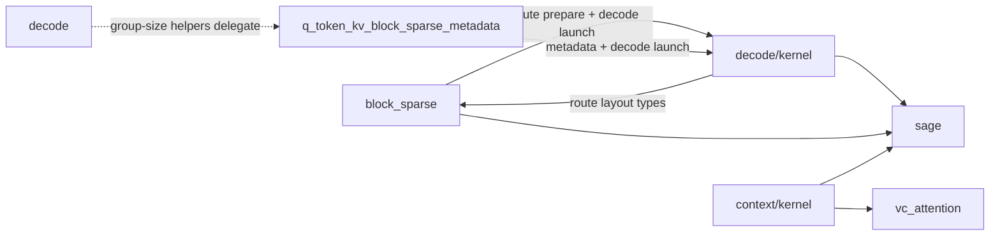
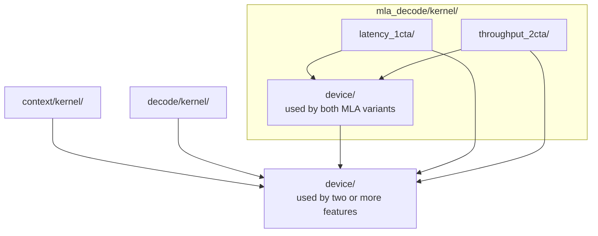

# PrimTS code structure

Rules for where PrimTS attention code lives, how it is named and how it is
formatted. The [checks](#checks) table lists the tests that enforce them. For
runtime behavior, see the [runtime contract](runtime_contract.md).

## Layers



Arrows point from the importer to the imported code. `common/` and `device/`
import nothing from the feature folders.

## Folder layout

```text
prims_ts/
├── __init__.py            public re-exports, plus the public module paths
│                          of the feature packages (see "Public API")
├── README.md              entry point: feature map, API table, quickstart
├── compile_cache.py       stays at the root: it hashes every source file below it
├── docs/                  cross-feature contracts and these rules
├── common/                host helpers used by two or more features
├── device/                CuTe DSL helpers used by two or more features (see below)
└── variants/              one package per attention feature
    └── <feature>/         context, decode, mla_decode, block_sparse,
        │                  q_token_kv_block_sparse_metadata, sage, vc_attention
        ├── __init__.py    public classes and functions, kept thin
        ├── README.md      feature guide (see "Docs" below)
        ├── validation.py  ┐ host implementation, one job per module:
        ├── plan.py        │ argument checks, plan state, compile specs and
        ├── compile.py     │ kernel cache, launch. Not every feature needs
        ├── launch.py      ┘ all four (context adds geometry.py, MLA decode
        │                    sparse_plan.py); a module that does one of these
        │                    jobs uses that name
        └── kernel/
            ├── device/    CuTe DSL helpers of this feature's kernel: layouts,
            │              indexing, intrinsics (MLA decode: shared by the
            │              latency 1CTA and throughput 2CTA kernels)
            ├── config.py  static kernel configuration
            ├── selection.py  runtime heuristics: grouping, split-KV, launch mode
            │              (MLA decode also sparse_selection.py; QToken keeps its
            │              host-only selection.py at the feature root)
            ├── kernel.py  @cute.kernel entry points and launches
            ├── resources/ one module per SMEM / TMEM / GMEM resource; only
            │              MemoryResource classes and their own constants
            └── tasks/     one module per task role (load, mma, softmax, ...)
```

Every folder that holds Python files has an `__init__.py`, because wheels ship
only packages.

## Where new code goes

| You are adding | Put it in |
| --- | --- |
| A public class or function | `variants/<feature>/__init__.py`, listed in its `__all__` and re-exported from `prims_ts/__init__.py` |
| Host logic behind a public entry point | A module next to it: `validation.py`, `plan.py`, `launch.py`, or a new module with one job |
| A host helper that a second feature needs | `common/` (move it there; don't import it from the other feature) |
| A CuTe DSL helper that a second feature needs | `device/` (see [shared device code](#shared-device-code)) |
| A CuTe DSL helper that only one feature's kernel needs (not a resource or task role) | `variants/<feature>/kernel/device/`; a helper that only one MLA kernel variant needs stays in that variant's folder |
| A kernel resource or task role | `variants/<feature>/kernel/resources/<name>.py` or `variants/<feature>/kernel/tasks/<role>.py` |
| A new feature | A new `variants/<feature>/` folder with `__init__.py` and `README.md`, plus `kernel/` if it has its own kernel |
| A rule that spans features | `docs/` |

Split a module when it does more than one of these jobs. Splitting moves
implementation only. Public definitions stay where they are.

## Dependencies

- **CuTe DSL boundary.** Only `kernel/` and `device/` import `cutlass` at
  module level. Host modules that build kernels import them inside the
  function that needs them, so `import flashinfer.attention.prims_ts` works
  without the CuTe DSL. This holds for every feature, including Sage and
  VC, whose CuTe DSL code lives in `sage/kernel/` and `vc_attention/kernel/`.
- **Sharing between features** goes through `common/` and `device/`. The
  edges below already exist; don't add new ones. Move the shared code
  instead.



Block sparse and QToken are front ends over the decode kernel. Sage and VC are
add-ons that the context and decode kernels read. MLA decode imports no other
feature.

- **Cycles.** Break a cycle with a function-local import only when the type
  that causes it is public and must stay in a package `__init__.py` (QToken
  grouping, the MLA tuning type). Otherwise, move the shared code down a layer.

## Shared device code

Device code is shared at two levels:



| Module | Holds | Used by |
| --- | --- | --- |
| `lse_merge.py` | Split-KV partial-output and LSE merge arithmetic | context, decode, MLA decode |
| `mask.py` | Masking predicates | decode, MLA decode |
| `packing.py` | Register packing (FP8/BF16/FP16, NVFP4 → E4M3), SMEM descriptor freezing, the packed E4M3 × E2M1 capability probe | context, decode, MLA decode, VC |
| `pipeline.py` | `StructuredWaitPipelineAsync`, a pipeline with an explicit retry wait | context, MLA decode |
| `placeholders.py` | Trace-time SMEM and register placeholders | context, decode |
| `schedule.py` | Schedule steps: page-offset produce/release, token-throttle head/tail | decode, MLA decode |
| `softmax.py` | Row-max sentinel and the unsigned atomic-max encoding | decode, MLA decode |
| `stage.py` | `WorkStage`, the schedule-section tag | context, decode, MLA decode |
| `task.py` | CuTe DSL 4.7/4.8 task-API compatibility | decode, MLA decode |
| `tcgen05.py` | tcgen05 compatibility helpers | context, decode, MLA decode, Sage |
| `tensor_map.py` | Ragged tensor-map helpers | context, decode, MLA decode |

When to share:

- **Share** a helper when two kernels hold the same code: same decorators,
  signature and body, differing at most in type annotations or import
  aliases. Move one copy here, delete the others and import the shared one.
- **Merge drifted copies only when the result compiles to the same SASS** for
  every kernel that uses it. Copies that differ in `const_expr` branches,
  config types or address math stay separate.
- **Don't share kernel-specific resources and tasks** (`TmemSResource`,
  `create_mma_task`, ...), even when they share a name. They differ in MMA
  shape, CTA count and layout, and are tuned per kernel.

To check that a move changes no kernel, compile the GPU suite before and after
with `CUTE_DSL_KEEP=cubin` and give each compile its own `CUTE_DSL_DUMP_DIR`
(dumped file names encode only tensor types, so different configurations
overwrite each other). Then compare the sets of normalized SASS: `cuobjdump
-sass` without addresses and encodings, one hash per kernel. The compile cache
hashes every source file in the package, so after any edit each kernel
recompiles once.

A few kernels don't compile deterministically: recompiling the same source
can renumber uniform registers and reorder independent instructions, even with
`PYTHONHASHSEED` fixed. Seen so far: the MLA 2CTA BF16 split-KV kernel and
the DeepSeek v4.1 HCA split-KV kernel. For a kernel whose hash differs, compare
the opcode sequences, then compile the unchanged base twice. If the base copies
also differ from each other, the difference is compile noise, not the move.

## Public API and compatibility

Only the public API is a compatibility surface:

- the names in `flashinfer.attention.prims_ts.__all__`;
- the public modules `context`, `decode`, `mla_decode`, `block_sparse`,
  `q_token_kv_block_sparse_metadata`, `sage`, `sage.config`, `vc_attention`
  and `vc_attention.quantization`;
- the PrimTS names that `flashinfer.decode` and `flashinfer.mla` re-export.

For these, the name, qualified name, signature, trace tag and behavior stay
fixed. The feature packages live in `variants/`; `prims_ts/__init__.py`
registers each public module under its public path, so
`import flashinfer.attention.prims_ts.decode` returns
`flashinfer.attention.prims_ts.variants.decode`. In-tree code imports the
`variants` paths. Internal submodules (`decode.launch` and so on) have no
public path.

The `fi_api` trace tag is `__module__ + "." + __qualname__`, with the
`prims_ts.variants.` prefix mapped to `prims_ts.` (`_trace_fi_api_for` in
`flashinfer/api_logging.py`). A public object must therefore stay *defined* in
its `variants/<feature>/__init__.py`. Re-exporting it from a new module would
change its tag.

Public entry points stay thin. The signature, docstring and decorators stay in
place, and the body calls the implementation module:

```python
@flashinfer_experimental_api
def suggest_q_token_kv_block_sparse_group_size(*args, **kwargs):
    """Public docstring stays here."""
    from ..q_token_kv_block_sparse_metadata.grouping import suggest_group_size

    return suggest_group_size(*args, **kwargs)
```

Everything else is internal: module paths, helper names and kernel layout can
change without aliases or deprecation shims. Update in-tree callers
(`flashinfer.decode`, `flashinfer.mla`, `flashinfer/experimental`, trace
templates, tests and benchmarks) in the same change.

## Order of definitions

Definitions are ordered by kind, then alphabetically, so a reader can find a
name without reading the file top to bottom:

- **Module:** docstring, imports, constants (kept in their written order,
  because they are grouped and build on each other), classes, functions,
  `__all__`.
- **Class:** docstring, fields, nested classes, dunder methods (`__init__` and
  `__post_init__` first), properties, methods.
- **Resource fields** (`kw_only` dataclasses) are grouped under comment headers:
  static configuration, linked resources, runtime scalars, GMEM pointers and
  tensors, allocations, per-task state.

A definition stays below anything it needs while the module or class body runs
(base classes, decorators, defaults). Positional dataclasses keep their field
order, and Enum and NamedTuple classes keep their member order, because that
order is part of their behavior.

## Naming

| Element | Rule | Example |
| --- | --- | --- |
| Modules and folders | No leading `_`. Don't repeat the parent folder | `decode/kernel/config.py`, not `fmha_decode/fmha_decode_config.py` |
| Leading `_` | None on modules, functions, classes, constants, fields, methods or attributes. Exceptions: dunders, the throwaway `_`, and methods that override CuTe DSL hooks (`_run_task_body_impl` and similar) | `SageScaleLayout`, `alloc`, `stage_base` |
| Implementation behind a wrapper | `<name>_impl` when the wrapper takes the plain name | `store_o` and `store_o_impl` |
| Functions and methods | `snake_case`, starting with a verb from the table below | `resolve_max_sequence_length`, `select_split_kv_modes` |
| Classes | `CapWords` | `WorkspaceSection` |
| Constants | `UPPER_SNAKE_CASE` | `LOG2_E` |
| Prefixes | No `prims_ts_`, `fmha_decode_` or `decode_gen_` on internal names; the folder already says it | `get_task_cache`, `launch_decode_kernel` |
| Collisions | If the plain name is a common local variable, choose a descriptive one | `cuda_device_index`, `attention_dtype_key`, `pointer_address` |

| Verb | Meaning |
| --- | --- |
| `validate_` | Check inputs and raise; returns nothing or the normalized value. Not `check_` |
| `resolve_` | Derive one value from inputs and defaults |
| `select_` | Choose among policies, configurations or kernels |
| `make_`, `build_` | Construct a new object or schedule |
| `prepare_` | Produce launch-ready tensors or state |
| `get_` | Look up a cached or compiled object (`get_compiled_*`) |
| `launch_` | Enqueue a kernel |

Exceptions:
- Public names never change, even when they break a rule above.
- `@cute.kernel` entry points (`decode_gen_kernel`, ...) keep their names,
  because they become kernel symbols that profilers and tooling filter on.
- Overrides of CuTe DSL hooks keep the hook's name, e.g.
  `_verify_head_loop_producer_overlap`.

## Formatting

- Every file starts with the FlashInfer Apache-2.0 license header.
- `ruff` (lint and format) runs on the whole package through pre-commit.
  `mypy` runs on host code; it excludes `device/` and `*/kernel/`, whose
  bodies are lowered by the CuTe DSL compiler.
- Inside the package, use relative imports. Outside it, import the public
  module path.
- Moves use `git mv` with import updates only, so `git blame` follows the
  history. Behavior changes go in separate commits.
- Error messages and exception types are part of behavior. Merging two
  helpers that report different messages is not allowed; keep both under
  distinct names, or pass the message as a parameter.

## Docs

- The root `README.md` is the entry point and stays at its path
  (`docs/api/attention.rst` links it). Each feature's `README.md` follows one
  template: purpose, minimal example, support matrix, lifecycle, dataflow
  diagram, limitations tagged by cause, source map, tests.
- Write in the present tense about current behavior. Performance tables and
  validation history belong in benchmarks and PR descriptions.
- Diagrams are Mermaid. Use SVG only for TMEM/SMEM tile layouts.
- Python snippets in the docs must import only names that exist, and relative
  links must resolve.

## Checks

| Check | Enforces |
| --- | --- |
| `tests/trace/test_fi_trace_template_consistency.py` | Trace golden files match without regeneration |
| `tests/attention/test_attention_ts_*.py` (GPU) | Behavior on B200 / B300 |
