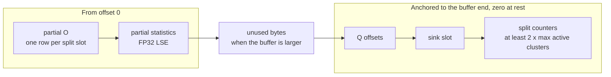
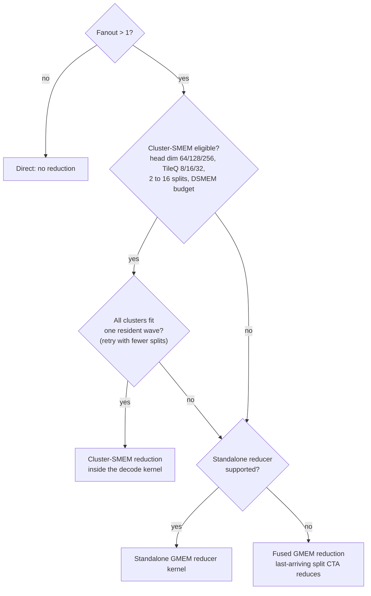

# PrimTS runtime contract

These rules apply to every PrimTS attention family. The family guides
([context](../variants/context/README.md), [decode](../variants/decode/README.md),
[MLA decode](../variants/mla_decode/README.md), [block sparse](../variants/block_sparse/README.md),
[QToken-KV-block sparse](../variants/q_token_kv_block_sparse_metadata/README.md),
[Sage](../variants/sage/README.md), [VC-Attention](../variants/vc_attention/README.md)) link here
instead of repeating them.

## Plans and ownership

`plan()` takes the model configuration, the exact batch size and the Q/KV
bounds. It selects a cached policy, compiles or loads the kernels, and binds
workspace. `run()` uses that prepared state with live tensors and metadata; it
never selects a policy or compiles. The exception is QToken-KV-block sparse
attention, whose first eager `run()` binds the tensor ABI, compiles and
initializes scratch; run it once outside capture. Replan when the planned shape or capacity
contract changes. Live K/V lengths that grow within the planned capacity do
not need a new plan.

- CPU policy resolvers and compiled-callable lookups use `functools.cache`, so
  equivalent plans across layers share selection and compiled code.
- Each wrapper holds one prepared state and owns its resource bindings. There
  is no shared multi-key GPU-binding cache.
- One wrapper serves one ordered lane. Concurrent streams or concurrent graph
  replays need separate wrappers and separate workspaces.

## Workspace

| Family | Workspace | Size query | Initialization |
| --- | --- | --- | --- |
| Context | None (no split reduction) | None | None |
| Paged decode | Caller or plan-allocated byte arena | `get_prims_ts_batch_decode_workspace_size` | Control area must be zero before the first launch |
| QToken-KV-block sparse | Caller arena passed to `plan()`: route metadata and decode scratch in disjoint regions | `get_q_token_kv_block_sparse_workspace_size` | The first eager `run()` initializes split-KV scratch |
| Dense MLA | Split-KV scratch | `get_prims_ts_batch_mla_decode_workspace_size` | Not required |
| Sparse MLA | Split-KV scratch | `get_prims_ts_sparse_mla_decode_workspace_size` (takes the `plan()` arguments) | Not required |

A workspace is a contiguous `torch.int8` or `torch.uint8` CUDA tensor on the
plan device, 32-byte aligned and at least the queried size. Pass the same
geometry and dtypes to the size query and to `plan()`. Caller scratch can go
straight to `plan()` without a query; without one, planning allocates exactly
the selected layout. Output, LSE and workspace must be disjoint from each other
and from every input. Overlap is a caller precondition and is not checked.

### Decode arena

The decode arena ([`decode/launch.py`](../variants/decode/launch.py)
`make_decode_workspace_layout` / `bind_decode_workspace`, sections from
[`common/workspace.py`](../common/workspace.py)) puts the split-KV partial
outputs and their FP32 statistics at offset 0. The zero-at-rest control area
(query offsets, sink slot, split-completion counters) is laid out last and
anchored to the end of the buffer, whatever its size. Every section starts on a
256-byte boundary.



- Partials are 16-bit (the output dtype, or BF16/FP16 for FP8 output). The
  standalone reducer reads one log2-LSE per row; the fused and cluster
  reducers keep two FP32 values per row.
- The counter reserve is at least two device waves of logical Q CTAs, so plans
  that share one buffer keep the control area at the same bytes.
- The fused reducer's completion counter wraps back to zero after the last
  split arrives, so launches leave the control area zero.

Initialization rules:

- `BatchDecodePagedTSWrapper.plan()` zeroes the control area unless
  `initialize_workspace=False`, which hands that duty to the caller.
- `batch_decode_with_paged_kv_cache` with a caller `workspace_buffer` does not
  zero it. Zero it before the first launch, and again whenever a layout input
  (including `batch_size`) changes, because section offsets can move while the
  compiled callable is reused.
- Plans for one device may share one buffer of at least the largest queried
  size: zero the whole buffer once, bind the same full tensor (not slices) to
  every plan, and plan and launch them on one stream.

## `validate=False` obligations

`validate=True` checks structure and values, and reads per-run metadata back
to the host. `validate=False` treats every argument as a trusted binding: no
metadata validation and no device-to-host synchronization. Scale argument
types and metadata are checked in both modes.

Block sparse is the exception: `BlockSparseTSWrapper.run(validate=True)` and
`BlockSparsePagedTSWrapper.run(validate=True)` check tensor structure, not
routing values. An out-of-range block ID passes validation and reaches the
GPU, so block-sparse callers guarantee routing values in both modes (see
[block sparse](../variants/block_sparse/README.md)). The one-shot calls
that take BSR routes add one value check: `block_sparse_attention_with_paged_kv_cache`
always, and `block_sparse_attention` with `sparse_format="bsr"`. A GPU inspector
validates the BSR rows (canonical rows of in-range block IDs; for paged K/V also
`seq_lens_kv` and the live page IDs in `block_tables`) and copies a small fixed
summary to the host. Contiguous bitmask mode sizes its plan from the structural
bound and dense mode has no routes, so neither inspects values; bitmask contents
(`exact_block_bits`) and `kv_valid_bits` are never inspected.

With `validate=False` the caller guarantees:

- shapes, dtypes, strides, alignment and devices match the plan;
- page IDs index the cache, offsets are monotonic and within bounds, and live
  lengths stay within the planned capacity;
- causal per-request Q lengths do not exceed their K/V lengths;
- output, LSE and workspace do not alias inputs or each other;
- every bound tensor stays alive until the launch or replay finishes.

Omitted run bounds then default to the plan capacities. Update live metadata
only between completed launches or replays.

## CUDA graphs

1. Plan and run once with `validate=True` outside capture. Warm up every scale
   type signature you will capture.
2. Capture `run()` with `validate=False` and caller-supplied output (and LSE,
   when enabled). One-shot decode capture also needs `workspace_buffer`,
   `max_kv_len` and, for packed Q, `max_q_len`.
3. Replay runs the captured GPU work without Python planning or dispatch.
   Change metadata, scale and sink contents in place between replays; keep
   addresses, shapes, dtypes and owners alive.
4. Replanning invalidates graphs captured from the previous plan. Let earlier
   launches and replays finish before you replan.

## Global scale operands

Each global scale accepts either a positive finite Python number or a
contiguous CUDA FP32 tensor of shape `()` or `(1,)` on the attention device
([`common/scales.py`](../common/scales.py)). Validation never reads tensor
contents, so keeping them positive and finite is the caller's job. QK scales
use natural-exponential units; the conversion to base 2 is internal.

| Family | Global operands | QK default |
| --- | --- | --- |
| Context (contiguous and paged) | `softmax_scale`, `output_scale` | `1 / sqrt(D)` |
| Paged decode (wrapper, prepared plan, one-shot) | `softmax_scale`, `output_scale` | `1 / sqrt(D)` |
| QToken-KV-block sparse | `sm_scale`, `v_scale` | `1 / sqrt(D)` |
| Block sparse (contiguous and paged) | `sm_scale`, `output_scale` | `1 / sqrt(D)` |
| Dense MLA | `softmax_scale`, `output_scale` | 1 |
| Sparse MLA | `softmax_scale`, `output_scale`; `kv_cache_scale` for a per-tensor FP8 primary pool | `1 / sqrt(query_width)` |

- Output multipliers and sparse storage descales default to 1. The output
  multiplier scales the whole attention result, including any restored Sage V
  mean, and never changes LSE.
- Pass defaults to `plan()` (or the prepared-plan constructor). Their types
  pick the kernel signature independently: float/float, float/tensor,
  tensor/float or tensor/tensor. Only types specialize compiled code; values
  and tensor addresses are runtime arguments.
- `run()` with `None` inherits the planned operand. An override must keep the
  planned type; replan to change it. One-shot calls infer types from the
  operands supplied.
- FP8 dequantization is composed by the caller: the effective QK scale is
  `attention_scale * q_scale * k_scale`, and the output scale includes
  `v_scale`. A GPU quantizer can write these products into the scale tensors;
  attention reads them in stream order without a host readback.
- A captured graph keeps the float values and tensor addresses seen at
  capture. Update tensor contents in place before replay. Replacing a tensor or
  changing a Python float affects only later eager launches or new captures.
- The plan keeps references to its default scale tensors; the caller keeps any
  tensor passed as a run-time override.
- Sage/VC block and channel scales, NVFP4 block scales and the MLA output
  quantization buffer `out_scale` are separate contracts (see their guides).

## Final softmax statistics and attention sinks

Context, dense FMHA decode and dense MLA decode plans take
`lse_mode="none"` (default) or `"base2"`. Base 2 matches FlashInfer FMHA and
cascade statistics.

- Enable LSE in `plan()`, then pass `return_lse=True` to get `(output, lse)`.
- `lse` is a compact CUDA FP32 tensor shaped like the query without its last
  dimension. A supplied buffer is written whenever the plan enables LSE, even
  with `return_lse=False`; an omitted one is allocated.
- LSE excludes output scaling and removes the internal FP8 probability
  amplification. Split scratch stays base 2 until the final store.
- Sparse MLA keeps its own `return_lse` contract: natural-log QK LSE before the
  attention-sink contribution. An empty sparse row writes zero output and
  `-inf` LSE.

Context and dense FMHA decode plans also accept `use_attention_sinks=True`;
every `run()` then binds `attention_sinks`, a compact CUDA FP32 `[Hq]` vector
of natural-log sink logits after QK scaling. A sink adds denominator mass and
contributes no value. Values must be finite or `-inf`; validation checks only
tensor metadata. The final stable merge happens once, after any split
reduction and before output rounding, and the returned LSE includes the sink.
Sink values may change between completed graph replays. Sparse MLA uses the
same `attention_sinks` / `use_attention_sinks` names; its LSE contract is above.

## Split-KV policy

Split counts are automatic and private. No count, ceiling or count tensor is
public. Paged decode and QToken-KV-block sparse attention take
`split_kv=False` (in their workspace-size queries, `plan()`, the prepared
decode entry point and the one-shot calls), which forces nonsplit execution
and must match between the size query, planning and launch. MLA decode and
block sparse have no `split_kv` argument and choose splits automatically.

- **Fanout.** Splits fill otherwise idle SM slots of one wave while keeping at
  least two KV loop iterations per split
  ([`decode/kernel/selection.py`](../variants/decode/kernel/selection.py)). The
  physical SM count is the ceiling.
- **Runtime count.** The fanout is a runtime operand of the producer and
  reducer. GMEM split plans prepare capacity for the SM count; compact partials
  are packed by the runtime fanout, so changing the count within capacity
  reuses every compiled callable, including the reducer. Inactive slots and
  cluster ranks contribute neutral state.
- **Exceptions.** Cluster-SMEM plans use the fanout as their capacity (it is
  the cluster size). Grids whose `batch * Q CTAs` exceed CUDA's grid-Z limit
  keep an exact-fanout launch.
- **Page IDs.** When the KV bound and runtime count guarantee that a CTA's
  instruction-aligned span fits in 32 page IDs, dense FMHA keeps one
  CTA-relative page window through K and V; longer spans use the staged
  pipeline. The choice is made inside the compiled launcher and does not affect
  workspace size.

### Reducer choice

FMHA decode tries reducers in a fixed order
([`common/split_kv_mode.py`](../common/split_kv_mode.py)) and takes the first
one the plan supports:



- Cluster-SMEM also requires the SwapsMmaAb variant, no persistent scheduler,
  and either single-token ungrouped Q or complete-token grouped Q. Residency is
  checked with the real cluster size; when no smaller split count fits one
  wave, selection falls back to the standalone reducer.
- The standalone reducer ([`decode/kernel/reduction.py`](../variants/decode/kernel/reduction.py))
  picks its schedule from the split count (2-4, 5-16, 17 and more) and merges
  the sink denominator before writing the output.
- Plans with attention sinks or sliding windows skip this search; a sink plan
  that splits keeps the fused reducer.
- MLA uses the same ordering: the 1CTA kernel tries cluster-SMEM and then the
  standalone reducer; the 2CTA kernel uses the standalone reducer. MLA 2CTA
  sizes split scratch from its capacity (1, or the SM count).

## Compile cache

All families compile through [`compile_cache.py`](../compile_cache.py), which
uses FlashInfer's persistent CuTe DSL object cache
([`flashinfer/jit/cute_dsl_core.py`](../../../jit/cute_dsl_core.py)).

- **Key.** The hash covers the static kernel specification (compile options,
  configuration, dtypes, scale types) and the physical GPU capability. The
  device index is excluded, so ranks on equivalent GPUs share artifacts.
  Specifications that cannot be encoded stably skip the disk cache.
- **Invalidation.** A change to any `*.py` file under `prims_ts/`, the compile
  target, or the installed DSL stack (CuTe DSL, TVM-FFI, PyTorch, Python ABI)
  invalidates the module directory.
- **Location.** Objects and `meta.json` live under
  `~/.cache/flashinfer/<flashinfer-version>/<cuda-archs>/cached_ops/prims_ts_<family>_<compile-arch>_cute_dsl/`,
  where `<family>` is `context`, `decode`, `mla_decode`, `block_sparse` or
  `vc_prepare`. For example, FlashInfer 0.7.2 on a GB300 stores decode kernels
  in `~/.cache/flashinfer/0.7.2/103a/cached_ops/prims_ts_decode_sm103a_cute_dsl/`.
- **Overrides.** `FLASHINFER_WORKSPACE_BASE=/path` moves the cache under
  `/path/.cache/flashinfer/`. `FLASHINFER_CUTE_DSL_DISABLE_CACHE=1` compiles
  in process without disk persistence.
- **In-process caches.** Occupancy probes run once per device and cluster
  size in each process. Sage scale preparation compiles in process only.

Print the resolved `cached_ops` directory with:

```bash
python -c 'from flashinfer.jit import env; print(env.FLASHINFER_JIT_DIR)'
```

Plan (and so compile) before CUDA graph capture.
