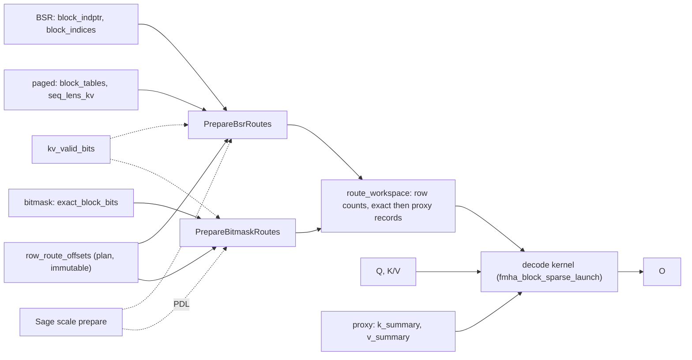
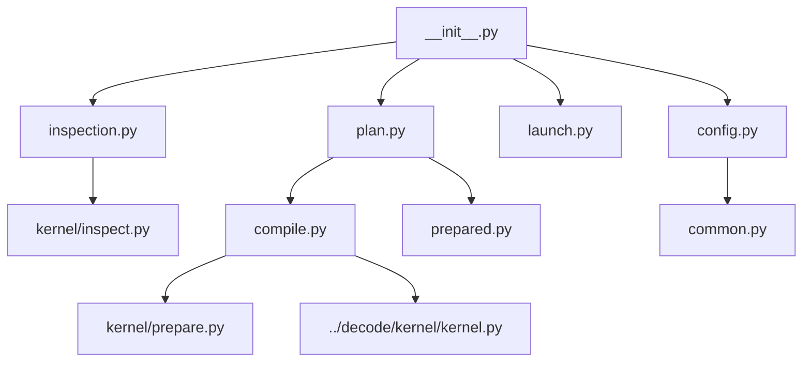

# Block-sparse attention

`block_sparse/` is a front end over the [decode kernel](../decode/README.md).
Each run turns the caller's sparse pattern (BSR rows or a packed exact-block
bitmask) into compact, fixed-width route records, then launches the decode
kernel, which reads only those records. Contiguous BSHD K/V supports exact and
proxy routes, a dense mode and [Sage attention](../sage/README.md); paged K/V
supports exact BSR routes.

## Example

```python
import torch
from flashinfer.attention.prims_ts import BlockSparseTSWrapper

device = torch.device("cuda")
B, Sq, Skv, Hq, Hkv, D = 1, 256, 1024, 8, 2, 128
q_block_size, kv_block_size = 64, 64
num_q_blocks, num_kv_blocks = Sq // q_block_size, Skv // kv_block_size

wrapper = BlockSparseTSWrapper()
wrapper.plan(
    B, Sq, Skv, Hq, Hkv, D, q_block_size, kv_block_size,
    device=device, max_blocks_per_row=3, q_data_type=torch.bfloat16,
)

q = torch.randn(B, Sq, Hq, D, dtype=torch.bfloat16, device=device)
k = torch.randn(B, Skv, Hkv, D, dtype=torch.bfloat16, device=device)
v = torch.randn_like(k)

# Every (batch, KV head, Q block) row selects KV blocks 0, 1 and the last one.
# block_indptr holds absolute offsets into the flat block_indices.
selected = torch.tensor([0, 1, num_kv_blocks - 1], dtype=torch.int32, device=device)
block_indices = selected.repeat(B * Hkv * num_q_blocks)
block_indptr = (
    torch.arange(B * Hkv, dtype=torch.int32, device=device).view(B, Hkv, 1) * num_q_blocks
    + torch.arange(num_q_blocks + 1, dtype=torch.int32, device=device)
) * selected.numel()

out = wrapper.run(q, k, v, block_indptr, block_indices)  # [B, Sq, Hq, D]
```

| API | Use |
| --- | --- |
| `BlockSparseTSWrapper` | Contiguous K/V: reusable plan; BSR or bitmask, exact or proxy routes, or dense mode |
| `block_sparse_attention` | One-shot contiguous call; with BSR, a GPU inspector validates the rows and sizes its plan |
| `BlockSparsePagedTSWrapper` | Paged K/V: plan fixes Q geometry and `max_seq_len_kv`; page tables, lengths and routes are live run inputs |
| `block_sparse_attention_with_paged_kv_cache` | One-shot paged call; a GPU inspector validates the live lengths, page IDs and BSR rows first |

## Support matrix

| Feature | Contiguous (`BlockSparseTSWrapper`) | Paged (`BlockSparsePagedTSWrapper`) |
| --- | --- | --- |
| GPU | SM100a, SM103a, SM107a | same |
| Q / O | `[B, Sq, Hq, D]` compact | `[B, Sq, Hq, D]` compact, fixed Sq (no packed Q) |
| K/V | `[B, Skv, Hkv, D]` compact | combined `[P, 2, Hkv, page, D]` or `(K, V)` `[P, Hkv, page, D]`; Int32 `block_tables[B, C]`, `seq_lens_kv[B]` |
| Head dim | 128 | 128 |
| Heads | `Hq/Hkv` a power of two, at most 32 | same |
| Dtypes | Matching FP16 or BF16 Q/K/V/O; Sage: FP8-E4M3 or INT8 (SM100a only) Q/K, FP8 V, BF16/FP16 O | Matching FP16 or BF16 |
| `q_block_size` | `q_block_size * Hq/Hkv % 8 == 0` (row-pure Q tile) | same |
| `kv_block_size` | 8, 16, 32 or a multiple of 64 | same; page size 16, 32, 64 or 128, divisible by `min(kv_block_size, 64)` |
| Pattern | BSR or packed UInt32 bitmask (`sparse_format`) | BSR |
| Routes | Exact; proxy (`use_proxy_routes=True`) with K/V block-mean summaries | Exact |
| Mask | Dense or causal (`Sq <= Skv`); proxy requires dense | Dense or causal |
| Token mask | Optional `kv_valid_bits` UInt32 `[B, ceil(Skv/32)]`, exact routes only | `[B, ceil(max_seq_len_kv/32)]` |
| Pattern heads | `share_pattern_across_kv_heads` (default False: one pattern per KV head) | same |
| Dense mode | `use_block_sparse=False`; block sizes default to 128 (Q128/KV128) | none |
| Outputs | O only, no LSE | O only |

The Q tile is the largest row-pure tile: Swaps Q8/Q16/Q32 or Keeps Q64/Q128,
capped at Q32 for KV blocks under 64 tokens. Q64 with coarse KV blocks uses
KV256 routes; other plans use KV128. `softmax_rescale_threshold_log2` (0-8,
default 8) lets a Q64/KV256 or Q128/KV128 row keep its exponent anchor while
the row maximum rises by at most that many binades; 0 rescales on every new
maximum.

## Lifecycle and ownership

`plan()` fixes geometry, dtypes and `max_blocks_per_row` (the semantic row
capacity, at most `ceil(Skv / kv_block_size)`), allocates the route
workspace and publishes an immutable plan revision. It never reads routing
values or synchronizes. `run()` enqueues route preparation and attention on
the current stream; routing tensors may change identity and extent on every
run within the planned capacity.

`run(validate=True)` checks tensor structure but not values; `validate=False`
skips the Q/K/V and routing checks too. Reusable runs trust routing values:
invalid rows are undefined behavior unless CuTe DSL assertions are enabled
(for example `CUTE_DSL_ENABLE_ASSERTIONS=1` before the first compile), which
report asynchronously and leave the CUDA context unusable. The one-shot APIs
cannot run under CUDA graph capture. The paged one-shot call, and the
contiguous one with `sparse_format="bsr"`, synchronize once: a GPU inspector
validates the BSR rows (and, for paged K/V, `seq_lens_kv` and the live page IDs)
and copies a small summary to the host. Contiguous bitmask mode sizes its plan
from the structural bound and dense mode has no routes, so neither inspects
values; bitmask contents and `kv_valid_bits` are never inspected. Paged runs require dense lengths in `[1, max_seq_len_kv]`, causal
lengths in `[Sq, max_seq_len_kv]`, live page IDs in `[0, P)` and BSR rows with
strictly increasing IDs that start below the request's length.

One plan revision owns one mutable route workspace (and, for Sage, its
prepared scales), so runs must be ordered on one stream.
[Global scales](../../docs/runtime_contract.md#global-scale-operands)
(`sm_scale`, `output_scale`), [CUDA graphs](../../docs/runtime_contract.md#cuda-graphs)
and [`validate=False`](../../docs/runtime_contract.md#validatefalse-obligations)
follow the [runtime contract](../../docs/runtime_contract.md).

## Route preparation



One warp prepares one sparse row; four warps share a CTA. Each record holds
logical KV atom origins, page IDs (paged), an atom-valid mask, flags (full,
proxy) and optional token-mask words. A continuous row lists its exact
records first and then one proxy record per summary group. Proxy summaries
are per-block K and V arithmetic means; the final partial block averages only
its structural tokens, and each proxy block counts as that many tokens in the
softmax. `kv_valid_bits` filters exact tokens only. A Sage plan's route
prepare is a programmatic dependent launch of its scale prepare.

## Limitations

- Paged K/V supports neither proxy routes nor the bitmask format (not implemented).
- Paged block-sparse does not support packed or variable-length Q (not implemented).
- Paged block-sparse does not support Sage attention (not implemented).
- Proxy routes require `mask_type="dense"` (not implemented).
- Head dim is 128 only; `Hq/Hkv` must be a power of two up to 32 (not implemented).
- KV blocks under 64 tokens cannot use Keeps Q64/Q128 tiles (hardware/ABI).
- No LSE output (not implemented).
- Planning and one-shot calls are rejected during CUDA graph capture (hardware/ABI: one-shot calls synchronize).
- A block-sparse plan prepares routes even when every block is selected; plan the dense mode for dense patterns (not implemented).

| Validated on | Stack |
| --- | --- |
| B200 (SM100a); GB300 (SM103) | GB300: PyTorch 26.08, CUDA 13.4, CuTe DSL 4.7.0 |

## Source map



| File | Owns |
| --- | --- |
| [`__init__.py`](__init__.py) | Public wrappers and one-shot APIs |
| [`common.py`](common.py) | Semantic contract: block sizes, Q-tile selection, atom size, proxy geometry |
| [`config.py`](config.py) | Static profile validation, compile key, decode-kernel configuration |
| [`plan.py`](plan.py) | Atomic plan state, route storage, stream lifetime |
| [`prepared.py`](prepared.py) | `BlockSparseRouteLayout`: route record and workspace layout |
| [`compile.py`](compile.py) | Compiled adapters: Sage prepare, route prepare, decode kernel |
| [`launch.py`](launch.py) | Run-time tensor validation and launch |
| [`inspection.py`](inspection.py) | Host side of one-shot validation and capacity reduction |
| [`kernel/prepare.py`](kernel/prepare.py) | `PrepareBsrRoutes`, `PrepareBitmaskRoutes` |
| [`kernel/inspect.py`](kernel/inspect.py) | GPU inspectors for canonical BSR and paged metadata |

## Tests

```bash
pytest -q tests/attention/test_attention_ts_block_sparse.py
pytest -q tests/attention/test_attention_ts_sage.py
```
