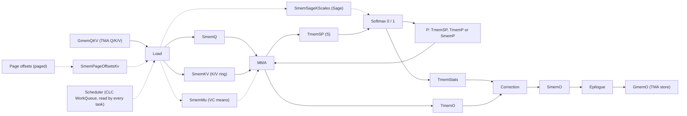
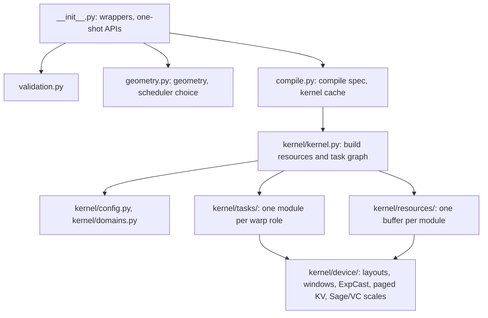

# Context (prefill) attention

The CuTe DSL task-scheduled (TS) FMHA prefill kernel for Blackwell and Rubin. One
implementation serves fixed contiguous, packed contiguous (uniform or ragged) and
packed-Q paged-K/V attention with MHA or GQA. Its recipes have their own pages:
[Sage attention](../sage/README.md) and [VC-Attention](../vc_attention/README.md).

| API | Use |
| --- | --- |
| `BatchPrefillTSWrapper` / `batch_prefill` | Reusable / one-shot fixed or packed contiguous attention |
| `BatchPrefillPagedTSWrapper` / `batch_prefill_with_paged_kv_cache` | Reusable / one-shot packed Q over paged K/V |

## Example

```python
import torch
from flashinfer.attention.prims_ts import BatchPrefillTSWrapper, BatchPrefillPagedTSWrapper

B, Sq, Sk, Hq, Hkv, D = 2, 256, 512, 8, 2, 128
q = torch.randn(B, Sq, Hq, D, device="cuda", dtype=torch.bfloat16)
k = torch.randn(B, Sk, Hkv, D, device="cuda", dtype=torch.bfloat16)
v = torch.randn_like(k)
wrapper = BatchPrefillTSWrapper()
wrapper.plan(device="cuda", batch_size=B, max_q_len=Sq, max_kv_len=Sk, num_qo_heads=Hq,
             num_kv_heads=Hkv, head_dim=D, q_dtype=q.dtype, k_dtype=k.dtype, mask_type="causal")
out = wrapper.run(q, k, v)  # [B, Sq, Hq, D]

# Packed Q over an HND page pool [num_pages, Hkv, page_size, D].
q = torch.randn(80, Hq, D, device="cuda", dtype=torch.float16)
k_cache = torch.randn(5, Hkv, 32, D, device="cuda", dtype=torch.float16)
v_cache = torch.randn_like(k_cache)
qo_indptr = torch.tensor((0, 32, 80), device="cuda", dtype=torch.int32)
block_tables = torch.tensor(((0, 1, -1), (2, 3, 4)), device="cuda", dtype=torch.int32)
seq_lens_kv = torch.tensor((64, 80), device="cuda", dtype=torch.int32)
paged = BatchPrefillPagedTSWrapper(kv_layout="HND")
paged.plan(device="cuda", batch_size=2, max_q_len=48, max_kv_len=80, num_qo_heads=Hq,
           num_kv_heads=Hkv, head_dim=D, q_dtype=q.dtype, k_dtype=k_cache.dtype,
           page_size=32, mask_type="causal")
out = paged.run(q, k_cache, v_cache, qo_indptr, block_tables, seq_lens_kv)
```

`softmax_scale` defaults to `1 / sqrt(Dqk)`, `output_scale` to 1. MLA passes `head_dim=192,
head_dim_vo=128` with separate compact Q/K/V. E4M3 inputs pass `softmax_scale=q_descale *
k_descale / sqrt(D)` and `output_scale=v_descale`; BF16 Q/K with E4M3 V passes `v_dtype` and `output_scale=v_descale`.

## Support matrix

| Feature | Support |
| --- | --- |
| GPU | SM100a/B200, SM103a/B300, SM107a/Rubin (Rubin needs CuTe DSL 4.8, or `CUTE_DSL_ARCH=sm_100f` with older DSLs) |
| Head dims (QK/V) | 128/128, 192/192, 256/256; contiguous only: 192/128 (MLA) |
| Heads | MHA/GQA; `Hq % Hkv == 0` |
| Q/K dtype | One dtype: FP16, BF16 or E4M3; INT8 only under a Sage or VC recipe (SM100 only); `torch.float8_e8m0fnu` selects MXFP8 (E4M3 data, one E8M0 scale per 32 channels; fixed contiguous dense or causal) |
| V dtype | Equal to Q/K, or E4M3 with BF16, INT8 or MXFP8 Q/K (`v_dtype`, defaults to `k_dtype`, or E4M3 for INT8/MXFP8) |
| Output dtype | FP16, BF16 or E4M3 (`out_dtype`); Sage/INT8/MXFP8 plans default to BF16 |
| Masks | Dense, bottom-right causal, causal with a positive left window; fixed contiguous also `variable_window` |
| Contiguous layouts | Fixed `[B, S, H, D]` (BSHD) or packed `[total, H, D]` (THD, `packed_query=True`) |
| Paged layouts | Separate K and V pools, `kv_layout="HND"` `[pages, Hkv, page_size, D]` (default) or `"NHD"` `[pages, page_size, Hkv, D]`; page size 4, 8, 16, 32, 64 or 128 |
| Accumulation | FP32 QK/PV and softmax state; INT8 Q/K accumulate INT32 scores read as FP32 |
| Outputs | O; with `lse_mode="base2"` also final FP32 LSE; optional attention sinks |
| Scheduling | Automatic nonpersistent, static-persistent or CLC-persistent launch; no public knob |

| Validated on | Stack |
| --- | --- |
| SM100a/B200; SM103/GB300 (including QK192/V128) | PyTorch 26.08, CUDA 13.4, CuTe DSL 4.7.0; correctness smoke on DSL 4.8.1. SM107 admission does not imply measured coverage |

## Lifecycle and ownership

`plan()` selects a cached policy and compiles or loads the kernel; `run()`
supplies live tensors and metadata. Shared rules (workspace, `validate=False`
obligations, CUDA graphs, global scales, LSE and sinks) are in the
[runtime contract](../../docs/runtime_contract.md). Context-specific rules:

- **Fixed by the plan:** exact batch; exact fixed extents, or `max_q_len`/`max_kv_len`
  bounds for packed and paged requests; heads, head dims, dtypes, mask, window,
  `packed_query`, page size and scale types (float or CUDA tensor). Re-plan to change any of them.
- **Paged promises** (one specialization each, re-plan to change):
  `uniform_packed_lengths=True` (every Q delta is `max_q_len`, every K/V length `max_kv_len`),
  `has_q_offset=False` (causal `Sq[b] == Sk[b]`; dense ignores it) and
  `paged_v_tail_is_zero=True` (unused rows of each final V page are zero, so the
  kernel skips its V-tail clear). The one-shot paged API derives the tightest length flags and keeps the V-tail clear.
- **Metadata:** `qo_indptr`/`kv_indptr` are compact CUDA `int32[B + 1]`, start at 0,
  are nondecreasing and end at the packed extents; deltas stay within the plan bounds.
  `block_tables` is `int32[B, C]` with unit column stride, row stride at least `C`
  and `C >= ceil(max_kv_len / page_size)`; entries past `ceil(seq_lens_kv[b] / page_size)`
  are never read. Page IDs may be arbitrary, repeated and shared by K and V.
  Windowed paged loads skip pages wholly before a Q tile's first visible key,
  so recycled pages there may hold NaNs.
- **Variable window:** inclusive per-token `[B, max_q_len]` starts and ends with
  `0 <= start <= end < Sk` and ends nondecreasing along Q. Optional
  `variable_window_cta_starts` `[B, ceil(max_q_len / Tq)]` (`Tq` 256 at D128, else 128)
  gives each Q tile's minimum start; without it the wrapper refills plan-owned
  scratch on every run, so those runs must not overlap across streams or graphs;
  caller CTA starts must stay consistent with the token starts across replays.
- **Strides:** Q, K, O are compact and 16-byte aligned. Contiguous V may pad
  token rows and batches (head/feature strides `(Dv, 1)`, 16-byte-multiple
  token and batch strides); paged K/V take any positive, non-overlapping, 16-byte-aligned
  page/head/token strides with unit feature stride. Strides are runtime values: no copy or recompile.
- **`validate=True`** reads metadata to the host (may synchronize) and checks
  caller CTA starts against the token starts; it never reads V-cache contents,
  so `paged_v_tail_is_zero` stays a caller promise. `out` must not overlap any input,
  metadata or wrapper scratch in either mode.
- **Empty requests:** packed and paged K/V lengths may be zero. With LSE enabled,
  ordinary dense contiguous requests with empty K/V write zero O and `-inf` LSE.
  Every other empty request (paged K/V, or LSE disabled) is skipped: its O and
  LSE rows are not written, so caller-owned rows keep their contents and fresh
  ones are unspecified. Packed K/V storage needs at least one physical token.
  Uniform-length plans cannot express empty or padded requests.

## Dataflow

Each warp role is a task in [`kernel/tasks/`](kernel/tasks/__init__.py); each buffer
is a resource in [`kernel/resources/`](kernel/resources/__init__.py) whose
pipeline orders its producer and consumer. Dashed edges exist only for the named feature.



Ordering-only resources (`resources/sync.py`): `S0S1SequenceResource` (paces
softmax 1 behind softmax 0; P reaches the MMA through the S/P release or `TmemP`
with P in TMEM, and through `SmemP` with P in SMEM), `TmemPPrefixReadyResource` (first 64 keys of P ready, PV
starts early), `TmemStatsDoneResource` (MMA to correction, no cross-tile TMEM reuse).
Some configurations fuse the epilogue into the correction warps.

Kernel notes (internal, not tunable):

- D192 keeps 128-wide K/V stages and issues PV as N128 + N64 (Q stages 192 columns for FP16/BF16, 256 for FP8).
- QK192/V128 reuses the paired Q schedule: K streams in two 128-wide stages shared by both Q tiles.
- On SM103, unmasked score tiles fuse the TMEM load with the row maximum (LDTM.STAT).
- Packed dense contiguous plans use each request's live KV extent as every task's loop domain.
- Paged D256 dense static domains stage 64 page IDs per handoff; other cases a 32-lane window.
- A positive left window selects head-paired GQA; all other plans are query-paired.

## Limitations

- INT8 Q/K needs SM100 (hardware/ABI): only SM100 has the INT8 tcgen05 MMA kind.
- Aggregate Q and K extents (`B*Sq`, `B*Sk`, `total_q`, `total_k`; paged: Q only)
  are at most `2**31 - 256` (hardware/ABI): Int32 coordinates reserve the padded tail of a 256-row Q work tile.
- `window_left=0` is rejected; use `-1` to disable or a positive value (hardware/ABI).
- Positive windows need GQA with an even `Hq/Hkv > 1` (not implemented): the kernel pairs Q heads that share a K/V head.
- Causal attention needs `Sq[b] <= Sk[b]` for every active request (not implemented).
- QK192/V128 is contiguous only, with no positive left window; paged K/V keeps equal head dims (not implemented).
- No custom masks; Q and K share one dtype; paged plans reject INT8; MXFP8 needs fixed tensors and no window (not implemented).
- Sage and VC-Attention run only dense fixed-length contiguous D128 plans; VC also needs `Hq == Hkv` and rejects SM107 (not implemented).
- Extremely small effective QK scales, such as `softmax_scale=1e-38`, are outside the supported masking range (not implemented).
- Context entry points are not registered with `fi_trace` (not implemented). SM107 is admitted but not measured (not yet validated).

## Source map



| File | Owns |
| --- | --- |
| [`__init__.py`](__init__.py) | Public wrappers and one-shot APIs; plan/run adaptation |
| [`validation.py`](validation.py) | Argument, dtype, device, metadata and runtime-input checks |
| [`geometry.py`](geometry.py) | Plan geometry, hardware defaults, persistent/CLC selection |
| [`compile.py`](compile.py) | Compile specs, compiled-kernel and Sage-prepare lookup |
| [`kernel/config.py`](kernel/config.py) | `FmhaConfig`: tiles, stages, TMEM offsets, recipe gates |
| [`kernel/domains.py`](kernel/domains.py) | Dense, causal and variable-window K/V loop domains |
| [`kernel/kernel.py`](kernel/kernel.py) | Resource instances, task creation and dependency graph |
| [`kernel/tasks/`](kernel/tasks/__init__.py) | `common` (work queue, schedule helpers), `load`, `mma`, `softmax`, `correction`, `epilogue`, `page_offsets`, `scheduler` (with padding) |
| [`kernel/resources/`](kernel/resources/__init__.py) | `gmem_qkv`, `gmem_o`, `smem_q`, `smem_kv` (K/V ring, page offsets), `smem_o`, `smem_p`, `smem_sage_k_scales`, `smem_mu` (VC mean ring), `tmem_sp`, `tmem_p`, `tmem_o`, `tmem_stats`, `sync` |
| [`kernel/device/`](kernel/device/__init__.py) | CuTe DSL helpers: `common` (SMEM layouts, work-tile coordinates), `windows` (KV tile and sliding-window bounds), `expcast` (ExpCast and packed f16x2 intrinsics), `paged_kv` (paged addressing, page-ID staging), `sage_scales` (Sage K transport, score scaling, scale reads), `vc_scales` (QK8 scale tables, `VCKScaleTable`) |

## Tests

```bash
pytest -q tests/attention/test_attention_ts_context.py \
  tests/attention/test_attention_ts_context_dense_kv_domain.py \
  tests/attention/test_attention_ts_features.py \
  tests/attention/test_attention_ts_context_sage.py \
  tests/attention/test_attention_ts_vc.py
```

Coverage: fixed, ragged and paged layouts; head dims 128/192/256; FP16/BF16/E4M3 in and out;
BF16 Q/K with E4M3 V; dense, causal and windowed masks; scheduler safety; CUDA graphs.
