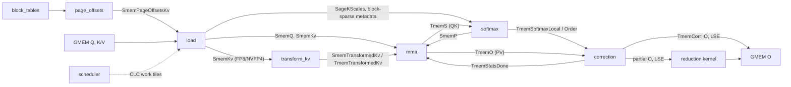
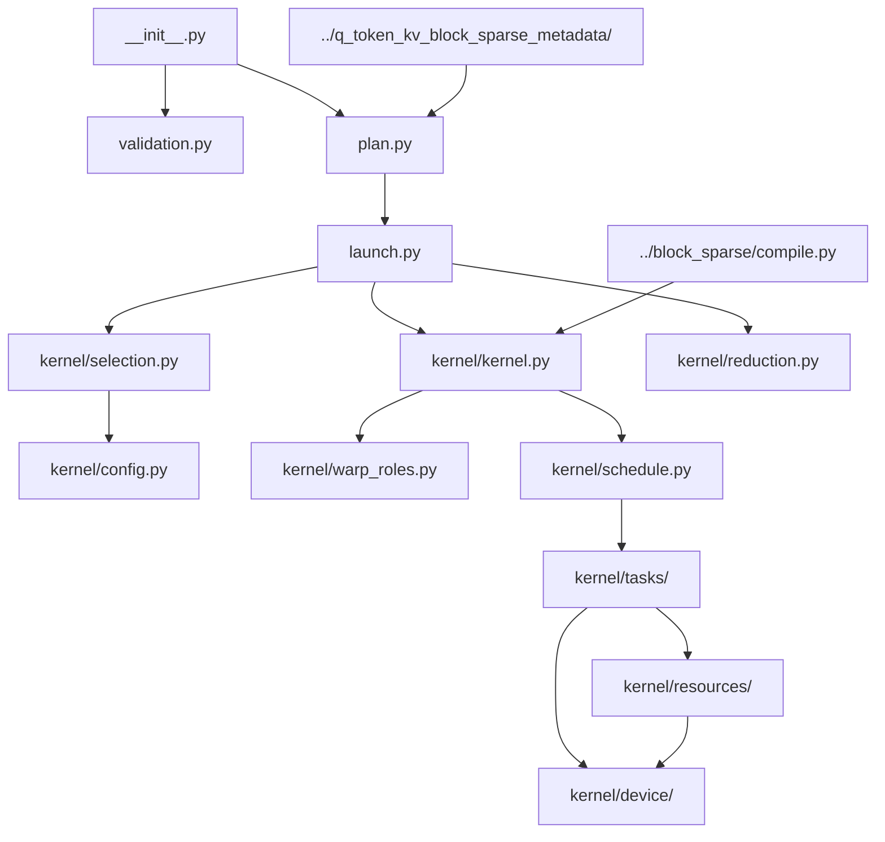

# Task-scheduled FMHA decode

`decode/` holds the CuTe DSL task-scheduled (TS) FMHA kernel for paged decode
on NVIDIA Blackwell. It covers token-at-a-time decode, small fixed
speculative-query batches and packed variable-length queries over a paged K/V
cache. The same kernel also runs the [block-sparse](../block_sparse/README.md)
and [QToken-KvBlock-Sparse](../q_token_kv_block_sparse_metadata/README.md)
APIs: both are front ends that prepare route metadata and then launch this
decode kernel.

Tile shapes, MMA orientation (Swaps or Keeps), split-KV fanout and launch mode
are chosen internally; there is no tuning knob and no fallback backend.

## Example

```python
import torch
from flashinfer.attention.prims_ts import BatchDecodePagedTSWrapper

device, dtype = torch.device("cuda:0"), torch.bfloat16
num_qo_heads, num_kv_heads, head_dim, page_size = 32, 4, 128, 32
batch_size, max_q_len, max_kv_len = 2, 2, 128

wrapper = BatchDecodePagedTSWrapper("NHD")
wrapper.plan(
    device, batch_size, num_qo_heads, num_kv_heads, head_dim, page_size, max_kv_len,
    max_q_len=max_q_len, q_dtype=dtype, packed_query=True, mask_type="causal",
)

# Two requests: Q lengths [2, 1], KV lengths [128, 96].
qo_indptr = torch.tensor([0, 2, 3], dtype=torch.int32, device=device)
seq_lens_kv = torch.tensor([128, 96], dtype=torch.int32, device=device)
block_tables = torch.tensor([[0, 1, 2, 3], [4, 5, 6, 0]], dtype=torch.int32, device=device)
q = torch.randn(3, num_qo_heads, head_dim, dtype=dtype, device=device)
# Separate NHD K/V: [pages, page_size, kv_heads, head_dim].
k_cache = torch.randn(7, page_size, num_kv_heads, head_dim, dtype=dtype, device=device)
v_cache = torch.randn_like(k_cache)
out = torch.empty_like(q)

wrapper.run(q, (k_cache, v_cache), seq_lens_kv, block_tables, qo_indptr=qo_indptr, out=out)
graph = torch.cuda.CUDAGraph()
with torch.cuda.graph(graph):
    wrapper.run(
        q, (k_cache, v_cache), seq_lens_kv, block_tables,
        qo_indptr=qo_indptr, out=out, validate=False,
    )
graph.replay()
```

| API | Use |
| --- | --- |
| `BatchDecodePagedTSWrapper` | Reusable `plan()` with explicit bounds; `run()` takes live metadata. |
| `batch_decode_with_paged_kv_cache` | One-shot call. With `workspace_buffer`, `max_kv_len`, `out` and `validate=False` (plus `max_q_len` for packed Q) it is allocation-free and capturable. |
| `get_prims_ts_batch_decode_workspace_size` | Bytes of caller scratch for the same geometry and dtypes passed to `plan()`. |
| `prepare_prims_ts_batch_decode_with_kv_cache` | Validates once and returns a `PrimsTSBatchDecodePlan` with a light `run()`. |

## Support matrix

| Feature | Support |
| --- | --- |
| GPU | SM100a (B200), SM103a (B300/GB300), SM107a (Rubin) |
| Head dim | 64, 128, 192, 256; 512 only for dense paged FP8-E4M3 Q with NVFP4 K/V |
| Q layout | SQ=1 `[B, Hq, D]`; fixed `[B, SQ, Hq, D]`; packed `[total_q, Hq, D]` with Int32 `qo_indptr[B + 1]` |
| Heads | MHA/GQA, `Hq % Hkv == 0`, `1 <= Hq/Hkv <= 128` |
| Q, K/V -> O dtypes | FP16 -> FP16; BF16 -> BF16 with BF16, FP8-E4M3 or NVFP4 (`torch.uint8`) K/V, or BF16 K with FP8 V; FP8-E4M3 with FP8 or NVFP4 K/V -> FP16, BF16 or FP8 |
| K/V cache | HND or NHD; combined `[P, 2, Hkv, page, D]` (NHD `[P, 2, page, Hkv, D]`) or separate `(K, V)`; mixed K/V dtypes need separate tensors |
| Page table | Dense Int32 `block_tables[B, C]`, rows contiguous, padded row stride allowed |
| Page size | 4, 8, 16, 32, 64, 128 |
| Max K/V length | `2,147,483,392` (`INT32_MAX - 255`); `B * max_q_len * Hq` must fit in Int32 |
| Mask | Dense or bottom-right causal; causal left window via `window_left` (`-1` disables) |
| Scheduling | Direct, CLC-persistent, or split-KV when `split_kv=True` and the grid is underfilled |
| Outputs | O; optional FP32 base-2 LSE (`lse_mode="base2"`); optional attention sinks |
| Accumulation | FP32 QK, PV and softmax state |

Large grouped-Q tiles (fixed Q, dense or causal, direct or GMEM split
reduction): Swaps Q48 (D128/256), Swaps Q64 (D128/256/512), Swaps Q128 (D128/256)
and Keeps Q64 (D128/256/512) use FP8 Q with FP8 or NVFP4 K/V; Keeps Q128 (D128)
uses FP8 Q/K/V. All write FP16 or BF16 and run one CTA per SM.

D512 Keeps Q64 runs KV128 tiles as four D128 head-dim stages with one KV
instance; separate K and V warp groups convert NVFP4 K/V to FP8 SMEM rings,
and FP8 K/V is read as stored. Both are qualified at eight Q heads per KV head,
where automatic selection compares them with Swaps. Other head ratios run
NVFP4 K/V on Swaps (grouped tiles up to Q64 while one KV head's Q heads fit,
ungrouped Q8/Q16 head bands otherwise).

## Lifecycle and ownership

`plan()` takes model geometry, exact `batch_size` and Q/KV bounds, selects a
cached policy, compiles or loads kernels and binds scratch. `run()` only
launches. Live K/V lengths, page IDs and `qo_indptr` are per-run bindings and
may change between completed launches; `plan(seq_lens_kv=...)` can instead own
a CUDA copy of the lengths. `max_q_len`/`max_kv_len` passed to `run()` are
launch operands that must cover the live lengths without exceeding the plan.
Nonpositive per-run K/V lengths mark inactive requests: their table rows and
Q/K/V are not read and caller-owned output stays untouched.

Shared contracts live in the [runtime contract](../../docs/runtime_contract.md):
[workspace](../../docs/runtime_contract.md#workspace) sizing, zeroing and
`initialize_workspace=False`;
[`validate=False`](../../docs/runtime_contract.md#validatefalse-obligations);
[CUDA graphs](../../docs/runtime_contract.md#cuda-graphs);
[global scales](../../docs/runtime_contract.md#global-scale-operands)
(`softmax_scale`, `output_scale`);
[LSE and sinks](../../docs/runtime_contract.md#final-softmax-statistics-and-attention-sinks);
and the [split-KV policy](../../docs/runtime_contract.md#split-kv-policy). One
wrapper and its workspace serve one ordered stream; replanning invalidates
captured graphs.

## Dataflow

Each CTA runs warp-specialized tasks (`kernel/tasks/`) that exchange data
through SMEM/TMEM resources (`kernel/resources/`). Producers
acquire/commit, consumers wait/release.



`page_offsets` stages 32-page page-table windows for the load warp;
`transform_kv` runs only for converted K/V and `scheduler` only for CLC launches.

## Limitations

- Contiguous K/V is not accepted by the paged decode API; use the block-sparse APIs (not implemented).
- CSR page tables and `BatchDecodeWithPagedKVCacheWrapper(backend="prims-ts")` are unsupported (not implemented).
- Custom masks are not exposed (not implemented).
- Sage attention runs only through the contiguous [block-sparse](../block_sparse/README.md) APIs (not implemented).
- D512 needs `tile_size_q <= 64`: Q128 PV accumulators alone use all 512 TMEM columns (hardware/ABI).
- D512 takes FP8-E4M3 Q with NVFP4 or FP8 K/V. FP8 K/V D512 runs only at eight Q heads per KV head (not yet validated elsewhere).
- D512 Keeps Q64 has no cluster-SMEM split reduction, and the NVFP4 profile no persistent scheduling (not implemented).
- D64 NVFP4 K/V with page size 16 is rejected: its staging produces a misaligned access (hardware/ABI).
- Sliding-window plans never split KV (not yet validated).
- Large Swaps tiles are not used for packed Q, persistent scheduling, sparse routes, windows, sinks, cluster-SMEM reduction or FP8 output (not implemented).
- D192 Keeps has no cluster-SMEM reducer (not implemented); packed Q and sinks on D192 Keeps (not yet validated); FP8 D192 uses 128-wide stages, not 192 (not implemented).
- Output, LSE and workspace overlap with inputs is not checked in either validation mode (hardware/ABI).

| Validated on | Stack |
| --- | --- |
| B200 (SM100a); GB300 (SM103) | GB300: PyTorch 26.08, CUDA 13.4, CuTe DSL 4.7.0 |

## Source map



| File | Owns |
| --- | --- |
| [`__init__.py`](__init__.py) | Public wrapper, one-shot, workspace-size and prepared-plan APIs; QToken group helpers |
| [`validation.py`](validation.py) | Argument checks: head dims, dtypes, Q modes, bounds |
| [`plan.py`](plan.py) | `PrimsTSBatchDecodePlan` and wrapper plan state |
| [`launch.py`](launch.py) | Launch specs, compilation, workspace layout, runtime launch |
| [`kernel/selection.py`](kernel/selection.py) | Automatic tile, split-KV and launch-mode selection |
| [`kernel/config.py`](kernel/config.py) | `FmhaDecodeConfig` and profile validation |
| [`kernel/warp_roles.py`](kernel/warp_roles.py) | Warp placement and padding per task |
| [`kernel/kernel.py`](kernel/kernel.py) | Task-manager assembly, kernel and block-sparse launch entry points |
| [`kernel/schedule.py`](kernel/schedule.py) | HEAD/LOOP/TAIL schedule of every task |
| [`kernel/reduction.py`](kernel/reduction.py) | Standalone split-KV GMEM reducers |
| [`kernel/tasks/`](kernel/tasks/) | `load`, `page_offsets`, `transform_kv`, `mma`, `softmax`, `correction`, `scheduler` |
| [`kernel/resources/smem_resources.py`](kernel/resources/smem_resources.py) | `SmemQ`, `SmemPageOffsetsKv`, `SmemKv`, `SmemKvTile` |
| [`kernel/resources/smem_block_sparse_metadata.py`](kernel/resources/smem_block_sparse_metadata.py) | Prepared-route metadata for load and softmax |
| [`kernel/resources/smem_transformed_kv.py`](kernel/resources/smem_transformed_kv.py), [`tmem_transformed_kv.py`](kernel/resources/tmem_transformed_kv.py) | Converted K/V rings |
| [`kernel/resources/sage_scales.py`](kernel/resources/sage_scales.py) | `SageKScales`, `SageVScales` |
| [`kernel/resources/smem_p.py`](kernel/resources/smem_p.py), [`tmem_s.py`](kernel/resources/tmem_s.py), [`tmem_o.py`](kernel/resources/tmem_o.py) | P operand, S scores, O accumulator |
| [`kernel/resources/tmem_softmax_stats.py`](kernel/resources/tmem_softmax_stats.py) | Softmax stats, ordering and overwrite credits |
| [`kernel/resources/tmem_corr.py`](kernel/resources/tmem_corr.py) | O rescale, normalization, epilogue and split partials |
| [`kernel/resources/common.py`](kernel/resources/common.py), [`sync.py`](kernel/resources/sync.py) | `DecodeGenResourceBase`; sparse-membership lifetime and schedule-token throttle |
| [`kernel/device/`](kernel/device/__init__.py) | CuTe DSL helpers: `common` (task cache, barriers, primitives), `constants` (shared constants with their rationale), `kv_tile_idx`, `q_rows`, `keeps_layout`, `output_layout`, `mma_kinds`, `softmax_math`, `kv_transform` (NVFP4/E4M3 conversions, SMEM vector loads), `direct_sparse_metadata` (QToken G1 metadata resolved inside attention) |

## Tests

```bash
pytest -q tests/attention/test_attention_ts_decode.py tests/attention/test_attention_ts_decode_mixed_precision.py
pytest -q tests/attention/test_prims_ts_decode_backend.py
pytest -q tests/trace/test_fi_trace_template_consistency.py
```
