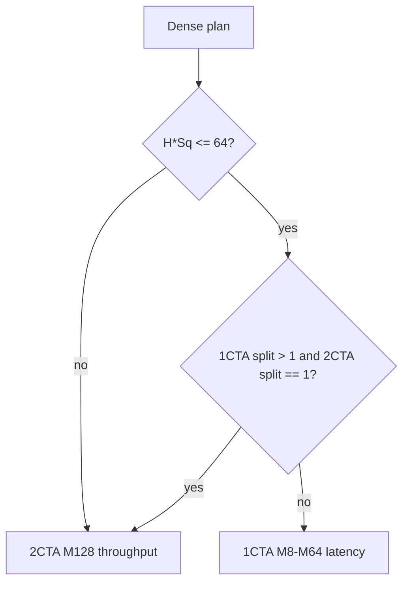
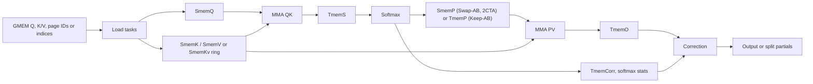
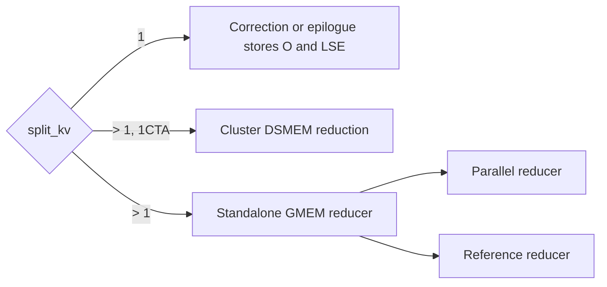
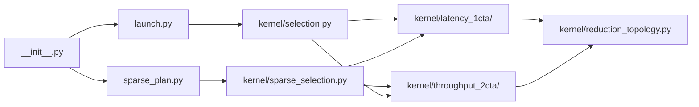

# Task-Scheduled MLA Decode

PrimTS MLA decode runs absorbed multi-head latent attention: every query head attends to one shared
latent K/V head, and the output has 512 channels. Dense MLA reads a paged cache through a page
table; sparse MLA reads caller-selected storage rows from a primary pool plus an optional extra
pool. Query RoPE and Q quantization happen upstream.

## Example

```python
import torch
from flashinfer.attention.prims_ts import BatchMLADecodePagedTSWrapper

B, H, page_size, max_kv_len = 8, 128, 64, 4096
pages = max_kv_len // page_size
q = torch.randn(B, 1, H, 576, device="cuda", dtype=torch.bfloat16)  # 512 latent + 64 RoPE
kv_cache = torch.randn(B * pages, page_size, 576, device="cuda", dtype=torch.bfloat16)
block_tables = torch.arange(B * pages, device="cuda", dtype=torch.int32).view(B, pages)
seq_lens_kv = torch.full((B,), max_kv_len, device="cuda", dtype=torch.int32)

wrapper = BatchMLADecodePagedTSWrapper()
wrapper.plan("cuda", B, H, 512, 64, page_size, max_kv_len,
             max_q_len=1, packed_query=False, q_dtype=torch.bfloat16,
             kv_dtype=torch.bfloat16, out_dtype=torch.bfloat16,
             mask_type="causal", softmax_scale=576 ** -0.5)
out = wrapper.run(q, kv_cache, block_tables, seq_lens_kv)  # [B, 1, H, 512]
```

Sparse plans take capacities, e.g. `plan("cuda", B, H, max_topk=512, q_dtype=torch.float8_e4m3fn,
kv_cache_format="nvfp4")`, then `run(q, cache, indices, lengths)`. The eager one-shot equivalents are
`batch_mla_decode_with_paged_kv_cache` and `batch_sparse_mla_decode_with_paged_kv_cache`.

## Support matrix

| Feature | Dense: `BatchMLADecodePagedTSWrapper` | Sparse: `BatchSparseMLADecodePagedTSWrapper` |
|---|---|---|
| GPUs | SM100a (B200), SM103a (B300), SM107a (Rubin) | Same |
| Head dims | `kv_lora_rank=512`, `qk_rope_head_dim=64` (QK 576, V 512) | D512 (QK = V = 512) or D576 (`qk_rope_head_dim=64`, QK-only RoPE tail); V and output 512 |
| Query | Fixed `[B,Sq,H,576]` or packed `[total_q,H,576]` + `qo_indptr` | Fixed `[B,Sq,H,D]` or packed `[total_q,H,D]` + `qo_indptr` |
| Query heads | Any positive H with B·Sq·H in int32 | 1 to 128; NVFP4 qualification covers H8/16/32/64/128 |
| Q / KV dtype | BF16 or E4M3, `q_dtype == kv_dtype` | BF16 or E4M3 Q; cache per recipe below |
| Output | BF16 | BF16, or E4M3 + block32/block128 UE8M0 or FP32 scales (D512 fused output RoPE) |
| KV layout | `[pages, page_size, 576]` or `[pages, 1, page_size, 576]`; page size 4, 8, 16, 32, 64 or 128; int32 `block_tables` | Flat `[rows, R]`, paged `[pages, page, R]`, or 4-D NHD/HND with one KV head; any page stride |
| Visibility | `mask_type="dense"` or bottom-right `"causal"`; optional context parallelism (`cp_world`, `cp_interleave_size`, runtime `cp_rank`) | int32 indices `[T,K]` + lengths `[T]` per pool; `-1` holes, tails; empty rows give zero O, LSE `-inf` |
| Final LSE | Optional, base 2 (`lse_mode="base2"`) | Optional, natural log (`return_lse=True`) |
| Sinks | None | Optional FP32 `attention_sinks[H]` |
| Global scales | `softmax_scale`, `output_scale` (default 1.0) | `softmax_scale` (default `1/sqrt(D)`), `output_scale`, `kv_cache_scale` (FP8 primary only) |
| Scheduling | Automatic 1CTA/2CTA and runtime split-KV | Automatic sparse profile (1CTA Swap-AB/Keep-AB, 2CTA, D576 reload) |

Sparse cache recipes (`R` is the record size per token; NVFP4 and FP8 records are `uint8`):

| Target | QK / V | `kv_cache_format` / `extra_kv_cache_format` | Record bytes | Q | Output |
|---|---|---|---|---|---|
| DeepSeek V3.2-style sparse MLA | 576 / 512 | `nvfp4.fp8rope` / same | 352 | E4M3 | BF16 |
| DeepSeek V4.1-style sparse MLA | 512 / 512 | `nvfp4` / `nvfp4` | 288 | E4M3 | BF16 or fused RoPE + FP8 |
| DeepSeek V4.1-style SWA + compressed KV | 512 / 512 | `fp8` (per-tensor E4M3) / `nvfp4` | 512 / 288 | E4M3 | BF16 or fused RoPE + FP8 |
| Native sparse MLA | 512 or 576 / 512 | `native` / `native` | 512 + RoPE elements | Matching BF16 or E4M3 | BF16; fused for D512 |

DeepSeek V2/V3-style absorbed dense MLA uses the dense wrapper with a native BF16 or E4M3 cache.
NVFP4 records hold 256 B of packed E2M1 and 32 E4M3 block16 scales, with no global scale;
`nvfp4.fp8rope` inserts 64 unscaled E4M3 RoPE bytes before the scales. The loader expands NVFP4 to
E4M3 for ordinary FP8 MMA. `kv_cache_scale` descales an `fp8` primary pool on QK scores and FP32
output; other formats require the identity. Byte layouts: [nvfp4_kv.py](kernel/device/nvfp4_kv.py).

## Lifecycle and ownership

`plan()` resolves a cached policy, compiles or loads the kernel and binds the workspace; `run()`
binds live tensors and metadata. Size caller workspace with
`get_prims_ts_batch_mla_decode_workspace_size` (plan geometry, `cp_world`, `cp_interleave_size`) or
`get_prims_ts_sparse_mla_decode_workspace_size` (sparse `plan()` arguments). One wrapper and
workspace serve one in-flight run. Workspace, `validate=False`, CUDA graph, scale, LSE/sink and
split-KV rules are in the [runtime contract](../../docs/runtime_contract.md).

- `validate=True` (default) reads metadata on the host and synchronizes; serving validates
  upstream and calls `run(validate=False)`.
- A sparse plan with `batch_size=1`, `packed_query=True` and `max_q_len=row_capacity` serves
  any row count up to the capacity with `[rows,H,D]` Q and `qo_indptr=[0, rows]`.
- Dense one-shot is capture-safe only with `workspace_buffer`, `max_kv_len`, `out` and
  `validate=False` (plus `max_q_len` for packed Q); plan the sparse wrapper before capture.
- `FLASHINFER_PRIMS_TS_DEBUG_CHECKS=1` before a cold build shows task-builder advisories.

**Context parallelism (dense).** `plan(cp_world=C, cp_interleave_size=I)` compiles the CP
geometry; `run(cp_rank=r)` passes the rank as a runtime scalar (captured by value in a graph).
`seq_lens_kv` holds global lengths including the current Q tokens; page tables, the cache and
`max_kv_len` stay rank-local. Global token `t` lives on rank `(t // I) % C`, so a global prefix `n`
holds `n // (I*C) * I + clamp(n % (I*C) - r*I, 0, I)` local tokens. Dense rows map the full length
`G`; causal row `i` maps `G - actual_Q + i + 1` (packed `actual_Q` from `qo_indptr`). The kernel
derives these prefixes itself: no bounds tensor, no prep launch, no host readback with
`validate=False`. For C > 1, empty local rows give zero O and LSE `-inf` through a neutral-row
launch; `zero_empty_rows=False` omits it, leaving them unspecified (sanitize before merging).
C = 1 is ordinary dense/causal MLA. CP adds no workspace.

**Softmax rescale threshold.** `MLAAttentionTuning(softmax_rescale_threshold_log2=T)` skips the O
correction while a row maximum rises by at most T binades (0 to 8 for E4M3, 0 to 32 for BF16).
Positive T quantizes FP8 P at `448 * 2**-T`, trading tail precision for fewer corrections. `None`
keeps each entry point's default, `0.0` rescales on every new maximum, and each T compiles a kernel.

## Kernel selection



Dense selection ([kernel/selection.py](kernel/selection.py)) compares task-graph structure, not measured
tables: inside one 1CTA tile, 2CTA wins only when it stores output directly while 1CTA would need a
split-KV reduction; a shape without a 1CTA profile uses 2CTA. Split counts target one resident
wave, are capped at the SM count and stay runtime operands. 2CTA is persistent only above one wave.

Sparse selection ([kernel/sparse_selection.py](kernel/sparse_selection.py)) picks 1CTA Keep-AB (M64),
1CTA Swap-AB (M8/M16) or 2CTA from measured GB300 crossovers over rows (B·Sq), heads, capacity
(each source rounded to 128, at least 256), dtype and format; these are schedules, not shape
limits. D576 FP8 head counts map to the next of 8/16/32/64/128. Quantized H16/H32 plans retain
whole converted K/V tiles; small grids fill one wave with a nonpersistent power-of-two KV split.
Native D576 E4M3 H64/H128 plans without extra pool, sinks or `assume_valid_prefix` may use the q64
Keep-AB reload schedule (K released before V is reloaded from L2; H128 only at four or more KV
splits). The 1CTA persistent/CLC scheduler requires `split_kv=1`; split plans run nonpersistent.

Static persistent 2CTA launches use up to the physical cluster limit. The
compilation key retains that limit, so different row buckets that choose
the same profile reuse one compiled kernel. BF16 persistent 2CTA uses CLC
and sizes the launch grid to the logical work, which can exceed that limit.

## Dataflow



The 2CTA kernel splits M128 tiles over a CTA pair (256 V columns each). BF16 runs 12 warps with a
combined TMA load task and one MMA task; FP8 runs 16 warps with separate K/V loads, QK/PV MMA tasks
and two softmax groups; NVFP4 uses one loader that converts K once and exchanges V through DSMEM.
Dense 2CTA loaders cache 32 page IDs per warp. The 1CTA kernel runs two score/softmax streams
(Swap-AB) or one (Keep-AB), an optional page-offset task and, when persistent, a CLC scheduler.

## Split-KV reduction



[kernel/reduction_topology.py](kernel/reduction_topology.py) spreads the actual splits over a
cluster of G ranks (G in 1, 2, 4, 8, 16) with fewer than G padding slots. 1CTA Q64 picks G from at
least 32 splits per rank within four waves; other 1CTA tiles use G1. 2CTA Q128 uses the parallel
reducer with G1 for up to 16 splits when the reference grid is under one wave and the producer
fills half a wave, or with G 2 to 8 above 32 splits; otherwise the reference reducer. Sparse 2CTA
fuses the epilogue (one split) or the reduction (several). Partials stay base 2 until the final
store. Reducer and capacity rules: [runtime contract](../../docs/runtime_contract.md).

## Limitations

- Dense: `kv_lora_rank=512`, `qk_rope_head_dim=64`, equal Q/KV dtypes and BF16 output only; no
  sinks, packed cache formats or sparse indices (not implemented).
- Dense page size 4, 8, 16, 32, 64 or 128: each partitions a 128-token K/V tile (hardware/ABI).
- `max_kv_len` plus the padded split span must fit signed int32 (hardware/ABI).
- Sparse: `kv_lora_rank=512`, H <= 128, `qk_rope_head_dim` 0 or 64, no context parallelism (not implemented).
- Sparse pool pairs: native/native, nvfp4/nvfp4, nvfp4.fp8rope/nvfp4.fp8rope or fp8/nvfp4;
  NVFP4-containing recipes require E4M3 Q (not implemented).
- Fused output RoPE and quantization is D512 only; `num_output_groups` divides H (not implemented).
- The 1CTA persistent/CLC work queue has no KV-split coordinate (not implemented).
- Parallel reducer partial-O workspace below 2^31 elements (not implemented: 64-bit strides).
- NVFP4 paths with heads other than 8, 16, 32, 64, 128 (not yet validated).

## Source map



| File | Owns |
|---|---|
| [`__init__.py`](__init__.py) | Public wrappers, one-shot helpers, workspace-size helpers, `MLAAttentionTuning` |
| [`launch.py`](launch.py) | Dense validators, cached launch spec (policy, split count, workspace), compile, launch |
| [`sparse_plan.py`](sparse_plan.py) | Sparse plan resolution, D576 reload plan, output-quantization arguments |
| [`kernel/selection.py`](kernel/selection.py), [`kernel/sparse_selection.py`](kernel/sparse_selection.py) | Dense 1CTA/2CTA choice; sparse profile choice and grid fill |
| [`kernel/latency_1cta/`](kernel/latency_1cta) | `config.py` profiles, `kernel.py` task graphs, `tasks/` (`common`, `load`, `page_offsets`, `mma`, `softmax`, `correction`, `scheduler`), `resources/` SMEM Q/KV/P/page offsets and TMEM S/P/O/stats/correction, `reduction.py`, `parallel_reduction.py` |
| [`kernel/throughput_2cta/`](kernel/throughput_2cta) | `config.py`, `kernel.py`, `tasks/` (`common`, `load`, `mma`, `softmax`, `correction`, `epilogue`, `scheduler`), `resources/` (page window, SMEM Q/K/V/P, TMEM S/O/correction, GmemO), `work_queue.py`, `nvfp4_kv_load.py`, `work_partition.py`, reducers |
| [`kernel/device/`](kernel/device) | Cache formats, NVFP4 records, gather, masks, context-parallel prefixes, output quantization, sparse indices, schedule helpers |

## Tests

| Validated on | Stack |
|---|---|
| GB300 (SM103); NVFP4 paths also on Rubin (SM107) | PyTorch 26.08, CUDA 13.4, CuTe DSL 4.7.0 (correctness smoke on 4.8.1) |

```bash
pytest -q tests/attention/test_attention_ts_mla_decode.py tests/attention/test_attention_ts_mla_cp.py \
  tests/attention/test_attention_ts_sparse_mla.py tests/jit/test_prims_ts_mla_prebuild.py \
  tests/trace/test_prims_ts_global_scales.py
```
