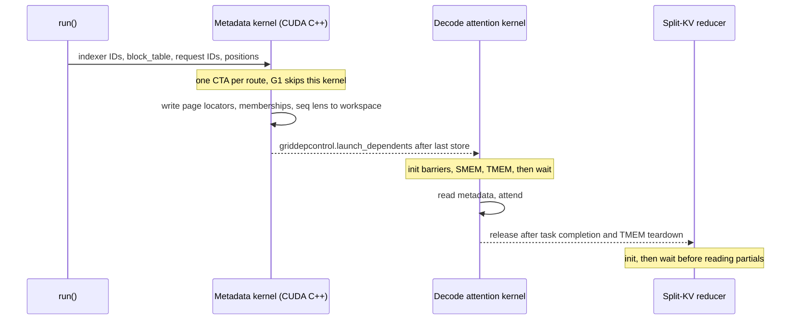
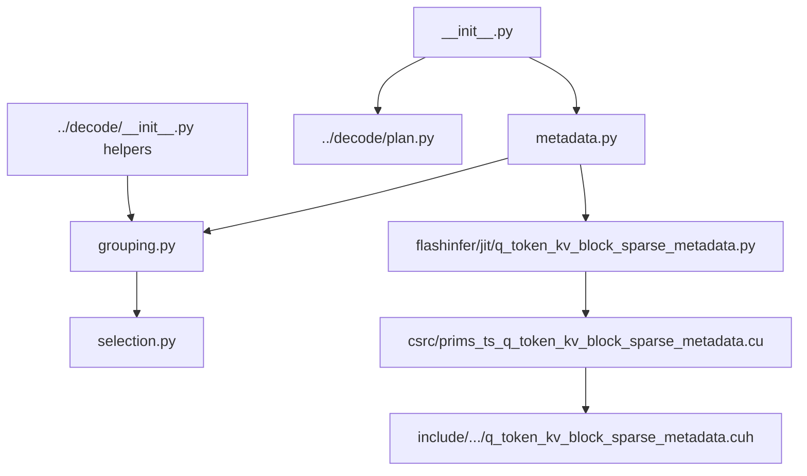

# QToken-KvBlock-Sparse attention

QToken-KvBlock-Sparse attention consumes a per-query indexer's top-k logical
K/V-block IDs directly. A CUDA C++ metadata kernel turns those IDs into dense
physical page locators (plus, for grouped queries, per-page query-membership
masks), and the [decode kernel](../decode/README.md) then attends over them.
It is a front end over the decode kernel, chained to it with programmatic
dependent launch (PDL).

## Example

```python
import torch
from flashinfer.attention.prims_ts import (
    QTokenKvBlockSparsePagedTSWrapper,
    get_q_token_kv_block_sparse_workspace_size,
)

device, dtype = torch.device("cuda"), torch.bfloat16
B, Hq, Hkv, D = 2, 16, 1, 128
kv_block_size, page_size, block_topk, max_seq_len_kv = 4, 16, 8, 256
pages_per_request = max_seq_len_kv // page_size

# Fixed Q: [B, Nq, G, Hq, D] with one query group of one token per request.
q = torch.randn(B, 1, 1, Hq, D, dtype=dtype, device=device)
k = torch.randn(B * pages_per_request, Hkv, page_size, D, dtype=dtype, device=device)
v = torch.randn_like(k)
block_table = torch.arange(B * pages_per_request, dtype=torch.int32, device=device).view(B, -1)
seq_lens = torch.tensor([256, 100], dtype=torch.int32, device=device)
# Indexer output: distinct completed-block IDs per query token, [T, block_topk].
indexer_block_ids = torch.arange(block_topk, dtype=torch.int32, device=device).repeat(B, 1)

workspace = torch.empty(
    get_q_token_kv_block_sparse_workspace_size(
        q, k, block_table, block_topk=block_topk, max_seq_len_kv=max_seq_len_kv,
        kv_block_size=kv_block_size,
    ),
    dtype=torch.uint8, device=device,
)
wrapper = QTokenKvBlockSparsePagedTSWrapper()
wrapper.plan(
    B, Hq, Hkv, D, kv_block_size, page_size, block_topk, max_seq_len_kv,
    device=device, workspace_buffer=workspace, q_dtype=dtype,
)
out = wrapper.run(q, (k, v), block_table, indexer_block_ids, seq_lens=seq_lens)
```

| API | Use |
| --- | --- |
| `QTokenKvBlockSparsePagedTSWrapper` | `plan()` fixes capacity outside capture; `run()` rebuilds routes from live indexer output |
| `get_q_token_kv_block_sparse_workspace_size` | Bytes for route metadata plus disjoint attention scratch |
| `q_token_kv_block_sparse_attention_with_paged_kv_cache` | Eager plan-plus-run; not capturable; infers `page_size` from the cache |
| `suggest_q_token_kv_block_sparse_group_size`, `validate_q_token_kv_block_sparse_group_size`, `make_q_token_kv_block_sparse_qo_indptr` | Group-size helpers, exported from `prims_ts.decode` |

## Support matrix

| Feature | Support |
| --- | --- |
| GPU | SM100a, SM103a, SM107a; PDL handoff on SM90 and newer |
| Q | Packed `[total_q, Hq, D]` with Int32 `qo_indptr` routes, or fixed `[B, Nq, G, Hq, D]` (plan `batch_size = B * Nq`) |
| Indexer IDs | Int32 `indexer_block_ids` `[total_q, block_topk]` (shared pattern, default) or `[total_q, Hkv, block_topk]`, last dim contiguous |
| K/V cache | Separate HND `(K, V)`, each `[num_pages, Hkv, page_size, D]`; dense Int32 `block_table[num_requests, max_storage_pages]` |
| `kv_block_size` | 4, 8, 16, 32, 64, 128 (semantic indexer block) |
| `page_size` | Positive multiple of 4; blocks may cross pages, resolved per fragment of `gcd(kv_block_size, page_size)` tokens |
| Head dim | 64, 128, 192, 256 |
| Dtypes | Matching FP16 or BF16 Q/K/V/O; FP8-E4M3 Q/K/V with FP16/BF16 O; D256 NVFP4 K/V (`torch.uint8`) with BF16 or FP8 Q and BF16 O |
| `group_size` G | 1-8, 16, 32 with `G * Hq/Hkv <= 128`; G16/G32 need packed Q and fragments of at most 16 tokens |
| Mask | Causal, no sliding window |
| Tiles | KV128; Swaps up to Q32 rows, Keeps Q64/Q128 |
| Scales | `sm_scale` (default `1/sqrt(D)`) and `v_scale` (default 1), host float or CUDA FP32 tensor |

NVFP4 K/V comes as `[pages, Hkv, page_size, D/2]` with
`kv_scale_factors=(K_SF, V_SF)` or as interleaved rows
`[pages, Hkv, page_size, D/2 + D/16]`. BF16 Q runs exact BF16 MMA; FP8 Q runs
FP8 MMA on K/V rounded to E4M3. A transform task converts NVFP4 into TMEM
(Swaps) or into SMEM K/V tiles (Keeps). The policy takes Keeps for BF16 Q,
for G > 8 or more than 32 rows per KV head, and for FP8 Q with G >= 5 or more
than 16 rows.

## Lifecycle and ownership

`plan()` binds the single caller-owned byte workspace and fixes `batch_size`,
`group_size`, head geometry, `block_topk`, `max_seq_len_kv`, dtypes, Q layout
and `split_kv`. The first eager `run()` binds the tensor ABI, compiles the
kernels and initializes split-KV state; capture only later runs. Pass the same
`group_size`, `split_kv`, `share_pattern_across_kv_heads` and
`count_current_block_in_topk` to workspace sizing and `plan()`.

- `count_current_block_in_topk=True` selects completed blocks and appends the
  current block only while incomplete. False selects up to `block_topk`
  historical blocks and always appends the current block. For query position
  `p`, the first `min(block_topk, (p + int(flag)) // kv_block_size)` IDs must
  be distinct and below that bound.
- Request-aligned fixed Q may pass `seq_lens` (`[B]`, including the `Nq * G`
  queries) instead of `token_to_request` and `query_positions`. Nonpositive
  lengths mark inactive requests.
- `split_kv=False` forces one KV partition and omits reduction scratch
  (typical for prefill); True permits automatic splits (typical for decode).
- `run(validate=False)` is allowed after a validated run. Shapes, strides,
  dtypes and alignment must not change; K/V, `kv_scale_factors` and
  `qo_indptr` must keep their storage, while Q, indexer IDs, tables,
  per-token metadata and `out` may use replacement storage. Scale overrides
  are still checked.
- One wrapper owns mutable route and split-KV scratch: order its runs on one
  stream. Output and workspace must not overlap any input (unchecked).

[Workspace](../../docs/runtime_contract.md#workspace),
[CUDA graph](../../docs/runtime_contract.md#cuda-graphs),
[global-scale](../../docs/runtime_contract.md#global-scale-operands) and
[split-KV](../../docs/runtime_contract.md#split-kv-policy) rules follow the
[runtime contract](../../docs/runtime_contract.md).

## Dataflow



G1 routes resolve selected blocks, the causal tail and physical locators
inside attention, with no metadata launch. G2 and wider routes union at most
`G * (block_topk + 1)` selected and tail IDs per route (and per KV head for
independent patterns) with a shared byte/bit map sized by model context, or a
bounded radix sort when the map would exceed shared memory or add CTA waves.
Memberships are stored as four 8-bit masks per Int32 word; eligible
G2-G8/page-4 Keeps routes instead store eight query words per 32-fragment
tile. Nonsplit grids larger than one wave use the CLC persistent scheduler.

## Limitations

- Causal, non-windowed masks only (not implemented).
- NVFP4 K/V only at head dim 256 (hardware/ABI: the transform stages two 128-channel halves of a 144-byte row).
- BF16 Q with interleaved NVFP4 rows on the Swaps recipe needs a CUDA 13.2+ toolkit (hardware/ABI).
- NVFP4 groups wider than 32 rows per KV head need the Keeps recipe (hardware/ABI).
- G16/G32 need packed Q and fragments of at most 16 tokens (hardware/ABI: four blocks per membership word per lane).
- No QK-BF16/PV-FP8 mixed K/V dtypes (not implemented).
- The one-shot API cannot be captured (not implemented).
- The KV-cache writer must zero-fill unused page slots: TMA loads complete fragments and masking does not sanitize NaN/Inf in V (hardware/ABI).

| Validated on | Stack |
| --- | --- |
| B200 (SM100a); GB300 (SM103), including D192 and packed-Q bounds | GB300: PyTorch 26.08, CUDA 13.4, CuTe DSL 4.7.0 |

## Source map



| File | Owns |
| --- | --- |
| [`__init__.py`](__init__.py) | Wrapper, workspace-size and one-shot APIs |
| [`metadata.py`](metadata.py) | Workspace layout, plan state, metadata build and launch order |
| [`grouping.py`](grouping.py) | Group legality, decode-config resolution, `qo_indptr` helpers behind the `prims_ts.decode` functions |
| [`selection.py`](selection.py) | Host-only launch selection and group recommendation |
| [`q_token_kv_block_sparse_metadata.py`](../../../../jit/q_token_kv_block_sparse_metadata.py) | JIT spec of the CUDA module |
| [`prims_ts_q_token_kv_block_sparse_metadata.cu`](../../../../../csrc/prims_ts_q_token_kv_block_sparse_metadata.cu) | TVM-FFI host entry points that check geometry and call the launchers |
| [`q_token_kv_block_sparse_metadata.cuh`](../../../../../include/flashinfer/attention/prims_ts/q_token_kv_block_sparse_metadata.cuh) | Metadata kernels, their launchers and the PDL release |
| [`direct_sparse_metadata.py`](../decode/kernel/device/direct_sparse_metadata.py) | G1 metadata resolved inside attention |

## Tests

```bash
pytest -q tests/attention/test_attention_ts_q_token_kv_block_sparse_metadata.py
pytest -q tests/attention/test_attention_ts_decode.py -k q_token_kv_block_sparse
```
