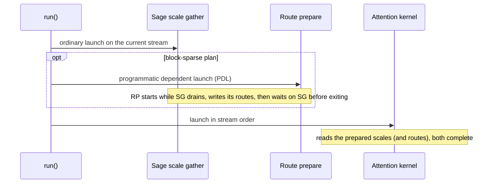
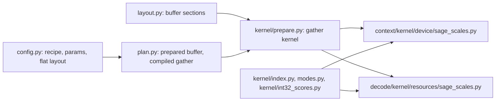

# Sage attention

Sage attention runs attention on 8-bit Q, K and V with caller-supplied
dequantization scales. It runs on two kernels: the contiguous decode kernel,
through the dense and block-sparse modes of `BlockSparseTSWrapper` and
`block_sparse_attention`, and the context kernel, through dense fixed-length
`BatchPrefillTSWrapper` plans. FlashInfer does not quantize; the 8-bit tensors
and scales come from the caller, for example TensorRT-LLM's `sageQuant`.

```text
S[r][c] = sfQ[blkQ(r)] * sfK[blkK(c)] * (Q8 . K8^T)[r][c]
P       = softmax_row(S), quantized to E4M3 as C * p
O[r][d] = sfV[d] * (sum_c P8[r][c] * V8[c][d]) / (C * l[r])  (+ v_mean[d])
```

`v_mean` adds a per-channel mean back after normalization, for callers that
quantized `V - v_mean`. `C` is the kernel's P scale (support matrix below).

## Example

```python
import torch
from flashinfer.attention.prims_ts import (
    BatchPrefillTSWrapper, BlockSparseTSWrapper, SageAttentionConfig, SageAttentionParams,
)
from flashinfer.attention.prims_ts.variants.sage import sage_flat_scale_numel

B, Sq, Skv, Hq, Hkv, D = 2, 1024, 1024, 4, 4, 128
fp8 = torch.float8_e4m3fn
q = torch.randn(B, Sq, Hq, D, device="cuda").to(fp8)
k = torch.randn(B, Skv, Hkv, D, device="cuda").to(fp8)
v = torch.randn(B, Skv, Hkv, D, device="cuda").to(fp8)
scales = SageAttentionParams(  # default recipe: q_block_size=1, k_block_size=16
    q_scale=torch.rand(Hq, sage_flat_scale_numel(B, Sq, 1), device="cuda"),
    k_scale=torch.rand(Hkv, sage_flat_scale_numel(B, Skv, 16), device="cuda"),
    v_scale=torch.rand(B, Hkv, D, device="cuda"),
)

# Context kernel: dense fixed-length plan; the output defaults to bfloat16.
prefill = BatchPrefillTSWrapper()
prefill.plan(device="cuda", batch_size=B, max_q_len=Sq, max_kv_len=Skv, num_qo_heads=Hq,
             num_kv_heads=Hkv, head_dim=D, q_dtype=fp8, k_dtype=fp8, sage=SageAttentionConfig())
out = prefill.run(q, k, v, sage=scales)

# Decode kernel: q_block_size=64 and kv_block_size=64 select the Q64/KV256 tile.
dense = BlockSparseTSWrapper()
dense.plan(B, Sq, Skv, Hq, Hkv, D, 64, 64, device="cuda", use_block_sparse=False,
           q_data_type=fp8, kv_data_type=fp8, sage_config=SageAttentionConfig())
out = dense.run(q, k, v, sage=scales)
```

A block-sparse Sage plan adds `max_blocks_per_row` (and optionally
`use_proxy_routes=True`) and passes routes plus, for proxy routes, `k_summary`,
`v_summary` and `sage.k_summary_scale` to `run()`; route formats and rules are in
[block-sparse attention](../block_sparse/README.md). An INT8 plan names its E4M3 V:
`q_data_type=torch.int8, k_data_type=torch.int8, v_data_type=torch.float8_e4m3fn`.
`block_sparse_attention(..., sage=...)` runs the same launches in one shot; its
recipe is `sage_config` or, when omitted, the default recipe with a V mean exactly
when `sage.v_mean` is set.

## Recipe and scale tensors

Both kernels take the same recipe (`SageAttentionConfig`, checked at plan time
by `validate_sage_recipe`) and the same per-run scales (`SageAttentionParams`).
The defaults are TensorRT-LLM's production recipe.

| Recipe field | Values |
| --- | --- |
| `q_block_size` | Power of two, may exceed the Q tile; default 1 |
| `k_block_size` | 1, 4, 16, 32, 64, 128 or 256; default 16 |
| `k_summary_block_size` | One of the `k_block_size` values, for proxy summary scales; default `k_block_size` |
| `v_mean` | Whether every run supplies `v_mean`; default `False` |

Scales are contiguous, 16-byte-aligned `torch.float32` tensors on the run device.
Q and K scales use the trtllm-gen flat layout: within one head, sequence `b` starts
at slot `b * S // blk + b` and token `t` uses slot `t // blk` inside it, so one head
owns `sage_flat_scale_numel(B, S, blk) == ceil(B * S / blk) + B - 1` slots.

| Field | Shape |
| --- | --- |
| `q_scale` | `[Hq, sage_flat_scale_numel(B, Sq, q_block_size)]` |
| `k_scale` | `[Hkv, sage_flat_scale_numel(B, Skv, k_block_size)]` |
| `v_scale` | `[B, Hkv, D]` |
| `v_mean` | `[B, Hkv, D]`; exactly when the recipe sets `v_mean=True` |
| `k_summary_scale` | `[Hkv, sage_flat_scale_numel(B, ceil(Skv / kv_block_size), k_summary_block_size)]`; exactly for proxy plans |

With proxy routes, `k_summary` holds the per-block K means in the K dtype,
quantized as one more K sequence of `ceil(Skv / kv_block_size)` tokens;
`v_summary` holds the per-block V means in E4M3 and shares `v_scale` (built from
`V - v_mean` when a mean is used).

## Support matrix

| | Decode kernel | Context kernel |
| --- | --- | --- |
| APIs | `BlockSparseTSWrapper`, `block_sparse_attention` | `BatchPrefillTSWrapper` |
| Q/K, V, output dtypes | One Q/K dtype, E4M3 or INT8 (SM100a/B200 only); E4M3 V (`v_data_type`); BF16 (default) or FP16 output | Same; V via `v_dtype`, which defaults to E4M3 for INT8 Q/K |
| K/V storage | Contiguous `[B, S, H, D]`; paged block-sparse APIs do not support Sage | Contiguous fixed-length `[B, S, H, D]` (`packed_query=False`) |
| Geometry | `head_dim=128`; Q64/KV256 or Q128/KV128 Keeps tile, which needs a `kv_block_size` multiple of 64 and at least 64 grouped Q rows (`q_block_size * Hq / Hkv`) | `head_dim=128`; 128-token Q tiles of one Q head |
| Masks and routes | Dense and causal; exact and proxy routes (BSR or bitmask) | `mask_type="dense"`, `window_left=-1`; no routes, so `k_summary_block_size` is unused |
| Split-KV | Rejected: only the direct output store applies `sfV` and `v_mean` | No split-KV launch |
| K transport (`SageKTransport`) | `SMEM` for every K block size: the load warp stages each K tile's scales | `GMEM` for 4-token and coarser blocks (softmax loads them before the score wait); `SMEM` for 1-token blocks |
| Score scaling (`SageScoreScaling`) | `DEQUANTIZED` on dense Q128/KV128 tiles; on Q64/KV256 tiles and routes, `BLOCK` for 4-token and coarser blocks, `DEQUANTIZED` for 1-token blocks | `BLOCK` per 16-column block for 16-token and coarser blocks; `DEQUANTIZED` for 4- and 1-token blocks |
| P scale `C` | `448 * 2**-h`, `h` = `softmax_rescale_threshold_log2` (0 to 8, default 8) | 1: the lazy correction lets `p` reach `2**8` |

`BLOCK` keeps the scores raw and folds `sfQ * sfK` into each block's maximum and
exp2 multiplier; `DEQUANTIZED` multiplies the scores in place in the max pass,
which costs more per score. Masks and scheduling otherwise follow each kernel's
16-bit plans. INT8 Q/K accumulate INT32 scores on a float bias that the softmax
reads as FP32 (`kernel/int32_scores.py`).

| Validated on | Coverage |
| --- | --- |
| SM100a/B200, SM103/GB300 | FP8 on both; INT8 on B200 only |

## Lifecycle and ownership

The plan fixes the recipe (`sage=` for `BatchPrefillTSWrapper.plan`,
`sage_config=` for the block-sparse APIs), allocates the prepared scale buffer and
compiles the scale-gather kernel. Every run passes `sage=SageAttentionParams(...)`;
a validating run checks dtype, shape, contiguity, alignment and device against the
plan, never the values, which must be finite and positive. The prepared buffer is
plan-owned and rewritten by every run, so runs of one plan must be stream-ordered.
Global scales, graph capture and `validate=False` follow the
[runtime contract](../../docs/runtime_contract.md).

## Scale-gather launch ordering

Every run first launches a small kernel (`PrepareSageScales`) that gathers the
flat scales into one buffer in the order the attention kernel reads them; per
(batch, KV head) sequence: the K scales per 64-token atom (then a proxy plan's
summary atoms), the Q scales per Q-tile row, then the `sfV` row and the `v_mean`
row. Attention reads only that buffer, never the caller's tensors.



The context plan compiles the gather as its own launch (`plan.py`); the decode
kernel's block-sparse adapter issues the gather, the route prepare and attention
from one compiled host function (`block_sparse/compile.py`).
The context kernel reads K scales directly from the buffer or through
`SmemSageKScalesResource`, and V scales in the epilogue; the decode kernel stages
K scales in `SageKScalesResource` and V scales in `SageVScalesResource`.

## Limitations

- INT8 Q/K needs SM100a/B200 (hardware/ABI): only SM100 has the INT8 tcgen05 MMA kind.
- With the default threshold the decode kernel quantizes P at `C = 1.75`, so
  probabilities far below the anchor round to E4M3 subnormals or zero; rows whose
  largest scores come first, such as sinks in the leading blocks, lose the most.
  `h = 0` keeps exact anchors and `C = 448` (hardware/ABI: E4M3 range).
- `head_dim=128` only; context Sage plans are dense, fixed-length and unwindowed; decode Sage plans are contiguous only (not implemented).
- Decode: no split-KV, variable-Q, sliding-window or attention-sink plans (not implemented).
- Context: a V mean cannot be combined with attention sinks (not implemented).
- No 8-bit output and no built-in quantizer (not implemented).

## Source map



| File | Owns |
| --- | --- |
| [`config.py`](config.py) | `SageAttentionConfig`, `SageAttentionParams`, flat layout, validation, INT8 device gate |
| [`layout.py`](layout.py) | `SageScaleLayout`: word layout of the prepared buffer |
| [`kernel/prepare.py`](kernel/prepare.py) | `PrepareSageScales`: the gather kernel |
| [`plan.py`](plan.py) | `SagePreparedScales`: plan-owned buffer and compiled gather launch (context) |
| [`kernel/index.py`](kernel/index.py) | Device index math and scale loads over both layouts |
| [`modes.py`](modes.py) | `SageKTransport`, `SageScoreScaling` names |
| [`kernel/int32_scores.py`](kernel/int32_scores.py) | INT8 Q/K MMA as INT32 scores on a float bias |
| [`../context/kernel/device/sage_scales.py`](../context/kernel/device/sage_scales.py) | Context transport and scaling choice, K/V scale reads |
| [`../decode/kernel/resources/sage_scales.py`](../decode/kernel/resources/sage_scales.py) | Decode `SageKScalesResource` and `SageVScalesResource` |

## Tests

```bash
pytest -q tests/attention/test_attention_ts_sage.py tests/attention/test_attention_ts_context_sage.py
```
