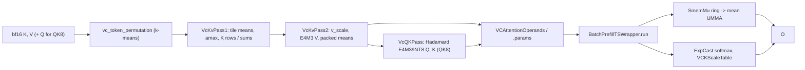
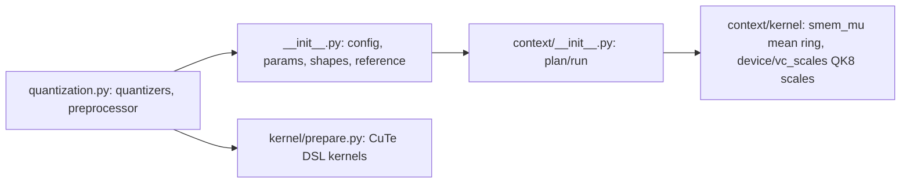

# VC-Attention

VC-Attention ([Li et al., 2026](https://arxiv.org/html/2609.15810v1)) runs the
dense fixed-length context kernel (`BatchPrefillTSWrapper`, `batch_prefill`) with
E4M3 V stored as residuals around per-128-token-tile means, which the kernel
restores inside the online softmax, and a direct probability cast to E4M3
(ExpCast). The plan selects the recipe with `vc_config=VCAttentionConfig(...)`;
the planned Q/K dtype selects the Q/K side:

- **VC-Attention-QK16** (`q_dtype`/`k_dtype` bf16): Q and K stay bf16.
- **VC-Attention-QK8** (`q_dtype`/`k_dtype` = `vc_qk8_dtype(device)`: INT8 on
  SM100/B200, E4M3 elsewhere): K is centred by its per-head channel mean, Q and K
  are rotated by the normalised 128-point Hadamard matrix and quantized with one
  scale per 128-token Q block and per 128-token K tile.

```text
K'      = (K - mean_tokens(K)) H,  Q' = Q H                         (QK8 only; H: 128-point Hadamard)
S[r][c] = sfQ[blkQ(r)] * sfK[tileK(c)] * (Q8 . K8[perm]^T)[r][c]   (QK16: Q . K[perm]^T)
P8      = ExpCast(S - rowmax(S))                                    (E4M3)
O[r][d] = sfV[b, h, d] * (sum_c P8[r][c] * V8[perm(c)][d] + sum_t rowsum_t(P8[r]) * mu_t[d]) / l[r]
```

`V8` holds the E4M3 residuals of the k-means-permuted values around their tile
means `mu_t` (bf16, divided by `sfV`). The kernel adds the mean terms inside the
online-softmax recurrence, two K=16 UMMA steps per group of 16 tiles, so the
row-max correction covers them.

## Example

```python
import torch
from flashinfer.attention.prims_ts import (
    BatchPrefillTSWrapper, VCAttentionConfig, VCAttentionPreprocessor, vc_qk8_dtype,
)

S, H, step, num_steps = 4096, 8, 0, 50
q_bf16, k_bf16, v_bf16 = (
    torch.randn(1, S, H, 128, device="cuda", dtype=torch.bfloat16) for _ in range(3)
)

def plan(qk_dtype, demean):
    wrapper = BatchPrefillTSWrapper()
    wrapper.plan(device="cuda", batch_size=1, max_q_len=S, max_kv_len=S, num_qo_heads=H,
                 num_kv_heads=H, head_dim=128, q_dtype=qk_dtype, k_dtype=qk_dtype,
                 v_dtype=torch.float8_e4m3fn, out_dtype=torch.bfloat16,
                 vc_config=VCAttentionConfig(demean=demean))
    return wrapper

# One plan per demean phase; the preprocessor reports which one a step needs.
prep = VCAttentionPreprocessor()
qk16 = {demean: plan(torch.bfloat16, demean) for demean in (True, False)}
ops = prep.prepare(k_bf16, v_bf16, denoise_step=(step, num_steps))
out = qk16[ops.demean].run(q_bf16, ops.k, ops.v, vc=ops.params)

# QK8: plan the device's Q/K code type and pass Q to the preprocessor.
qk8 = {demean: plan(vc_qk8_dtype("cuda"), demean) for demean in (True, False)}
ops8 = prep.prepare(k_bf16, v_bf16, q=q_bf16, denoise_step=(step, num_steps))
out8 = qk8[ops8.demean].run(ops8.q, ops8.k, ops8.v, vc=ops8.params)
```

The one-shot `batch_prefill(q, k, v, vc=ops.params)` plans the recipe from the
operands; `vc_config` without `vc` is rejected, and V repair operands need a wrapper.

## Support matrix

| Input | Supported values |
| --- | --- |
| GPU | SM100a/B200, SM103a/B300; VC plans are rejected on SM107 |
| Q/K dtype | bf16 (QK16); INT8 on SM100/B200 or E4M3 (QK8, `vc_qk8_dtype(device)`) |
| V dtype | `torch.float8_e4m3fn` residuals |
| Output dtype | `torch.bfloat16` or `torch.float16` |
| Geometry | `head_dim=128`, `num_qo_heads == num_kv_heads`, `packed_query=False`, `mask_type="dense"` |
| Kernel form | QK16 runs the two-CTA UMMA form; QK8 follows the device default |
| Recipes | Tile means (`demean=True`, default); plain E4M3 V (`demean=False`); V repair (`demean=False`, `repair_tiles > 0`) |
| Preparation inputs | CUDA bf16/fp16 `[B, S, H, 128]` K/V (and Q under QK8); QK16 plans need bf16 Q/K |
| LSE / attention sinks | Unsupported |

## Operand tensors

Every run passes the permuted K, the E4M3 V residuals and `vc=VCAttentionParams(...)`;
QK8 runs pass the coded Q too. All tensors are contiguous, 16-byte aligned and on
the run device; a validating `run()` checks dtype and shape against the plan.

| Field | Shape and dtype | When |
| --- | --- | --- |
| `v_scale` | `[B, Hkv, D]` fp32 per-channel residual scale | Always |
| `tile_means` | `[B, Hkv, ceil(Skv / 2048), 16, 256]` packed bf16 mean operands | `demean=True` plans only |
| `q_scale` | `[Hq, B, ceil(Sq / 128)]` fp32 | QK8 plans only |
| `k_scale` | `[Hkv, B, ceil(Skv_rows / 128)]` fp32, `Skv_rows` including repair tiles | QK8 plans only |

The run multiplies `v_scale` by `output_scale` into a plan-owned buffer, so runs
sharing one plan must not overlap. Scales must be positive and finite; the kernel
does not check them. Other plan/run rules follow the [context kernel](../context/README.md) and the
[runtime contract](../../docs/runtime_contract.md).

## Preprocessor and quantizers

`VCAttentionPreprocessor.prepare` applies the paper's V-Smooth schedule:
grouping and demeaning run on the first `smooth_step_fraction` (default 0.25) of
the denoising steps; inside that window the permutation is refreshed every
`perm_refresh_every` (default 4) steps, warm-started from the previous centroids,
and kept afterwards with zero tile means (`ops.demean` is then `False`).

- **Generations.** Step 0, or a step behind the last one seen, cold-starts the
  k-means from fixed seed rows: one host draw from `VC_KMEANS_SEED`, shared by every
  batch element and head. A generation depends on neither the previous one nor the
  other batch elements, and the caller's global generator is untouched.
- **CUDA graphs.** A runner that replays one graph per step kind passes
  `mode="cold"`, `"warm"`, `"keep"` or `"plain"` instead of a step. Grouping
  buffers keep their addresses across refreshes.
- **Joint sequences.** `grouped_tokens=(start, stop)` groups only the video token
  range; text or audio tokens follow in input order. A text key grouped among video
  keys would precede the long video tail in rows attending to it, and that tail
  would round to zero against the row maximum.

The quantizers live in `flashinfer.attention.prims_ts.variants.vc_attention.quantization`
and return `VCAttentionOperands`, whose `.params` is the run-time object:
`vc_quantize` (QK16), `vc_quantize_fp8` / `vc_quantize_int8` (QK8, E4M3 or INT8
codes), and `vc_quantize_repair` / `vc_quantize_repair_int8` (V repair operands of
either recipe: the budget fraction of tokens with the largest residual energy gets
a repair row). A repair plan sets `VCAttentionConfig(demean=False,
repair_tiles=ops.repair_tiles)`. `vc_reference` is the fp32 torch reference.

## Dataflow



Repair preparation replaces the permutation with `VcSelectPass` (radix select of
the largest residual energies) and `VcRepairRowsPass` (repair tiles and padding).

## Limitations

- QK8 INT8 codes need SM100/B200 (hardware/ABI): only SM100 has the INT8 tensor core path.
- VC plans are rejected on SM107, where the dense FP8 kernel runs the softmax exp2 natively (not implemented).
- Dense, fixed-length, `head_dim=128`, `Hq == Hkv` only; no packed, causal or
  variable-window kernel (not implemented).
- No LSE or attention sinks: the softmax sums are quantized (not implemented).
- Repair tiles cannot exceed the sequence tiles; each costs one extra K/V tile of
  attention work. `batch_prefill` does not run repair operands (not implemented).

## Source map



| File | Owns |
| --- | --- |
| [`__init__.py`](__init__.py) | `VCAttentionConfig`, `VCAttentionParams`, `vc_scale_shapes`, `validate_vc_params`, `vc_qk8_dtype`, repair arithmetic, `vc_reference` |
| [`quantization.py`](quantization.py) | `vc_token_permutation`, `vc_quantize*`, `VCAttentionOperands`, `VCAttentionPreprocessor` |
| [`kernel/prepare.py`](kernel/prepare.py) | Preparation kernels `VcKvPass1`, `VcKvPass2`, `VcQKPass`, `VcSelectPass`, `VcRepairRowsPass` |
| [`../context/kernel/resources/smem_mu.py`](../context/kernel/resources/smem_mu.py) | `SmemMuResource` tile-mean ring |
| [`../context/kernel/device/vc_scales.py`](../context/kernel/device/vc_scales.py) | QK8 Q/K scale addressing, `VCKScaleTable` |

## Tests

```bash
pytest -q tests/attention/test_attention_ts_vc.py
```
