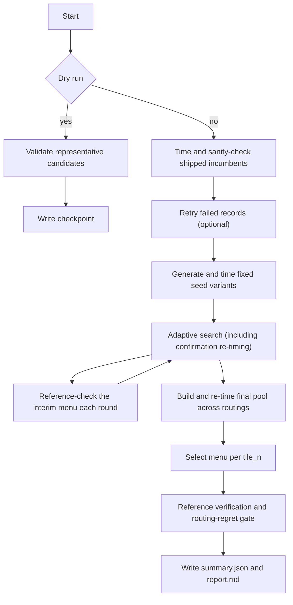

# Prims-TS MoE sweep

This package performs offline, budgeted search for Prims-TS MoE batched-GEMM
configurations. A sweep targets one model, one GPU architecture, and one FC
layer. It starts with the configurations shipped in
`prims_ts_moe_configs.json` or `prims_ts_moe_configs_sm107.json`, searches
nearby configurations, re-times the finalists under several routing
distributions, checks correctness, and selects a small menu for every
applicable `tile_n`.

The sweep writes a proposed menu and its evidence to an output directory. It
does **not** modify the shipped configuration JSON. Promoting a selected menu
is a separate, manual review step.

## Cross-model menu builder

The `menu` command turns completed FC1 and FC2 sweeps into one ordered,
cross-model tactic menu. Its checked-in target JSON defines the models, TP:EP
points, useful token counts, shape weights, routings, quantization mode, and
an estimated autotune cost model. The SM107 targets are
`menus/sm107_nvfp4.json`, `menus/sm107_mxfp4_mxfp8.json`, and
`menus/sm107_mxfp8.json`. A shape the sweep cannot model directly appears as an
explicitly commented proxy deployment or TP:EP point.

First re-time the union of the shipped incumbents and each input sweep's
selected menu:

```bash
python -m flashinfer.prims_ts.moe.tools.sweep menu retime \
  --config flashinfer/prims_ts/moe/tools/sweep/menus/sm107_nvfp4.json \
  --runs results/deepseek-v4-pro-nvfp4-sm107/fc1 \
          results/deepseek-v4-pro-nvfp4-sm107/fc2 \
          results/kimi-k3-nvfp4-sm107/fc1 \
          results/kimi-k3-nvfp4-sm107/fc2 \
  --calibration-file results/calibration.json \
  --out results/menu-sm107-nvfp4
```

Use `--candidate-source pool` to include every successful candidate from each
sweep's final re-time pool instead of only its selected menu. Input runs must
all have the target quantization mode; omit `--runs` to re-time only the
shipped incumbents. Re-time output is resumable at each `<model>/<fc>`
subdirectory, and a resumed run times again any candidate whose last attempt
timed out, lost its worker, or ran out of memory. Like a sweep, menu resume
accepts a code hotfix with a warning but rejects a changed target, candidate
pool, or calibration.

Selection is host-only and can be rerun without touching a GPU:

```bash
python -m flashinfer.prims_ts.moe.tools.sweep menu select \
  --retime-dir results/menu-sm107-nvfp4
```

This writes `menu_order.json` and `menu_report.md`. The order starts with a
mandatory coverage floor, then greedily maximizes joint FC1+FC2 log-regret
gain per weighted-mean estimated autotune second across deployment and TP:EP
targets. For each target, the cost model generates the runtime's hybrid token
buckets up to the largest target token count, reconstructs the eligible
`tile_n` window at every bucket, and counts only the kernels and FC1-by-FC2
pairs that process can reach. Persistent kernels include the drain-and-throttle
twin added by the runtime, with identical explicit twins deduplicated. Pair
counts also include the runner's default tactic once per runtime bucket.

Use repeatable `--floor-tile-n TILE` options to keep an FC1+FC2 pair for a tile
that does not win on the measured deployment mix but should remain available as
coverage insurance. The selector scores each pair in isolation on shapes where
that tile is eligible and its best measured pair is within 1.25x of the global
best. `--floor-plausible-ratio` changes that threshold. If no shape meets the
threshold, all eligible shapes are used. Each requested tile normally adds two
mandatory kernels plus runtime autotune pairs only in buckets that can reach
the tile. The selected tiles and plausibility ratio are recorded in both output
files.

Set `tune_max_num_tokens` on a `tp_ep` target to model a runtime tuning range
larger than its measured `tokens`; it must be at least the largest listed token.
The report shows every prefix's regret, leave-one-model-out regret, total
runtime kernels, and mean/max pairs and estimated seconds per deployment.
Per-deployment checkpoint tables include the shipped menu, floor, knee and full
selected menu. `--order-by gain` provides a cost-agnostic comparison.

After choosing a prefix length, emit a proposed config file:

```bash
python -m flashinfer.prims_ts.moe.tools.sweep menu emit \
  --order results/menu-sm107-nvfp4/menu_order.json \
  --n 24 \
  --dtype NvFP4xNvFP4 \
  --base flashinfer/prims_ts/moe/prims_ts_moe_configs_sm107.json \
  --out results/menu-sm107-nvfp4/proposed_configs.json
```

Emission refuses prefixes below the mandatory floor and replaces only the
selected dtype's contiguous FC1/FC2 block. It inherits the production
activation tuples and per-token scale variants from the base file, removes
explicit drain-and-throttle rows that the runtime already creates as
persistent-kernel twins, and groups the result under the existing templates.
Rows for all other dtypes and every template remain byte-identical.

`--activations auto` (the default) keeps gated and element-wise kernels
separate when the selected prefix contains element-wise FC1 entries, as in
NvFP4. When it does not, the selected FC1 geometries are shared by every
activation supported by the base slice, as for the MX menus. Use
`--activations per-class` or `--activations shared` to override this rule.
NvFP4 FC1 inherits both `use_per_token_sf_b=true` and `false`.

Before writing, the emitter expands the compact JSON, applies the runtime twin
rule, verifies the exact runtime tactic set for every activation and per-token
variant, checks FC1/FC2 tile pairing and confirms that non-target configs did
not change. It then prints FC1-by-FC2 autotune pair counts per tile. Preview
all checks without writing with `--dry-run`.

To update a working tree directly, replace `--out ...` with `--in-place`.
In-place output is written only after verification succeeds, using an atomic
replacement of `--base`. Apply multiple dtype selections one after another:

```bash
CONFIG=flashinfer/prims_ts/moe/prims_ts_moe_configs_sm107.json
python -m flashinfer.prims_ts.moe.tools.sweep menu emit \
  --order results/menu-sm107-nvfp4/menu_order.json --n 39 \
  --dtype NvFP4xNvFP4 --base "$CONFIG" --in-place
python -m flashinfer.prims_ts.moe.tools.sweep menu emit \
  --order results/menu-sm107-mxfp4_mxfp8/menu_order.json --n 29 \
  --dtype MxFP4xMxFP8 --base "$CONFIG" --in-place
python -m flashinfer.prims_ts.moe.tools.sweep menu emit \
  --order results/menu-sm107-mxfp8/menu_order.json --n 24 \
  --dtype MxFP8xMxFP8 --base "$CONFIG" --in-place
```

Each command touches only its dtype block, so their order does not matter.
Using successive `--out` files remains supported when an in-place update is
not desired.

## Quick start

Run commands from the repository root. Calibrate once for a GPU and software
environment, then run FC1 and FC2 into separate directories:

```bash
python -m flashinfer.prims_ts.moe.tools.sweep calibrate \
  --model deepseek-v4-pro-nvfp4 \
  --tp-ep 4:4 8:8 \
  --sm-arch 107 \
  --gpu 0 \
  --calibration-file results/deepseek-v4-pro-nvfp4-sm107/calibration.json

python -m flashinfer.prims_ts.moe.tools.sweep sweep \
  --model deepseek-v4-pro-nvfp4 \
  --tp-ep 4:4 8:8 \
  --fc fc1 \
  --sm-arch 107 \
  --gpu 0 \
  --calibration-file results/deepseek-v4-pro-nvfp4-sm107/calibration.json \
  --out results/deepseek-v4-pro-nvfp4-sm107/fc1
```

Repeat the sweep command with `--fc fc2` and a separate `.../fc2` output.
The default hard budget is 240 minutes per FC sweep. Search stops 25 minutes
before the deadline so the tool can re-time and verify the final menu.
Calibration is recommended but optional; without it, the sweep warns and uses
`min(8, available CPU count)` compiler workers.

Resume an interrupted run with exactly the same target and output directory:

```bash
python -m flashinfer.prims_ts.moe.tools.sweep sweep \
  --model deepseek-v4-pro-nvfp4 --tp-ep 4:4 8:8 --fc fc1 --sm-arch 107 --gpu 0 \
  --calibration-file results/deepseek-v4-pro-nvfp4-sm107/calibration.json \
  --out results/deepseek-v4-pro-nvfp4-sm107/fc1 --resume
```

To describe a model without a preset, provide all model fields:

```bash
python -m flashinfer.prims_ts.moe.tools.sweep sweep \
  --dtype nvfp4 --hidden 7168 --intermediate 3072 \
  --num-experts 384 --top-k 6 --activation swiglu --gemm1-clamp-limit 10 \
  --tp-ep 4:4 8:8 --fc fc1 --sm-arch 107 --gpu 0 \
  --out results/custom-sm107/fc1
```

Use `--dry-run` on `sweep` to construct and validate representative candidates
without compiling or timing them. A dry run writes the manifest, journal, and
checkpoint, but not a final summary:

```bash
python -m flashinfer.prims_ts.moe.tools.sweep sweep \
  --model deepseek-v4-pro-nvfp4 --tp-ep 4:4 8:8 --fc fc1 --sm-arch 107 \
  --out results/dry-run/fc1 --dry-run
```

The command maps `--sm-arch 100`, `103`, or `107` to
`FLASHINFER_CUDA_ARCH_LIST=10.0a`, `10.3a`, or `10.7a` when the variable is
not already set. Other FlashInfer and CuTe DSL environment variables, such as
`FLASHINFER_WORKSPACE_BASE`, `FLASHINFER_PRIMS_TS_COMPILE_OPTIONS`,
`CUTE_DSL_ARCH`, and `CUTE_DSL_CACHE_DIR`, are honored as usual.

## Pipeline

`SweepEngine.run()` executes the following phases. The journal records the
phase for every attempted candidate, so an interrupted run can continue from
the last checkpoint.



The budget is wall-clock time, not accumulated GPU time:

```text
start                         budget - tail          hard deadline
|<------------ search ------------->|<------- tail ------->|
                                       |<-- ref reserve -->|
```

`--budget-min` sets the hard deadline. `--tail-min` is reserved for final
re-timing, menu selection, and verification. Within the tail, the engine
reserves either a measured correctness-check estimate or
`--reference-reserve-min`, capped by the tail. Compilation can run in
parallel, but timing is serialized by a per-GPU lock.

## Models, shapes, and routing

### Built-in model presets

The preset names accepted by `--model` are defined in `shapes.py`:

| Preset | Quantization | Hidden / intermediate | Experts / top-k | Activation |
| --- | --- | ---: | ---: | --- |
| `deepseek-v3-nvfp4` | NvFP4 × NvFP4 | 7168 / 2048 | 256 / 8 | SwiGLU |
| `deepseek-v4-pro-nvfp4` | NvFP4 × NvFP4 | 7168 / 3072 | 384 / 6 | SwiGLU |
| `deepseek-v4.1-flash` | MxFP4 × MxFP8 | 5120 / 2304 | 384 / 6 | SwiGLU |
| `deepseek-v4.1-flash-mxfp8` | MxFP8 × MxFP8 | 5120 / 2304 | 384 / 6 | SwiGLU |
| `kimi-k3` | MxFP4 × MxFP8 | 3584 / 3072 | 896 / 16 | SiTU |
| `kimi-k3-nvfp4` | NvFP4 × NvFP4 | 3584 / 3072 | 896 / 16 | SiTU |
| `qwen3-30b-a3b` | NvFP4 × NvFP4 | 2048 / 768 | 128 / 8 | SwiGLU |
| `gpt-oss-120b` | MxFP4 × MxFP8 | 3072 / 3072 | 128 / 4 | SwiGLU |
| `gpt-oss-120b-mxfp8` | MxFP8 × MxFP8 | 3072 / 3072 | 128 / 4 | SwiGLU |
| `minimax-m3-mxfp8` | MxFP8 × MxFP8 | 6144 / 3072 | 128 / 4 | SwiGLU |
| `nemotron-3.5-lightning-nvfp4` | NvFP4 × NvFP4 | 2688 / 1920 | 128 / 6 | ReLU² |
| `nemotron-3-ultra-nvfp4` | NvFP4 × NvFP4 | 2048 / 5120 | 512 / 22 | ReLU² |

Presets also carry activation parameters. DSv4 and DeepSeek V4.1 use a clamp
limit of 10; Kimi K3 uses alpha 4 and beta 25; GPT-OSS uses bias, alpha
1.702, beta 1, and clamp 7. GPT-OSS uses a 3072-aligned proxy for its 2880
dimensions. Nemotron-3.5-Lightning pads its 1856 intermediate size to 1920 so
its ungated ReLU² FC1 width is 128-aligned at TP=1. MiniMax-M3 uses the same alpha, beta, and clamp without bias. Explicit `--bias`, `--gemm1-alpha`, `--gemm1-beta`, and
`--gemm1-clamp-limit` values override the preset; use `none` to clear a
preset's floating-point parameter.

Custom models accept `BF16`, `NvFP4xNvFP4`, `MxFP4xMxFP8`, `MxFP4xBf16`,
`Fp8-Per-Tensor`, `Fp8-Block`, and `MxFP8xMxFP8`, plus normalized aliases such
as `bf16`, `nvfp4`, and `mxfp4mxfp8`.

### Shape construction

For every requested global token count and TP/EP point, the tool constructs a
rank-local timing shape:

- `local_intermediate = intermediate / TP`
- `local_experts = experts / EP`
- `timing_tokens = ceil(global_tokens / EP)`
- FC1 is `M=timing_tokens`, `N=2*local_intermediate` for a gated activation
  (otherwise `N=local_intermediate`), and `K=hidden`
- FC2 is `M=timing_tokens`, `N=hidden`, and `K=local_intermediate`

Divisibility and quantization-specific K alignment are validated. NvFP4
requires K to be a multiple of 64; MxFP4/MxFP8-family paths require a multiple
of 128. `--tp 2 4 --ep 4 8` requests the Cartesian product, whereas
`--tp-ep 2:4 4:8` requests only those exact pairs.

Each shape has a small `selected_tile_ns` set centered on its average routed
tokens per expert. A candidate is timed only on shapes that select its
`tile_n`. Launch-equivalent shapes are merged and their weights are summed,
while their original model/TP/EP/token points remain in the metadata.

`--tokens` controls adaptive-search shapes and defaults to the sparse grid in
`defaults.py` (1 through 16384). `--final-tokens` controls final re-timing,
verification, and menu selection; its default uses the complete standard
bucket list through 8192 plus 12288 and 16384.

### Routing distributions

The accepted routing specifications are:

- `uniform`: seeded uniform-random expert assignments.
- `zipf:<alpha>`: seeded Zipf assignments with a positive finite alpha, such
  as `zipf:0.8`.
- `balanced_round_robin`: deterministic balanced assignments.

Adaptive search uses one `--search-routing` (`uniform` by default). Finalists
are re-timed under every `--retime-routings` value (by default all three
above). `--selection-routings` defaults to all re-time routings, must be a
subset of them, and must include the search routing.

## How search works

### Candidates and pruning

A candidate is a mapper-format kernel options dictionary plus its `tile_n`.
Its identity is a hash of those effective options. Search moves vary tile K,
cluster geometry, operand and scale-factor SMEM stages, accumulator and
scale-factor TMEM stages, epilogue and work-ID stages, scale-factor ring
depth, load warps and routes, register splits, scheduler flags, kernel
skeleton choices, and crossover fields from another parent.

This is a local search, not a Cartesian enumeration of every knob. Candidate
construction rejects configurations outside the `--max-*-stages` and
`--max-sf-ring-ratio` bounds, configurations that fail register, SMEM, TMEM,
cluster, or task-manager validation, and configurations inapplicable to the
shape. `--enable-cluster-y` adds experimental two-CTA token-direction
clusters. The `large_carveout` move is SM107-only; materialization selects the
227 or 327 KiB shared-memory regime from the candidate's resource use.

### Baseline, seeds, and adaptive moves

The baseline times applicable shipped configurations. For each `tile_n`, up
to `SEED_LIMIT` high-ranked incumbents produce fixed stage, store, cluster,
and (on SM107) carveout variants. Baseline and seed sets are pruned
round-robin across tile groups and capped by `MAX_SEEDS`.

The adaptive loop then:

1. Allocates work among contested `tile_n` groups, retaining a floor share
   while decaying and eventually freezing stagnant groups.
2. Selects parents for near-best shape coverage and menu contribution, with a
   mean-regret fallback.
3. Chooses move kinds with Beta Thompson sampling, a small exploration
   probability, and a penalty for moves that repeatedly produce duplicates.
4. Gives candidates in the wider two-step band a short second generation of
   local moves.

For a shape, linear regret is:

```text
regret = candidate_time / best_time - 1
```

The classifier accounts for measured noise. Its minimum success band is 3%
regret and its minimum two-step band is 10%; calibrated noise can widen both.
A child must also improve on its parent beyond noise to count as a successful
move.

If a result appears to improve a shape by more than `--confirm-fraction`
(10% by default), it is re-timed before selection. Until confirmation it is
excluded from trusted timings. The conservative, slower value from search and
confirmation is retained, preventing a one-off fast sample from winning.

### Final re-timing and menu selection

The final pool combines the interim menu, contributing candidates,
incumbents, each shape's fastest candidates, and a bounded set within 3% of
each shape's best. Re-timing doubles the search repeat count, with a minimum
of 60 samples, and evaluates every requested final routing.

Menu selection greedily minimizes weighted, capped log-regret. The
`--menu-size` limit applies independently to each `tile_n`, rather than being
one global cap. A menu is reported as verified only when finalization
completed, every required shape is covered and reference-checked, and the
worst regret on each non-search routing is no greater than
`--max-routing-regret`.

Timing prefers CUPTI and uses a cold L2 cache. If a compatible `cupti-python`
is unavailable, it falls back to the CUTLASS testing CUDA-graph/event timer
and records the resolved backend in the manifest and measurements.

## Workers and calibration

The driver maintains persistent `worker-loop` subprocesses. A worker accepts
`compile`, `evaluate`, and `reference` actions over a file-backed JSON
protocol. Compilation may overlap across workers; kernel timing and selected
reference checks hold an advisory lock keyed by the physical GPU. Workers
restart after 20 successful jobs or immediately after a CUDA fault. The
default phase limits are 120 seconds for compilation and 60 seconds for a
shape; the hard sweep deadline always takes precedence.

Workers receive a single visible GPU, default `OMP_NUM_THREADS` to 1, and add
`expandable_segments:True` to `PYTORCH_CUDA_ALLOC_CONF`. Their stdout and
stderr go to `.worker_logs/worker-<index>.log`.

Calibration measures:

- compiler throughput at 1, 2, 4, 8, and 16 workers, stopping after a failed
  point and selecting the smallest count within 10% of the best throughput;
- a representative timing noise band;
- representative FC1/FC2 GPU-lock costs; and
- retained per-worker GPU memory, reserving space for reference checks and a
  memory margin when choosing the safe worker count.

The calibration JSON fingerprints the GPU, driver, CUDA, CuTe DSL, CPU,
compute capability, and measurement protocol. A mismatch normally rejects
reuse; `--force-calibration` prints the differences and proceeds. Recalibrate
after meaningful driver, toolchain, GPU, or timing-protocol changes.

## Outputs and monitoring

| Path | Purpose |
| --- | --- |
| `run_manifest.json` | Target, code and environment fingerprints, timing protocol, search settings, calibration digest, and resume history |
| `results.jsonl` | Append-only journal of search (including baseline and seed), confirmation, re-time, reference, and dry-run records |
| `state.json` | Atomic checkpoint containing RNG and adaptive-search state |
| `summary.json` | Machine-readable selected menu, per-shape results, verification state, regret, failures, search statistics, and adaptive-loop timing profile |
| `report.md` | Human-readable rendering of the final summary |
| `.worker_logs/worker-*.log` | Persistent worker stdout and stderr, including compile failures |

`results.jsonl` is the detailed evidence and recovery log. Common terminal
statuses include `ok`, `error`, `timeout`, `worker_error`, `oom`, `failed`,
`reference_error`, `validation_error`, and `duplicate_signature`. Consult a
worker log for compile or process errors. Use `--retry-failed` for transient
search timeouts, worker errors, and OOM records; deterministic validation or
reference failures need investigation rather than blind retrying.

The report starts with `VERIFIED`, `UNVERIFIED`, `FAILED`, or `INCOMPLETE`,
then shows GPU clocks, selected counts per tile, per-shape and per-routing
performance, menu-size trade-offs, correctness and search failures, adaptive
move statistics, worker utilization, feature effects, and selected-candidate
lineage. The actual mapper-format configurations are in `summary.json` under
`selected_menu`, keyed by `tile_n`. Copying reviewed configurations into a
packaged `prims_ts_moe_configs*.json` is deliberately outside this tool.

Console progress has the form:

```text
[sweep elapsed=HH:MM:SS remaining=HH:MM:SS] phase: completed/total ...
```

It reports compile, GPU-lock wait and run phases, rates, ETAs, status counts,
phase transitions, and a cumulative adaptive-loop timing breakdown about once
per minute. A calibrated sweep also prints projected compile and GPU-lock
throughput. Sustained low GPU clocks are called out in the final report.

## Resume and failure handling

Without `--resume`, an output directory containing `results.jsonl` or
`state.json` is rejected. A resumed run requires `run_manifest.json` and must
match the original target (including shapes and routings), timing protocol,
GPU identity, seed, menu size, and stage limits. Operational values such as
the worker count and wall-clock budget may change.

The tool reloads journal records, candidates, RNG state, seeds, and adaptive
state. Completed phase/candidate pairs and successful final re-times are
skipped. If Prims-TS source files changed, normal resume keeps prior evidence
but tags new records with a new resume segment; `--strict-resume` rejects that
case instead.

Workers are killed and restarted after phase timeouts or crashes. Final
re-timing and reference checks have bounded OOM retries. Waiting for the
per-GPU lock is not charged to the compile or run timeout, but it still
consumes the hard sweep budget. Repeated OOM usually means the calibration or
manual `--workers` value is unsafe for the current environment.

## CLI reference

Run either subcommand with `--help` for the authoritative reference:

```bash
python -m flashinfer.prims_ts.moe.tools.sweep calibrate --help
python -m flashinfer.prims_ts.moe.tools.sweep sweep --help
```

### Model and shape options

These options are shared by `calibrate` and `sweep`.

| Option | Default | Meaning |
| --- | --- | --- |
| `--model NAME` | required alternative | Built-in preset; mutually exclusive with `--dtype` |
| `--dtype TYPE` | required alternative | Custom quantization/dtype; requires all custom model fields below |
| `--hidden`, `--intermediate` | none | Custom model dimensions |
| `--num-experts`, `--top-k`, `--activation` | none | Remaining required custom model fields |
| `--bias` / `--no-bias` | preset | Override FC1/FC2 bias |
| `--gemm1-alpha`, `--gemm1-beta`, `--gemm1-clamp-limit` | preset | Override with a float, or clear with `none` |
| `--tp N [...]`, `--ep N [...]` | none | TP/EP Cartesian product; both are required together |
| `--tp-ep TP:EP [...]` | none | Exact pairs; mutually exclusive with `--tp`/`--ep` |
| `--tokens N [N ...]` | standard search grid | Global token counts used during search |
| `--sm-arch {100,103,107}` | required | Target GPU architecture |
| `--gpu ID` | `0` | GPU index within `CUDA_VISIBLE_DEVICES` |

### Calibration options

| Option | Default | Meaning |
| --- | --- | --- |
| `--calibration-file PATH` | required | Destination calibration JSON |

Calibration chooses its worker probes and timing protocol from `defaults.py`;
they are intentionally not command-line knobs.

### Sweep scope, budget, and routing

| Option | Default | Meaning |
| --- | --- | --- |
| `--fc {fc1,fc2}` | required | FC layer to tune |
| `--out DIR` | required | Sweep output directory |
| `--calibration-file PATH` | none | Previously generated calibration JSON |
| `--budget-min MIN` | `240` | Hard wall-clock budget |
| `--tail-min MIN` | `25` | Final re-time and verification reserve |
| `--reference-reserve-min MIN` | `5` | Correctness reserve within the tail |
| `--final-tokens N [...]` | standard buckets ≤8192, 12288, 16384 | Final re-time and selection token counts |
| `--search-routing ROUTING` | `uniform` | Routing used for adaptive search |
| `--retime-routings R [...]` | `uniform`, `zipf:0.8`, `balanced_round_robin` | Routings used for final re-time |
| `--selection-routings R [...]` | all re-time routings | Routings included in the selection objective |
| `--max-routing-regret FRACTION` | `0.05` | Largest allowed finalist-menu regret on a re-time routing |

### Search-space and execution controls

| Option | Default | Meaning |
| --- | --- | --- |
| `--menu-size N` | `4` | Maximum selected configurations per `tile_n` |
| `--max-near-best-per-shape N` | `10` | 3%-near-best candidates retained per shape for final re-time |
| `--confirm-fraction F` | `0.10` | Improvement that triggers confirmation re-timing |
| `--max-input-stages`, `--max-accumulator-stages` | `16`, `10` | Input/scale-factor and accumulator stage bounds |
| `--max-c-smem-stages`, `--max-workid-stages` | `4`, `8` | Output-SMEM and persistent work-ID stage bounds |
| `--max-sf-ring-ratio N` | `4` | Scale-factor ring depth relative to operand stages |
| `--enable-cluster-y` | off | Search experimental two-CTA token-direction clusters |
| `--workers N` | calibrated, else `min(8,nproc)` | Persistent compiler worker count |
| `--force-calibration` | off | Accept and warn about calibration mismatches |
| `--dry-run` | off | Validate representative candidates without compiling or timing |
| `--resume`, `--strict-resume` | off | Continue `--out`; strict mode rejects source changes |
| `--retry-failed` | off | Retry latest transient search failures |

## Source map

| Module | Responsibility |
| --- | --- |
| `__main__.py` | CLI parsing, environment fingerprinting, calibration orchestration |
| `engine.py` | End-to-end phases, worker dispatch, persistence integration, finalization |
| `shapes.py` | Model presets and rank-local shape construction |
| `space.py` | Candidate identity, moves, repair, materialization, and validation |
| `search.py` | Noise-aware outcomes, parent/move selection, and group budgets |
| `portfolio.py` | Final re-time pool and greedy menu selection |
| `measure.py` | Timing protocols, timing backends, evaluation, and reference checks |
| `workers.py` | Persistent process lifecycle, progress files, timeouts, and GPU locks |
| `calibration.py` | Environment schema, noise, compiler scaling, and memory admission |
| `db.py` | Append-only JSONL and atomic checkpoint persistence |
| `report.py` | Summary metrics and Markdown rendering |
| `defaults.py` | Shared search, timing, budget, and stage defaults |
| `utils.py` | Host-safe Git, CPU, GPU visibility, and NVML helpers |

The host-side tests are organized similarly:

- `test_moe_sweep_shapes.py`: presets, TP/EP expansion, geometry, alignment,
  deduplication, and token defaults.
- `test_moe_sweep_space.py`: incumbents, moves, stage/resource limits,
  clusters, crossover, and SM107 repair.
- `test_moe_sweep_search.py`: noise bands, parent and move selection, group
  allocation, confirmation, re-time pools, and resume helpers.
- `test_moe_sweep_calibration.py`: scaling, memory caps, noise, and schema
  round trips.
- `test_moe_sweep_state.py`: lazy imports, JSONL recovery, checkpoints, and
  RNG restoration.
- `test_moe_sweep_report.py`: summary and report metrics, routings,
  correctness, and GPU clocks.
